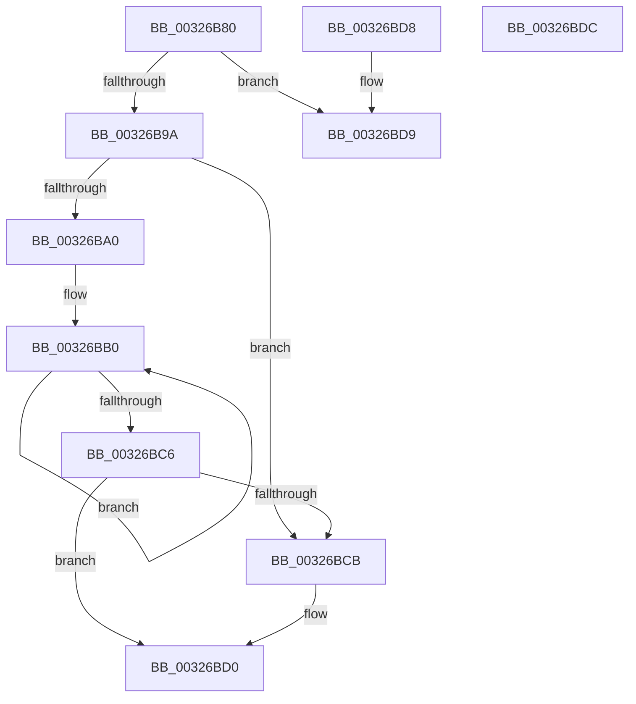

# RtlpHpSegPageRangeCountCommittedPages

- RVA: `0x00326B80`–`0x00326BDD` (길이 `93` bytes)
- VA: `0x0000000140326B80`
- 실행 섹션: `.text`
- PDB 이름 있음: `예`; PDB Function 태그: `아니요`
- unwind 정보 RVA: `0x000DB714`
- 디코드: `31`개 명령, `93/93` bytes 표시
- 미해석 바이트: `0` (있으면 어셈블리에 `.byte`로 보존)

> 이 문서는 커널 이미지의 기계어와 PDB 기호를 분석해 생성했습니다. 4번과 5번은 함수 원형과 자료형을 바이너리 사용 방식에서 추정한 C 해석이며 원본 소스 복구 결과는 아닙니다.

## 1. Dependencies

- 직접 호출 지점: **0**; 고유 호출 대상: **0**
- 직접 호출자로 확인된 함수: **1**
- RIP 상대 이미지 참조: **0**

### Outgoing calls
- 직접 디코드된 call 명령이 없습니다.

### Direct callers
- [sub_003267E9](Unknown_function_003267E9.md) at `0x003269CF`

### Static image references
- 디코드된 RIP-relative 메모리 참조가 없습니다.

## 2. Other-region calls and transfers

- 다른 실행 섹션으로 향하는 call: **0**
- 별도 외부 분기/꼬리 이동을 확인하지 못했습니다.

## 3. Assembly (complete function range)

```asm
00326B80  33 C9                           xor ecx, ecx
00326B82  45 8B D8                        mov r11d, r8d
00326B85  49 C1 E3 05                     shl r11, 5
00326B89  44 8B C9                        mov r9d, ecx
00326B8C  4C 03 DA                        add r11, rdx
00326B8F  41 8B C0                        mov eax, r8d
00326B92  44 8B D1                        mov r10d, ecx
00326B95  49 3B D3                        cmp rdx, r11
00326B98  73 3F                           jae 0x140326bd9
00326B9A  48 83 F8 02                     cmp rax, 2
00326B9E  72 2B                           jb 0x140326bcb
00326BA0  4D 8D 43 E0                     lea r8, [r11 - 0x20]
00326BA4  0F 1F 40 00                     nop dword ptr [rax]
00326BA8  0F 1F 84 00 00 00 00 00         nop dword ptr [rax + rax]
00326BB0  0F B6 42 19                     movzx eax, byte ptr [rdx + 0x19]
00326BB4  03 C8                           add ecx, eax
00326BB6  0F B6 42 39                     movzx eax, byte ptr [rdx + 0x39]
00326BBA  44 03 C8                        add r9d, eax
00326BBD  48 83 C2 40                     add rdx, 0x40
00326BC1  49 3B D0                        cmp rdx, r8
00326BC4  72 EA                           jb 0x140326bb0
00326BC6  49 3B D3                        cmp rdx, r11
00326BC9  73 05                           jae 0x140326bd0
00326BCB  44 0F B6 52 19                  movzx r10d, byte ptr [rdx + 0x19]
00326BD0  41 8D 04 09                     lea eax, [r9 + rcx]
00326BD4  41 03 C2                        add eax, r10d
00326BD7  C3                              ret
00326BD8  CC                              int3
00326BD9  8B C1                           mov eax, ecx
00326BDB  C3                              ret
00326BDC  CC                              int3
```

## 4. C-style interpretation (structured pseudocode)

```c
__int64 __fastcall RtlpHpSegPageRangeCountCommittedPages(int a1, __int64 a2, int a3)
{
    __int64 result;
    __int64 v_r10;
    __int64 v_r11;

    a1 = 0;
    v_r11 = ((unsigned int)(a3)) << (5);
    v_r11 = (v_r11) + (a2);
    if (a2 >= v_r11) goto loc_00326BD9;
    if (((unsigned int)(a3)) < 2) goto loc_00326BCB;
loc_00326BB0:
    a1 = (unsigned int)((a1) + ((unsigned int)(*(unsigned __int8 *)(a2 + 25))));
    a4 = (unsigned int)((0) + ((unsigned int)(*(unsigned __int8 *)(a2 + 57))));
    a2 = (a2) + (64);
    if (a2 < (v_r11 - 32)) goto loc_00326BB0;
    v_r10 = 0;
    if (a2 < v_r11) {
        v_r10 = *(unsigned __int8 *)(a2 + 25);
    }
    result = (unsigned int)((a4 + a1 * 1) + ((unsigned int)(v_r10)));
    return result;
loc_00326BD9:
    return (unsigned int)(a1);
}
```

## 5. (Beta) C Style

```c
int64_t RtlpHpSegPageRangeCountCommittedPages(int32_t Arg1, int64_t Arg2, int32_t Arg3)
{
    int64_t result;
    int64_t local_r10;
    int64_t local_r11;

    Arg1 = 0;
    local_r11 = ((uint32_t)(Arg3)) << (5);
    local_r11 = (local_r11) + (Arg2);
    if (Arg2 >= local_r11) goto loc_00326BD9;
    if (((uint32_t)(Arg3)) < 2) goto loc_00326BCB;
loc_00326BB0:
    Arg1 = (uint32_t)((Arg1) + ((uint32_t)(*(uint8_t *)(Arg2 + 0x19))));
    a4 = (uint32_t)((0) + ((uint32_t)(*(uint8_t *)(Arg2 + 0x39))));
    Arg2 = (Arg2) + (64);
    if (Arg2 < (local_r11 - 32)) goto loc_00326BB0;
    local_r10 = 0;
    if (Arg2 < local_r11) {
        local_r10 = *(uint8_t *)(Arg2 + 0x19);
    }
    result = (uint32_t)((a4 + Arg1 * 1) + ((uint32_t)(local_r10)));
    return result;
loc_00326BD9:
    return (uint32_t)(Arg1);
}
```

## 6. Execution-region graph

[열기: 2D/3D 그래프와 함수 탐색 컨트롤 패널](../../../control-panel.html?section=text&rva=0x00326B80&view=graph)

- 2D 그래프는 위에서 아래로 흐르고, 3D 그래프는 빈 공간을 드래그해 회전합니다. Shift+드래그는 이동, 휠은 확대·축소, 함수 노드 선택은 대상 보고서 이동입니다.

### Static fallback


