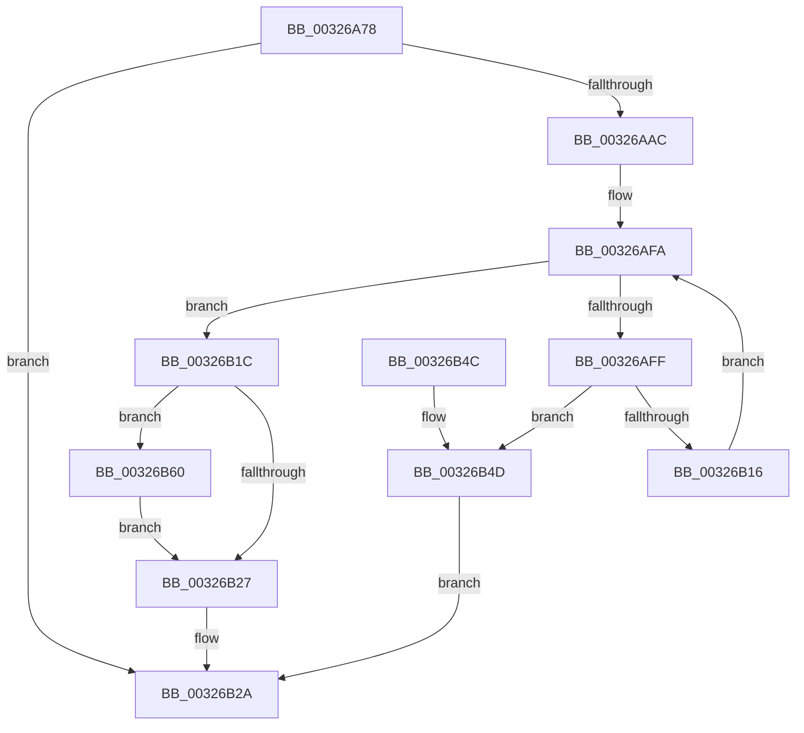

# RtlpHpSegSegmentAllocate

- RVA: `0x00326A78`–`0x00326B76` (길이 `254` bytes)
- VA: `0x0000000140326A78`
- 실행 섹션: `.text`
- PDB 이름 있음: `예`; PDB Function 태그: `아니요`
- unwind 정보 RVA: `0x00075D1C`
- 디코드: `75`개 명령, `254/254` bytes 표시
- 미해석 바이트: `0` (있으면 어셈블리에 `.byte`로 보존)

> 이 문서는 커널 이미지의 기계어와 PDB 기호를 분석해 생성했습니다. 4번과 5번은 함수 원형과 자료형을 바이너리 사용 방식에서 추정한 C 해석이며 원본 소스 복구 결과는 아닙니다.

## 1. Dependencies

- 직접 호출 지점: **4**; 고유 호출 대상: **4**
- 직접 호출자로 확인된 함수: **2**
- RIP 상대 이미지 참조: **2**

### Outgoing calls
- `0x00326A9F` → [RtlpHpSegMgrAllocate](../2E/RtlpHpSegMgrAllocate_function_002ED130.md) (function, `0x002ED130`)
- `0x00326B0D` → [RtlCSparseBitmapBitmaskWrite](../2F/RtlCSparseBitmapBitmaskWrite_function_002F0A8C.md) (function, `0x002F0A8C`)
- `0x00326B59` → [RtlpHpSegSegmentFree](../47/RtlpHpSegSegmentFree_function_00471328.md) (function, `0x00471328`)
- `0x00326B6F` → [RtlpLogHeapCommit](../4F/RtlpLogHeapCommit_function_004F9F74.md) (function, `0x004F9F74`)

### Direct callers
- [sub_003267E9](Unknown_function_003267E9.md) at `0x003268A0`
- [RtlpHpSegContextReserve](../60/RtlpHpSegContextReserve_function_00604338.md) at `0x006043B7`

### Static image references
- `0x00326AE1` → RVA `0x00E68608` (`.data`; read)
- `0x00326B06` → RVA `0x00E68610` (`.data`; read)

## 2. Other-region calls and transfers

- 다른 실행 섹션으로 향하는 call: **0**
- 별도 외부 분기/꼬리 이동을 확인하지 못했습니다.

## 3. Assembly (complete function range)

```asm
00326A78  48 8B C4                        mov rax, rsp
00326A7B  48 89 58 08                     mov qword ptr [rax + 8], rbx
00326A7F  48 89 68 10                     mov qword ptr [rax + 0x10], rbp
00326A83  48 89 70 18                     mov qword ptr [rax + 0x18], rsi
00326A87  48 89 78 20                     mov qword ptr [rax + 0x20], rdi
00326A8B  41 54                           push r12
00326A8D  41 56                           push r14
00326A8F  41 57                           push r15
00326A91  48 83 EC 20                     sub rsp, 0x20
00326A95  8D 7A 02                        lea edi, [rdx + 2]
00326A98  4C 8B F1                        mov r14, rcx
00326A9B  8B D7                           mov edx, edi
00326A9D  33 DB                           xor ebx, ebx
00326A9F  E8 8C 66 FC FF                  call 0x1402ed130
00326AA4  48 8B E8                        mov rbp, rax
00326AA7  48 85 C0                        test rax, rax
00326AAA  74 7E                           je 0x140326b2a
00326AAC  41 8B 16                        mov edx, dword ptr [r14]
00326AAF  49 0F BF 46 16                  movsx rax, word ptr [r14 + 0x16]
00326AB4  F7 DA                           neg edx
00326AB6  8B CA                           mov ecx, edx
00326AB8  48 C1 E9 0C                     shr rcx, 0xc
00326ABC  44 8B C2                        mov r8d, edx
00326ABF  F0 4A 01 0C 30                  lock add qword ptr [rax + r14], rcx
00326AC4  49 0F BF 46 16                  movsx rax, word ptr [r14 + 0x16]
00326AC9  8B CF                           mov ecx, edi
00326ACB  F0 4A 01 4C 30 08               lock add qword ptr [rax + r14 + 8], rcx
00326AD1  81 FA 00 00 10 00               cmp edx, 0x100000
00326AD7  44 8B FB                        mov r15d, ebx
00326ADA  48 8B F5                        mov rsi, rbp
00326ADD  41 0F 95 C7                     setne r15b
00326AE1  48 2B 35 20 1B B4 00            sub rsi, qword ptr [rip + 0xb41b20]
00326AE8  49 C1 E8 14                     shr r8, 0x14
00326AEC  48 C1 EE 14                     shr rsi, 0x14
00326AF0  48 03 F6                        add rsi, rsi
00326AF3  4F 8D 24 00                     lea r12, [r8 + r8]
00326AF7  4C 03 E6                        add r12, rsi
00326AFA  49 3B F4                        cmp rsi, r12
00326AFD  73 1D                           jae 0x140326b1c
00326AFF  4D 8D 4F 01                     lea r9, [r15 + 1]
00326B03  48 8B D6                        mov rdx, rsi
00326B06  48 8D 0D 03 1B B4 00            lea rcx, [rip + 0xb41b03]
00326B0D  E8 7A 9F FC FF                  call 0x1402f0a8c
00326B12  85 C0                           test eax, eax
00326B14  78 37                           js 0x140326b4d
00326B16  48 83 C6 02                     add rsi, 2
00326B1A  EB DE                           jmp 0x140326afa
00326B1C  49 8B 4E 38                     mov rcx, qword ptr [r14 + 0x38]
00326B20  8B 41 14                        mov eax, dword ptr [rcx + 0x14]
00326B23  84 C0                           test al, al
00326B25  78 39                           js 0x140326b60
00326B27  48 8B DD                        mov rbx, rbp
00326B2A  48 8B 6C 24 48                  mov rbp, qword ptr [rsp + 0x48]
00326B2F  48 8B C3                        mov rax, rbx
00326B32  48 8B 5C 24 40                  mov rbx, qword ptr [rsp + 0x40]
00326B37  48 8B 74 24 50                  mov rsi, qword ptr [rsp + 0x50]
00326B3C  48 8B 7C 24 58                  mov rdi, qword ptr [rsp + 0x58]
00326B41  48 83 C4 20                     add rsp, 0x20
00326B45  41 5F                           pop r15
00326B47  41 5E                           pop r14
00326B49  41 5C                           pop r12
00326B4B  C3                              ret
00326B4C  CC                              int3
00326B4D  44 8B CB                        mov r9d, ebx
00326B50  44 8B C7                        mov r8d, edi
00326B53  48 8B D5                        mov rdx, rbp
00326B56  49 8B CE                        mov rcx, r14
00326B59  E8 CA A7 14 00                  call 0x140471328
00326B5E  EB CA                           jmp 0x140326b2a
00326B60  C1 E7 0C                        shl edi, 0xc
00326B63  41 B9 0C 00 00 00               mov r9d, 0xc
00326B69  44 8B C7                        mov r8d, edi
00326B6C  48 8B D5                        mov rdx, rbp
00326B6F  E8 00 34 1D 00                  call 0x1404f9f74
00326B74  EB B1                           jmp 0x140326b27
```

## 4. C-style interpretation (structured pseudocode)

```c
__int64 __fastcall RtlpHpSegSegmentAllocate(__int64 a1, __int64 a2)
{
    __int64 result;
    __int64 v_r12;
    __int64 v_r15;
    __int64 v_rbx;
    __int64 v_rdi;
    __int64 v_rsi;
    __int64 v_rsp;
    unsigned __int64 v_stack_p10;
    unsigned __int64 v_stack_p18;
    unsigned __int64 v_stack_p20;
    unsigned __int64 v_stack_p8;

    *(unsigned __int64 *)(v_rsp + 8) = v_rbx;
    *(unsigned __int64 *)(v_rsp + 16) = v_rbp;
    *(unsigned __int64 *)(v_rsp + 24) = v_rsi;
    *(unsigned __int64 *)(v_rsp + 32) = v_rdi;
    v_rsp = (v_rsp) - (32);
    v_rbx = 0;
    result = RtlpHpSegMgrAllocate(a1, (unsigned int)((unsigned int)(a2 + 2)), a3, a4);
    if (result == 0) goto loc_00326B2A;
    a2 = (unsigned int)(-((unsigned int)(*(unsigned int *)(a1))));
    a1 = ((unsigned int)((unsigned int)(a2))) >> (12);
    v_r15 = (((unsigned int)(a2)) != 0x100000ULL) ? 1 : 0;
    v_rsi = (result) - (*(unsigned __int64 *)(v_rip + 11803424));
    a3 = ((unsigned int)((unsigned int)(a2))) >> (20);
    v_rsi = (v_rsi) >> (20);
    v_rsi = (v_rsi) + (v_rsi);
    v_r12 = (a3 + a3 * 1) + (v_rsi);
loc_00326AFA:
    if (v_rsi >= v_r12) goto loc_00326B1C;
    result = RtlCSparseBitmapBitmaskWrite(v_rip + 11803395, v_rsi, a3, v_r15 + 1);
    if (sign_flag) goto loc_00326B4D;
    v_rsi = (v_rsi) + (2);
    goto loc_00326AFA;
loc_00326B1C:
    if (sign_flag) goto loc_00326B60;
loc_00326B27:
loc_00326B2A:
    v_rsp = (v_rsp) + (32);
    return result;
loc_00326B4D:
    result = RtlpHpSegSegmentFree(a1, v_stack_p10, (unsigned int)((unsigned int)(v_stack_p20)), (unsigned int)((unsigned int)(v_stack_p8)));
    goto loc_00326B2A;
loc_00326B60:
    v_rdi = (unsigned int)((v_stack_p20) << (12));
    result = RtlpLogHeapCommit(a1, v_stack_p10, (unsigned int)((unsigned int)(v_rdi)), 12);
    goto loc_00326B27;
}
```

## 5. (Beta) C Style

```c
int64_t RtlpHpSegSegmentAllocate(void *Arg1, void *Arg2)
{
    uint8_t *arg1 = (uint8_t *)Arg1;
    uint8_t *arg2 = (uint8_t *)Arg2;

    int64_t result;
    int64_t local_r12;
    int64_t local_r15;
    int64_t local_rbx;
    int64_t local_rdi;
    int64_t local_rsi;
    int64_t local_rsp;
    uint64_t v_stack_p10;
    uint64_t v_stack_p18;
    uint64_t v_stack_p20;
    uint64_t v_stack_p8;

    *(uint64_t *)(local_rsp + 0x8) = local_rbx;
    *(uint64_t *)(local_rsp + 0x10) = local_rbp;
    *(uint64_t *)(local_rsp + 0x18) = local_rsi;
    *(uint64_t *)(local_rsp + 0x20) = local_rdi;
    local_rsp = (local_rsp) - (32);
    local_rbx = 0;
    result = RtlpHpSegMgrAllocate(Arg1, (uint32_t)((uint32_t)(Arg2 + 2)), a3, a4);
    if (result == 0) goto loc_00326B2A;
    Arg2 = (uint32_t)(-((uint32_t)(*(uint32_t *)(arg1))));
    Arg1 = ((uint32_t)((uint32_t)(Arg2))) >> (12);
    local_r15 = (((uint32_t)(Arg2)) != 0x100000ULL) ? 1 : 0;
    local_rsi = (result) - (*(uint64_t *)(v_rip + 0xB41B20));
    a3 = ((uint32_t)((uint32_t)(Arg2))) >> (20);
    local_rsi = (local_rsi) >> (20);
    local_rsi = (local_rsi) + (local_rsi);
    local_r12 = (a3 + a3 * 1) + (local_rsi);
loc_00326AFA:
    if (local_rsi >= local_r12) goto loc_00326B1C;
    result = RtlCSparseBitmapBitmaskWrite(v_rip + 11803395, local_rsi, a3, local_r15 + 1);
    if (sign_flag) goto loc_00326B4D;
    local_rsi = (local_rsi) + (2);
    goto loc_00326AFA;
loc_00326B1C:
    if (sign_flag) goto loc_00326B60;
loc_00326B27:
loc_00326B2A:
    local_rsp = (local_rsp) + (32);
    return result;
loc_00326B4D:
    result = RtlpHpSegSegmentFree(Arg1, v_stack_p10, (uint32_t)((uint32_t)(v_stack_p20)), (uint32_t)((uint32_t)(v_stack_p8)));
    goto loc_00326B2A;
loc_00326B60:
    local_rdi = (uint32_t)((v_stack_p20) << (12));
    result = RtlpLogHeapCommit(Arg1, v_stack_p10, (uint32_t)((uint32_t)(local_rdi)), 12);
    goto loc_00326B27;
}
```

### 관측된 메모리 오프셋

구조체 형식이 확인되지 않은 접근은 인자 기준의 오프셋으로만 기록했습니다.

| 기준 인자 | 오프셋 표현 | 폭 (bit) | 접근 |
|---|---:|---:|---|
| `Arg1` | `+ 0x0` | `32` | `R` |
| `Arg1` | `+ 0x16` | `16` | `R` |
| `Arg1` | `+ 0x38` | `64` | `R` |
| `Arg2` | `+ 0x2` | `32` | `R` |

## 6. Execution-region graph

[열기: 2D/3D 그래프와 함수 탐색 컨트롤 패널](../../../control-panel.html?section=text&rva=0x00326A78&view=graph)

- 2D 그래프는 위에서 아래로 흐르고, 3D 그래프는 빈 공간을 드래그해 회전합니다. Shift+드래그는 이동, 휠은 확대·축소, 함수 노드 선택은 대상 보고서 이동입니다.

### Static fallback


