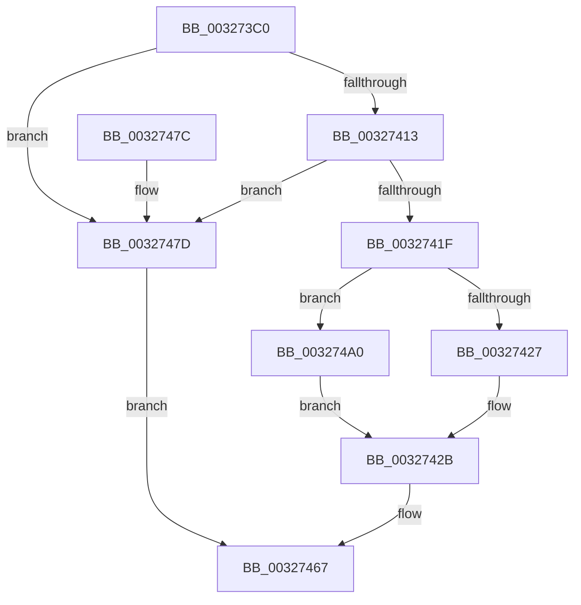

# RtlpHpVaMgrCtxQuery

- RVA: `0x003273C0`–`0x003274A6` (길이 `230` bytes)
- VA: `0x00000001403273C0`
- 실행 섹션: `.text`
- PDB 이름 있음: `예`; PDB Function 태그: `아니요`
- unwind 정보 RVA: `0x00075D9C`
- 디코드: `65`개 명령, `230/230` bytes 표시
- 미해석 바이트: `0` (있으면 어셈블리에 `.byte`로 보존)

> 이 문서는 커널 이미지의 기계어와 PDB 기호를 분석해 생성했습니다. 4번과 5번은 함수 원형과 자료형을 바이너리 사용 방식에서 추정한 C 해석이며 원본 소스 복구 결과는 아닙니다.

## 1. Dependencies

- 직접 호출 지점: **2**; 고유 호출 대상: **2**
- 직접 호출자로 확인된 함수: **12**
- RIP 상대 이미지 참조: **0**

### Outgoing calls
- `0x00327406` → [RtlCSparseBitmapFindBitSetCapped](RtlCSparseBitmapFindBitSetCapped_function_003274AC.md) (function, `0x003274AC`)
- `0x00327494` → [RtlpLogHeapFailure](../35/RtlpLogHeapFailure_function_0035B7BC.md) (function, `0x0035B7BC`)

### Direct callers
- [RtlpHpSegMgrRelease](../2E/RtlpHpSegMgrRelease_function_002E37FC.md) at `0x002E3900`
- [RtlpHpLargeAlloc](../2E/RtlpHpLargeAlloc_function_002EBD5C.md) at `0x002EBF06`
- [RtlpHpSegMgrVaCtxInsert](../2E/RtlpHpSegMgrVaCtxInsert_function_002ED470.md) at `0x002ED499`
- [RtlpHpSegMgrVaCtxInitialize](../2E/RtlpHpSegMgrVaCtxInitialize_function_002ED50C.md) at `0x002ED534`
- [RtlpHpSegMgrVaCtxFree](../2E/RtlpHpSegMgrVaCtxFree_function_002ED570.md) at `0x002ED5BF`
- [RtlpHpSegMgrCommit](RtlpHpSegMgrCommit_function_00326BE4.md) at `0x00326C84`
- [ExAllocateHeapPool](../35/ExAllocateHeapPool_function_0035BA30.md) at `0x0035D5B6`
- [sub_00360911](../36/Unknown_function_00360911.md) at `0x00360957`
- [ExGetHeapFromVA](../36/ExGetHeapFromVA_function_00361840.md) at `0x003618F6`
- [RtlpHpSegSegmentInitialize](../47/RtlpHpSegSegmentInitialize_function_00478EB0.md) at `0x00478EF1`
- [ExpAllocatePoolWithQuotaTag](../../poolcode/B8/ExpAllocatePoolWithQuotaTag_function_00B82210.md) at `0x00B8263F`
- [sub_00B836C7](../../poolcode/B8/Unknown_function_00B836C7.md) at `0x00B8370D`

### Static image references
- 디코드된 RIP-relative 메모리 참조가 없습니다.

## 2. Other-region calls and transfers

- 다른 실행 섹션으로 향하는 call: **0**
- 별도 외부 분기/꼬리 이동을 확인하지 못했습니다.

## 3. Assembly (complete function range)

```asm
003273C0  48 89 5C 24 08                  mov qword ptr [rsp + 8], rbx
003273C5  48 89 6C 24 10                  mov qword ptr [rsp + 0x10], rbp
003273CA  48 89 74 24 18                  mov qword ptr [rsp + 0x18], rsi
003273CF  57                              push rdi
003273D0  48 83 EC 30                     sub rsp, 0x30
003273D4  48 8B DA                        mov rbx, rdx
003273D7  49 8B F8                        mov rdi, r8
003273DA  48 2B 59 08                     sub rbx, qword ptr [rcx + 8]
003273DE  48 8B EA                        mov rbp, rdx
003273E1  48 8B F1                        mov rsi, rcx
003273E4  48 C1 EB 14                     shr rbx, 0x14
003273E8  8B 49 18                        mov ecx, dword ptr [rcx + 0x18]
003273EB  48 8B D3                        mov rdx, rbx
003273EE  48 D3 E2                        shl rdx, cl
003273F1  41 B8 01 00 00 00               mov r8d, 1
003273F7  49 D3 E0                        shl r8, cl
003273FA  48 C1 E2 03                     shl rdx, 3
003273FE  48 8D 4E 20                     lea rcx, [rsi + 0x20]
00327402  49 C1 E0 03                     shl r8, 3
00327406  E8 A1 00 00 00                  call 0x1403274ac
0032740B  33 D2                           xor edx, edx
0032740D  48 83 F8 FF                     cmp rax, -1
00327411  74 6A                           je 0x14032747d
00327413  8B 4E 18                        mov ecx, dword ptr [rsi + 0x18]
00327416  48 D3 E3                        shl rbx, cl
00327419  48 03 5E 28                     add rbx, qword ptr [rsi + 0x28]
0032741D  74 5E                           je 0x14032747d
0032741F  89 57 1C                        mov dword ptr [rdi + 0x1c], edx
00327422  F6 03 04                        test byte ptr [rbx], 4
00327425  75 79                           jne 0x1403274a0
00327427  0F B7 43 18                     movzx eax, word ptr [rbx + 0x18]
0032742B  48 C1 E0 14                     shl rax, 0x14
0032742F  48 89 07                        mov qword ptr [rdi], rax
00327432  0F B6 43 01                     movzx eax, byte ptr [rbx + 1]
00327436  48 83 C0 2D                     add rax, 0x2d
0032743A  C7 47 18 10 00 00 00            mov dword ptr [rdi + 0x18], 0x10
00327441  48 8D 0C 40                     lea rcx, [rax + rax*2]
00327445  48 03 C9                        add rcx, rcx
00327448  0F B6 44 CE 2E                  movzx eax, byte ptr [rsi + rcx*8 + 0x2e]
0032744D  D1 E8                           shr eax, 1
0032744F  83 E0 07                        and eax, 7
00327452  89 47 08                        mov dword ptr [rdi + 8], eax
00327455  0F B6 44 CE 2D                  movzx eax, byte ptr [rsi + rcx*8 + 0x2d]
0032745A  89 47 0C                        mov dword ptr [rdi + 0xc], eax
0032745D  48 8D 43 08                     lea rax, [rbx + 8]
00327461  48 89 47 10                     mov qword ptr [rdi + 0x10], rax
00327465  33 C0                           xor eax, eax
00327467  48 8B 5C 24 40                  mov rbx, qword ptr [rsp + 0x40]
0032746C  48 8B 6C 24 48                  mov rbp, qword ptr [rsp + 0x48]
00327471  48 8B 74 24 50                  mov rsi, qword ptr [rsp + 0x50]
00327476  48 83 C4 30                     add rsp, 0x30
0032747A  5F                              pop rdi
0032747B  C3                              ret
0032747C  CC                              int3
0032747D  48 89 54 24 28                  mov qword ptr [rsp + 0x28], rdx
00327482  45 33 C9                        xor r9d, r9d
00327485  48 89 54 24 20                  mov qword ptr [rsp + 0x20], rdx
0032748A  45 33 C0                        xor r8d, r8d
0032748D  48 8B D5                        mov rdx, rbp
00327490  41 8D 49 16                     lea ecx, [r9 + 0x16]
00327494  E8 23 43 03 00                  call 0x14035b7bc
00327499  B8 01 00 00 C0                  mov eax, 0xc0000001
0032749E  EB C7                           jmp 0x140327467
003274A0  48 8B 43 18                     mov rax, qword ptr [rbx + 0x18]
003274A4  EB 85                           jmp 0x14032742b
```

## 4. C-style interpretation (structured pseudocode)

```c
__int64 __fastcall RtlpHpVaMgrCtxQuery(__int64 a1, __int64 a2, __int64 a3, int a4)
{
    __int64 result;
    __int64 v_rbx;
    __int64 v_rsp;
    unsigned __int64 v_stack_p10;
    unsigned __int64 v_stack_p18;
    unsigned __int64 v_stack_p20;
    unsigned __int64 v_stack_p28;
    unsigned __int64 v_stack_p8;

    v_stack_p8 = v_rbx;
    v_stack_p10 = v_rbp;
    v_stack_p18 = v_rsi;
    v_rsp = (v_rsp) - (48);
    v_rbx = (a2) - (*(unsigned __int64 *)(a1 + 8));
    v_rbx = (v_rbx) >> (20);
    a2 = (v_rbx) << ((unsigned __int8)((unsigned int)(*(unsigned int *)(a1 + 24))));
    a3 = (1) << ((unsigned __int8)((unsigned int)(*(unsigned int *)(a1 + 24))));
    a2 = (a2) << (3);
    a3 = (a3) << (3);
    result = RtlCSparseBitmapFindBitSetCapped(a1 + 32, a2, a3, a4);
    a2 = 0;
    if (result == -1) goto loc_0032747D;
    v_rbx = (v_rbx) << ((unsigned __int8)((unsigned int)(*(unsigned int *)(a1 + 24))));
    v_rbx = (v_rbx) + (*(unsigned __int64 *)(a1 + 40));
    if (condition_is_equal) goto loc_0032747D;
    *(unsigned int *)(a3 + 28) = 0;
    if (((*(unsigned __int8 *)(v_rbx)) & (4)) != 0) goto loc_003274A0;
loc_0032742B:
    result = (*(unsigned __int16 *)(v_rbx + 24)) << (20);
    *(unsigned __int64 *)(a3) = result;
    result = (*(unsigned __int8 *)(v_rbx + 1)) + (45);
    *(unsigned int *)(a3 + 24) = 16;
    a1 = (result + result * 2) + (result + result * 2);
    result = (unsigned int)((*(unsigned __int8 *)(a1 + a1 * 8 + 46)) >> (1));
    result = (unsigned int)((result) & (7));
    *(unsigned int *)(a3 + 8) = (unsigned int)(result);
    *(unsigned int *)(a3 + 12) = (unsigned int)(*(unsigned __int8 *)(a1 + a1 * 8 + 45));
    *(unsigned __int64 *)(a3 + 16) = v_rbx + 8;
    result = 0;
loc_00327467:
    v_rsp = (v_rsp) + (48);
    return result;
loc_0032747D:
    v_stack_p28 = 0;
    a4 = 0;
    v_stack_p20 = 0;
    a3 = 0;
    result = RtlpLogHeapFailure(a4 + 22, v_stack_p10, a3, a4);
    goto loc_00327467;
loc_003274A0:
    goto loc_0032742B;
}
```

## 5. (Beta) C Style

```c
int64_t RtlpHpVaMgrCtxQuery(void *Arg1, int64_t Arg2, void *Arg3, int32_t Arg4)
{
    uint8_t *arg1 = (uint8_t *)Arg1;
    uint8_t *arg3 = (uint8_t *)Arg3;

    int64_t result;
    int64_t local_rbx;
    int64_t local_rsp;
    uint64_t v_stack_p10;
    uint64_t v_stack_p18;
    uint64_t v_stack_p20;
    uint64_t v_stack_p28;
    uint64_t v_stack_p8;

    v_stack_p8 = local_rbx;
    v_stack_p10 = local_rbp;
    v_stack_p18 = local_rsi;
    local_rsp = (local_rsp) - (48);
    local_rbx = (Arg2) - (*(uint64_t *)(arg1 + 0x8));
    local_rbx = (local_rbx) >> (20);
    Arg2 = (local_rbx) << ((uint8_t)((uint32_t)(*(uint32_t *)(arg1 + 0x18))));
    Arg3 = (1) << ((uint8_t)((uint32_t)(*(uint32_t *)(arg1 + 0x18))));
    Arg2 = (Arg2) << (3);
    Arg3 = (Arg3) << (3);
    result = RtlCSparseBitmapFindBitSetCapped(Arg1 + 32, Arg2, Arg3, Arg4);
    Arg2 = 0;
    if (result == -1) goto loc_0032747D;
    local_rbx = (local_rbx) << ((uint8_t)((uint32_t)(*(uint32_t *)(arg1 + 0x18))));
    local_rbx = (local_rbx) + (*(uint64_t *)(arg1 + 0x28));
    if (condition_is_equal) goto loc_0032747D;
    *(uint32_t *)(arg3 + 0x1C) = 0;
    if (((*(uint8_t *)(local_rbx)) & (4)) != 0) goto loc_003274A0;
loc_0032742B:
    result = (*(uint16_t *)(local_rbx + 0x18)) << (20);
    *(uint64_t *)(arg3) = result;
    result = (*(uint8_t *)(local_rbx + 0x1)) + (45);
    *(uint32_t *)(arg3 + 0x18) = 16;
    Arg1 = (result + result * 2) + (result + result * 2);
    result = (uint32_t)((*(uint8_t *)(arg1 + arg1 * 8 + 0x2E)) >> (1));
    result = (uint32_t)((result) & (7));
    *(uint32_t *)(arg3 + 0x8) = (uint32_t)(result);
    *(uint32_t *)(arg3 + 0xC) = (uint32_t)(*(uint8_t *)(arg1 + arg1 * 8 + 0x2D));
    *(uint64_t *)(arg3 + 0x10) = local_rbx + 8;
    result = 0;
loc_00327467:
    local_rsp = (local_rsp) + (48);
    return result;
loc_0032747D:
    v_stack_p28 = 0;
    Arg4 = 0;
    v_stack_p20 = 0;
    Arg3 = 0;
    result = RtlpLogHeapFailure(Arg4 + 22, v_stack_p10, Arg3, Arg4);
    goto loc_00327467;
loc_003274A0:
    goto loc_0032742B;
}
```

### 관측된 메모리 오프셋

구조체 형식이 확인되지 않은 접근은 인자 기준의 오프셋으로만 기록했습니다.

| 기준 인자 | 오프셋 표현 | 폭 (bit) | 접근 |
|---|---:|---:|---|
| `Arg1` | `+ 0x8` | `64` | `R` |
| `Arg1` | `+ 0x18` | `32` | `R` |
| `Arg1` | `+ 0x20` | `64` | `R` |
| `Arg1` | `+ 0x28` | `64` | `R` |
| `Arg1` | `+ 0x2D + rcx*8` | `8` | `R` |
| `Arg1` | `+ 0x2E + rcx*8` | `8` | `R` |
| `Arg3` | `+ 0x0` | `64` | `W` |
| `Arg3` | `+ 0x8` | `32` | `W` |
| `Arg3` | `+ 0xC` | `32` | `W` |
| `Arg3` | `+ 0x10` | `64` | `W` |
| `Arg3` | `+ 0x18` | `32` | `W` |
| `Arg3` | `+ 0x1C` | `32` | `W` |

## 6. Execution-region graph

[열기: 2D/3D 그래프와 함수 탐색 컨트롤 패널](../../../control-panel.html?section=text&rva=0x003273C0&view=graph)

- 2D 그래프는 위에서 아래로 흐르고, 3D 그래프는 빈 공간을 드래그해 회전합니다. Shift+드래그는 이동, 휠은 확대·축소, 함수 노드 선택은 대상 보고서 이동입니다.

### Static fallback


