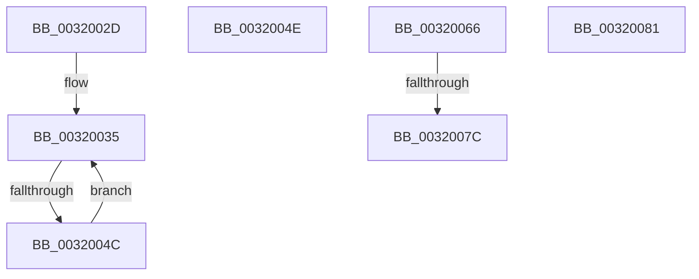

# sub_0032002D

- RVA: `0x0032002D`–`0x0032008E` (길이 `97` bytes)
- VA: `0x000000014032002D`
- 실행 섹션: `.text`
- PDB 이름 있음: `아니요`; PDB Function 태그: `아니요`
- unwind 정보 RVA: `0x00075528`
- 디코드: `21`개 명령, `97/97` bytes 표시
- 미해석 바이트: `0` (있으면 어셈블리에 `.byte`로 보존)

> 이 문서는 커널 이미지의 기계어와 PDB 기호를 분석해 생성했습니다. 4번과 5번은 함수 원형과 자료형을 바이너리 사용 방식에서 추정한 C 해석이며 원본 소스 복구 결과는 아닙니다.

## 1. Dependencies

- 직접 호출 지점: **1**; 고유 호출 대상: **1**
- 직접 호출자로 확인된 함수: **0**
- RIP 상대 이미지 참조: **1**

### Outgoing calls
- `0x0032005C` → [MiRewritePteWithLockBit](MiRewritePteWithLockBit_function_00322FEC.md) (function, `0x00322FEC`)

### Direct callers
- 이 함수 시작 RVA로 연결되는 직접 call은 확인되지 않았습니다. 간접 호출은 완전히 역산할 수 없습니다.

### Static image references
- `0x0032004E` → RVA `0x00010880` (`.rdata`; read)

## 2. Other-region calls and transfers

- 다른 실행 섹션으로 향하는 call: **0**
- call이 아닌 외부 분기/꼬리 이동: **5**
  - `0x00320046` → [sub_0031FE95 + 0xD1](../31/Unknown_function_0031FE95.md) (`tail-transfer`)
  - `0x00320061` → [sub_0031FE95 + 0x10B](../31/Unknown_function_0031FE95.md) (`tail-transfer`)
  - `0x00320076` → [sub_0031FE95 + 0x5C](../31/Unknown_function_0031FE95.md) (`tail-transfer`)
  - `0x0032007C` → [sub_0031FE95 + 0x14A](../31/Unknown_function_0031FE95.md) (`tail-transfer`)
  - `0x00320089` → [sub_0031FE95 + 0x14A](../31/Unknown_function_0031FE95.md) (`tail-transfer`)

## 3. Assembly (complete function range)

```asm
0032002D  B9 02 00 00 00                  mov ecx, 2
00320032  41 2B CD                        sub ecx, r13d
00320035  48 C1 EF 09                     shr rdi, 9
00320039  49 23 F8                        and rdi, r8
0032003C  49 8B C6                        mov rax, r14
0032003F  48 03 F8                        add rdi, rax
00320042  48 83 E9 01                     sub rcx, 1
00320046  0F 84 1A FF FF FF               je 0x14031ff66
0032004C  EB E7                           jmp 0x140320035
0032004E  4C 8B 0D 2B 08 CF FF            mov r9, qword ptr [rip - 0x30f7d5]
00320055  4C 8B C1                        mov r8, rcx
00320058  33 C9                           xor ecx, ecx
0032005A  33 D2                           xor edx, edx
0032005C  E8 8B 2F 00 00                  call 0x140322fec
00320061  E9 3A FF FF FF                  jmp 0x14031ffa0
00320066  FF 82 40 02 00 00               inc dword ptr [rdx + 0x240]
0032006C  81 BA 40 02 00 00 00 02 00 00   cmp dword ptr [rdx + 0x240], 0x200
00320076  0F 84 75 FE FF FF               je 0x14031fef1
0032007C  E9 5E FF FF FF                  jmp 0x14031ffdf
00320081  43 FF 84 A8 B4 50 EF 00         inc dword ptr [r8 + r13*4 + 0xef50b4]
00320089  E9 51 FF FF FF                  jmp 0x14031ffdf
```

## 4. C-style interpretation (structured pseudocode)

```c
__int64 __fastcall sub_0032002D(__int64 a1, int a2, __int64 a3)
{
    __int64 v_rdi;

    a1 = (unsigned int)((2) - ((unsigned int)(v_r13)));
loc_00320035:
    v_rdi = (v_rdi) >> (9);
    v_rdi = (v_rdi) & (a3);
    v_rdi = (v_rdi) + (v_r14);
    a1 = (a1) - (1);
    goto loc_00320035;
}
```

## 5. (Beta) C Style

```c
int64_t sub_0032002D(int64_t Arg1, int32_t Arg2, int64_t Arg3)
{
    int64_t local_rdi;

    Arg1 = (uint32_t)((2) - ((uint32_t)(local_r13)));
loc_00320035:
    local_rdi = (local_rdi) >> (9);
    local_rdi = (local_rdi) & (Arg3);
    local_rdi = (local_rdi) + (local_r14);
    Arg1 = (Arg1) - (1);
    goto loc_00320035;
}
```

## 6. Execution-region graph

[열기: 2D/3D 그래프와 함수 탐색 컨트롤 패널](../../../control-panel.html?section=text&rva=0x0032002D&view=graph)

- 2D 그래프는 위에서 아래로 흐르고, 3D 그래프는 빈 공간을 드래그해 회전합니다. Shift+드래그는 이동, 휠은 확대·축소, 함수 노드 선택은 대상 보고서 이동입니다.

### Static fallback


