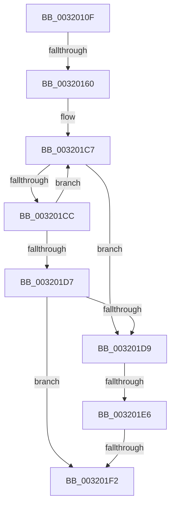

# sub_0032010F

- RVA: `0x0032010F`–`0x00320214` (길이 `261` bytes)
- VA: `0x000000014032010F`
- 실행 섹션: `.text`
- PDB 이름 있음: `아니요`; PDB Function 태그: `아니요`
- unwind 정보 RVA: `0x00075560`
- 디코드: `57`개 명령, `261/261` bytes 표시
- 미해석 바이트: `0` (있으면 어셈블리에 `.byte`로 보존)

> 이 문서는 커널 이미지의 기계어와 PDB 기호를 분석해 생성했습니다. 4번과 5번은 함수 원형과 자료형을 바이너리 사용 방식에서 추정한 C 해석이며 원본 소스 복구 결과는 아닙니다.

## 1. Dependencies

- 직접 호출 지점: **1**; 고유 호출 대상: **1**
- 직접 호출자로 확인된 함수: **0**
- RIP 상대 이미지 참조: **2**

### Outgoing calls
- `0x003201BB` → [memcpy](../6C/memcpy_function_006C6840.md) (function, `0x006C6840`)

### Direct callers
- 이 함수 시작 RVA로 연결되는 직접 call은 확인되지 않았습니다. 간접 호출은 완전히 역산할 수 없습니다.

### Static image references
- `0x00320153` → RVA `0x00FC5002` (`ALMOSTRO`; read)
- `0x0032018B` → RVA `0x00E2CB40` (`.data`; read)

## 2. Other-region calls and transfers

- 다른 실행 섹션으로 향하는 call: **0**
- call이 아닌 외부 분기/꼬리 이동: **3**
  - `0x0032015A` → [sub_00320232 + 0x1A4](Unknown_function_00320232.md) (`tail-transfer`)
  - `0x003201E0` → [sub_00320232 + 0x16F](Unknown_function_00320232.md) (`tail-transfer`)
  - `0x003201F0` → [sub_00320232](Unknown_function_00320232.md) (`tail-transfer`)

## 3. Assembly (complete function range)

```asm
0032010F  48 89 AC 24 F8 00 00 00         mov qword ptr [rsp + 0xf8], rbp
00320117  8B C3                           mov eax, ebx
00320119  48 C1 E8 10                     shr rax, 0x10
0032011D  8B CB                           mov ecx, ebx
0032011F  83 E0 03                        and eax, 3
00320122  C1 E9 0F                        shr ecx, 0xf
00320125  4C 89 A4 24 B0 00 00 00         mov qword ptr [rsp + 0xb0], r12
0032012D  83 E1 01                        and ecx, 1
00320130  4C 89 AC 24 A8 00 00 00         mov qword ptr [rsp + 0xa8], r13
00320138  4C 89 B4 24 A0 00 00 00         mov qword ptr [rsp + 0xa0], r14
00320140  48 8D 2C 80                     lea rbp, [rax + rax*4]
00320144  8B C3                           mov eax, ebx
00320146  C1 E8 10                        shr eax, 0x10
00320149  48 C1 E5 08                     shl rbp, 8
0032014D  83 E0 03                        and eax, 3
00320150  49 03 EF                        add rbp, r15
00320153  80 3D A8 4E CA 00 01            cmp byte ptr [rip + 0xca4ea8], 1
0032015A  0F 87 76 02 00 00               ja 0x1403203d6
00320160  44 8B CE                        mov r9d, esi
00320163  44 8B C1                        mov r8d, ecx
00320166  48 8D 0C 80                     lea rcx, [rax + rax*4]
0032016A  49 8D 04 48                     lea rax, [r8 + rcx*2]
0032016E  49 8D 0C 81                     lea rcx, [r9 + rax*4]
00320172  48 8D 04 8F                     lea rax, [rdi + rcx*4]
00320176  49 8B 8C C7 20 04 00 00         mov rcx, qword ptr [r15 + rax*8 + 0x420]
0032017E  4E 8D 34 87                     lea r14, [rdi + r8*4]
00320182  48 89 4C 24 48                  mov qword ptr [rsp + 0x48], rcx
00320187  49 C1 E6 05                     shl r14, 5
0032018B  4C 8D 25 AE C9 B0 00            lea r12, [rip + 0xb0c9ae]
00320192  4D 8B 84 2E 90 00 00 00         mov r8, qword ptr [r14 + rbp + 0x90]
0032019A  48 8D 4C 24 78                  lea rcx, [rsp + 0x78]
0032019F  49 8B 94 2E 98 00 00 00         mov rdx, qword ptr [r14 + rbp + 0x98]
003201A7  0F 57 C0                        xorps xmm0, xmm0
003201AA  49 C1 E8 03                     shr r8, 3
003201AE  0F 11 44 24 78                  movups xmmword ptr [rsp + 0x78], xmm0
003201B3  0F 11 84 24 88 00 00 00         movups xmmword ptr [rsp + 0x88], xmm0
003201BB  E8 80 66 3A 00                  call 0x1406c6840
003201C0  8B C6                           mov eax, esi
003201C2  48 8D 4C 24 78                  lea rcx, [rsp + 0x78]
003201C7  48 39 31                        cmp qword ptr [rcx], rsi
003201CA  75 0D                           jne 0x1403201d9
003201CC  FF C0                           inc eax
003201CE  48 83 C1 08                     add rcx, 8
003201D2  83 F8 04                        cmp eax, 4
003201D5  72 F0                           jb 0x1403201c7
003201D7  74 19                           je 0x1403201f2
003201D9  80 3D 22 4E CA 00 01            cmp byte ptr [rip + 0xca4e22], 1
003201E0  0F 87 BB 01 00 00               ja 0x1403203a1
003201E6  48 8D 45 10                     lea rax, [rbp + 0x10]
003201EA  48 8B 00                        mov rax, qword ptr [rax]
003201ED  48 85 C0                        test rax, rax
003201F0  75 40                           jne 0x140320232
003201F2  33 C0                           xor eax, eax
003201F4  4C 8B AC 24 A8 00 00 00         mov r13, qword ptr [rsp + 0xa8]
003201FC  4C 8B A4 24 B0 00 00 00         mov r12, qword ptr [rsp + 0xb0]
00320204  48 8B AC 24 F8 00 00 00         mov rbp, qword ptr [rsp + 0xf8]
0032020C  4C 8B B4 24 A0 00 00 00         mov r14, qword ptr [rsp + 0xa0]
```

## 4. C-style interpretation (structured pseudocode)

```c
__int64 __fastcall sub_0032010F(__int64 a1, __int64 a2, __int64 a3, __int64 a4, __int64 a5, __int64 a6, __int64 a7, __int64 a8, __int64 a9, __int64 a10, __int64 a11, __int64 a12, __int64 a13, __int64 a14, __int64 a15, __int64 a16, __int64 a17, __int64 a18, __int64 a19, __int64 a20, __int64 a21, __int64 a22, __int64 a23, __int64 a24, __int64 a25, __int64 a26, __int64 a27, __int64 a28, __int64 a29, __int64 a30, __int64 a31)
{
    __int64 result;
    __int64 v_r14;
    __int64 v_rbp;
    unsigned __int64 v_stack_p48;
    unsigned __int64 v_stack_pA0;
    unsigned __int64 v_stack_pA8;
    unsigned __int64 v_stack_pB0;
    unsigned __int64 v_stack_pF8;

    v_stack_pF8 = v_rbp;
    result = ((unsigned int)((unsigned int)(v_rbx))) >> (16);
    result = (unsigned int)((result) & (3));
    a1 = (unsigned int)(((unsigned int)((unsigned int)(v_rbx))) >> (15));
    v_stack_pB0 = v_r12;
    a1 = (unsigned int)((a1) & (1));
    v_stack_pA8 = v_r13;
    v_stack_pA0 = v_r14;
    result = (unsigned int)(((unsigned int)((unsigned int)(v_rbx))) >> (16));
    v_rbp = (result + result * 4) << (8);
    result = (unsigned int)((result) & (3));
    v_rbp = (v_rbp) + (v_r15);
    v_stack_p48 = *(unsigned __int64 *)(v_r15 + v_rdi + (unsigned int)((unsigned int)(v_rsi)) + (unsigned int)((unsigned int)(a1)) + result + result * 4 * 2 * 4 * 4 * 8 + 1056);
    v_r14 = (v_rdi + (unsigned int)((unsigned int)(a1)) * 4) << (5);
    a3 = (*(unsigned __int64 *)(v_r14 + v_rbp * 1 + 144)) >> (3);
    a15 = v_xmm0;
    a17 = v_xmm0;
    result = memcpy(a15, *(unsigned __int64 *)(v_r14 + v_rbp * 1 + 152), a3, (unsigned int)((unsigned int)(v_rsi)));
loc_003201C7:
    if ((*(unsigned __int64 *)(a15)) != v_rsi) goto loc_003201D9;
    result = (unsigned int)(((unsigned int)((unsigned int)(v_rsi))) + 1);
    a1 = (a15) + (8);
    if (((unsigned int)(result)) < 4) goto loc_003201C7;
    if (((unsigned int)(result)) == 4) goto loc_003201F2;
loc_003201D9:
loc_003201F2:
    result = 0;
    return result;
}
```

## 5. (Beta) C Style

```c
int64_t sub_0032010F(int64_t Arg1, int64_t Arg2, int64_t Arg3, int64_t Arg4, uint64_t Arg5, uint64_t Arg6, uint64_t Arg7, uint64_t Arg8, uint64_t Arg9, uint64_t Arg10, uint64_t Arg11, uint64_t Arg12, uint64_t Arg13, uint64_t Arg14, int64_t Arg15, uint64_t Arg16, int64_t Arg17, uint64_t Arg18, uint64_t Arg19, int64_t Arg20, int64_t Arg21, int64_t Arg22, uint64_t Arg23, uint64_t Arg24, uint64_t Arg25, uint64_t Arg26, uint64_t Arg27, uint64_t Arg28, uint64_t Arg29, uint64_t Arg30, int64_t Arg31)
{
    int64_t result;
    int64_t local_r14;
    int64_t local_rbp;
    uint64_t v_stack_p48;
    uint64_t v_stack_pA0;
    uint64_t v_stack_pA8;
    uint64_t v_stack_pB0;
    uint64_t v_stack_pF8;

    v_stack_pF8 = local_rbp;
    result = ((uint32_t)((uint32_t)(local_rbx))) >> (16);
    result = (uint32_t)((result) & (3));
    Arg1 = (uint32_t)(((uint32_t)((uint32_t)(local_rbx))) >> (15));
    v_stack_pB0 = local_r12;
    Arg1 = (uint32_t)((Arg1) & (1));
    v_stack_pA8 = local_r13;
    v_stack_pA0 = local_r14;
    result = (uint32_t)(((uint32_t)((uint32_t)(local_rbx))) >> (16));
    local_rbp = (result + result * 4) << (8);
    result = (uint32_t)((result) & (3));
    local_rbp = (local_rbp) + (local_r15);
    v_stack_p48 = *(uint64_t *)(local_r15 + local_rdi + (uint32_t)((uint32_t)(local_rsi)) + (uint32_t)((uint32_t)(Arg1)) + result + result * 4 * 2 * 4 * 4 * 8 + 0x420);
    local_r14 = (local_rdi + (uint32_t)((uint32_t)(Arg1)) * 4) << (5);
    Arg3 = (*(uint64_t *)(local_r14 + local_rbp * 1 + 0x90)) >> (3);
    Arg15 = v_xmm0;
    Arg17 = v_xmm0;
    result = memcpy(Arg15, *(uint64_t *)(local_r14 + local_rbp * 1 + 0x98), Arg3, (uint32_t)((uint32_t)(local_rsi)));
loc_003201C7:
    if ((*(uint64_t *)(Arg15)) != local_rsi) goto loc_003201D9;
    result = (uint32_t)(((uint32_t)((uint32_t)(local_rsi))) + 1);
    Arg1 = (Arg15) + (8);
    if (((uint32_t)(result)) < 4) goto loc_003201C7;
    if (((uint32_t)(result)) == 4) goto loc_003201F2;
loc_003201D9:
loc_003201F2:
    result = 0;
    return result;
}
```

## 6. Execution-region graph

[열기: 2D/3D 그래프와 함수 탐색 컨트롤 패널](../../../control-panel.html?section=text&rva=0x0032010F&view=graph)

- 2D 그래프는 위에서 아래로 흐르고, 3D 그래프는 빈 공간을 드래그해 회전합니다. Shift+드래그는 이동, 휠은 확대·축소, 함수 노드 선택은 대상 보고서 이동입니다.

### Static fallback


