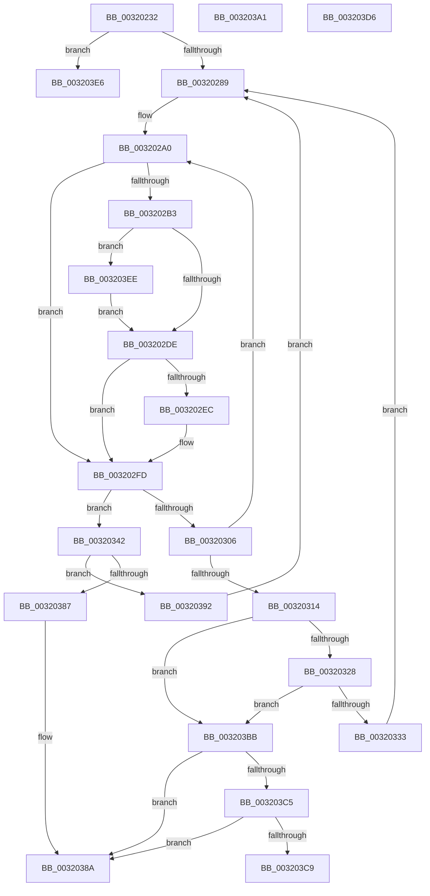

# sub_00320232

- RVA: `0x00320232`–`0x003203FE` (길이 `460` bytes)
- VA: `0x0000000140320232`
- 실행 섹션: `.text`
- PDB 이름 있음: `아니요`; PDB Function 태그: `아니요`
- unwind 정보 RVA: `0x00075594`
- 디코드: `121`개 명령, `460/460` bytes 표시
- 미해석 바이트: `0` (있으면 어셈블리에 `.byte`로 보존)

> 이 문서는 커널 이미지의 기계어와 PDB 기호를 분석해 생성했습니다. 4번과 5번은 함수 원형과 자료형을 바이너리 사용 방식에서 추정한 C 해석이며 원본 소스 복구 결과는 아닙니다.

## 1. Dependencies

- 직접 호출 지점: **1**; 고유 호출 대상: **1**
- 직접 호출자로 확인된 함수: **0**
- RIP 상대 이미지 참조: **1**

### Outgoing calls
- `0x0032037D` → [MiSetPageZeroInProgress](../43/MiSetPageZeroInProgress_function_0043B980.md) (function, `0x0043B980`)

### Direct callers
- 이 함수 시작 RVA로 연결되는 직접 call은 확인되지 않았습니다. 간접 호출은 완전히 역산할 수 없습니다.

### Static image references
- `0x00320348` → RVA `0x00E2CB40` (`.data`; read)

## 2. Other-region calls and transfers

- 다른 실행 섹션으로 향하는 call: **0**
- call이 아닌 외부 분기/꼬리 이동: **5**
  - `0x0032038D` → [sub_0032010F + 0xE5](Unknown_function_0032010F.md) (`tail-transfer`)
  - `0x003203B6` → [sub_0032010F + 0xDB](Unknown_function_0032010F.md) (`tail-transfer`)
  - `0x003203D1` → [sub_0032010F + 0x7C](Unknown_function_0032010F.md) (`tail-transfer`)
  - `0x003203E1` → [sub_0032010F + 0x54](Unknown_function_0032010F.md) (`tail-transfer`)
  - `0x003203E9` → [sub_006E18C4](../6E/Unknown_function_006E18C4.md) (`tail-transfer`)

## 3. Assembly (complete function range)

```asm
00320232  8B 7C 24 5C                     mov edi, dword ptr [rsp + 0x5c]
00320236  4C 8B DE                        mov r11, rsi
00320239  8B 54 24 60                     mov edx, dword ptr [rsp + 0x60]
0032023D  8B CF                           mov ecx, edi
0032023F  8B C1                           mov eax, ecx
00320241  89 74 24 24                     mov dword ptr [rsp + 0x24], esi
00320245  48 C1 E8 10                     shr rax, 0x10
00320249  4C 8B CE                        mov r9, rsi
0032024C  83 E0 03                        and eax, 3
0032024F  89 54 24 28                     mov dword ptr [rsp + 0x28], edx
00320253  48 89 74 24 30                  mov qword ptr [rsp + 0x30], rsi
00320258  48 89 74 24 38                  mov qword ptr [rsp + 0x38], rsi
0032025D  45 8B 84 84 80 11 00 00         mov r8d, dword ptr [r12 + rax*4 + 0x1180]
00320265  45 8B D0                        mov r10d, r8d
00320268  40 0F B6 C7                     movzx eax, dil
0032026C  4C 8B E6                        mov r12, rsi
0032026F  89 44 24 2C                     mov dword ptr [rsp + 0x2c], eax
00320273  44 8B E8                        mov r13d, eax
00320276  44 89 44 24 24                  mov dword ptr [rsp + 0x24], r8d
0032027B  44 89 44 24 20                  mov dword ptr [rsp + 0x20], r8d
00320280  F6 C2 40                        test dl, 0x40
00320283  0F 85 5D 01 00 00               jne 0x1403203e6
00320289  49 8B 8C 2E 98 00 00 00         mov rcx, qword ptr [r14 + rbp + 0x98]
00320291  45 8B C2                        mov r8d, r10d
00320294  48 89 4C 24 70                  mov qword ptr [rsp + 0x70], rcx
00320299  41 83 E0 3F                     and r8d, 0x3f
0032029D  45 8B CA                        mov r9d, r10d
003202A0  41 8B C5                        mov eax, r13d
003202A3  48 C1 E8 06                     shr rax, 6
003202A7  41 8B D5                        mov edx, r13d
003202AA  48 8D 0C C1                     lea rcx, [rcx + rax*8]
003202AE  4C 3B D9                        cmp r11, rcx
003202B1  74 4A                           je 0x1403202fd
003202B3  4C 8B D9                        mov r11, rcx
003202B6  48 89 4C 24 30                  mov qword ptr [rsp + 0x30], rcx
003202BB  0F B6 CA                        movzx ecx, dl
003202BE  41 BC 01 00 00 00               mov r12d, 1
003202C4  80 E1 3F                        and cl, 0x3f
003202C7  49 D3 E4                        shl r12, cl
003202CA  49 FF CC                        dec r12
003202CD  49 F7 D4                        not r12
003202D0  4D 23 23                        and r12, qword ptr [r11]
003202D3  F6 44 24 28 40                  test byte ptr [rsp + 0x28], 0x40
003202D8  0F 85 10 01 00 00               jne 0x1403203ee
003202DE  49 8B C1                        mov rax, r9
003202E1  48 33 C2                        xor rax, rdx
003202E4  48 A9 C0 FF FF FF               test rax, -0x40
003202EA  75 11                           jne 0x1403202fd
003202EC  49 8B C8                        mov rcx, r8
003202EF  B8 01 00 00 00                  mov eax, 1
003202F4  48 D3 E0                        shl rax, cl
003202F7  48 FF C8                        dec rax
003202FA  4C 23 E0                        and r12, rax
003202FD  41 83 E5 C0                     and r13d, 0xffffffc0
00320301  4D 85 E4                        test r12, r12
00320304  75 3C                           jne 0x140320342
00320306  48 8B 4C 24 70                  mov rcx, qword ptr [rsp + 0x70]
0032030B  41 83 C5 40                     add r13d, 0x40
0032030F  45 3B EA                        cmp r13d, r10d
00320312  72 8C                           jb 0x1403202a0
00320314  8B 44 24 2C                     mov eax, dword ptr [rsp + 0x2c]
00320318  4C 8B DE                        mov r11, rsi
0032031B  48 89 74 24 30                  mov qword ptr [rsp + 0x30], rsi
00320320  85 C0                           test eax, eax
00320322  0F 84 93 00 00 00               je 0x1403203bb
00320328  44 3B 54 24 24                  cmp r10d, dword ptr [rsp + 0x24]
0032032D  0F 85 88 00 00 00               jne 0x1403203bb
00320333  44 8B D0                        mov r10d, eax
00320336  89 44 24 20                     mov dword ptr [rsp + 0x20], eax
0032033A  44 8B EE                        mov r13d, esi
0032033D  E9 47 FF FF FF                  jmp 0x140320289
00320342  4D 0F BC C4                     bsf r8, r12
00320346  33 D2                           xor edx, edx
00320348  4C 8D 0D F1 C7 B0 00            lea r9, [rip + 0xb0c7f1]
0032034F  8B CF                           mov ecx, edi
00320351  45 03 E8                        add r13d, r8d
00320354  48 C1 E9 10                     shr rcx, 0x10
00320358  41 8B C5                        mov eax, r13d
0032035B  83 E1 03                        and ecx, 3
0032035E  41 F7 B4 89 80 11 00 00         div dword ptr [r9 + rcx*4 + 0x1180]
00320366  48 8D 4C 24 40                  lea rcx, [rsp + 0x40]
0032036B  33 D7                           xor edx, edi
0032036D  0F B6 C2                        movzx eax, dl
00320370  33 F8                           xor edi, eax
00320372  41 8B C0                        mov eax, r8d
00320375  49 0F B3 C4                     btr r12, rax
00320379  89 7C 24 5C                     mov dword ptr [rsp + 0x5c], edi
0032037D  E8 FE B5 11 00                  call 0x14043b980
00320382  48 85 C0                        test rax, rax
00320385  74 0B                           je 0x140320392
00320387  48 8B F0                        mov rsi, rax
0032038A  48 8B C6                        mov rax, rsi
0032038D  E9 62 FE FF FF                  jmp 0x1403201f4
00320392  44 8B 54 24 20                  mov r10d, dword ptr [rsp + 0x20]
00320397  4C 8B 5C 24 30                  mov r11, qword ptr [rsp + 0x30]
0032039C  E9 E8 FE FF FF                  jmp 0x140320289
003203A1  8B C3                           mov eax, ebx
003203A3  C1 E8 08                        shr eax, 8
003203A6  83 E0 01                        and eax, 1
003203A9  48 C1 E0 04                     shl rax, 4
003203AD  48 05 38 3B 00 00               add rax, 0x3b38
003203B3  49 03 C7                        add rax, r15
003203B6  E9 2F FE FF FF                  jmp 0x1403201ea
003203BB  8B 44 24 60                     mov eax, dword ptr [rsp + 0x60]
003203BF  0F BA E0 0A                     bt eax, 0xa
003203C3  72 C5                           jb 0x14032038a
003203C5  A8 02                           test al, 2
003203C7  74 C1                           je 0x14032038a
003203C9  0F BA E8 0A                     bts eax, 0xa
003203CD  89 44 24 60                     mov dword ptr [rsp + 0x60], eax
003203D1  E9 B5 FD FF FF                  jmp 0x14032018b
003203D6  44 8B CB                        mov r9d, ebx
003203D9  49 C1 E9 08                     shr r9, 8
003203DD  41 83 E1 01                     and r9d, 1
003203E1  E9 7D FD FF FF                  jmp 0x140320163
003203E6  83 E1 0F                        and ecx, 0xf
003203E9  E9 D6 14 3C 00                  jmp 0x1406e18c4
003203EE  48 8B 44 24 38                  mov rax, qword ptr [rsp + 0x38]
003203F3  48 F7 D0                        not rax
003203F6  4C 23 E0                        and r12, rax
003203F9  E9 E0 FE FF FF                  jmp 0x1403202de
```

## 4. C-style interpretation (structured pseudocode)

```c
__int64 __fastcall sub_00320232(__int64 a1, __int64 a2, __int64 a3, __int64 a4, unsigned __int8 a5, __int64 a6, __int64 a7, __int64 a8, __int64 a9, __int64 a10, __int64 a11, unsigned int a12, __int64 a13, __int64 a14)
{
    __int64 result;
    __int64 v_r12;
    __int64 v_r13;
    __int64 v_rdi;
    unsigned int v_stack_p20;
    unsigned int v_stack_p24;
    unsigned int v_stack_p28;
    unsigned int v_stack_p2C;
    unsigned __int64 v_stack_p30;
    unsigned __int64 v_stack_p38;
    unsigned int v_stack_p5C;
    unsigned int v_stack_p60;
    unsigned __int64 v_stack_p70;

    v_stack_p24 = (unsigned int)(v_rsi);
    result = ((unsigned int)((unsigned int)((unsigned int)((unsigned int)((unsigned int)(v_stack_p5C)))))) >> (16);
    result = (unsigned int)((result) & (3));
    v_stack_p28 = (unsigned int)((unsigned int)(a12));
    v_stack_p30 = v_rsi;
    v_stack_p38 = v_rsi;
    v_stack_p2C = (unsigned int)((unsigned __int8)((unsigned int)(v_stack_p5C)));
    v_stack_p24 = (unsigned int)((unsigned int)(*(unsigned int *)(v_r12 + result * 4 + 4480)));
    v_stack_p20 = (unsigned int)((unsigned int)(*(unsigned int *)(v_r12 + result * 4 + 4480)));
    if ((((unsigned __int8)((unsigned int)(a12))) & (64)) != 0) goto loc_003203E6;
loc_00320289:
    v_stack_p70 = *(unsigned __int64 *)(v_r14 + v_rbp * 1 + 152);
    a3 = (unsigned int)(((unsigned int)((unsigned int)((unsigned int)((unsigned int)((unsigned int)(*(unsigned int *)(v_r12 + result * 4 + 4480))))))) & (63));
loc_003202A0:
    result = ((unsigned int)((unsigned int)((unsigned int)((unsigned int)((unsigned __int8)((unsigned int)(v_stack_p5C))))))) >> (6);
    if (v_rsi == (*(unsigned __int64 *)(v_r14 + v_rbp * 1 + 152) + result * 8)) goto loc_003202FD;
    v_stack_p30 = *(unsigned __int64 *)(v_r14 + v_rbp * 1 + 152) + result * 8;
    a1 = (unsigned __int8)(((unsigned __int8)((unsigned int)((unsigned int)((unsigned int)((unsigned int)((unsigned __int8)((unsigned int)(v_stack_p5C)))))))) & (63));
    v_r12 = (1) << ((unsigned __int8)(a1));
    v_r12 = (v_r12) - 1;
    v_r12 = ~(v_r12);
    v_r12 = (v_r12) & (*(unsigned __int64 *)(*(unsigned __int64 *)(v_r14 + v_rbp * 1 + 152) + result * 8));
    if (((a5) & (64)) != 0) goto loc_003203EE;
loc_003202DE:
    result = ((unsigned int)((unsigned int)((unsigned int)((unsigned int)((unsigned int)(*(unsigned int *)(v_r12 + result * 4 + 4480))))))) ^ ((unsigned int)((unsigned int)((unsigned int)((unsigned int)((unsigned __int8)((unsigned int)(v_stack_p5C)))))));
    if (((result) & (-64)) == 0) {
        a1 = a3;
        result = 1;
        result = (result) << ((unsigned __int8)(a1));
        result = (result) - 1;
        v_r12 = (v_r12) & (result);
    }
    v_r13 = (unsigned int)(((unsigned int)((unsigned int)((unsigned __int8)((unsigned int)(v_stack_p5C))))) & (0xFFFFFFC0ULL));
    if (v_r12 != 0) goto loc_00320342;
    v_r13 = (unsigned int)((v_r13) + (64));
    if (((unsigned int)(v_r13)) < ((unsigned int)((unsigned int)((unsigned int)((unsigned int)(*(unsigned int *)(v_r12 + result * 4 + 4480))))))) goto loc_003202A0;
    v_stack_p30 = v_rsi;
    if ((unsigned int)((unsigned int)(v_stack_p2C)) == 0) goto loc_003203BB;
    if (((unsigned int)((unsigned int)((unsigned int)((unsigned int)(*(unsigned int *)(v_r12 + result * 4 + 4480)))))) != v_stack_p24) goto loc_003203BB;
    v_stack_p20 = (unsigned int)((unsigned int)(v_stack_p2C));
    goto loc_00320289;
loc_00320342:
    a2 = 0;
    v_r13 = (unsigned int)(((unsigned int)((unsigned int)(v_rsi))) + ((unsigned int)(a3)));
    a1 = ((unsigned int)((unsigned int)((unsigned int)(v_stack_p5C)))) >> (16);
    a1 = (unsigned int)((a1) & (3));
    a2 = (unsigned int)((a2) ^ ((unsigned int)((unsigned int)(v_stack_p5C))));
    v_rdi = (unsigned int)(((unsigned int)(v_stack_p5C)) ^ ((unsigned int)((unsigned __int8)(a2))));
    v_stack_p5C = (unsigned int)(v_rdi);
    result = MiSetPageZeroInProgress(a8, a2, a3, v_rip + 11585521);
    if (result == 0) goto loc_00320392;
loc_0032038A:
loc_00320392:
    goto loc_00320289;
loc_003203BB:
    if (condition_is_below) goto loc_0032038A;
    if ((((unsigned __int8)((unsigned int)(a12))) & (2)) == 0) goto loc_0032038A;
    v_stack_p60 = (unsigned int)((unsigned int)(a12));
loc_003203E6:
    a1 = (unsigned int)((a8) & (15));
loc_003203EE:
    result = ~(a7);
    v_r12 = (v_r12) & (result);
    goto loc_003202DE;
}
```

## 5. (Beta) C Style

```c
int64_t sub_00320232(int64_t Arg1, int64_t Arg2, int64_t Arg3, int64_t Arg4, uint8_t Arg5, int64_t Arg6, int64_t Arg7, int64_t Arg8, uint64_t Arg9, uint64_t Arg10, uint64_t Arg11, uint32_t Arg12, uint64_t Arg13, int64_t Arg14)
{
    int64_t result;
    int64_t local_r12;
    int64_t local_r13;
    int64_t local_rdi;
    uint32_t v_stack_p20;
    uint32_t v_stack_p24;
    uint32_t v_stack_p28;
    uint32_t v_stack_p2C;
    uint64_t v_stack_p30;
    uint64_t v_stack_p38;
    uint32_t v_stack_p5C;
    uint32_t v_stack_p60;
    uint64_t v_stack_p70;

    v_stack_p24 = (uint32_t)(local_rsi);
    result = ((uint32_t)((uint32_t)((uint32_t)((uint32_t)((uint32_t)(v_stack_p5C)))))) >> (16);
    result = (uint32_t)((result) & (3));
    v_stack_p28 = (uint32_t)((uint32_t)(Arg12));
    v_stack_p30 = local_rsi;
    v_stack_p38 = local_rsi;
    v_stack_p2C = (uint32_t)((uint8_t)((uint32_t)(v_stack_p5C)));
    v_stack_p24 = (uint32_t)((uint32_t)(*(uint32_t *)(local_r12 + result * 4 + 0x1180)));
    v_stack_p20 = (uint32_t)((uint32_t)(*(uint32_t *)(local_r12 + result * 4 + 0x1180)));
    if ((((uint8_t)((uint32_t)(Arg12))) & (64)) != 0) goto loc_003203E6;
loc_00320289:
    v_stack_p70 = *(uint64_t *)(local_r14 + local_rbp * 1 + 0x98);
    Arg3 = (uint32_t)(((uint32_t)((uint32_t)((uint32_t)((uint32_t)((uint32_t)(*(uint32_t *)(local_r12 + result * 4 + 0x1180))))))) & (63));
loc_003202A0:
    result = ((uint32_t)((uint32_t)((uint32_t)((uint32_t)((uint8_t)((uint32_t)(v_stack_p5C))))))) >> (6);
    if (local_rsi == (*(uint64_t *)(local_r14 + local_rbp * 1 + 0x98) + result * 8)) goto loc_003202FD;
    v_stack_p30 = *(uint64_t *)(local_r14 + local_rbp * 1 + 0x98) + result * 8;
    Arg1 = (uint8_t)(((uint8_t)((uint32_t)((uint32_t)((uint32_t)((uint32_t)((uint8_t)((uint32_t)(v_stack_p5C)))))))) & (63));
    local_r12 = (1) << ((uint8_t)(Arg1));
    local_r12 = (local_r12) - 1;
    local_r12 = ~(local_r12);
    local_r12 = (local_r12) & (*(uint64_t *)(*(uint64_t *)(local_r14 + local_rbp * 1 + 0x98) + result * 8));
    if (((Arg5) & (64)) != 0) goto loc_003203EE;
loc_003202DE:
    result = ((uint32_t)((uint32_t)((uint32_t)((uint32_t)((uint32_t)(*(uint32_t *)(local_r12 + result * 4 + 0x1180))))))) ^ ((uint32_t)((uint32_t)((uint32_t)((uint32_t)((uint8_t)((uint32_t)(v_stack_p5C)))))));
    if (((result) & (-64)) == 0) {
        Arg1 = Arg3;
        result = 1;
        result = (result) << ((uint8_t)(Arg1));
        result = (result) - 1;
        local_r12 = (local_r12) & (result);
    }
    local_r13 = (uint32_t)(((uint32_t)((uint32_t)((uint8_t)((uint32_t)(v_stack_p5C))))) & (0xFFFFFFC0ULL));
    if (local_r12 != 0) goto loc_00320342;
    local_r13 = (uint32_t)((local_r13) + (64));
    if (((uint32_t)(local_r13)) < ((uint32_t)((uint32_t)((uint32_t)((uint32_t)(*(uint32_t *)(local_r12 + result * 4 + 0x1180))))))) goto loc_003202A0;
    v_stack_p30 = local_rsi;
    if ((uint32_t)((uint32_t)(v_stack_p2C)) == 0) goto loc_003203BB;
    if (((uint32_t)((uint32_t)((uint32_t)((uint32_t)(*(uint32_t *)(local_r12 + result * 4 + 0x1180)))))) != v_stack_p24) goto loc_003203BB;
    v_stack_p20 = (uint32_t)((uint32_t)(v_stack_p2C));
    goto loc_00320289;
loc_00320342:
    Arg2 = 0;
    local_r13 = (uint32_t)(((uint32_t)((uint32_t)(local_rsi))) + ((uint32_t)(Arg3)));
    Arg1 = ((uint32_t)((uint32_t)((uint32_t)(v_stack_p5C)))) >> (16);
    Arg1 = (uint32_t)((Arg1) & (3));
    Arg2 = (uint32_t)((Arg2) ^ ((uint32_t)((uint32_t)(v_stack_p5C))));
    local_rdi = (uint32_t)(((uint32_t)(v_stack_p5C)) ^ ((uint32_t)((uint8_t)(Arg2))));
    v_stack_p5C = (uint32_t)(local_rdi);
    result = MiSetPageZeroInProgress(Arg8, Arg2, Arg3, v_rip + 11585521);
    if (result == 0) goto loc_00320392;
loc_0032038A:
loc_00320392:
    goto loc_00320289;
loc_003203BB:
    if (condition_is_below) goto loc_0032038A;
    if ((((uint8_t)((uint32_t)(Arg12))) & (2)) == 0) goto loc_0032038A;
    v_stack_p60 = (uint32_t)((uint32_t)(Arg12));
loc_003203E6:
    Arg1 = (uint32_t)((Arg8) & (15));
loc_003203EE:
    result = ~(Arg7);
    local_r12 = (local_r12) & (result);
    goto loc_003202DE;
}
```

## 6. Execution-region graph

[열기: 2D/3D 그래프와 함수 탐색 컨트롤 패널](../../../control-panel.html?section=text&rva=0x00320232&view=graph)

- 2D 그래프는 위에서 아래로 흐르고, 3D 그래프는 빈 공간을 드래그해 회전합니다. Shift+드래그는 이동, 휠은 확대·축소, 함수 노드 선택은 대상 보고서 이동입니다.

### Static fallback


