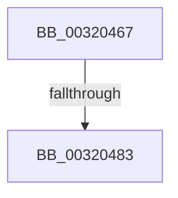

# sub_00320467

- RVA: `0x00320467`–`0x003204B2` (길이 `75` bytes)
- VA: `0x0000000140320467`
- 실행 섹션: `.text`
- PDB 이름 있음: `아니요`; PDB Function 태그: `아니요`
- unwind 정보 RVA: `0x000755DC`
- 디코드: `21`개 명령, `75/75` bytes 표시
- 미해석 바이트: `0` (있으면 어셈블리에 `.byte`로 보존)

> 이 문서는 커널 이미지의 기계어와 PDB 기호를 분석해 생성했습니다. 4번과 5번은 함수 원형과 자료형을 바이너리 사용 방식에서 추정한 C 해석이며 원본 소스 복구 결과는 아닙니다.

## 1. Dependencies

- 직접 호출 지점: **0**; 고유 호출 대상: **0**
- 직접 호출자로 확인된 함수: **0**
- RIP 상대 이미지 참조: **1**

### Outgoing calls
- 직접 디코드된 call 명령이 없습니다.

### Direct callers
- 이 함수 시작 RVA로 연결되는 직접 call은 확인되지 않았습니다. 간접 호출은 완전히 역산할 수 없습니다.

### Static image references
- `0x0032046C` → RVA `0x00E38D10` (`.data`; read)

## 2. Other-region calls and transfers

- 다른 실행 섹션으로 향하는 call: **0**
- call이 아닌 외부 분기/꼬리 이동: **2**
  - `0x00320481` → [sub_00320502](Unknown_function_00320502.md) (`tail-transfer`)
  - `0x003204B0` → [sub_003204B2 + 0x16](Unknown_function_003204B2.md) (`tail-transfer`)

## 3. Assembly (complete function range)

```asm
00320467  48 89 5C 24 10                  mov qword ptr [rsp + 0x10], rbx
0032046C  4C 03 05 9D 88 B1 00            add r8, qword ptr [rip + 0xb1889d]
00320473  48 89 3C 24                     mov qword ptr [rsp], rdi
00320477  41 8B 88 50 3B 00 00            mov ecx, dword ptr [r8 + 0x3b50]
0032047E  F6 C1 01                        test cl, 1
00320481  75 7F                           jne 0x140320502
00320483  45 32 C0                        xor r8b, r8b
00320486  48 8B 3C 24                     mov rdi, qword ptr [rsp]
0032048A  83 E2 03                        and edx, 3
0032048D  48 8B 5C 24 10                  mov rbx, qword ptr [rsp + 0x10]
00320492  83 CA 04                        or edx, 4
00320495  C1 E2 07                        shl edx, 7
00320498  83 E0 3F                        and eax, 0x3f
0032049B  0B D0                           or edx, eax
0032049D  41 83 E0 01                     and r8d, 1
003204A1  03 D2                           add edx, edx
003204A3  41 0B D0                        or edx, r8d
003204A6  C1 E2 08                        shl edx, 8
003204A9  41 89 51 08                     mov dword ptr [r9 + 8], edx
003204AD  4D 85 D2                        test r10, r10
003204B0  74 16                           je 0x1403204c8
```

## 4. C-style interpretation (structured pseudocode)

```c
__int64 __fastcall sub_00320467(__int64 a1, int a2, __int64 a3, __int64 a4)
{
    __int64 result;
    unsigned __int64 v_stack_p0;
    unsigned __int64 v_stack_p10;

    v_stack_p10 = v_rbx;
    a3 = (a3) + (*(unsigned __int64 *)(v_rip + 11634845));
    v_stack_p0 = v_rdi;
    a3 = 0;
    a2 = (unsigned int)((a2) & (3));
    a2 = (unsigned int)((a2) | (4));
    a2 = (unsigned int)((a2) << (7));
    result = (unsigned int)((result) & (63));
    a2 = (unsigned int)((a2) | ((unsigned int)(result)));
    a3 = (unsigned int)((a3) & (1));
    a2 = (unsigned int)((a2) + (a2));
    a2 = (unsigned int)((a2) | ((unsigned int)(a3)));
    a2 = (unsigned int)((a2) << (8));
    *(unsigned int *)(a4 + 8) = a2;
}
```

## 5. (Beta) C Style

```c
int64_t sub_00320467(int64_t Arg1, int32_t Arg2, void *Arg3, void *Arg4)
{
    uint8_t *arg3 = (uint8_t *)Arg3;
    uint8_t *arg4 = (uint8_t *)Arg4;

    int64_t result;
    uint64_t v_stack_p0;
    uint64_t v_stack_p10;

    v_stack_p10 = local_rbx;
    Arg3 = (Arg3) + (*(uint64_t *)(v_rip + 0xB1889D));
    v_stack_p0 = local_rdi;
    Arg3 = 0;
    Arg2 = (uint32_t)((Arg2) & (3));
    Arg2 = (uint32_t)((Arg2) | (4));
    Arg2 = (uint32_t)((Arg2) << (7));
    result = (uint32_t)((result) & (63));
    Arg2 = (uint32_t)((Arg2) | ((uint32_t)(result)));
    Arg3 = (uint32_t)((Arg3) & (1));
    Arg2 = (uint32_t)((Arg2) + (Arg2));
    Arg2 = (uint32_t)((Arg2) | ((uint32_t)(Arg3)));
    Arg2 = (uint32_t)((Arg2) << (8));
    *(uint32_t *)(arg4 + 0x8) = Arg2;
}
```

### 관측된 메모리 오프셋

구조체 형식이 확인되지 않은 접근은 인자 기준의 오프셋으로만 기록했습니다.

| 기준 인자 | 오프셋 표현 | 폭 (bit) | 접근 |
|---|---:|---:|---|
| `Arg3` | `+ 0x3B50` | `32` | `R` |
| `Arg4` | `+ 0x8` | `32` | `W` |

## 6. Execution-region graph

[열기: 2D/3D 그래프와 함수 탐색 컨트롤 패널](../../../control-panel.html?section=text&rva=0x00320467&view=graph)

- 2D 그래프는 위에서 아래로 흐르고, 3D 그래프는 빈 공간을 드래그해 회전합니다. Shift+드래그는 이동, 휠은 확대·축소, 함수 노드 선택은 대상 보고서 이동입니다.

### Static fallback


