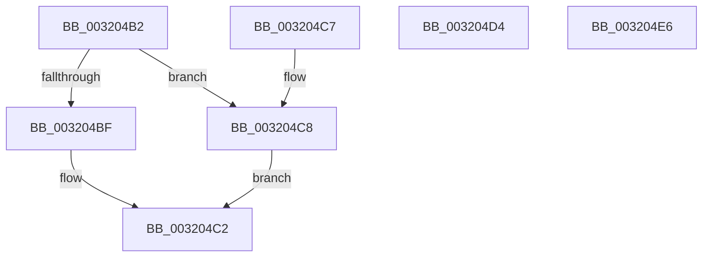

# sub_003204B2

- RVA: `0x003204B2`–`0x00320502` (길이 `80` bytes)
- VA: `0x00000001403204B2`
- 실행 섹션: `.text`
- PDB 이름 있음: `아니요`; PDB Function 태그: `아니요`
- unwind 정보 RVA: `0x000755F4`
- 디코드: `18`개 명령, `80/80` bytes 표시
- 미해석 바이트: `0` (있으면 어셈블리에 `.byte`로 보존)

> 이 문서는 커널 이미지의 기계어와 PDB 기호를 분석해 생성했습니다. 4번과 5번은 함수 원형과 자료형을 바이너리 사용 방식에서 추정한 C 해석이며 원본 소스 복구 결과는 아닙니다.

## 1. Dependencies

- 직접 호출 지점: **0**; 고유 호출 대상: **0**
- 직접 호출자로 확인된 함수: **0**
- RIP 상대 이미지 참조: **0**

### Outgoing calls
- 직접 디코드된 call 명령이 없습니다.

### Direct callers
- 이 함수 시작 RVA로 연결되는 직접 call은 확인되지 않았습니다. 간접 호출은 완전히 역산할 수 없습니다.

### Static image references
- 디코드된 RIP-relative 메모리 참조가 없습니다.

## 2. Other-region calls and transfers

- 다른 실행 섹션으로 향하는 call: **0**
- call이 아닌 외부 분기/꼬리 이동: **2**
  - `0x003204E1` → [MiInitializePageColorBase + 0x4E](MiInitializePageColorBase_function_00320410.md) (`tail-transfer`)
  - `0x003204FD` → [MiInitializePageColorBase + 0x4E](MiInitializePageColorBase_function_00320410.md) (`tail-transfer`)

## 3. Assembly (complete function range)

```asm
003204B2  41 8B 82 B8 00 00 00            mov eax, dword ptr [r10 + 0xb8]
003204B9  24 0F                           and al, 0xf
003204BB  3C 01                           cmp al, 1
003204BD  73 09                           jae 0x1403204c8
003204BF  4D 89 11                        mov qword ptr [r9], r10
003204C2  48 83 C4 08                     add rsp, 8
003204C6  C3                              ret
003204C7  CC                              int3
003204C8  49 8D 83 50 87 00 00            lea rax, [r11 + 0x8750]
003204CF  49 89 01                        mov qword ptr [r9], rax
003204D2  EB EE                           jmp 0x1403204c2
003204D4  65 4C 8B 1C 25 20 00 00 00      mov r11, qword ptr gs:[0x20]
003204DD  41 8D 40 FF                     lea eax, [r8 - 1]
003204E1  E9 78 FF FF FF                  jmp 0x14032045e
003204E6  48 8B 81 B8 00 00 00            mov rax, qword ptr [rcx + 0xb8]
003204ED  65 4C 8B 1C 25 20 00 00 00      mov r11, qword ptr gs:[0x20]
003204F6  0F B7 80 04 01 00 00            movzx eax, word ptr [rax + 0x104]
003204FD  E9 5C FF FF FF                  jmp 0x14032045e
```

## 4. C-style interpretation (structured pseudocode)

```c
__int64 __fastcall sub_003204B2(__int64 a1, __int64 a2, __int64 a3, __int64 a4)
{
    __int64 result;
    __int64 v_rsp;

    result = (unsigned __int8)(((unsigned int)(*(unsigned int *)(v_r10 + 184))) & (15));
    if (((unsigned __int8)(result)) >= 1) goto loc_003204C8;
    *(unsigned __int64 *)(a4) = v_r10;
loc_003204C2:
    v_rsp = (v_rsp) + (8);
    return result;
loc_003204C8:
    *(unsigned __int64 *)(a4) = v_r11 + 34640;
    goto loc_003204C2;
}
```

## 5. (Beta) C Style

```c
int64_t sub_003204B2(int64_t Arg1, int64_t Arg2, int64_t Arg3, void *Arg4)
{
    uint8_t *arg4 = (uint8_t *)Arg4;

    int64_t result;
    int64_t local_rsp;

    result = (uint8_t)(((uint32_t)(*(uint32_t *)(local_r10 + 0xB8))) & (15));
    if (((uint8_t)(result)) >= 1) goto loc_003204C8;
    *(uint64_t *)(arg4) = local_r10;
loc_003204C2:
    local_rsp = (local_rsp) + (8);
    return result;
loc_003204C8:
    *(uint64_t *)(arg4) = local_r11 + 34640;
    goto loc_003204C2;
}
```

### 관측된 메모리 오프셋

구조체 형식이 확인되지 않은 접근은 인자 기준의 오프셋으로만 기록했습니다.

| 기준 인자 | 오프셋 표현 | 폭 (bit) | 접근 |
|---|---:|---:|---|
| `Arg4` | `+ 0x0` | `64` | `W` |

## 6. Execution-region graph

[열기: 2D/3D 그래프와 함수 탐색 컨트롤 패널](../../../control-panel.html?section=text&rva=0x003204B2&view=graph)

- 2D 그래프는 위에서 아래로 흐르고, 3D 그래프는 빈 공간을 드래그해 회전합니다. Shift+드래그는 이동, 휠은 확대·축소, 함수 노드 선택은 대상 보고서 이동입니다.

### Static fallback


