# sub_00320540

- RVA: `0x00320540`–`0x00320843` (길이 `771` bytes)
- VA: `0x0000000140320540`
- 실행 섹션: `.text`
- PDB 이름 있음: `아니요`; PDB Function 태그: `아니요`
- unwind 정보 RVA: `0x00075650`
- 디코드: `177`개 명령, `771/771` bytes 표시
- 미해석 바이트: `0` (있으면 어셈블리에 `.byte`로 보존)

> 이 문서는 커널 이미지의 기계어와 PDB 기호를 분석해 생성했습니다. 4번과 5번은 함수 원형과 자료형을 바이너리 사용 방식에서 추정한 C 해석이며 원본 소스 복구 결과는 아닙니다.

## 1. Dependencies

- 직접 호출 지점: **2**; 고유 호출 대상: **2**
- 직접 호출자로 확인된 함수: **0**
- RIP 상대 이미지 참조: **1**

### Outgoing calls
- `0x00320636` → [MiComputeMaximumFaultCluster](../41/MiComputeMaximumFaultCluster_function_00418210.md) (function, `0x00418210`)
- `0x00320716` → [MiResolveProtoPteFault](MiResolveProtoPteFault_function_00321750.md) (function, `0x00321750`)

### Direct callers
- 이 함수 시작 RVA로 연결되는 직접 call은 확인되지 않았습니다. 간접 호출은 완전히 역산할 수 없습니다.

### Static image references
- `0x0032065B` → RVA `0x00E2F1AC` (`.data`; read)

## 2. Other-region calls and transfers

- 다른 실행 섹션으로 향하는 call: **0**
- call이 아닌 외부 분기/꼬리 이동: **14**
  - `0x00320621` → [sub_00320866 + 0x420](Unknown_function_00320866.md) (`tail-transfer`)
  - `0x00320644` → [sub_00320866 + 0x187](Unknown_function_00320866.md) (`tail-transfer`)
  - `0x00320690` → [sub_00320866 + 0x1A](Unknown_function_00320866.md) (`tail-transfer`)
  - `0x003206BC` → [sub_00320866 + 0x11F](Unknown_function_00320866.md) (`tail-transfer`)
  - `0x003206C5` → [sub_00320866 + 0x290](Unknown_function_00320866.md) (`tail-transfer`)
  - `0x003206CE` → [sub_00320866 + 0x290](Unknown_function_00320866.md) (`tail-transfer`)
  - `0x003206E1` → [sub_00320866 + 0x1BC](Unknown_function_00320866.md) (`tail-transfer`)
  - `0x003206EC` → [sub_00320866 + 0x2EF](Unknown_function_00320866.md) (`tail-transfer`)
  - `0x003206F9` → [sub_00320866 + 0x199](Unknown_function_00320866.md) (`tail-transfer`)
  - `0x00320704` → [sub_00320866 + 0x221](Unknown_function_00320866.md) (`tail-transfer`)
  - `0x0032074F` → [sub_00320866 + 0x4D0](Unknown_function_00320866.md) (`tail-transfer`)
  - `0x00320774` → [sub_00320866 + 0x592](Unknown_function_00320866.md) (`tail-transfer`)
  - `0x0032078A` → [sub_00320866](Unknown_function_00320866.md) (`tail-transfer`)
  - `0x00320841` → [sub_00320843 + 0x19](Unknown_function_00320843.md) (`tail-transfer`)

## 3. Assembly (complete function range)

```asm
00320540  49 89 73 18                     mov qword ptr [r11 + 0x18], rsi
00320544  48 B8 F8 FF FF FF 7F 00 00 00   movabs rax, 0x7ffffffff8
0032054E  49 89 7B E0                     mov qword ptr [r11 - 0x20], rdi
00320552  48 8B DA                        mov rbx, rdx
00320555  4D 89 63 D8                     mov qword ptr [r11 - 0x28], r12
00320559  48 8B F9                        mov rdi, rcx
0032055C  45 33 E4                        xor r12d, r12d
0032055F  4D 89 6B D0                     mov qword ptr [r11 - 0x30], r13
00320563  4C 89 22                        mov qword ptr [rdx], r12
00320566  0F 10 41 20                     movups xmm0, xmmword ptr [rcx + 0x20]
0032056A  48 8B 71 08                     mov rsi, qword ptr [rcx + 8]
0032056E  0F 10 49 50                     movups xmm1, xmmword ptr [rcx + 0x50]
00320572  4D 89 7B C8                     mov qword ptr [r11 - 0x38], r15
00320576  83 E6 02                        and esi, 2
00320579  0F 10 19                        movups xmm3, xmmword ptr [rcx]
0032057C  48 89 54 24 60                  mov qword ptr [rsp + 0x60], rdx
00320581  0F 10 51 30                     movups xmm2, xmmword ptr [rcx + 0x30]
00320585  48 89 4C 24 58                  mov qword ptr [rsp + 0x58], rcx
0032058A  0F 10 61 10                     movups xmm4, xmmword ptr [rcx + 0x10]
0032058E  4C 89 64 24 38                  mov qword ptr [rsp + 0x38], r12
00320593  0F 29 45 A0                     movaps xmmword ptr [rbp - 0x60], xmm0
00320597  66 49 0F 7E DF                  movq r15, xmm3
0032059C  0F 10 41 40                     movups xmm0, xmmword ptr [rcx + 0x40]
003205A0  49 C1 EF 09                     shr r15, 9
003205A4  0F 29 4D D0                     movaps xmmword ptr [rbp - 0x30], xmm1
003205A8  4C 23 F8                        and r15, rax
003205AB  0F 10 49 70                     movups xmm1, xmmword ptr [rcx + 0x70]
003205AF  48 89 74 24 40                  mov qword ptr [rsp + 0x40], rsi
003205B4  0F 29 45 C0                     movaps xmmword ptr [rbp - 0x40], xmm0
003205B8  0F 10 41 60                     movups xmm0, xmmword ptr [rcx + 0x60]
003205BC  48 B8 00 00 00 00 80 F6 FF FF   movabs rax, 0xfffff68000000000
003205C6  0F 29 55 B0                     movaps xmmword ptr [rbp - 0x50], xmm2
003205CA  F3 0F 7E 51 38                  movq xmm2, qword ptr [rcx + 0x38]
003205CF  0F 29 45 E0                     movaps xmmword ptr [rbp - 0x20], xmm0
003205D3  0F 10 81 80 00 00 00            movups xmm0, xmmword ptr [rcx + 0x80]
003205DA  0F 29 4D F0                     movaps xmmword ptr [rbp - 0x10], xmm1
003205DE  F2 0F 10 89 90 00 00 00         movsd xmm1, qword ptr [rcx + 0x90]
003205E6  0F 29 45 00                     movaps xmmword ptr [rbp], xmm0
003205EA  0F 29 5D 80                     movaps xmmword ptr [rbp - 0x80], xmm3
003205EE  0F 29 65 90                     movaps xmmword ptr [rbp - 0x70], xmm4
003205F2  F2 0F 11 4D 10                  movsd qword ptr [rbp + 0x10], xmm1
003205F7  66 0F D6 54 24 30               movq qword ptr [rsp + 0x30], xmm2
003205FD  48 8B C0                        mov rax, rax
00320600  4C 03 F8                        add r15, rax
00320603  45 8B F4                        mov r14d, r12d
00320606  66 0F 7E E0                     movd eax, xmm4
0032060A  A8 01                           test al, 1
0032060C  75 05                           jne 0x140320613
0032060E  4D 8B EC                        mov r13, r12
00320611  EB 18                           jmp 0x14032062b
00320613  4C 8B 6D 90                     mov r13, qword ptr [rbp - 0x70]
00320617  49 8B C5                        mov rax, r13
0032061A  48 83 E0 FE                     and rax, 0xfffffffffffffffe
0032061E  80 38 05                        cmp byte ptr [rax], 5
00320621  0F 85 5F 06 00 00               jne 0x140320c86
00320627  49 83 E5 FE                     and r13, 0xfffffffffffffffe
0032062B  33 D2                           xor edx, edx
0032062D  4C 89 64 24 48                  mov qword ptr [rsp + 0x48], r12
00320632  48 8D 4D 80                     lea rcx, [rbp - 0x80]
00320636  E8 D5 7B 0F 00                  call 0x140418210
0032063B  48 89 44 24 50                  mov qword ptr [rsp + 0x50], rax
00320640  48 83 F8 01                     cmp rax, 1
00320644  0F 86 A3 03 00 00               jbe 0x1403209ed
0032064A  80 4D C5 08                     or byte ptr [rbp - 0x3b], 8
0032064E  80 65 C5 FB                     and byte ptr [rbp - 0x3b], 0xfb
00320652  48 8B 7C 24 30                  mov rdi, qword ptr [rsp + 0x30]
00320657  F6 45 C5 10                     test byte ptr [rbp - 0x3b], 0x10
0032065B  48 8D 1D 4A EB B0 00            lea rbx, [rip + 0xb0eb4a]
00320662  48 B9 F8 D7 BE 7D FB F6 FF FF   movabs rcx, 0xfffff6fb7dbed7f8
0032066C  41 BB 01 00 00 00               mov r11d, 1
00320672  49 BA FF DF BE 7D FB F6 FF FF   movabs r10, 0xfffff6fb7dbedfff
0032067C  49 B8 00 D0 BE 7D FB F6 FF FF   movabs r8, 0xfffff6fb7dbed000
00320686  49 B9 68 DF BE 7D FB F6 FF FF   movabs r9, 0xfffff6fb7dbedf68
00320690  0F 85 EA 01 00 00               jne 0x140320880
00320696  49 8B 1F                        mov rbx, qword ptr [r15]
00320699  49 8B C0                        mov rax, r8
0032069C  4C 3B F8                        cmp r15, rax
0032069F  72 21                           jb 0x1403206c2
003206A1  48 8B C1                        mov rax, rcx
003206A4  4C 3B F8                        cmp r15, rax
003206A7  77 19                           ja 0x1403206c2
003206A9  F6 C3 01                        test bl, 1
003206AC  74 14                           je 0x1403206c2
003206AE  F6 C3 42                        test bl, 0x42
003206B1  0F 95 C1                        setne cl
003206B4  F6 C3 20                        test bl, 0x20
003206B7  0F 95 C0                        setne al
003206BA  84 C8                           test al, cl
003206BC  0F 84 C3 02 00 00               je 0x140320985
003206C2  48 85 DB                        test rbx, rbx
003206C5  0F 84 2B 04 00 00               je 0x140320af6
003206CB  F6 C3 01                        test bl, 1
003206CE  0F 85 22 04 00 00               jne 0x140320af6
003206D4  C7 44 24 30 00 01 00 00         mov dword ptr [rsp + 0x30], 0x100
003206DC  48 0F BA E3 0A                  bt rbx, 0xa
003206E1  0F 83 3B 03 00 00               jae 0x140320a22
003206E7  48 83 7D E8 00                  cmp qword ptr [rbp - 0x18], 0
003206EC  0F 84 63 04 00 00               je 0x140320b55
003206F2  0F B6 4D 90                     movzx ecx, byte ptr [rbp - 0x70]
003206F6  F6 C1 01                        test cl, 1
003206F9  0F 85 00 03 00 00               jne 0x1403209ff
003206FF  48 0F BA E3 0A                  bt rbx, 0xa
00320704  0F 83 7D 03 00 00               jae 0x140320a87
0032070A  4C 8D 44 24 38                  lea r8, [rsp + 0x38]
0032070F  48 8B D6                        mov rdx, rsi
00320712  48 8D 4D 80                     lea rcx, [rbp - 0x80]
00320716  E8 35 10 00 00                  call 0x140321750
0032071B  8B C8                           mov ecx, eax
0032071D  0F B6 45 C5                     movzx eax, byte ptr [rbp - 0x3b]
00320721  A8 10                           test al, 0x10
00320723  44 0F 44 F1                     cmove r14d, ecx
00320727  85 C9                           test ecx, ecx
00320729  78 6E                           js 0x140320799
0032072B  48 8B 5C 24 48                  mov rbx, qword ptr [rsp + 0x48]
00320730  0C 10                           or al, 0x10
00320732  48 81 45 80 00 10 00 00         add qword ptr [rbp - 0x80], 0x1000
0032073A  48 FF C3                        inc rbx
0032073D  49 83 C7 08                     add r15, 8
00320741  88 45 C5                        mov byte ptr [rbp - 0x3b], al
00320744  4C 89 7D 98                     mov qword ptr [rbp - 0x68], r15
00320748  48 89 5C 24 48                  mov qword ptr [rsp + 0x48], rbx
0032074D  A8 04                           test al, 4
0032074F  0F 85 E1 05 00 00               jne 0x140320d36
00320755  48 8B 4C 24 50                  mov rcx, qword ptr [rsp + 0x50]
0032075A  45 33 E4                        xor r12d, r12d
0032075D  48 8B 75 90                     mov rsi, qword ptr [rbp - 0x70]
00320761  48 8B C6                        mov rax, rsi
00320764  4C 89 65 E8                     mov qword ptr [rbp - 0x18], r12
00320768  83 E0 01                        and eax, 1
0032076B  74 0D                           je 0x14032077a
0032076D  48 83 E6 FE                     and rsi, 0xfffffffffffffffe
00320771  80 3E 02                        cmp byte ptr [rsi], 2
00320774  0F 84 7E 06 00 00               je 0x140320df8
0032077A  48 83 65 88 FD                  and qword ptr [rbp - 0x78], 0xfffffffffffffffd
0032077F  49 8B F4                        mov rsi, r12
00320782  4C 89 64 24 40                  mov qword ptr [rsp + 0x40], r12
00320787  48 85 C0                        test rax, rax
0032078A  0F 85 D6 00 00 00               jne 0x140320866
00320790  48 3B D9                        cmp rbx, rcx
00320793  0F 82 BE FE FF FF               jb 0x140320657
00320799  48 8B 7C 24 58                  mov rdi, qword ptr [rsp + 0x58]
0032079E  48 8B 5C 24 60                  mov rbx, qword ptr [rsp + 0x60]
003207A3  0F 10 57 38                     movups xmm2, xmmword ptr [rdi + 0x38]
003207A7  8B 57 50                        mov edx, dword ptr [rdi + 0x50]
003207AA  0F B6 45 C5                     movzx eax, byte ptr [rbp - 0x3b]
003207AE  83 E2 E0                        and edx, 0xffffffe0
003207B1  0F 10 4D B8                     movups xmm1, xmmword ptr [rbp - 0x48]
003207B5  24 03                           and al, 3
003207B7  4C 8B BC 24 30 01 00 00         mov r15, qword ptr [rsp + 0x130]
003207BF  F2 0F 10 45 C8                  movsd xmm0, qword ptr [rbp - 0x38]
003207C4  4C 8B AC 24 38 01 00 00         mov r13, qword ptr [rsp + 0x138]
003207CC  4C 8B A4 24 40 01 00 00         mov r12, qword ptr [rsp + 0x140]
003207D4  48 8B B4 24 80 01 00 00         mov rsi, qword ptr [rsp + 0x180]
003207DC  0F 11 4F 38                     movups xmmword ptr [rdi + 0x38], xmm1
003207E0  F2 0F 11 47 48                  movsd qword ptr [rdi + 0x48], xmm0
003207E5  66 0F 73 DA 08                  psrldq xmm2, 8
003207EA  66 48 0F 7E D1                  movq rcx, xmm2
003207EF  48 C1 E9 28                     shr rcx, 0x28
003207F3  80 E1 FC                        and cl, 0xfc
003207F6  0A C8                           or cl, al
003207F8  48 8B 45 F8                     mov rax, qword ptr [rbp - 8]
003207FC  88 4F 45                        mov byte ptr [rdi + 0x45], cl
003207FF  48 8B 4D 08                     mov rcx, qword ptr [rbp + 8]
00320803  48 89 47 78                     mov qword ptr [rdi + 0x78], rax
00320807  48 8B 45 00                     mov rax, qword ptr [rbp]
0032080B  48 89 8F 88 00 00 00            mov qword ptr [rdi + 0x88], rcx
00320812  8B 4D D0                        mov ecx, dword ptr [rbp - 0x30]
00320815  48 89 87 80 00 00 00            mov qword ptr [rdi + 0x80], rax
0032081C  83 E1 1F                        and ecx, 0x1f
0032081F  48 8B 45 10                     mov rax, qword ptr [rbp + 0x10]
00320823  0B D1                           or edx, ecx
00320825  48 89 87 90 00 00 00            mov qword ptr [rdi + 0x90], rax
0032082C  41 8B C6                        mov eax, r14d
0032082F  89 57 50                        mov dword ptr [rdi + 0x50], edx
00320832  48 8B BC 24 48 01 00 00         mov rdi, qword ptr [rsp + 0x148]
0032083A  41 81 FE 33 33 03 C0            cmp r14d, 0xc0033333
00320841  74 19                           je 0x14032085c
```

## 4. C-style interpretation (structured pseudocode)

```c
__int64 __fastcall sub_00320540(__int64 a1, __int64 a2, __int64 a3, __int64 a4, __int64 a5, __int64 a6, __int64 a7, __int64 a8, __int64 a9, __int64 a10, __int64 a11, __int64 a12, __int64 a13, __int64 a14, __int64 a15, __int64 a16, __int64 a17, __int64 a18, __int64 a19, __int64 a20, __int64 a21, __int64 a22, __int64 a23, __int64 a24, __int64 a25, __int64 a26, __int64 a27, __int64 a28, __int64 a29, __int64 a30, __int64 a31, __int64 a32, __int64 a33, __int64 a34, __int64 a35, __int64 a36, __int64 a37, __int64 a38, __int64 a39, __int64 a40, __int64 a41, __int64 a42, __int64 a43, __int64 a44, __int64 a45, __int64 a46, __int64 a47, __int64 a48)
{
    __int64 result;
    __int64 v_r12;
    __int64 v_r13;
    __int64 v_r14;
    __int64 v_r15;
    __int64 v_rbx;
    __int64 v_rsi;
    unsigned int v_stack_p30;
    unsigned __int64 v_stack_p38;
    unsigned __int64 v_stack_p40;
    unsigned __int64 v_stack_p48;
    unsigned __int64 v_stack_p50;
    unsigned __int64 v_stack_p58;
    unsigned __int64 v_stack_p60;

    *(unsigned __int64 *)(v_r11 + 24) = v_rsi;
    *(unsigned __int64 *)(v_r11 - 32) = v_rdi;
    *(unsigned __int64 *)(v_r11 - 40) = v_r12;
    v_r12 = 0;
    *(unsigned __int64 *)(v_r11 - 48) = v_r13;
    *(unsigned __int64 *)(a2) = 0;
    *(unsigned __int64 *)(v_r11 - 56) = v_r15;
    v_rsi = (unsigned int)((*(unsigned __int64 *)(a1 + 8)) & (2));
    v_stack_p60 = a2;
    v_stack_p58 = a1;
    v_stack_p38 = 0;
    *(unsigned __int64 *)(v_rbp - 96) = v_xmm0;
    v_r15 = (v_r15) >> (9);
    *(unsigned __int64 *)(v_rbp - 48) = v_xmm1;
    v_r15 = (v_r15) & (result);
    v_stack_p40 = v_rsi;
    *(unsigned __int64 *)(v_rbp - 64) = v_xmm0;
    *(unsigned __int64 *)(v_rbp - 80) = v_xmm2;
    *(unsigned __int64 *)(v_rbp - 32) = v_xmm0;
    *(unsigned __int64 *)(v_rbp - 16) = v_xmm1;
    *(unsigned __int64 *)(v_rbp) = v_xmm0;
    *(unsigned __int64 *)(v_rbp - 128) = v_xmm3;
    *(unsigned __int64 *)(v_rbp - 112) = v_xmm4;
    *(unsigned __int64 *)(v_rbp + 16) = v_xmm1;
    a6 = v_xmm2;
    v_r15 = (v_r15) + (result);
    if ((((unsigned __int8)(result)) & (1)) != 0) goto loc_00320613;
    goto loc_0032062B;
loc_00320613:
    result = (*(unsigned __int64 *)(v_rbp - 112)) & (-2);
    v_r13 = (*(unsigned __int64 *)(v_rbp - 112)) & (-2);
loc_0032062B:
    a2 = 0;
    v_stack_p48 = 0;
    result = MiComputeMaximumFaultCluster(v_rbp - 128, a2, a3, a4);
    v_stack_p50 = result;
loc_00320657:
    if (v_r15 < a3) goto loc_003206C2;
    if (v_r15 > (v_rbp - 128)) goto loc_003206C2;
    if ((((unsigned __int8)(*(unsigned __int64 *)(v_r15))) & (1)) == 0) goto loc_003206C2;
    a1 = ((((unsigned __int8)(*(unsigned __int64 *)(v_r15))) & (66)) != 0) ? 1 : 0;
    result = ((((unsigned __int8)(*(unsigned __int64 *)(v_r15))) & (32)) != 0) ? 1 : 0;
loc_003206C2:
    v_stack_p30 = 256;
    result = MiResolveProtoPteFault(v_rbp - 128, v_rsi, a7, a4);
    v_r14 = 0;
    if ((((unsigned __int8)(*(unsigned __int8 *)(v_rbp - 59))) & (16)) == 0) { v_r14 = (unsigned int)((unsigned int)((unsigned int)(result))); }
    if (sign_flag) goto loc_00320799;
    result = (unsigned __int8)((*(unsigned __int8 *)(v_rbp - 59)) | (16));
    v_rbx = (a9) + 1;
    v_r15 = (v_r15) + (8);
    *(unsigned __int8 *)(v_rbp - 59) = (unsigned __int8)(result);
    *(unsigned __int64 *)(v_rbp - 104) = v_r15;
    v_stack_p48 = v_rbx;
    v_r12 = 0;
    *(unsigned __int64 *)(v_rbp - 24) = 0;
    result = (unsigned int)((*(unsigned __int64 *)(v_rbp - 112)) & (1));
    if (condition_is_equal) goto loc_0032077A;
    v_rsi = (*(unsigned __int64 *)(v_rbp - 112)) & (-2);
loc_0032077A:
    v_stack_p40 = 0;
    if (v_rbx < a10) goto loc_00320657;
loc_00320799:
    a2 = (unsigned int)(((unsigned int)(*(unsigned int *)(a11 + 80))) & (0xFFFFFFE0ULL));
    result = (unsigned __int8)((*(unsigned __int8 *)(v_rbp - 59)) & (3));
    *(unsigned __int64 *)(a11 + 56) = v_xmm1;
    *(unsigned __int64 *)(a11 + 72) = v_xmm0;
    a1 = (a10) >> (40);
    a1 = (unsigned __int8)((a1) & (252));
    a1 = (unsigned __int8)((a1) | ((unsigned __int8)(result)));
    *(unsigned __int8 *)(a11 + 69) = (unsigned __int8)(a1);
    *(unsigned __int64 *)(a11 + 120) = *(unsigned __int64 *)(v_rbp - 8);
    *(unsigned __int64 *)(a11 + 136) = *(unsigned __int64 *)(v_rbp + 8);
    *(unsigned __int64 *)(a11 + 128) = *(unsigned __int64 *)(v_rbp);
    a1 = (unsigned int)(((unsigned int)(*(unsigned int *)(v_rbp - 48))) & (31));
    a2 = (unsigned int)((a2) | ((unsigned int)(a1)));
    *(unsigned __int64 *)(a11 + 144) = *(unsigned __int64 *)(v_rbp + 16);
    *(unsigned int *)(a11 + 80) = (unsigned int)(a2);
}
```

## 5. (Beta) C Style

```c
int64_t sub_00320540(void *Arg1, void *Arg2, int64_t Arg3, int64_t Arg4, uint64_t Arg5, int64_t Arg6, int64_t Arg7, uint64_t Arg8, int64_t Arg9, int64_t Arg10, void *Arg11, int64_t Arg12, uint64_t Arg13, uint64_t Arg14, uint64_t Arg15, uint64_t Arg16, uint64_t Arg17, uint64_t Arg18, uint64_t Arg19, uint64_t Arg20, uint64_t Arg21, uint64_t Arg22, uint64_t Arg23, uint64_t Arg24, uint64_t Arg25, uint64_t Arg26, uint64_t Arg27, uint64_t Arg28, uint64_t Arg29, uint64_t Arg30, uint64_t Arg31, uint64_t Arg32, uint64_t Arg33, uint64_t Arg34, uint64_t Arg35, uint64_t Arg36, uint64_t Arg37, int64_t Arg38, int64_t Arg39, int64_t Arg40, int64_t Arg41, uint64_t Arg42, uint64_t Arg43, uint64_t Arg44, uint64_t Arg45, uint64_t Arg46, uint64_t Arg47, int64_t Arg48)
{
    uint8_t *arg1 = (uint8_t *)Arg1;
    uint8_t *arg2 = (uint8_t *)Arg2;
    uint8_t *arg11 = (uint8_t *)Arg11;

    int64_t result;
    int64_t local_r12;
    int64_t local_r13;
    int64_t local_r14;
    int64_t local_r15;
    int64_t local_rbx;
    int64_t local_rsi;
    uint32_t v_stack_p30;
    uint64_t v_stack_p38;
    uint64_t v_stack_p40;
    uint64_t v_stack_p48;
    uint64_t v_stack_p50;
    uint64_t v_stack_p58;
    uint64_t v_stack_p60;

    *(uint64_t *)(local_r11 + 0x18) = local_rsi;
    *(uint64_t *)(local_r11 - 0x20) = local_rdi;
    *(uint64_t *)(local_r11 - 0x28) = local_r12;
    local_r12 = 0;
    *(uint64_t *)(local_r11 - 0x30) = local_r13;
    *(uint64_t *)(arg2) = 0;
    *(uint64_t *)(local_r11 - 0x38) = local_r15;
    local_rsi = (uint32_t)((*(uint64_t *)(arg1 + 0x8)) & (2));
    v_stack_p60 = Arg2;
    v_stack_p58 = Arg1;
    v_stack_p38 = 0;
    *(uint64_t *)(local_rbp - 0x60) = v_xmm0;
    local_r15 = (local_r15) >> (9);
    *(uint64_t *)(local_rbp - 0x30) = v_xmm1;
    local_r15 = (local_r15) & (result);
    v_stack_p40 = local_rsi;
    *(uint64_t *)(local_rbp - 0x40) = v_xmm0;
    *(uint64_t *)(local_rbp - 0x50) = v_xmm2;
    *(uint64_t *)(local_rbp - 0x20) = v_xmm0;
    *(uint64_t *)(local_rbp - 0x10) = v_xmm1;
    *(uint64_t *)(local_rbp) = v_xmm0;
    *(uint64_t *)(local_rbp - 0x80) = v_xmm3;
    *(uint64_t *)(local_rbp - 0x70) = v_xmm4;
    *(uint64_t *)(local_rbp + 0x10) = v_xmm1;
    Arg6 = v_xmm2;
    local_r15 = (local_r15) + (result);
    if ((((uint8_t)(result)) & (1)) != 0) goto loc_00320613;
    goto loc_0032062B;
loc_00320613:
    result = (*(uint64_t *)(local_rbp - 0x70)) & (-2);
    local_r13 = (*(uint64_t *)(local_rbp - 0x70)) & (-2);
loc_0032062B:
    Arg2 = 0;
    v_stack_p48 = 0;
    result = MiComputeMaximumFaultCluster(local_rbp - 128, Arg2, Arg3, Arg4);
    v_stack_p50 = result;
loc_00320657:
    if (local_r15 < Arg3) goto loc_003206C2;
    if (local_r15 > (local_rbp - 128)) goto loc_003206C2;
    if ((((uint8_t)(*(uint64_t *)(local_r15))) & (1)) == 0) goto loc_003206C2;
    Arg1 = ((((uint8_t)(*(uint64_t *)(local_r15))) & (66)) != 0) ? 1 : 0;
    result = ((((uint8_t)(*(uint64_t *)(local_r15))) & (32)) != 0) ? 1 : 0;
loc_003206C2:
    v_stack_p30 = 256;
    result = MiResolveProtoPteFault(local_rbp - 128, local_rsi, Arg7, Arg4);
    local_r14 = 0;
    if ((((uint8_t)(*(uint8_t *)(local_rbp - 0x3B))) & (16)) == 0) { local_r14 = (uint32_t)((uint32_t)((uint32_t)(result))); }
    if (sign_flag) goto loc_00320799;
    result = (uint8_t)((*(uint8_t *)(local_rbp - 0x3B)) | (16));
    local_rbx = (Arg9) + 1;
    local_r15 = (local_r15) + (8);
    *(uint8_t *)(local_rbp - 0x3B) = (uint8_t)(result);
    *(uint64_t *)(local_rbp - 0x68) = local_r15;
    v_stack_p48 = local_rbx;
    local_r12 = 0;
    *(uint64_t *)(local_rbp - 0x18) = 0;
    result = (uint32_t)((*(uint64_t *)(local_rbp - 0x70)) & (1));
    if (condition_is_equal) goto loc_0032077A;
    local_rsi = (*(uint64_t *)(local_rbp - 0x70)) & (-2);
loc_0032077A:
    v_stack_p40 = 0;
    if (local_rbx < Arg10) goto loc_00320657;
loc_00320799:
    Arg2 = (uint32_t)(((uint32_t)(*(uint32_t *)(arg11 + 0x50))) & (0xFFFFFFE0ULL));
    result = (uint8_t)((*(uint8_t *)(local_rbp - 0x3B)) & (3));
    *(uint64_t *)(arg11 + 0x38) = v_xmm1;
    *(uint64_t *)(arg11 + 0x48) = v_xmm0;
    Arg1 = (Arg10) >> (40);
    Arg1 = (uint8_t)((Arg1) & (252));
    Arg1 = (uint8_t)((Arg1) | ((uint8_t)(result)));
    *(uint8_t *)(arg11 + 0x45) = (uint8_t)(Arg1);
    *(uint64_t *)(arg11 + 0x78) = *(uint64_t *)(local_rbp - 0x8);
    *(uint64_t *)(arg11 + 0x88) = *(uint64_t *)(local_rbp + 0x8);
    *(uint64_t *)(arg11 + 0x80) = *(uint64_t *)(local_rbp);
    Arg1 = (uint32_t)(((uint32_t)(*(uint32_t *)(local_rbp - 0x30))) & (31));
    Arg2 = (uint32_t)((Arg2) | ((uint32_t)(Arg1)));
    *(uint64_t *)(arg11 + 0x90) = *(uint64_t *)(local_rbp + 0x10);
    *(uint32_t *)(arg11 + 0x50) = (uint32_t)(Arg2);
}
```

### 관측된 메모리 오프셋

구조체 형식이 확인되지 않은 접근은 인자 기준의 오프셋으로만 기록했습니다.

| 기준 인자 | 오프셋 표현 | 폭 (bit) | 접근 |
|---|---:|---:|---|
| `Arg1` | `+ 0x0` | `128` | `R` |
| `Arg1` | `+ 0x8` | `64` | `R` |
| `Arg1` | `+ 0x10` | `128` | `R` |
| `Arg1` | `+ 0x20` | `128` | `R` |
| `Arg1` | `+ 0x30` | `128` | `R` |
| `Arg1` | `+ 0x38` | `64` | `R` |
| `Arg1` | `+ 0x40` | `128` | `R` |
| `Arg1` | `+ 0x50` | `128` | `R` |
| `Arg1` | `+ 0x60` | `128` | `R` |
| `Arg1` | `+ 0x70` | `128` | `R` |
| `Arg1` | `+ 0x80` | `128` | `R` |
| `Arg1` | `+ 0x90` | `64` | `R` |
| `Arg2` | `+ 0x0` | `64` | `W` |
| `Arg11` | `+ 0x38` | `128` | `R` |
| `Arg11` | `+ 0x45` | `8` | `W` |
| `Arg11` | `+ 0x48` | `64` | `W` |
| `Arg11` | `+ 0x50` | `32` | `R` |
| `Arg11` | `+ 0x50` | `32` | `W` |
| `Arg11` | `+ 0x78` | `64` | `W` |
| `Arg11` | `+ 0x80` | `64` | `W` |
| `Arg11` | `+ 0x88` | `64` | `W` |
| `Arg11` | `+ 0x90` | `64` | `W` |

## 6. Execution-region graph

[열기: 2D/3D 그래프와 함수 탐색 컨트롤 패널](../../../control-panel.html?section=text&rva=0x00320540&view=graph)

- 2D 그래프는 위에서 아래로 흐르고, 3D 그래프는 빈 공간을 드래그해 회전합니다. Shift+드래그는 이동, 휠은 확대·축소, 함수 노드 선택은 대상 보고서 이동입니다.

### Static fallback

```mermaid
flowchart TD
  bb_00320540[BB_00320540]
  bb_0032060E[BB_0032060E]
  bb_00320613[BB_00320613]
  bb_00320627[BB_00320627]
  bb_0032062B[BB_0032062B]
  bb_0032064A[BB_0032064A]
  bb_00320657[BB_00320657]
  bb_00320696[BB_00320696]
  bb_003206A1[BB_003206A1]
  bb_003206A9[BB_003206A9]
  bb_003206AE[BB_003206AE]
  bb_003206C2[BB_003206C2]
  bb_003206CB[BB_003206CB]
  bb_003206D4[BB_003206D4]
  bb_003206E7[BB_003206E7]
  bb_003206F2[BB_003206F2]
  bb_003206FF[BB_003206FF]
  bb_0032070A[BB_0032070A]
  bb_0032072B[BB_0032072B]
  bb_00320755[BB_00320755]
  bb_0032076D[BB_0032076D]
  bb_0032077A[BB_0032077A]
  bb_00320790[BB_00320790]
  bb_00320799[BB_00320799]
  bb_00320540 -->|branch| bb_00320613
  bb_00320540 -->|fallthrough| bb_0032060E
  bb_0032060E -->|branch| bb_0032062B
  bb_00320613 -->|fallthrough| bb_00320627
  bb_00320627 -->|flow| bb_0032062B
  bb_0032062B -->|fallthrough| bb_0032064A
  bb_0032064A -->|flow| bb_00320657
  bb_00320657 -->|fallthrough| bb_00320696
  bb_00320696 -->|branch| bb_003206C2
  bb_00320696 -->|fallthrough| bb_003206A1
  bb_003206A1 -->|branch| bb_003206C2
  bb_003206A1 -->|fallthrough| bb_003206A9
  bb_003206A9 -->|branch| bb_003206C2
  bb_003206A9 -->|fallthrough| bb_003206AE
  bb_003206AE -->|fallthrough| bb_003206C2
  bb_003206C2 -->|fallthrough| bb_003206CB
  bb_003206CB -->|fallthrough| bb_003206D4
  bb_003206D4 -->|fallthrough| bb_003206E7
  bb_003206E7 -->|fallthrough| bb_003206F2
  bb_003206F2 -->|fallthrough| bb_003206FF
  bb_003206FF -->|fallthrough| bb_0032070A
  bb_0032070A -->|branch| bb_00320799
  bb_0032070A -->|fallthrough| bb_0032072B
  bb_0032072B -->|fallthrough| bb_00320755
  bb_00320755 -->|branch| bb_0032077A
  bb_00320755 -->|fallthrough| bb_0032076D
  bb_0032076D -->|fallthrough| bb_0032077A
  bb_0032077A -->|fallthrough| bb_00320790
  bb_00320790 -->|branch| bb_00320657
  bb_00320790 -->|fallthrough| bb_00320799
```


