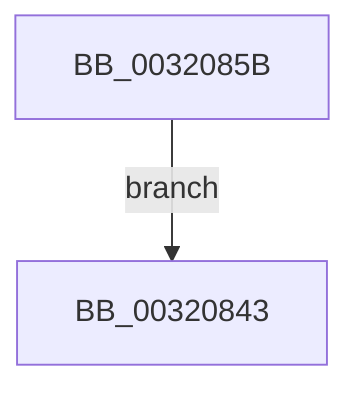

# sub_00320843

- RVA: `0x00320843`–`0x00320866` (길이 `35` bytes)
- VA: `0x0000000140320843`
- 실행 섹션: `.text`
- PDB 이름 있음: `아니요`; PDB Function 태그: `아니요`
- unwind 정보 RVA: `0x00075674`
- 디코드: `12`개 명령, `35/35` bytes 표시
- 미해석 바이트: `0` (있으면 어셈블리에 `.byte`로 보존)

> 이 문서는 커널 이미지의 기계어와 PDB 기호를 분석해 생성했습니다. 4번과 5번은 함수 원형과 자료형을 바이너리 사용 방식에서 추정한 C 해석이며 원본 소스 복구 결과는 아닙니다.

## 1. Dependencies

- 직접 호출 지점: **1**; 고유 호출 대상: **1**
- 직접 호출자로 확인된 함수: **0**
- RIP 상대 이미지 참조: **0**

### Outgoing calls
- `0x0032084A` → [_security_check_cookie](../6A/_security_check_cookie_function_006AC640.md) (function, `0x006AC640`)

### Direct callers
- 이 함수 시작 RVA로 연결되는 직접 call은 확인되지 않았습니다. 간접 호출은 완전히 역산할 수 없습니다.

### Static image references
- 디코드된 RIP-relative 메모리 참조가 없습니다.

## 2. Other-region calls and transfers

- 다른 실행 섹션으로 향하는 call: **0**
- 별도 외부 분기/꼬리 이동을 확인하지 못했습니다.

## 3. Assembly (complete function range)

```asm
00320843  48 8B 4D 20                     mov rcx, qword ptr [rbp + 0x20]
00320847  48 33 CC                        xor rcx, rsp
0032084A  E8 F1 BD 38 00                  call 0x1406ac640
0032084F  48 81 C4 50 01 00 00            add rsp, 0x150
00320856  41 5E                           pop r14
00320858  5B                              pop rbx
00320859  5D                              pop rbp
0032085A  C3                              ret
0032085B  CC                              int3
0032085C  48 8B 4C 24 38                  mov rcx, qword ptr [rsp + 0x38]
00320861  48 89 0B                        mov qword ptr [rbx], rcx
00320864  EB DD                           jmp 0x140320843
```

## 4. C-style interpretation (structured pseudocode)

```c
__int64 __fastcall sub_00320843(void)
{
    __int64 result;
    __int64 v_rsp;
    unsigned __int64 v_stack_p1A0;

    a1 = (*(unsigned __int64 *)(v_rbp + 32)) ^ (v_rsp);
    result = _security_check_cookie(a1, a2, a3, a4);
    v_rsp = (v_rsp) + (336);
    return result;
}
```

## 5. (Beta) C Style

```c
void sub_00320843(void)
{
    int64_t result;
    int64_t local_rsp;
    uint64_t v_stack_p1A0;

    a1 = (*(uint64_t *)(local_rbp + 0x20)) ^ (local_rsp);
    result = _security_check_cookie(a1, a2, a3, a4);
    local_rsp = (local_rsp) + (336);
    return result;
}
```

## 6. Execution-region graph

[열기: 2D/3D 그래프와 함수 탐색 컨트롤 패널](../../../control-panel.html?section=text&rva=0x00320843&view=graph)

- 2D 그래프는 위에서 아래로 흐르고, 3D 그래프는 빈 공간을 드래그해 회전합니다. Shift+드래그는 이동, 휠은 확대·축소, 함수 노드 선택은 대상 보고서 이동입니다.

### Static fallback


