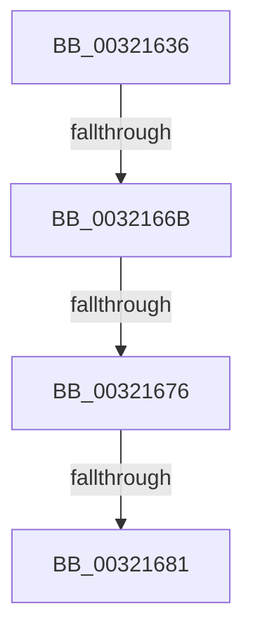

# sub_00321636

- RVA: `0x00321636`–`0x00321695` (길이 `95` bytes)
- VA: `0x0000000140321636`
- 실행 섹션: `.text`
- PDB 이름 있음: `아니요`; PDB Function 태그: `아니요`
- unwind 정보 RVA: `0x000756F4`
- 디코드: `23`개 명령, `95/95` bytes 표시
- 미해석 바이트: `0` (있으면 어셈블리에 `.byte`로 보존)

> 이 문서는 커널 이미지의 기계어와 PDB 기호를 분석해 생성했습니다. 4번과 5번은 함수 원형과 자료형을 바이너리 사용 방식에서 추정한 C 해석이며 원본 소스 복구 결과는 아닙니다.

## 1. Dependencies

- 직접 호출 지점: **0**; 고유 호출 대상: **0**
- 직접 호출자로 확인된 함수: **0**
- RIP 상대 이미지 참조: **1**

### Outgoing calls
- 직접 디코드된 call 명령이 없습니다.

### Direct callers
- 이 함수 시작 RVA로 연결되는 직접 call은 확인되지 않았습니다. 간접 호출은 완전히 역산할 수 없습니다.

### Static image references
- `0x00321662` → RVA `0x00FC6D20` (`ALMOSTRO`; read)

## 2. Other-region calls and transfers

- 다른 실행 섹션으로 향하는 call: **0**
- call이 아닌 외부 분기/꼬리 이동: **3**
  - `0x00321669` → [sub_00321696 + 0x17](Unknown_function_00321696.md) (`tail-transfer`)
  - `0x00321674` → [sub_003216DF](Unknown_function_003216DF.md) (`tail-transfer`)
  - `0x0032167F` → [sub_00321696](Unknown_function_00321696.md) (`tail-transfer`)

## 3. Assembly (complete function range)

```asm
00321636  48 89 5C 24 30                  mov qword ptr [rsp + 0x30], rbx
0032163B  48 8D 1C 49                     lea rbx, [rcx + rcx*2]
0032163F  48 C1 E3 04                     shl rbx, 4
00321643  48 89 74 24 38                  mov qword ptr [rsp + 0x38], rsi
00321648  48 B8 00 00 00 00 00 DE FF FF   movabs rax, 0xffffde0000000000
00321652  48 03 D8                        add rbx, rax
00321655  44 0F 20 C6                     mov rsi, cr8
00321659  B8 02 00 00 00                  mov eax, 2
0032165E  44 0F 22 C0                     mov cr8, rax
00321662  83 3D B7 56 CA 00 00            cmp dword ptr [rip + 0xca56b7], 0
00321669  75 42                           jne 0x1403216ad
0032166B  48 8B 43 28                     mov rax, qword ptr [rbx + 0x28]
0032166F  48 0F BA E0 36                  bt rax, 0x36
00321674  73 69                           jae 0x1403216df
00321676  33 FF                           xor edi, edi
00321678  F0 48 0F BA 6B 18 3F            lock bts qword ptr [rbx + 0x18], 0x3f
0032167F  72 15                           jb 0x140321696
00321681  48 8B 5C 24 30                  mov rbx, qword ptr [rsp + 0x30]
00321686  40 0F B6 C6                     movzx eax, sil
0032168A  48 8B 74 24 38                  mov rsi, qword ptr [rsp + 0x38]
0032168F  48 83 C4 20                     add rsp, 0x20
00321693  5F                              pop rdi
00321694  C3                              ret
```

## 4. C-style interpretation (structured pseudocode)

```c
__int64 __fastcall sub_00321636(__int64 a1, __int64 a2, __int64 a3, __int64 a4, __int64 a5, __int64 a6, __int64 a7)
{
    __int64 v_rbx;
    __int64 v_rdi;
    __int64 v_rsp;
    unsigned __int64 v_stack_p30;
    unsigned __int64 v_stack_p38;

    v_stack_p30 = v_rbx;
    v_rbx = (a1 + a1 * 2) << (4);
    v_stack_p38 = v_rsi;
    v_rbx = (v_rbx) + (result);
    v_rdi = 0;
    v_rsp = (v_rsp) + (32);
    return (unsigned __int8)(v_cr8);
}
```

## 5. (Beta) C Style

```c
int64_t sub_00321636(void *Arg1, int64_t Arg2, int64_t Arg3, int64_t Arg4, uint64_t Arg5, int64_t Arg6, int64_t Arg7)
{
    uint8_t *arg1 = (uint8_t *)Arg1;

    int64_t local_rbx;
    int64_t local_rdi;
    int64_t local_rsp;
    uint64_t v_stack_p30;
    uint64_t v_stack_p38;

    v_stack_p30 = local_rbx;
    local_rbx = (Arg1 + Arg1 * 2) << (4);
    v_stack_p38 = local_rsi;
    local_rbx = (local_rbx) + (result);
    local_rdi = 0;
    local_rsp = (local_rsp) + (32);
    return (uint8_t)(v_cr8);
}
```

### 관측된 메모리 오프셋

구조체 형식이 확인되지 않은 접근은 인자 기준의 오프셋으로만 기록했습니다.

| 기준 인자 | 오프셋 표현 | 폭 (bit) | 접근 |
|---|---:|---:|---|
| `Arg1` | `+ 0x0 + rcx*2` | `64` | `R` |

## 6. Execution-region graph

[열기: 2D/3D 그래프와 함수 탐색 컨트롤 패널](../../../control-panel.html?section=text&rva=0x00321636&view=graph)

- 2D 그래프는 위에서 아래로 흐르고, 3D 그래프는 빈 공간을 드래그해 회전합니다. Shift+드래그는 이동, 휠은 확대·축소, 함수 노드 선택은 대상 보고서 이동입니다.

### Static fallback


