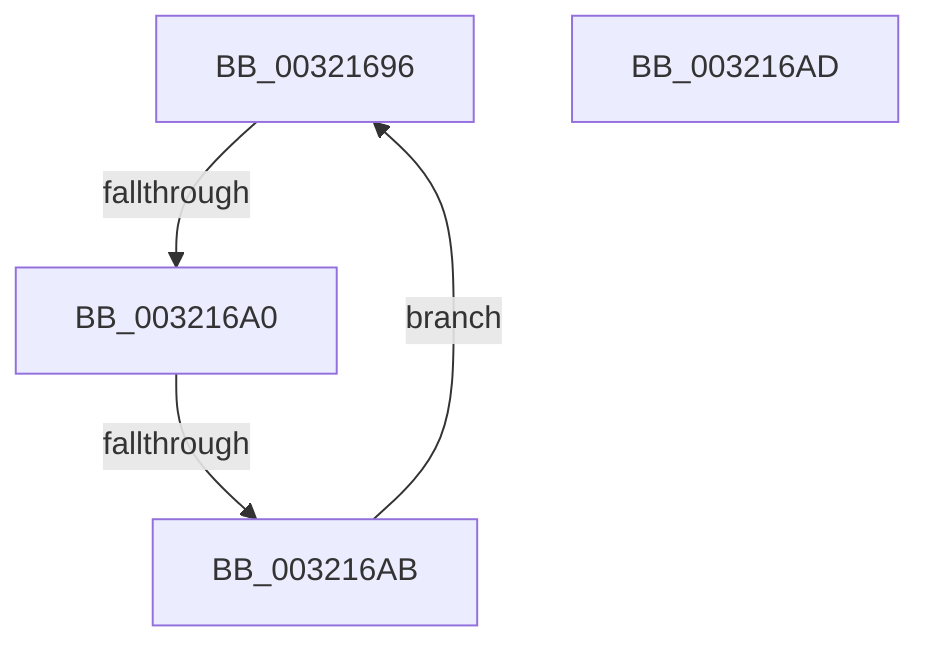

# sub_00321696

- RVA: `0x00321696`–`0x003216BB` (길이 `37` bytes)
- VA: `0x0000000140321696`
- 실행 섹션: `.text`
- PDB 이름 있음: `아니요`; PDB Function 태그: `아니요`
- unwind 정보 RVA: `0x00075720`
- 디코드: `12`개 명령, `37/37` bytes 표시
- 미해석 바이트: `0` (있으면 어셈블리에 `.byte`로 보존)

> 이 문서는 커널 이미지의 기계어와 PDB 기호를 분석해 생성했습니다. 4번과 5번은 함수 원형과 자료형을 바이너리 사용 방식에서 추정한 C 해석이며 원본 소스 복구 결과는 아닙니다.

## 1. Dependencies

- 직접 호출 지점: **1**; 고유 호출 대상: **1**
- 직접 호출자로 확인된 함수: **0**
- RIP 상대 이미지 참조: **1**

### Outgoing calls
- `0x003216B4` → [KiRaiseIrqlProcessIrqlFlags](../4F/KiRaiseIrqlProcessIrqlFlags_function_004F56FC.md) (function, `0x004F56FC`)

### Direct callers
- 이 함수 시작 RVA로 연결되는 직접 call은 확인되지 않았습니다. 간접 호출은 완전히 역산할 수 없습니다.

### Static image references
- `0x00321698` → RVA `0x00FC52AC` (`ALMOSTRO`; reference)

## 2. Other-region calls and transfers

- 다른 실행 섹션으로 향하는 call: **0**
- call이 아닌 외부 분기/꼬리 이동: **3**
  - `0x0032169E` → [sub_0032171B](Unknown_function_0032171B.md) (`tail-transfer`)
  - `0x003216A9` → [sub_00321636 + 0x42](Unknown_function_00321636.md) (`tail-transfer`)
  - `0x003216B9` → [sub_00321636 + 0x35](Unknown_function_00321636.md) (`tail-transfer`)

## 3. Assembly (complete function range)

```asm
00321696  FF C7                           inc edi
00321698  85 3D 0E 3C CA 00               test dword ptr [rip + 0xca3c0e], edi
0032169E  74 7B                           je 0x14032171b
003216A0  F3 90                           pause
003216A2  48 8B 43 18                     mov rax, qword ptr [rbx + 0x18]
003216A6  48 85 C0                        test rax, rax
003216A9  79 CD                           jns 0x140321678
003216AB  EB E9                           jmp 0x140321696
003216AD  0F B6 D0                        movzx edx, al
003216B0  40 0F B6 CE                     movzx ecx, sil
003216B4  E8 43 40 1D 00                  call 0x1404f56fc
003216B9  EB B0                           jmp 0x14032166b
```

## 4. C-style interpretation (structured pseudocode)

```c
__int64 __fastcall sub_00321696(void)
{
    __int64 v_rdi;

    v_rdi = (unsigned int)((v_rdi) + 1);
    goto loc_00321696;
}
```

## 5. (Beta) C Style

```c
void sub_00321696(void)
{
    int64_t local_rdi;

    local_rdi = (uint32_t)((local_rdi) + 1);
    goto loc_00321696;
}
```

## 6. Execution-region graph

[열기: 2D/3D 그래프와 함수 탐색 컨트롤 패널](../../../control-panel.html?section=text&rva=0x00321696&view=graph)

- 2D 그래프는 위에서 아래로 흐르고, 3D 그래프는 빈 공간을 드래그해 회전합니다. Shift+드래그는 이동, 휠은 확대·축소, 함수 노드 선택은 대상 보고서 이동입니다.

### Static fallback


