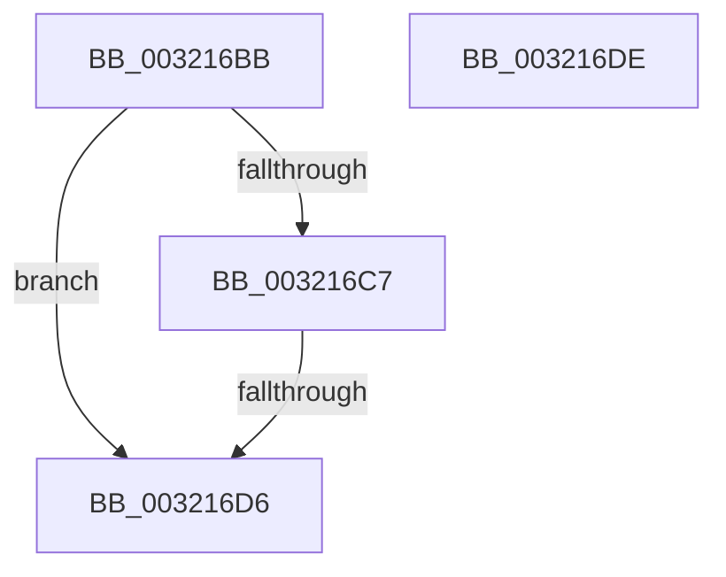

# sub_003216BB

- RVA: `0x003216BB`–`0x003216DF` (길이 `36` bytes)
- VA: `0x00000001403216BB`
- 실행 섹션: `.text`
- PDB 이름 있음: `아니요`; PDB Function 태그: `아니요`
- unwind 정보 RVA: `0x00075738`
- 디코드: `11`개 명령, `36/36` bytes 표시
- 미해석 바이트: `0` (있으면 어셈블리에 `.byte`로 보존)

> 이 문서는 커널 이미지의 기계어와 PDB 기호를 분석해 생성했습니다. 4번과 5번은 함수 원형과 자료형을 바이너리 사용 방식에서 추정한 C 해석이며 원본 소스 복구 결과는 아닙니다.

## 1. Dependencies

- 직접 호출 지점: **0**; 고유 호출 대상: **0**
- 직접 호출자로 확인된 함수: **0**
- RIP 상대 이미지 참조: **1**

### Outgoing calls
- 직접 디코드된 call 명령이 없습니다.

### Direct callers
- 이 함수 시작 RVA로 연결되는 직접 call은 확인되지 않았습니다. 간접 호출은 완전히 역산할 수 없습니다.

### Static image references
- `0x003216BB` → RVA `0x00E35C00` (`.data`; read)

## 2. Other-region calls and transfers

- 다른 실행 섹션으로 향하는 call: **0**
- call이 아닌 외부 분기/꼬리 이동: **1**
  - `0x003216D0` → [sub_00321636](Unknown_function_00321636.md) (`tail-transfer`)

## 3. Assembly (complete function range)

```asm
003216BB  48 8B 05 3E 45 B1 00            mov rax, qword ptr [rip + 0xb1453e]
003216C2  48 3B F8                        cmp rdi, rax
003216C5  72 0F                           jb 0x1403216d6
003216C7  48 05 00 08 00 00               add rax, 0x800
003216CD  48 3B F8                        cmp rdi, rax
003216D0  0F 82 60 FF FF FF               jb 0x140321636
003216D6  B0 11                           mov al, 0x11
003216D8  48 83 C4 20                     add rsp, 0x20
003216DC  5F                              pop rdi
003216DD  C3                              ret
003216DE  CC                              int3
```

## 4. C-style interpretation (structured pseudocode)

```c
__int64 __fastcall sub_003216BB(void)
{
    __int64 result;
    __int64 v_rsp;

    if (v_rdi < (*(unsigned __int64 *)(v_rip + 11617598))) goto loc_003216D6;
    result = (*(unsigned __int64 *)(v_rip + 11617598)) + (0x800ULL);
loc_003216D6:
    v_rsp = (v_rsp) + (32);
    return 17;
}
```

## 5. (Beta) C Style

```c
void sub_003216BB(void)
{
    int64_t result;
    int64_t local_rsp;

    if (local_rdi < (*(uint64_t *)(v_rip + 0xB1453E))) goto loc_003216D6;
    result = (*(uint64_t *)(v_rip + 0xB1453E)) + (0x800ULL);
loc_003216D6:
    local_rsp = (local_rsp) + (32);
    return 17;
}
```

## 6. Execution-region graph

[열기: 2D/3D 그래프와 함수 탐색 컨트롤 패널](../../../control-panel.html?section=text&rva=0x003216BB&view=graph)

- 2D 그래프는 위에서 아래로 흐르고, 3D 그래프는 빈 공간을 드래그해 회전합니다. Shift+드래그는 이동, 휠은 확대·축소, 함수 노드 선택은 대상 보고서 이동입니다.

### Static fallback


