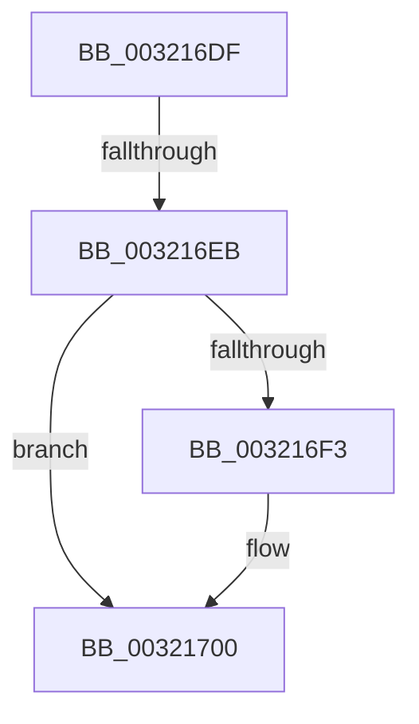

# sub_003216DF

- RVA: `0x003216DF`–`0x0032171A` (길이 `59` bytes)
- VA: `0x00000001403216DF`
- 실행 섹션: `.text`
- PDB 이름 있음: `아니요`; PDB Function 태그: `아니요`
- unwind 정보 RVA: `0x0007574C`
- 디코드: `17`개 명령, `59/59` bytes 표시
- 미해석 바이트: `0` (있으면 어셈블리에 `.byte`로 보존)

> 이 문서는 커널 이미지의 기계어와 PDB 기호를 분석해 생성했습니다. 4번과 5번은 함수 원형과 자료형을 바이너리 사용 방식에서 추정한 C 해석이며 원본 소스 복구 결과는 아닙니다.

## 1. Dependencies

- 직접 호출 지점: **2**; 고유 호출 대상: **2**
- 직접 호출자로 확인된 함수: **0**
- RIP 상대 이미지 참조: **1**

### Outgoing calls
- `0x003216E2` → [MiIsDecayPfn](../2B/MiIsDecayPfn_function_002B9240.md) (function, `0x002B9240`)
- `0x003216FB` → [KiLowerIrqlProcessIrqlFlags](../4F/KiLowerIrqlProcessIrqlFlags_function_004F5698.md) (function, `0x004F5698`)

### Direct callers
- 이 함수 시작 RVA로 연결되는 직접 call은 확인되지 않았습니다. 간접 호출은 완전히 역산할 수 없습니다.

### Static image references
- `0x003216EB` → RVA `0x00FC6D20` (`ALMOSTRO`; read)

## 2. Other-region calls and transfers

- 다른 실행 섹션으로 향하는 call: **0**
- call이 아닌 외부 분기/꼬리 이동: **1**
  - `0x003216E9` → [sub_00321636 + 0x40](Unknown_function_00321636.md) (`tail-transfer`)

## 3. Assembly (complete function range)

```asm
003216DF  48 8B CF                        mov rcx, rdi
003216E2  E8 59 7B F9 FF                  call 0x1402b9240
003216E7  85 C0                           test eax, eax
003216E9  75 8B                           jne 0x140321676
003216EB  39 05 2F 56 CA 00               cmp dword ptr [rip + 0xca562f], eax
003216F1  74 0D                           je 0x140321700
003216F3  44 0F 20 C1                     mov rcx, cr8
003216F7  40 0F B6 D6                     movzx edx, sil
003216FB  E8 98 3F 1D 00                  call 0x1404f5698
00321700  40 0F B6 C6                     movzx eax, sil
00321704  44 0F 22 C0                     mov cr8, rax
00321708  48 8B 5C 24 30                  mov rbx, qword ptr [rsp + 0x30]
0032170D  B0 11                           mov al, 0x11
0032170F  48 8B 74 24 38                  mov rsi, qword ptr [rsp + 0x38]
00321714  48 83 C4 20                     add rsp, 0x20
00321718  5F                              pop rdi
00321719  C3                              ret
```

## 4. C-style interpretation (structured pseudocode)

```c
__int64 __fastcall sub_003216DF(__int64 a1, __int64 a2, __int64 a3, __int64 a4, __int64 a5, __int64 a6, __int64 a7)
{
    __int64 result;
    __int64 v_rsp;

    result = MiIsDecayPfn(v_rdi, a2, a3, a4);
    if ((*(unsigned int *)(v_rip + 13260335)) != ((unsigned int)(result))) {
        a1 = v_cr8;
        a2 = (unsigned __int8)(v_rsi);
        result = KiLowerIrqlProcessIrqlFlags(a1, a2, a3, a4);
    }
    v_rsp = (v_rsp) + (32);
    return 17;
}
```

## 5. (Beta) C Style

```c
int64_t sub_003216DF(int64_t Arg1, int64_t Arg2, int64_t Arg3, int64_t Arg4, uint64_t Arg5, int64_t Arg6, int64_t Arg7)
{
    int64_t result;
    int64_t local_rsp;

    result = MiIsDecayPfn(local_rdi, Arg2, Arg3, Arg4);
    if ((*(uint32_t *)(v_rip + 0xCA562F)) != ((uint32_t)(result))) {
        Arg1 = v_cr8;
        Arg2 = (uint8_t)(local_rsi);
        result = KiLowerIrqlProcessIrqlFlags(Arg1, Arg2, Arg3, Arg4);
    }
    local_rsp = (local_rsp) + (32);
    return 17;
}
```

## 6. Execution-region graph

[열기: 2D/3D 그래프와 함수 탐색 컨트롤 패널](../../../control-panel.html?section=text&rva=0x003216DF&view=graph)

- 2D 그래프는 위에서 아래로 흐르고, 3D 그래프는 빈 공간을 드래그해 회전합니다. Shift+드래그는 이동, 휠은 확대·축소, 함수 노드 선택은 대상 보고서 이동입니다.

### Static fallback


