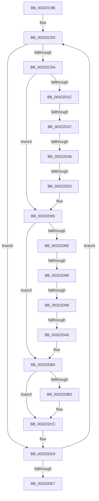

# sub_00322C9B

- RVA: `0x00322C9B`–`0x00322E06` (길이 `363` bytes)
- VA: `0x0000000140322C9B`
- 실행 섹션: `.text`
- PDB 이름 있음: `아니요`; PDB Function 태그: `아니요`
- unwind 정보 RVA: `0x00075834`
- 디코드: `86`개 명령, `363/363` bytes 표시
- 미해석 바이트: `0` (있으면 어셈블리에 `.byte`로 보존)

> 이 문서는 커널 이미지의 기계어와 PDB 기호를 분석해 생성했습니다. 4번과 5번은 함수 원형과 자료형을 바이너리 사용 방식에서 추정한 C 해석이며 원본 소스 복구 결과는 아닙니다.

## 1. Dependencies

- 직접 호출 지점: **4**; 고유 호출 대상: **3**
- 직접 호출자로 확인된 함수: **0**
- RIP 상대 이미지 참조: **5**

### Outgoing calls
- `0x00322D04` → [MiGetUltraMapping](MiGetUltraMapping_function_00323270.md) (function, `0x00323270`)
- `0x00322D53` → [MiReleaseFreshPage](../33/MiReleaseFreshPage_function_00334AE0.md) (function, `0x00334AE0`)
- `0x00322DA5` → [MiReleaseFreshPage](../33/MiReleaseFreshPage_function_00334AE0.md) (function, `0x00334AE0`)
- `0x00322DC7` → [MiReleaseNonPagedResources](MiReleaseNonPagedResources_function_0032299C.md) (function, `0x0032299C`)

### Direct callers
- 이 함수 시작 RVA로 연결되는 직접 call은 확인되지 않았습니다. 간접 호출은 완전히 역산할 수 없습니다.

### Static image references
- `0x00322CB0` → RVA `0x00011C60` (`.rdata`; read)
- `0x00322D09` → RVA `0x00E3601C` (`.data`; read/write)
- `0x00322D2A` → RVA `0x00E2DC41` (`.data`; read)
- `0x00322D37` → RVA `0x00FC6A88` (`ALMOSTRO`; read)
- `0x00322DC0` → RVA `0x00E38D00` (`.data`; read)

## 2. Other-region calls and transfers

- 다른 실행 섹션으로 향하는 call: **0**
- call이 아닌 외부 분기/꼬리 이동: **6**
  - `0x00322D31` → [sub_00322E07](Unknown_function_00322E07.md) (`tail-transfer`)
  - `0x00322D40` → [sub_00322E07 + 0x2E](Unknown_function_00322E07.md) (`tail-transfer`)
  - `0x00322D4D` → [sub_00322E07 + 0x57](Unknown_function_00322E07.md) (`tail-transfer`)
  - `0x00322D83` → [sub_00322E07 + 0x17](Unknown_function_00322E07.md) (`tail-transfer`)
  - `0x00322D92` → [sub_00322E07 + 0x61](Unknown_function_00322E07.md) (`tail-transfer`)
  - `0x00322D9F` → [sub_00322E07 + 0x8A](Unknown_function_00322E07.md) (`tail-transfer`)

## 3. Assembly (complete function range)

```asm
00322C9B  48 89 6C 24 50                  mov qword ptr [rsp + 0x50], rbp
00322CA0  48 8D 59 10                     lea rbx, [rcx + 0x10]
00322CA4  33 F6                           xor esi, esi
00322CA6  48 89 7C 24 58                  mov qword ptr [rsp + 0x58], rdi
00322CAB  4C 89 64 24 60                  mov qword ptr [rsp + 0x60], r12
00322CB0  4C 8D 35 A9 EF CE FF            lea r14, [rip - 0x311057]
00322CB7  49 BD 00 00 00 00 00 DE FF FF   movabs r13, 0xffffde0000000000
00322CC1  4C 89 7C 24 20                  mov qword ptr [rsp + 0x20], r15
00322CC6  8D 46 01                        lea eax, [rsi + 1]
00322CC9  8D 4E 02                        lea ecx, [rsi + 2]
00322CCC  0F 1F 40 00                     nop dword ptr [rax]
00322CD0  80 7B 08 00                     cmp byte ptr [rbx + 8], 0
00322CD4  0F 84 FA 00 00 00               je 0x140322dd4
00322CDA  80 7B 09 00                     cmp byte ptr [rbx + 9], 0
00322CDE  41 BC 03 00 00 00               mov r12d, 3
00322CE4  44 0F 45 E0                     cmovne r12d, eax
00322CE8  44 0F 20 C0                     mov rax, cr8
00322CEC  4D 8B 06                        mov r8, qword ptr [r14]
00322CEF  3C 02                           cmp al, 2
00322CF1  41 BF 06 00 00 00               mov r15d, 6
00322CF7  8B D6                           mov edx, esi
00322CF9  44 0F 45 F9                     cmovne r15d, ecx
00322CFD  48 8D 4B F0                     lea rcx, [rbx - 0x10]
00322D01  45 8B CF                        mov r9d, r15d
00322D04  E8 67 05 00 00                  call 0x140323270
00322D09  F0 FF 0D 0C 33 B1 00            lock dec dword ptr [rip + 0xb1330c]
00322D10  33 ED                           xor ebp, ebp
00322D12  48 8B 4B F8                     mov rcx, qword ptr [rbx - 8]
00322D16  48 83 F9 FF                     cmp rcx, -1
00322D1A  74 49                           je 0x140322d65
00322D1C  48 8D 3C 49                     lea rdi, [rcx + rcx*2]
00322D20  48 C1 E7 04                     shl rdi, 4
00322D24  49 8B C5                        mov rax, r13
00322D27  48 03 F8                        add rdi, rax
00322D2A  40 38 2D 10 AF B0 00            cmp byte ptr [rip + 0xb0af10], bpl
00322D31  0F 85 D0 00 00 00               jne 0x140322e07
00322D37  0F B6 05 4A 3D CA 00            movzx eax, byte ptr [rip + 0xca3d4a]
00322D3E  84 C0                           test al, al
00322D40  0F 88 EF 00 00 00               js 0x140322e35
00322D46  48 8B CF                        mov rcx, rdi
00322D49  41 F6 C7 04                     test r15b, 4
00322D4D  0F 85 0B 01 00 00               jne 0x140322e5e
00322D53  E8 88 1D 01 00                  call 0x140334ae0
00322D58  BD 01 00 00 00                  mov ebp, 1
00322D5D  48 C7 43 F8 FF FF FF FF         mov qword ptr [rbx - 8], 0xffffffffffffffff
00322D65  48 8B 0B                        mov rcx, qword ptr [rbx]
00322D68  48 83 F9 FF                     cmp rcx, -1
00322D6C  74 46                           je 0x140322db4
00322D6E  48 8D 3C 49                     lea rdi, [rcx + rcx*2]
00322D72  48 C1 E7 04                     shl rdi, 4
00322D76  49 8B C5                        mov rax, r13
00322D79  48 03 F8                        add rdi, rax
00322D7C  80 3D BE AE B0 00 00            cmp byte ptr [rip + 0xb0aebe], 0
00322D83  0F 85 95 00 00 00               jne 0x140322e1e
00322D89  0F B6 05 F8 3C CA 00            movzx eax, byte ptr [rip + 0xca3cf8]
00322D90  84 C0                           test al, al
00322D92  0F 88 D0 00 00 00               js 0x140322e68
00322D98  48 8B CF                        mov rcx, rdi
00322D9B  41 F6 C7 04                     test r15b, 4
00322D9F  0F 85 EC 00 00 00               jne 0x140322e91
00322DA5  E8 36 1D 01 00                  call 0x140334ae0
00322DAA  48 FF C5                        inc rbp
00322DAD  48 C7 03 FF FF FF FF            mov qword ptr [rbx], 0xffffffffffffffff
00322DB4  C6 43 08 00                     mov byte ptr [rbx + 8], 0
00322DB8  48 85 ED                        test rbp, rbp
00322DBB  74 0F                           je 0x140322dcc
00322DBD  48 8B D5                        mov rdx, rbp
00322DC0  48 8D 0D 39 5F B1 00            lea rcx, [rip + 0xb15f39]
00322DC7  E8 D0 FB FF FF                  call 0x14032299c
00322DCC  B9 02 00 00 00                  mov ecx, 2
00322DD1  8D 41 FF                        lea eax, [rcx - 1]
00322DD4  FF C6                           inc esi
00322DD6  48 83 C3 20                     add rbx, 0x20
00322DDA  49 83 C6 08                     add r14, 8
00322DDE  83 FE 04                        cmp esi, 4
00322DE1  0F 82 E9 FE FF FF               jb 0x140322cd0
00322DE7  4C 8B 7C 24 20                  mov r15, qword ptr [rsp + 0x20]
00322DEC  4C 8B 64 24 60                  mov r12, qword ptr [rsp + 0x60]
00322DF1  48 8B 7C 24 58                  mov rdi, qword ptr [rsp + 0x58]
00322DF6  48 8B 6C 24 50                  mov rbp, qword ptr [rsp + 0x50]
00322DFB  48 83 C4 28                     add rsp, 0x28
00322DFF  41 5E                           pop r14
00322E01  41 5D                           pop r13
00322E03  5E                              pop rsi
00322E04  5B                              pop rbx
00322E05  C3                              ret
```

## 4. C-style interpretation (structured pseudocode)

```c
__int64 __fastcall sub_00322C9B(__int64 a1, __int64 a2, __int64 a3, __int64 a4, __int64 a5, __int64 a6, __int64 a7, __int64 a8, __int64 a9, __int64 a10, __int64 a11, __int64 a12)
{
    __int64 result;
    __int64 v_r12;
    __int64 v_r14;
    __int64 v_r15;
    __int64 v_rbp;
    __int64 v_rbx;
    __int64 v_rdi;
    __int64 v_rsi;
    __int64 v_rsp;
    unsigned __int64 v_stack_p20;
    unsigned __int64 v_stack_p50;
    unsigned __int64 v_stack_p58;
    unsigned __int64 v_stack_p60;

    v_stack_p50 = v_rbp;
    v_rsi = 0;
    v_stack_p58 = v_rdi;
    v_stack_p60 = v_r12;
    v_stack_p20 = v_r15;
loc_00322CD0:
    if ((*(unsigned __int8 *)(a1 + 16 + 8)) == 0) goto loc_00322DD4;
    v_r12 = 3;
    if ((*(unsigned __int8 *)(a1 + 16 + 9)) != 0) { v_r12 = (unsigned int)(v_rsi + 1); }
    v_r15 = 6;
    if (((unsigned __int8)(v_cr8)) != 2) { v_r15 = (unsigned int)(v_rsi + 2); }
    result = MiGetUltraMapping(a1 + 16 - 16, 0, *(unsigned __int64 *)(v_rip - 3215447), (unsigned int)((unsigned int)(v_r15)));
    v_rbp = 0;
    if ((*(unsigned __int64 *)(a1 + 16 - 8)) == -1) goto loc_00322D65;
    v_rdi = (*(unsigned __int64 *)(a1 + 16 - 8) + *(unsigned __int64 *)(a1 + 16 - 8) * 2) << (4);
    v_rdi = (v_rdi) + (v_r13);
    result = MiReleaseFreshPage(v_rdi, 0, *(unsigned __int64 *)(v_rip - 3215447), (unsigned int)((unsigned int)(v_r15)));
    *(unsigned __int64 *)(a1 + 16 - 8) = -1;
loc_00322D65:
    if ((*(unsigned __int64 *)(a1 + 16)) == -1) goto loc_00322DB4;
    v_rdi = (*(unsigned __int64 *)(a1 + 16) + *(unsigned __int64 *)(a1 + 16) * 2) << (4);
    v_rdi = (v_rdi) + (v_r13);
    result = MiReleaseFreshPage(v_rdi, 0, *(unsigned __int64 *)(v_rip - 3215447), (unsigned int)((unsigned int)(v_r15)));
    v_rbp = (1) + 1;
    *(unsigned __int64 *)(a1 + 16) = -1;
loc_00322DB4:
    *(unsigned __int8 *)(a1 + 16 + 8) = 0;
    if (v_rbp != 0) {
        a2 = v_rbp;
        a1 = v_rip + 11624249;
        result = MiReleaseNonPagedResources(a1, a2, *(unsigned __int64 *)(v_rip - 3215447), (unsigned int)((unsigned int)(v_r15)));
    }
loc_00322DD4:
    v_rsi = (unsigned int)((v_rsi) + 1);
    v_rbx = (a1 + 16) + (32);
    v_r14 = (v_rip - 3215447) + (8);
    if (((unsigned int)(v_rsi)) < 4) goto loc_00322CD0;
    v_rsp = (v_rsp) + (40);
    return 2 - 1;
}
```

## 5. (Beta) C Style

```c
int64_t sub_00322C9B(void *Arg1, int64_t Arg2, int64_t Arg3, int64_t Arg4, uint64_t Arg5, uint64_t Arg6, uint64_t Arg7, uint64_t Arg8, uint64_t Arg9, int64_t Arg10, int64_t Arg11, int64_t Arg12)
{
    uint8_t *arg1 = (uint8_t *)Arg1;

    int64_t result;
    int64_t local_r12;
    int64_t local_r14;
    int64_t local_r15;
    int64_t local_rbp;
    int64_t local_rbx;
    int64_t local_rdi;
    int64_t local_rsi;
    int64_t local_rsp;
    uint64_t v_stack_p20;
    uint64_t v_stack_p50;
    uint64_t v_stack_p58;
    uint64_t v_stack_p60;

    v_stack_p50 = local_rbp;
    local_rsi = 0;
    v_stack_p58 = local_rdi;
    v_stack_p60 = local_r12;
    v_stack_p20 = local_r15;
loc_00322CD0:
    if ((*(uint8_t *)(arg1 + 0x10 + 0x8)) == 0) goto loc_00322DD4;
    local_r12 = 3;
    if ((*(uint8_t *)(arg1 + 0x10 + 0x9)) != 0) { local_r12 = (uint32_t)(local_rsi + 1); }
    local_r15 = 6;
    if (((uint8_t)(v_cr8)) != 2) { local_r15 = (uint32_t)(local_rsi + 2); }
    result = MiGetUltraMapping(Arg1 + 16 - 16, 0, *(uint64_t *)(v_rip - 0x311057), (uint32_t)((uint32_t)(local_r15)));
    local_rbp = 0;
    if ((*(uint64_t *)(arg1 + 0x10 - 0x8)) == -1) goto loc_00322D65;
    local_rdi = (*(uint64_t *)(arg1 + 0x10 - 0x8) + *(uint64_t *)(arg1 + 0x10 - 0x8) * 2) << (4);
    local_rdi = (local_rdi) + (local_r13);
    result = MiReleaseFreshPage(local_rdi, 0, *(uint64_t *)(v_rip - 0x311057), (uint32_t)((uint32_t)(local_r15)));
    *(uint64_t *)(arg1 + 0x10 - 0x8) = -1;
loc_00322D65:
    if ((*(uint64_t *)(arg1 + 0x10)) == -1) goto loc_00322DB4;
    local_rdi = (*(uint64_t *)(arg1 + 0x10) + *(uint64_t *)(arg1 + 0x10) * 2) << (4);
    local_rdi = (local_rdi) + (local_r13);
    result = MiReleaseFreshPage(local_rdi, 0, *(uint64_t *)(v_rip - 0x311057), (uint32_t)((uint32_t)(local_r15)));
    local_rbp = (1) + 1;
    *(uint64_t *)(arg1 + 0x10) = -1;
loc_00322DB4:
    *(uint8_t *)(arg1 + 0x10 + 0x8) = 0;
    if (local_rbp != 0) {
        Arg2 = local_rbp;
        Arg1 = v_rip + 11624249;
        result = MiReleaseNonPagedResources(Arg1, Arg2, *(uint64_t *)(v_rip - 0x311057), (uint32_t)((uint32_t)(local_r15)));
    }
loc_00322DD4:
    local_rsi = (uint32_t)((local_rsi) + 1);
    local_rbx = (Arg1 + 16) + (32);
    local_r14 = (v_rip - 3215447) + (8);
    if (((uint32_t)(local_rsi)) < 4) goto loc_00322CD0;
    local_rsp = (local_rsp) + (40);
    return 2 - 1;
}
```

### 관측된 메모리 오프셋

구조체 형식이 확인되지 않은 접근은 인자 기준의 오프셋으로만 기록했습니다.

| 기준 인자 | 오프셋 표현 | 폭 (bit) | 접근 |
|---|---:|---:|---|
| `Arg1` | `- 0x10` | `64` | `R` |
| `Arg1` | `- 0x8` | `64` | `R` |
| `Arg1` | `- 0x8` | `64` | `W` |
| `Arg1` | `+ 0x0` | `64` | `R` |
| `Arg1` | `+ 0x0` | `64` | `W` |
| `Arg1` | `+ 0x8` | `8` | `R` |
| `Arg1` | `+ 0x8` | `8` | `W` |
| `Arg1` | `+ 0x9` | `8` | `R` |
| `Arg1` | `+ 0x10` | `64` | `R` |

## 6. Execution-region graph

[열기: 2D/3D 그래프와 함수 탐색 컨트롤 패널](../../../control-panel.html?section=text&rva=0x00322C9B&view=graph)

- 2D 그래프는 위에서 아래로 흐르고, 3D 그래프는 빈 공간을 드래그해 회전합니다. Shift+드래그는 이동, 휠은 확대·축소, 함수 노드 선택은 대상 보고서 이동입니다.

### Static fallback


