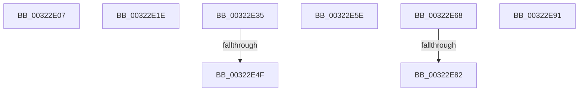

# sub_00322E07

- RVA: `0x00322E07`–`0x00322E9B` (길이 `148` bytes)
- VA: `0x0000000140322E07`
- 실행 섹션: `.text`
- PDB 이름 있음: `아니요`; PDB Function 태그: `아니요`
- unwind 정보 RVA: `0x00075868`
- 디코드: `32`개 명령, `148/148` bytes 표시
- 미해석 바이트: `0` (있으면 어셈블리에 `.byte`로 보존)

> 이 문서는 커널 이미지의 기계어와 PDB 기호를 분석해 생성했습니다. 4번과 5번은 함수 원형과 자료형을 바이너리 사용 방식에서 추정한 C 해석이며 원본 소스 복구 결과는 아닙니다.

## 1. Dependencies

- 직접 호출 지점: **8**; 고유 호출 대상: **4**
- 직접 호출자로 확인된 함수: **0**
- RIP 상대 이미지 참조: **3**

### Outgoing calls
- `0x00322E07` → [MI_PAGE_TO_FULL_COLOR](../33/MI_PAGE_TO_FULL_COLOR_function_00337820.md) (function, `0x00337820`)
- `0x00322E14` → [MiManageUltraSpacePageTable](../2D/MiManageUltraSpacePageTable_function_002DCAF0.md) (function, `0x002DCAF0`)
- `0x00322E1E` → [MI_PAGE_TO_FULL_COLOR](../33/MI_PAGE_TO_FULL_COLOR_function_00337820.md) (function, `0x00337820`)
- `0x00322E2B` → [MiManageUltraSpacePageTable](../2D/MiManageUltraSpacePageTable_function_002DCAF0.md) (function, `0x002DCAF0`)
- `0x00322E54` → [MiArePageContentsZero](../4D/MiArePageContentsZero_function_004D4278.md) (function, `0x004D4278`)
- `0x00322E5E` → [MiReleaseFreshPageAtDpc](../33/MiReleaseFreshPageAtDpc_function_00334B50.md) (function, `0x00334B50`)
- `0x00322E87` → [MiArePageContentsZero](../4D/MiArePageContentsZero_function_004D4278.md) (function, `0x004D4278`)
- `0x00322E91` → [MiReleaseFreshPageAtDpc](../33/MiReleaseFreshPageAtDpc_function_00334B50.md) (function, `0x00334B50`)

### Direct callers
- 이 함수 시작 RVA로 연결되는 직접 call은 확인되지 않았습니다. 간접 호출은 완전히 역산할 수 없습니다.

### Static image references
- `0x00322E35` → RVA `0x00E30270` (`.data`; read)
- `0x00322E3D` → RVA `0x00FC5054` (`ALMOSTRO`; reference)
- `0x00322E43` → RVA `0x00E30270` (`.data`; write)

## 2. Other-region calls and transfers

- 다른 실행 섹션으로 향하는 call: **0**
- call이 아닌 외부 분기/꼬리 이동: **8**
  - `0x00322E19` → [sub_00322C9B + 0xC2](Unknown_function_00322C9B.md) (`tail-transfer`)
  - `0x00322E30` → [sub_00322C9B + 0x112](Unknown_function_00322C9B.md) (`tail-transfer`)
  - `0x00322E49` → [sub_00322C9B + 0xAB](Unknown_function_00322C9B.md) (`tail-transfer`)
  - `0x00322E59` → [sub_00322C9B + 0xAB](Unknown_function_00322C9B.md) (`tail-transfer`)
  - `0x00322E63` → [sub_00322C9B + 0xBD](Unknown_function_00322C9B.md) (`tail-transfer`)
  - `0x00322E7C` → [sub_00322C9B + 0xFD](Unknown_function_00322C9B.md) (`tail-transfer`)
  - `0x00322E8C` → [sub_00322C9B + 0xFD](Unknown_function_00322C9B.md) (`tail-transfer`)
  - `0x00322E96` → [sub_00322C9B + 0x10F](Unknown_function_00322C9B.md) (`tail-transfer`)

## 3. Assembly (complete function range)

```asm
00322E07  E8 14 4A 01 00                  call 0x140337820
00322E0C  45 8B C4                        mov r8d, r12d
00322E0F  8B D0                           mov edx, eax
00322E11  48 8B CF                        mov rcx, rdi
00322E14  E8 D7 9C FB FF                  call 0x1402dcaf0
00322E19  E9 3F FF FF FF                  jmp 0x140322d5d
00322E1E  E8 FD 49 01 00                  call 0x140337820
00322E23  45 8B C4                        mov r8d, r12d
00322E26  8B D0                           mov edx, eax
00322E28  48 8B CF                        mov rcx, rdi
00322E2B  E8 C0 9C FB FF                  call 0x1402dcaf0
00322E30  E9 78 FF FF FF                  jmp 0x140322dad
00322E35  8B 05 35 D4 B0 00               mov eax, dword ptr [rip + 0xb0d435]
00322E3B  FF C0                           inc eax
00322E3D  85 05 11 22 CA 00               test dword ptr [rip + 0xca2211], eax
00322E43  89 05 27 D4 B0 00               mov dword ptr [rip + 0xb0d427], eax
00322E49  0F 85 F7 FE FF FF               jne 0x140322d46
00322E4F  BA 01 00 00 00                  mov edx, 1
00322E54  E8 1F 14 1B 00                  call 0x1404d4278
00322E59  E9 E8 FE FF FF                  jmp 0x140322d46
00322E5E  E8 ED 1C 01 00                  call 0x140334b50
00322E63  E9 F0 FE FF FF                  jmp 0x140322d58
00322E68  8B 05 02 D4 B0 00               mov eax, dword ptr [rip + 0xb0d402]
00322E6E  FF C0                           inc eax
00322E70  85 05 DE 21 CA 00               test dword ptr [rip + 0xca21de], eax
00322E76  89 05 F4 D3 B0 00               mov dword ptr [rip + 0xb0d3f4], eax
00322E7C  0F 85 16 FF FF FF               jne 0x140322d98
00322E82  BA 01 00 00 00                  mov edx, 1
00322E87  E8 EC 13 1B 00                  call 0x1404d4278
00322E8C  E9 07 FF FF FF                  jmp 0x140322d98
00322E91  E8 BA 1C 01 00                  call 0x140334b50
00322E96  E9 0F FF FF FF                  jmp 0x140322daa
```

## 4. C-style interpretation (structured pseudocode)

```c
__int64 __fastcall sub_00322E07(void)
{
    __int64 result;

    result = MI_PAGE_TO_FULL_COLOR(a1, a2, a3, a4);
    result = MiManageUltraSpacePageTable(v_rdi, (unsigned int)((unsigned int)(result)), (unsigned int)((unsigned int)(v_r12)), a4);
}
```

## 5. (Beta) C Style

```c
void sub_00322E07(void)
{
    int64_t result;

    result = MI_PAGE_TO_FULL_COLOR(a1, a2, a3, a4);
    result = MiManageUltraSpacePageTable(local_rdi, (uint32_t)((uint32_t)(result)), (uint32_t)((uint32_t)(local_r12)), a4);
}
```

## 6. Execution-region graph

[열기: 2D/3D 그래프와 함수 탐색 컨트롤 패널](../../../control-panel.html?section=text&rva=0x00322E07&view=graph)

- 2D 그래프는 위에서 아래로 흐르고, 3D 그래프는 빈 공간을 드래그해 회전합니다. Shift+드래그는 이동, 휠은 확대·축소, 함수 노드 선택은 대상 보고서 이동입니다.

### Static fallback


