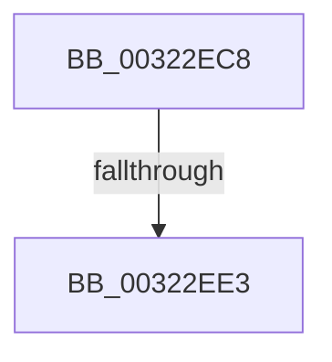

# sub_00322EC8

- RVA: `0x00322EC8`–`0x00322F44` (길이 `124` bytes)
- VA: `0x0000000140322EC8`
- 실행 섹션: `.text`
- PDB 이름 있음: `아니요`; PDB Function 태그: `아니요`
- unwind 정보 RVA: `0x00075894`
- 디코드: `25`개 명령, `124/124` bytes 표시
- 미해석 바이트: `0` (있으면 어셈블리에 `.byte`로 보존)

> 이 문서는 커널 이미지의 기계어와 PDB 기호를 분석해 생성했습니다. 4번과 5번은 함수 원형과 자료형을 바이너리 사용 방식에서 추정한 C 해석이며 원본 소스 복구 결과는 아닙니다.

## 1. Dependencies

- 직접 호출 지점: **1**; 고유 호출 대상: **1**
- 직접 호출자로 확인된 함수: **0**
- RIP 상대 이미지 참조: **1**

### Outgoing calls
- `0x00322F08` → [MiGetUltraMapping](MiGetUltraMapping_function_00323270.md) (function, `0x00323270`)

### Direct callers
- 이 함수 시작 RVA로 연결되는 직접 call은 확인되지 않았습니다. 간접 호출은 완전히 역산할 수 없습니다.

### Static image references
- `0x00322EDA` → RVA `0x00FC6D20` (`ALMOSTRO`; read)

## 2. Other-region calls and transfers

- 다른 실행 섹션으로 향하는 call: **0**
- call이 아닌 외부 분기/꼬리 이동: **1**
  - `0x00322EE1` → [sub_00322F50](Unknown_function_00322F50.md) (`tail-transfer`)

## 3. Assembly (complete function range)

```asm
00322EC8  48 89 7C 24 30                  mov qword ptr [rsp + 0x30], rdi
00322ECD  44 0F 20 C7                     mov rdi, cr8
00322ED1  B8 02 00 00 00                  mov eax, 2
00322ED6  44 0F 22 C0                     mov cr8, rax
00322EDA  83 3D 3F 3E CA 00 00            cmp dword ptr [rip + 0xca3e3f], 0
00322EE1  75 6D                           jne 0x140322f50
00322EE3  40 88 7B 08                     mov byte ptr [rbx + 8], dil
00322EE7  41 B9 04 00 00 00               mov r9d, 4
00322EED  65 48 8B 04 25 20 00 00 00      mov rax, qword ptr gs:[0x20]
00322EF6  4C 8B C6                        mov r8, rsi
00322EF9  41 8D 51 FF                     lea edx, [r9 - 1]
00322EFD  48 8B B8 38 88 00 00            mov rdi, qword ptr [rax + 0x8838]
00322F04  48 8D 4F 68                     lea rcx, [rdi + 0x68]
00322F08  E8 63 03 00 00                  call 0x140323270
00322F0D  48 C1 E8 09                     shr rax, 9
00322F11  48 B9 F8 FF FF FF 7F 00 00 00   movabs rcx, 0x7ffffffff8
00322F1B  48 23 C1                        and rax, rcx
00322F1E  48 B9 00 00 00 00 80 F6 FF FF   movabs rcx, 0xfffff68000000000
00322F28  48 03 C1                        add rax, rcx
00322F2B  48 89 07                        mov qword ptr [rdi], rax
00322F2E  48 8B 7C 24 30                  mov rdi, qword ptr [rsp + 0x30]
00322F33  C7 03 00 00 00 00               mov dword ptr [rbx], 0
00322F39  89 73 04                        mov dword ptr [rbx + 4], esi
00322F3C  48 89 43 10                     mov qword ptr [rbx + 0x10], rax
00322F40  C6 43 09 01                     mov byte ptr [rbx + 9], 1
```

## 4. C-style interpretation (structured pseudocode)

```c
__int64 __fastcall sub_00322EC8(__int64 a1, __int64 a2, __int64 a3, __int64 a4, __int64 a5, __int64 a6)
{
    __int64 result;
    unsigned __int64 v_stack_p30;

    v_stack_p30 = v_rdi;
    *(unsigned __int8 *)(v_rbx + 8) = (unsigned __int8)(v_cr8);
    result = MiGetUltraMapping(*(unsigned __int64 *)(*(unsigned __int64 *)(gs_base + (0 + 32)) + 34872) + 104, 4 - 1, v_rsi, 4);
    result = (result) >> (9);
    result = (result) & (*(unsigned __int64 *)(*(unsigned __int64 *)(gs_base + (0 + 32)) + 34872) + 104);
    result = (result) + (*(unsigned __int64 *)(*(unsigned __int64 *)(gs_base + (0 + 32)) + 34872) + 104);
    *(unsigned __int64 *)(*(unsigned __int64 *)(*(unsigned __int64 *)(gs_base + (0 + 32)) + 34872)) = result;
    *(unsigned int *)(v_rbx) = 0;
    *(unsigned int *)(v_rbx + 4) = (unsigned int)(v_rsi);
    *(unsigned __int64 *)(v_rbx + 16) = result;
    *(unsigned __int8 *)(v_rbx + 9) = 1;
    return result;
}
```

## 5. (Beta) C Style

```c
int64_t sub_00322EC8(int64_t Arg1, int64_t Arg2, int64_t Arg3, int64_t Arg4, uint64_t Arg5, int64_t Arg6)
{
    int64_t result;
    uint64_t v_stack_p30;

    v_stack_p30 = local_rdi;
    *(uint8_t *)(local_rbx + 0x8) = (uint8_t)(v_cr8);
    result = MiGetUltraMapping(*(uint64_t *)(*(uint64_t *)(gs_base + (0 + 0x20)) + 0x8838) + 104, 4 - 1, local_rsi, 4);
    result = (result) >> (9);
    result = (result) & (*(uint64_t *)(*(uint64_t *)(gs_base + (0 + 0x20)) + 0x8838) + 104);
    result = (result) + (*(uint64_t *)(*(uint64_t *)(gs_base + (0 + 0x20)) + 0x8838) + 104);
    *(uint64_t *)(*(uint64_t *)(*(uint64_t *)(gs_base + (0 + 0x20)) + 0x8838)) = result;
    *(uint32_t *)(local_rbx) = 0;
    *(uint32_t *)(local_rbx + 0x4) = (uint32_t)(local_rsi);
    *(uint64_t *)(local_rbx + 0x10) = result;
    *(uint8_t *)(local_rbx + 0x9) = 1;
    return result;
}
```

## 6. Execution-region graph

[열기: 2D/3D 그래프와 함수 탐색 컨트롤 패널](../../../control-panel.html?section=text&rva=0x00322EC8&view=graph)

- 2D 그래프는 위에서 아래로 흐르고, 3D 그래프는 빈 공간을 드래그해 회전합니다. Shift+드래그는 이동, 휠은 확대·축소, 함수 노드 선택은 대상 보고서 이동입니다.

### Static fallback


