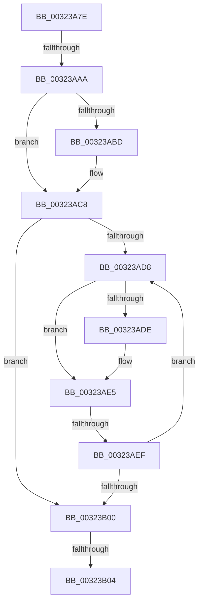

# sub_00323A7E

- RVA: `0x00323A7E`–`0x00323B13` (길이 `149` bytes)
- VA: `0x0000000140323A7E`
- 실행 섹션: `.text`
- PDB 이름 있음: `아니요`; PDB Function 태그: `아니요`
- unwind 정보 RVA: `0x00075964`
- 디코드: `40`개 명령, `149/149` bytes 표시
- 미해석 바이트: `0` (있으면 어셈블리에 `.byte`로 보존)

> 이 문서는 커널 이미지의 기계어와 PDB 기호를 분석해 생성했습니다. 4번과 5번은 함수 원형과 자료형을 바이너리 사용 방식에서 추정한 C 해석이며 원본 소스 복구 결과는 아닙니다.

## 1. Dependencies

- 직접 호출 지점: **1**; 고유 호출 대상: **1**
- 직접 호출자로 확인된 함수: **0**
- RIP 상대 이미지 참조: **2**

### Outgoing calls
- `0x00323AC1` → [ExpWaitForSpinLockExclusiveAndAcquire](ExpWaitForSpinLockExclusiveAndAcquire_function_003239A0.md) (function, `0x003239A0`)

### Direct callers
- 이 함수 시작 RVA로 연결되는 직접 call은 확인되지 않았습니다. 간접 호출은 완전히 역산할 수 없습니다.

### Static image references
- `0x00323A92` → RVA `0x00FC6B06` (`ALMOSTRO`; read)
- `0x00323AE7` → RVA `0x00FC52AC` (`ALMOSTRO`; reference)

## 2. Other-region calls and transfers

- 다른 실행 섹션으로 향하는 call: **0**
- call이 아닌 외부 분기/꼬리 이동: **4**
  - `0x00323AA4` → [sub_00323B23 + 0x2A](Unknown_function_00323B23.md) (`tail-transfer`)
  - `0x00323AED` → [sub_00323B23 + 0xE](Unknown_function_00323B23.md) (`tail-transfer`)
  - `0x00323B02` → [sub_00323B23](Unknown_function_00323B23.md) (`tail-transfer`)
  - `0x00323B11` → [sub_00323B76](Unknown_function_00323B76.md) (`tail-transfer`)

## 3. Assembly (complete function range)

```asm
00323A7E  48 89 6C 24 58                  mov qword ptr [rsp + 0x58], rbp
00323A83  33 DB                           xor ebx, ebx
00323A85  65 48 8B 2C 25 20 00 00 00      mov rbp, qword ptr gs:[0x20]
00323A8E  44 0F B6 C2                     movzx r8d, dl
00323A92  F6 05 6D 30 CA 00 01            test byte ptr [rip + 0xca306d], 1
00323A99  48 8B F9                        mov rdi, rcx
00323A9C  48 89 74 24 60                  mov qword ptr [rsp + 0x60], rsi
00323AA1  44 8B FB                        mov r15d, ebx
00323AA4  0F 85 A3 00 00 00               jne 0x140323b4d
00323AAA  40 32 F6                        xor sil, sil
00323AAD  44 8B F3                        mov r14d, ebx
00323AB0  FF 85 C0 8E 00 00               inc dword ptr [rbp + 0x8ec0]
00323AB6  F0 0F BA 29 1F                  lock bts dword ptr [rcx], 0x1f
00323ABB  73 0B                           jae 0x140323ac8
00323ABD  41 0F B6 D0                     movzx edx, r8b
00323AC1  E8 DA FE FF FF                  call 0x1403239a0
00323AC6  8B D8                           mov ebx, eax
00323AC8  8B 17                           mov edx, dword ptr [rdi]
00323ACA  8B CA                           mov ecx, edx
00323ACC  0F BA F1 1E                     btr ecx, 0x1e
00323AD0  81 F9 00 00 00 80               cmp ecx, 0x80000000
00323AD6  74 28                           je 0x140323b00
00323AD8  0F BA E2 1E                     bt edx, 0x1e
00323ADC  72 07                           jb 0x140323ae5
00323ADE  F0 81 0F 00 00 00 40            lock or dword ptr [rdi], 0x40000000
00323AE5  FF C3                           inc ebx
00323AE7  85 1D BF 17 CA 00               test dword ptr [rip + 0xca17bf], ebx
00323AED  74 42                           je 0x140323b31
00323AEF  F3 90                           pause
00323AF1  8B 17                           mov edx, dword ptr [rdi]
00323AF3  8B C2                           mov eax, edx
00323AF5  0F BA F0 1E                     btr eax, 0x1e
00323AF9  3D 00 00 00 80                  cmp eax, 0x80000000
00323AFE  75 D8                           jne 0x140323ad8
00323B00  85 DB                           test ebx, ebx
00323B02  75 1F                           jne 0x140323b23
00323B04  48 8B 6C 24 58                  mov rbp, qword ptr [rsp + 0x58]
00323B09  40 84 F6                        test sil, sil
00323B0C  48 8B 74 24 60                  mov rsi, qword ptr [rsp + 0x60]
00323B11  75 63                           jne 0x140323b76
```

## 4. C-style interpretation (structured pseudocode)

```c
__int64 __fastcall sub_00323A7E(__int64 a1, unsigned __int8 a2, __int64 a3, __int64 a4, __int64 a5, __int64 a6, __int64 a7, __int64 a8, __int64 a9, __int64 a10, __int64 a11, __int64 a12)
{
    __int64 result;
    __int64 v_rbx;
    __int64 v_rsi;
    unsigned __int64 v_stack_p58;
    unsigned __int64 v_stack_p60;

    v_stack_p58 = v_rbp;
    v_rbx = 0;
    v_stack_p60 = v_rsi;
    v_rsi = 0;
    if (!(condition_is_above_or_equal)) {
        a2 = a2;
        result = ExpWaitForSpinLockExclusiveAndAcquire(a1, a2, a2, a4);
        v_rbx = (unsigned int)(result);
    }
    if (((unsigned int)((unsigned int)((unsigned int)((unsigned int)(*(unsigned int *)(a1)))))) == 0x80000000ULL) goto loc_00323B00;
loc_00323AD8:
    if (((unsigned int)((unsigned int)((unsigned int)((unsigned int)(*(unsigned int *)(a1)))))) >= 0x80000000ULL) {
    }
    v_rbx = (unsigned int)((v_rbx) + 1);
    if (((unsigned int)((unsigned int)((unsigned int)((unsigned int)(*(unsigned int *)(a1)))))) != 0x80000000ULL) goto loc_00323AD8;
loc_00323B00:
}
```

## 5. (Beta) C Style

```c
int64_t sub_00323A7E(void *Arg1, uint8_t Arg2, int64_t Arg3, int64_t Arg4, uint64_t Arg5, uint64_t Arg6, uint64_t Arg7, uint64_t Arg8, uint64_t Arg9, uint64_t Arg10, int64_t Arg11, int64_t Arg12)
{
    uint8_t *arg1 = (uint8_t *)Arg1;

    int64_t result;
    int64_t local_rbx;
    int64_t local_rsi;
    uint64_t v_stack_p58;
    uint64_t v_stack_p60;

    v_stack_p58 = local_rbp;
    local_rbx = 0;
    v_stack_p60 = local_rsi;
    local_rsi = 0;
    if (!(condition_is_above_or_equal)) {
        Arg2 = Arg2;
        result = ExpWaitForSpinLockExclusiveAndAcquire(Arg1, Arg2, Arg2, Arg4);
        local_rbx = (uint32_t)(result);
    }
    if (((uint32_t)((uint32_t)((uint32_t)((uint32_t)(*(uint32_t *)(arg1)))))) == 0x80000000ULL) goto loc_00323B00;
loc_00323AD8:
    if (((uint32_t)((uint32_t)((uint32_t)((uint32_t)(*(uint32_t *)(arg1)))))) >= 0x80000000ULL) {
    }
    local_rbx = (uint32_t)((local_rbx) + 1);
    if (((uint32_t)((uint32_t)((uint32_t)((uint32_t)(*(uint32_t *)(arg1)))))) != 0x80000000ULL) goto loc_00323AD8;
loc_00323B00:
}
```

### 관측된 메모리 오프셋

구조체 형식이 확인되지 않은 접근은 인자 기준의 오프셋으로만 기록했습니다.

| 기준 인자 | 오프셋 표현 | 폭 (bit) | 접근 |
|---|---:|---:|---|
| `Arg1` | `+ 0x0` | `32` | `R` |
| `Arg1` | `+ 0x0` | `32` | `R/W` |

## 6. Execution-region graph

[열기: 2D/3D 그래프와 함수 탐색 컨트롤 패널](../../../control-panel.html?section=text&rva=0x00323A7E&view=graph)

- 2D 그래프는 위에서 아래로 흐르고, 3D 그래프는 빈 공간을 드래그해 회전합니다. Shift+드래그는 이동, 휠은 확대·축소, 함수 노드 선택은 대상 보고서 이동입니다.

### Static fallback


