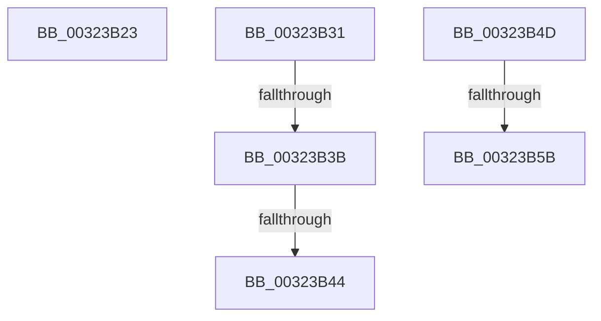

# sub_00323B23

- RVA: `0x00323B23`–`0x00323B76` (길이 `83` bytes)
- VA: `0x0000000140323B23`
- 실행 섹션: `.text`
- PDB 이름 있음: `아니요`; PDB Function 태그: `아니요`
- unwind 정보 RVA: `0x00075990`
- 디코드: `22`개 명령, `83/83` bytes 표시
- 미해석 바이트: `0` (있으면 어셈블리에 `.byte`로 보존)

> 이 문서는 커널 이미지의 기계어와 PDB 기호를 분석해 생성했습니다. 4번과 5번은 함수 원형과 자료형을 바이너리 사용 방식에서 추정한 C 해석이며 원본 소스 복구 결과는 아닙니다.

## 1. Dependencies

- 직접 호출 지점: **2**; 고유 호출 대상: **2**
- 직접 호출자로 확인된 함수: **0**
- RIP 상대 이미지 참조: **2**

### Outgoing calls
- `0x00323B3B` → [KiCheckVpBackingLongSpinWaitHypercall](../30/KiCheckVpBackingLongSpinWaitHypercall_function_0030F490.md) (function, `0x0030F490`)
- `0x00323B46` → [HvlNotifyLongSpinWait](../30/HvlNotifyLongSpinWait_function_0030F460.md) (function, `0x0030F460`)

### Direct callers
- 이 함수 시작 RVA로 연결되는 직접 call은 확인되지 않았습니다. 간접 호출은 완전히 역산할 수 없습니다.

### Static image references
- `0x00323B31` → RVA `0x00FC6AB8` (`ALMOSTRO`; read)
- `0x00323B4D` → RVA `0x00F0DE58` (`.data`; read)

## 2. Other-region calls and transfers

- 다른 실행 섹션으로 향하는 call: **0**
- call이 아닌 외부 분기/꼬리 이동: **6**
  - `0x00323B2F` → [sub_00323A7E + 0x86](Unknown_function_00323A7E.md) (`tail-transfer`)
  - `0x00323B39` → [sub_00323A7E + 0x71](Unknown_function_00323A7E.md) (`tail-transfer`)
  - `0x00323B42` → [sub_00323A7E + 0x71](Unknown_function_00323A7E.md) (`tail-transfer`)
  - `0x00323B4B` → [sub_00323A7E + 0x73](Unknown_function_00323A7E.md) (`tail-transfer`)
  - `0x00323B55` → [sub_00323A7E + 0x2C](Unknown_function_00323A7E.md) (`tail-transfer`)
  - `0x00323B71` → [sub_00323A7E + 0x32](Unknown_function_00323A7E.md) (`tail-transfer`)

## 3. Assembly (complete function range)

```asm
00323B23  FF 85 C4 8E 00 00               inc dword ptr [rbp + 0x8ec4]
00323B29  01 9D C8 8E 00 00               add dword ptr [rbp + 0x8ec8], ebx
00323B2F  EB D3                           jmp 0x140323b04
00323B31  8B 05 81 2F CA 00               mov eax, dword ptr [rip + 0xca2f81]
00323B37  A8 40                           test al, 0x40
00323B39  74 B4                           je 0x140323aef
00323B3B  E8 50 B9 FE FF                  call 0x14030f490
00323B40  84 C0                           test al, al
00323B42  74 AB                           je 0x140323aef
00323B44  8B CB                           mov ecx, ebx
00323B46  E8 15 B9 FE FF                  call 0x14030f460
00323B4B  EB A4                           jmp 0x140323af1
00323B4D  8B 05 05 A3 BE 00               mov eax, dword ptr [rip + 0xbea305]
00323B53  85 C0                           test eax, eax
00323B55  0F 85 4F FF FF FF               jne 0x140323aaa
00323B5B  40 B6 01                        mov sil, 1
00323B5E  0F 31                           rdtsc
00323B60  44 8B B5 40 86 00 00            mov r14d, dword ptr [rbp + 0x8640]
00323B67  48 C1 E2 20                     shl rdx, 0x20
00323B6B  48 0B C2                        or rax, rdx
00323B6E  4C 8B F8                        mov r15, rax
00323B71  E9 3A FF FF FF                  jmp 0x140323ab0
```

## 4. C-style interpretation (structured pseudocode)

```c
__int64 __fastcall sub_00323B23(__int64 a1, __int64 a2)
{
}
```

## 5. (Beta) C Style

```c
int64_t sub_00323B23(int64_t Arg1, int64_t Arg2)
{
}
```

## 6. Execution-region graph

[열기: 2D/3D 그래프와 함수 탐색 컨트롤 패널](../../../control-panel.html?section=text&rva=0x00323B23&view=graph)

- 2D 그래프는 위에서 아래로 흐르고, 3D 그래프는 빈 공간을 드래그해 회전합니다. Shift+드래그는 이동, 휠은 확대·축소, 함수 노드 선택은 대상 보고서 이동입니다.

### Static fallback


