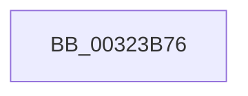

# sub_00323B76

- RVA: `0x00323B76`–`0x00323BA2` (길이 `44` bytes)
- VA: `0x0000000140323B76`
- 실행 섹션: `.text`
- PDB 이름 있음: `아니요`; PDB Function 태그: `아니요`
- unwind 정보 RVA: `0x000759A8`
- 디코드: `12`개 명령, `44/44` bytes 표시
- 미해석 바이트: `0` (있으면 어셈블리에 `.byte`로 보존)

> 이 문서는 커널 이미지의 기계어와 PDB 기호를 분석해 생성했습니다. 4번과 5번은 함수 원형과 자료형을 바이너리 사용 방식에서 추정한 C 해석이며 원본 소스 복구 결과는 아닙니다.

## 1. Dependencies

- 직접 호출 지점: **1**; 고유 호출 대상: **1**
- 직접 호출자로 확인된 함수: **0**
- RIP 상대 이미지 참조: **0**

### Outgoing calls
- `0x00323B98` → [PerfLogSpinLockAcquire](../41/PerfLogSpinLockAcquire_function_00414FC4.md) (function, `0x00414FC4`)

### Direct callers
- 이 함수 시작 RVA로 연결되는 직접 call은 확인되지 않았습니다. 간접 호출은 완전히 역산할 수 없습니다.

### Static image references
- 디코드된 RIP-relative 메모리 참조가 없습니다.

## 2. Other-region calls and transfers

- 다른 실행 섹션으로 향하는 call: **0**
- call이 아닌 외부 분기/꼬리 이동: **1**
  - `0x00323B9D` → [sub_00323B13](Unknown_function_00323B13.md) (`tail-transfer`)

## 3. Assembly (complete function range)

```asm
00323B76  0F 31                           rdtsc
00323B78  48 C1 E2 20                     shl rdx, 0x20
00323B7C  44 8B CB                        mov r9d, ebx
00323B7F  48 0B C2                        or rax, rdx
00323B82  C6 44 24 28 03                  mov byte ptr [rsp + 0x28], 3
00323B87  44 8B C0                        mov r8d, eax
00323B8A  44 89 74 24 20                  mov dword ptr [rsp + 0x20], r14d
00323B8F  45 2B C7                        sub r8d, r15d
00323B92  48 8B D0                        mov rdx, rax
00323B95  48 8B CF                        mov rcx, rdi
00323B98  E8 27 14 0F 00                  call 0x140414fc4
00323B9D  E9 71 FF FF FF                  jmp 0x140323b13
```

## 4. C-style interpretation (structured pseudocode)

```c
__int64 __fastcall sub_00323B76(__int64 a1, __int64 a2)
{
    __int64 result;
    unsigned int v_stack_p20;
    unsigned __int8 v_stack_p28;

    a2 = (a2) << (32);
    result = (result) | (a2);
    v_stack_p28 = 3;
    v_stack_p20 = (unsigned int)(v_r14);
    a3 = (unsigned int)(((unsigned int)((unsigned int)(result))) - ((unsigned int)(v_r15)));
    result = PerfLogSpinLockAcquire(v_rdi, result, a3, (unsigned int)((unsigned int)(v_rbx)));
}
```

## 5. (Beta) C Style

```c
int64_t sub_00323B76(int64_t Arg1, int64_t Arg2)
{
    int64_t result;
    uint32_t v_stack_p20;
    uint8_t v_stack_p28;

    Arg2 = (Arg2) << (32);
    result = (result) | (Arg2);
    v_stack_p28 = 3;
    v_stack_p20 = (uint32_t)(local_r14);
    a3 = (uint32_t)(((uint32_t)((uint32_t)(result))) - ((uint32_t)(local_r15)));
    result = PerfLogSpinLockAcquire(local_rdi, result, a3, (uint32_t)((uint32_t)(local_rbx)));
}
```

## 6. Execution-region graph

[열기: 2D/3D 그래프와 함수 탐색 컨트롤 패널](../../../control-panel.html?section=text&rva=0x00323B76&view=graph)

- 2D 그래프는 위에서 아래로 흐르고, 3D 그래프는 빈 공간을 드래그해 회전합니다. Shift+드래그는 이동, 휠은 확대·축소, 함수 노드 선택은 대상 보고서 이동입니다.

### Static fallback


