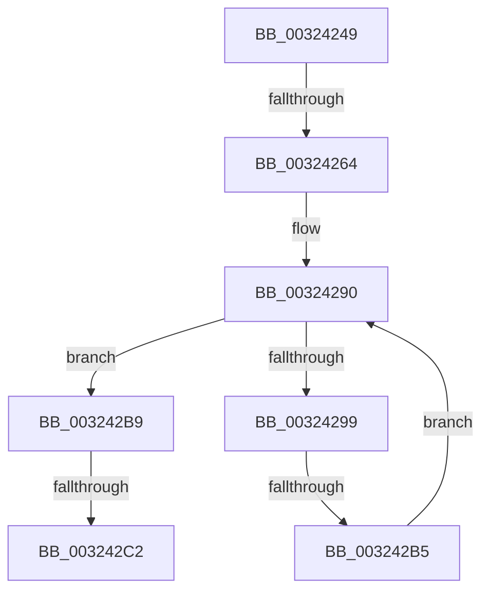

# sub_00324249

- RVA: `0x00324249`–`0x003242D8` (길이 `143` bytes)
- VA: `0x0000000140324249`
- 실행 섹션: `.text`
- PDB 이름 있음: `아니요`; PDB Function 태그: `아니요`
- unwind 정보 RVA: `0x000759FC`
- 디코드: `37`개 명령, `143/143` bytes 표시
- 미해석 바이트: `0` (있으면 어셈블리에 `.byte`로 보존)

> 이 문서는 커널 이미지의 기계어와 PDB 기호를 분석해 생성했습니다. 4번과 5번은 함수 원형과 자료형을 바이너리 사용 방식에서 추정한 C 해석이며 원본 소스 복구 결과는 아닙니다.

## 1. Dependencies

- 직접 호출 지점: **1**; 고유 호출 대상: **1**
- 직접 호출자로 확인된 함수: **0**
- RIP 상대 이미지 참조: **0**

### Outgoing calls
- `0x003242D2` → [KeBugCheckEx](../4F/KeBugCheckEx_function_004FD660.md) (function, `0x004FD660`)

### Direct callers
- 이 함수 시작 RVA로 연결되는 직접 call은 확인되지 않았습니다. 간접 호출은 완전히 역산할 수 없습니다.

### Static image references
- 디코드된 RIP-relative 메모리 참조가 없습니다.

## 2. Other-region calls and transfers

- 다른 실행 섹션으로 향하는 call: **0**
- call이 아닌 외부 분기/꼬리 이동: **3**
  - `0x0032425E` → [sub_00324361 + 0x33](Unknown_function_00324361.md) (`tail-transfer`)
  - `0x003242AF` → [sub_00324361](Unknown_function_00324361.md) (`tail-transfer`)
  - `0x003242C0` → [sub_00324310](Unknown_function_00324310.md) (`tail-transfer`)

## 3. Assembly (complete function range)

```asm
00324249  48 89 74 24 40                  mov qword ptr [rsp + 0x40], rsi
0032424E  48 C7 C0 FF FF FF FF            mov rax, 0xffffffffffffffff
00324255  F0 48 0F C1 01                  lock xadd qword ptr [rcx], rax
0032425A  24 06                           and al, 6
0032425C  3C 02                           cmp al, 2
0032425E  0F 84 30 01 00 00               je 0x140324394
00324264  65 48 8B 1C 25 88 01 00 00      mov rbx, qword ptr gs:[0x188]
0032426D  FA                              cli
0032426E  4C 8B 83 70 04 00 00            mov r8, qword ptr [rbx + 0x470]
00324275  4C 8B DF                        mov r11, rdi
00324278  48 BE FC FF FF FF FF FF FF 7F   movabs rsi, 0x7ffffffffffffffc
00324282  4C 23 DE                        and r11, rsi
00324285  45 33 C9                        xor r9d, r9d
00324288  41 8B C1                        mov eax, r9d
0032428B  0F 1F 44 00 00                  nop dword ptr [rax + rax]
00324290  41 0F B6 48 0C                  movzx ecx, byte ptr [r8 + 0xc]
00324295  3B C1                           cmp eax, ecx
00324297  73 20                           jae 0x1403242b9
00324299  8B C8                           mov ecx, eax
0032429B  4C 6B D1 58                     imul r10, rcx, 0x58
0032429F  4D 03 D0                        add r10, r8
003242A2  49 8B 52 10                     mov rdx, qword ptr [r10 + 0x10]
003242A6  48 8B CA                        mov rcx, rdx
003242A9  48 23 CE                        and rcx, rsi
003242AC  49 3B CB                        cmp rcx, r11
003242AF  0F 84 AC 00 00 00               je 0x140324361
003242B5  FF C0                           inc eax
003242B7  EB D7                           jmp 0x140324290
003242B9  8B 43 78                        mov eax, dword ptr [rbx + 0x78]
003242BC  0F BA E0 10                     bt eax, 0x10
003242C0  72 4E                           jb 0x140324310
003242C2  4C 8B C7                        mov r8, rdi
003242C5  4C 89 4C 24 20                  mov qword ptr [rsp + 0x20], r9
003242CA  48 8B D3                        mov rdx, rbx
003242CD  B9 62 01 00 00                  mov ecx, 0x162
003242D2  E8 89 93 1D 00                  call 0x1404fd660
003242D7  CC                              int3
```

## 4. C-style interpretation (structured pseudocode)

```c
__int64 __fastcall sub_00324249(__int64 a1, __int64 a2, __int64 a3, int a4)
{
    __int64 result;
    __int64 v_r10;
    __int64 v_r11;
    unsigned __int64 v_stack_p20;
    unsigned __int64 v_stack_p40;

    v_stack_p40 = v_rsi;
    result = (unsigned __int8)((-1) & (6));
    v_r11 = (v_rdi) & (v_rsi);
    a4 = 0;
loc_00324290:
    if (0 >= ((unsigned int)(*(unsigned __int8 *)(*(unsigned __int64 *)(*(unsigned __int64 *)(gs_base + (0 + 392)) + 1136) + 12)))) goto loc_003242B9;
    v_r10 = (v_r10) * (0);
    v_r10 = (v_r10) + (*(unsigned __int64 *)(*(unsigned __int64 *)(gs_base + (0 + 392)) + 1136));
    a1 = (*(unsigned __int64 *)(v_r10 + 16)) & (v_rsi);
    result = (unsigned int)((0) + 1);
    goto loc_00324290;
loc_003242B9:
    v_stack_p20 = 0;
    result = KeBugCheckEx(354, *(unsigned __int64 *)(gs_base + (0 + 392)), v_rdi, a4);
    return result;
}
```

## 5. (Beta) C Style

```c
int64_t sub_00324249(void *Arg1, int64_t Arg2, int64_t Arg3, int32_t Arg4)
{
    uint8_t *arg1 = (uint8_t *)Arg1;

    int64_t result;
    int64_t local_r10;
    int64_t local_r11;
    uint64_t v_stack_p20;
    uint64_t v_stack_p40;

    v_stack_p40 = local_rsi;
    result = (uint8_t)((-1) & (6));
    local_r11 = (local_rdi) & (local_rsi);
    Arg4 = 0;
loc_00324290:
    if (0 >= ((uint32_t)(*(uint8_t *)(*(uint64_t *)(*(uint64_t *)(gs_base + (0 + 0x188)) + 0x470) + 0xC)))) goto loc_003242B9;
    local_r10 = (local_r10) * (0);
    local_r10 = (local_r10) + (*(uint64_t *)(*(uint64_t *)(gs_base + (0 + 0x188)) + 0x470));
    Arg1 = (*(uint64_t *)(local_r10 + 0x10)) & (local_rsi);
    result = (uint32_t)((0) + 1);
    goto loc_00324290;
loc_003242B9:
    v_stack_p20 = 0;
    result = KeBugCheckEx(354, *(uint64_t *)(gs_base + (0 + 0x188)), local_rdi, Arg4);
    return result;
}
```

### 관측된 메모리 오프셋

구조체 형식이 확인되지 않은 접근은 인자 기준의 오프셋으로만 기록했습니다.

| 기준 인자 | 오프셋 표현 | 폭 (bit) | 접근 |
|---|---:|---:|---|
| `Arg1` | `+ 0x0` | `64` | `R/W` |

## 6. Execution-region graph

[열기: 2D/3D 그래프와 함수 탐색 컨트롤 패널](../../../control-panel.html?section=text&rva=0x00324249&view=graph)

- 2D 그래프는 위에서 아래로 흐르고, 3D 그래프는 빈 공간을 드래그해 회전합니다. Shift+드래그는 이동, 휠은 확대·축소, 함수 노드 선택은 대상 보고서 이동입니다.

### Static fallback


