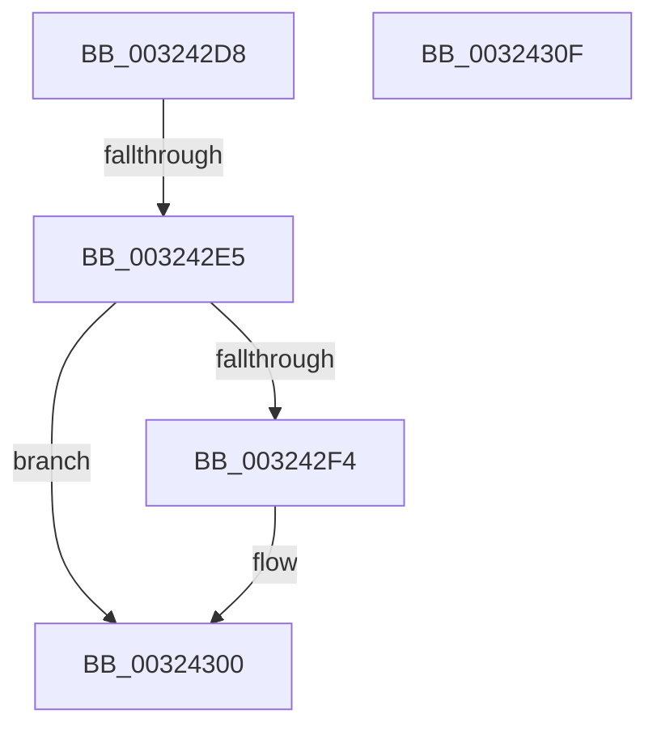

# sub_003242D8

- RVA: `0x003242D8`–`0x00324310` (길이 `56` bytes)
- VA: `0x00000001403242D8`
- 실행 섹션: `.text`
- PDB 이름 있음: `아니요`; PDB Function 태그: `아니요`
- unwind 정보 RVA: `0x00075A10`
- 디코드: `15`개 명령, `56/56` bytes 표시
- 미해석 바이트: `0` (있으면 어셈블리에 `.byte`로 보존)

> 이 문서는 커널 이미지의 기계어와 PDB 기호를 분석해 생성했습니다. 4번과 5번은 함수 원형과 자료형을 바이너리 사용 방식에서 추정한 C 해석이며 원본 소스 복구 결과는 아닙니다.

## 1. Dependencies

- 직접 호출 지점: **1**; 고유 호출 대상: **1**
- 직접 호출자로 확인된 함수: **0**
- RIP 상대 이미지 참조: **2**

### Outgoing calls
- `0x003242FB` → [KiLowerIrqlProcessIrqlFlags](../4F/KiLowerIrqlProcessIrqlFlags_function_004F5698.md) (function, `0x004F5698`)

### Direct callers
- 이 함수 시작 RVA로 연결되는 직접 call은 확인되지 않았습니다. 간접 호출은 완전히 역산할 수 없습니다.

### Static image references
- `0x003242D8` → RVA `0x00FC6B06` (`ALMOSTRO`; read)
- `0x003242EB` → RVA `0x00FC6D20` (`ALMOSTRO`; read)

## 2. Other-region calls and transfers

- 다른 실행 섹션으로 향하는 call: **0**
- call이 아닌 외부 분기/꼬리 이동: **1**
  - `0x003242DF` → [sub_0032439E](Unknown_function_0032439E.md) (`tail-transfer`)

## 3. Assembly (complete function range)

```asm
003242D8  F6 05 27 28 CA 00 01            test byte ptr [rip + 0xca2827], 1
003242DF  0F 85 B9 00 00 00               jne 0x14032439e
003242E5  45 33 C9                        xor r9d, r9d
003242E8  44 89 09                        mov dword ptr [rcx], r9d
003242EB  83 3D 2E 2A CA 00 00            cmp dword ptr [rip + 0xca2a2e], 0
003242F2  74 0C                           je 0x140324300
003242F4  44 0F 20 C1                     mov rcx, cr8
003242F8  0F B6 D3                        movzx edx, bl
003242FB  E8 98 13 1D 00                  call 0x1404f5698
00324300  44 0F 22 C3                     mov cr8, rbx
00324304  48 8B 5C 24 48                  mov rbx, qword ptr [rsp + 0x48]
00324309  48 83 C4 30                     add rsp, 0x30
0032430D  5F                              pop rdi
0032430E  C3                              ret
0032430F  CC                              int3
```

## 4. C-style interpretation (structured pseudocode)

```c
__int64 __fastcall sub_003242D8(__int64 a1, __int64 a2, __int64 a3, int a4, __int64 a5, __int64 a6, __int64 a7, __int64 a8, __int64 a9)
{
    __int64 result;
    __int64 v_rsp;

    a4 = 0;
    *(unsigned int *)(a1) = 0;
    if ((*(unsigned int *)(v_rip + 13249070)) != 0) {
        a1 = v_cr8;
        a2 = (unsigned __int8)(v_rbx);
        result = KiLowerIrqlProcessIrqlFlags(a1, a2, a3, a4);
    }
    v_rsp = (v_rsp) + (48);
    return result;
}
```

## 5. (Beta) C Style

```c
int64_t sub_003242D8(void *Arg1, int64_t Arg2, int64_t Arg3, int32_t Arg4, uint64_t Arg5, uint64_t Arg6, uint64_t Arg7, uint64_t Arg8, int64_t Arg9)
{
    uint8_t *arg1 = (uint8_t *)Arg1;

    int64_t result;
    int64_t local_rsp;

    Arg4 = 0;
    *(uint32_t *)(arg1) = 0;
    if ((*(uint32_t *)(v_rip + 0xCA2A2E)) != 0) {
        Arg1 = v_cr8;
        Arg2 = (uint8_t)(local_rbx);
        result = KiLowerIrqlProcessIrqlFlags(Arg1, Arg2, Arg3, Arg4);
    }
    local_rsp = (local_rsp) + (48);
    return result;
}
```

### 관측된 메모리 오프셋

구조체 형식이 확인되지 않은 접근은 인자 기준의 오프셋으로만 기록했습니다.

| 기준 인자 | 오프셋 표현 | 폭 (bit) | 접근 |
|---|---:|---:|---|
| `Arg1` | `+ 0x0` | `32` | `W` |

## 6. Execution-region graph

[열기: 2D/3D 그래프와 함수 탐색 컨트롤 패널](../../../control-panel.html?section=text&rva=0x003242D8&view=graph)

- 2D 그래프는 위에서 아래로 흐르고, 3D 그래프는 빈 공간을 드래그해 회전합니다. Shift+드래그는 이동, 휠은 확대·축소, 함수 노드 선택은 대상 보고서 이동입니다.

### Static fallback


