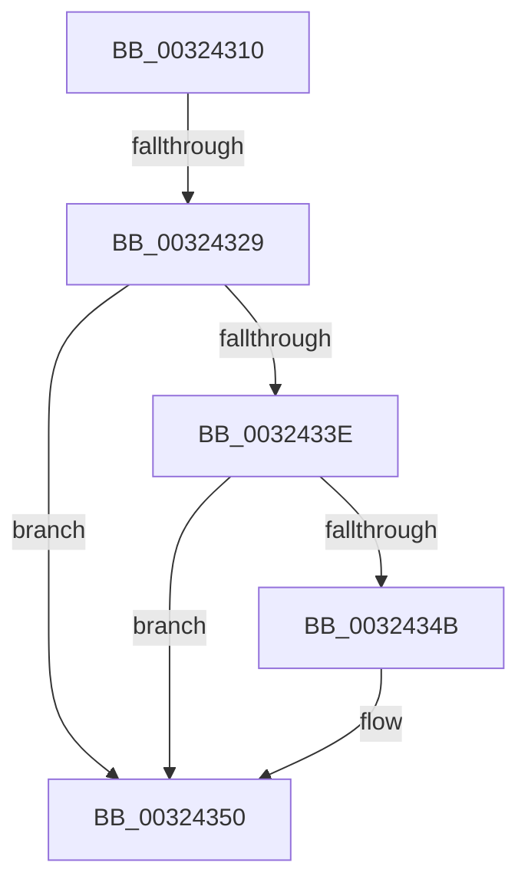

# sub_00324310

- RVA: `0x00324310`–`0x00324360` (길이 `80` bytes)
- VA: `0x0000000140324310`
- 실행 섹션: `.text`
- PDB 이름 있음: `아니요`; PDB Function 태그: `아니요`
- unwind 정보 RVA: `0x00075A24`
- 디코드: `19`개 명령, `80/80` bytes 표시
- 미해석 바이트: `0` (있으면 어셈블리에 `.byte`로 보존)

> 이 문서는 커널 이미지의 기계어와 PDB 기호를 분석해 생성했습니다. 4번과 5번은 함수 원형과 자료형을 바이너리 사용 방식에서 추정한 C 해석이며 원본 소스 복구 결과는 아닙니다.

## 1. Dependencies

- 직접 호출 지점: **1**; 고유 호출 대상: **1**
- 직접 호출자로 확인된 함수: **0**
- RIP 상대 이미지 참조: **0**

### Outgoing calls
- `0x0032434B` → [KiCheckForKernelApcDelivery](../2E/KiCheckForKernelApcDelivery_function_002E2C80.md) (function, `0x002E2C80`)

### Direct callers
- 이 함수 시작 RVA로 연결되는 직접 call은 확인되지 않았습니다. 간접 호출은 완전히 역산할 수 없습니다.

### Static image references
- 디코드된 RIP-relative 메모리 참조가 없습니다.

## 2. Other-region calls and transfers

- 다른 실행 섹션으로 향하는 call: **0**
- call이 아닌 외부 분기/꼬리 이동: **1**
  - `0x00324323` → [sub_003243BB](Unknown_function_003243BB.md) (`tail-transfer`)

## 3. Assembly (complete function range)

```asm
00324310  65 48 8B 0C 25 20 00 00 00      mov rcx, qword ptr gs:[0x20]
00324319  4C 8B 81 B8 8E 00 00            mov r8, qword ptr [rcx + 0x8eb8]
00324320  4D 85 C0                        test r8, r8
00324323  0F 85 92 00 00 00               jne 0x1403243bb
00324329  FB                              sti
0032432A  65 48 8B 0C 25 88 01 00 00      mov rcx, qword ptr gs:[0x188]
00324333  90                              nop
00324334  66 83 81 E6 01 00 00 01         add word ptr [rcx + 0x1e6], 1
0032433C  75 12                           jne 0x140324350
0032433E  48 8D 81 98 00 00 00            lea rax, [rcx + 0x98]
00324345  90                              nop
00324346  48 39 00                        cmp qword ptr [rax], rax
00324349  74 05                           je 0x140324350
0032434B  E8 30 E9 FB FF                  call 0x1402e2c80
00324350  48 8B 74 24 40                  mov rsi, qword ptr [rsp + 0x40]
00324355  48 8B 5C 24 48                  mov rbx, qword ptr [rsp + 0x48]
0032435A  48 83 C4 30                     add rsp, 0x30
0032435E  5F                              pop rdi
0032435F  C3                              ret
```

## 4. C-style interpretation (structured pseudocode)

```c
__int64 __fastcall sub_00324310(__int64 a1, __int64 a2, __int64 a3, __int64 a4, __int64 a5, __int64 a6, __int64 a7, __int64 a8, __int64 a9)
{
    __int64 result;
    __int64 v_rsp;

    if (*(unsigned __int64 *)(*(unsigned __int64 *)(gs_base + (0 + 32)) + 36536) != 0) goto loc_00324350;
    result = *(unsigned __int64 *)(gs_base + (0 + 392)) + 152;
    if ((*(unsigned __int64 *)(*(unsigned __int64 *)(gs_base + (0 + 392)) + 152)) != (*(unsigned __int64 *)(gs_base + (0 + 392)) + 152)) {
        result = KiCheckForKernelApcDelivery(*(unsigned __int64 *)(gs_base + (0 + 392)), a2, *(unsigned __int64 *)(*(unsigned __int64 *)(gs_base + (0 + 32)) + 36536), a4);
    }
    v_rsp = (v_rsp) + (48);
    return result;
}
```

## 5. (Beta) C Style

```c
int64_t sub_00324310(int64_t Arg1, int64_t Arg2, int64_t Arg3, int64_t Arg4, uint64_t Arg5, uint64_t Arg6, uint64_t Arg7, int64_t Arg8, int64_t Arg9)
{
    int64_t result;
    int64_t local_rsp;

    if (*(uint64_t *)(*(uint64_t *)(gs_base + (0 + 0x20)) + 0x8EB8) != 0) goto loc_00324350;
    result = *(uint64_t *)(gs_base + (0 + 0x188)) + 152;
    if ((*(uint64_t *)(*(uint64_t *)(gs_base + (0 + 0x188)) + 0x98)) != (*(uint64_t *)(gs_base + (0 + 0x188)) + 152)) {
        result = KiCheckForKernelApcDelivery(*(uint64_t *)(gs_base + (0 + 0x188)), Arg2, *(uint64_t *)(*(uint64_t *)(gs_base + (0 + 0x20)) + 0x8EB8), Arg4);
    }
    local_rsp = (local_rsp) + (48);
    return result;
}
```

## 6. Execution-region graph

[열기: 2D/3D 그래프와 함수 탐색 컨트롤 패널](../../../control-panel.html?section=text&rva=0x00324310&view=graph)

- 2D 그래프는 위에서 아래로 흐르고, 3D 그래프는 빈 공간을 드래그해 회전합니다. Shift+드래그는 이동, 휠은 확대·축소, 함수 노드 선택은 대상 보고서 이동입니다.

### Static fallback


