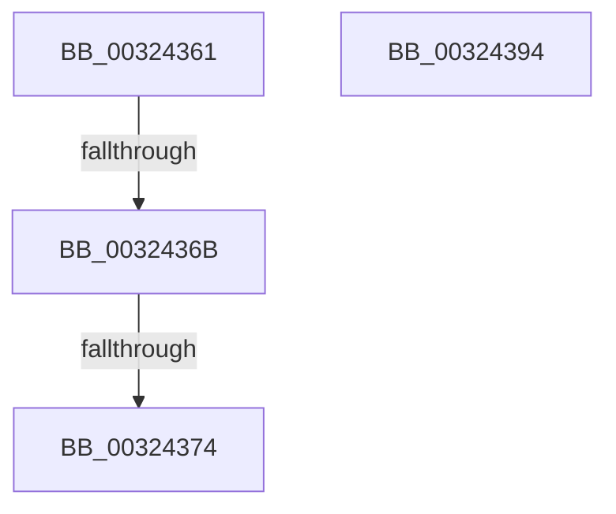

# sub_00324361

- RVA: `0x00324361`–`0x0032439E` (길이 `61` bytes)
- VA: `0x0000000140324361`
- 실행 섹션: `.text`
- PDB 이름 있음: `아니요`; PDB Function 태그: `아니요`
- unwind 정보 RVA: `0x00075A4C`
- 디코드: `14`개 명령, `61/61` bytes 표시
- 미해석 바이트: `0` (있으면 어셈블리에 `.byte`로 보존)

> 이 문서는 커널 이미지의 기계어와 PDB 기호를 분석해 생성했습니다. 4번과 5번은 함수 원형과 자료형을 바이너리 사용 방식에서 추정한 C 해석이며 원본 소스 복구 결과는 아닙니다.

## 1. Dependencies

- 직접 호출 지점: **2**; 고유 호출 대상: **2**
- 직접 호출자로 확인된 함수: **0**
- RIP 상대 이미지 참조: **0**

### Outgoing calls
- `0x0032438D` → [KiAbEntryFreeAndEnableInterrupts](../26/KiAbEntryFreeAndEnableInterrupts_function_002622D0.md) (function, `0x002622D0`)
- `0x00324394` → [ExfTryToWakePushLock](../26/ExfTryToWakePushLock_function_00265DD0.md) (function, `0x00265DD0`)

### Direct callers
- 이 함수 시작 RVA로 연결되는 직접 call은 확인되지 않았습니다. 간접 호출은 완전히 역산할 수 없습니다.

### Static image references
- 디코드된 RIP-relative 메모리 참조가 없습니다.

## 2. Other-region calls and transfers

- 다른 실행 섹션으로 향하는 call: **0**
- call이 아닌 외부 분기/꼬리 이동: **4**
  - `0x00324365` → [sub_00324249 + 0x6C](Unknown_function_00324249.md) (`tail-transfer`)
  - `0x0032436E` → [sub_00324249 + 0x6C](Unknown_function_00324249.md) (`tail-transfer`)
  - `0x00324392` → [sub_00324310 + 0x1A](Unknown_function_00324310.md) (`tail-transfer`)
  - `0x00324399` → [sub_00324249 + 0x1B](Unknown_function_00324249.md) (`tail-transfer`)

## 3. Assembly (complete function range)

```asm
00324361  45 38 4A 1A                     cmp byte ptr [r10 + 0x1a], r9b
00324365  0F 84 4A FF FF FF               je 0x1403242b5
0032436B  F6 C2 01                        test dl, 1
0032436E  0F 85 41 FF FF FF               jne 0x1403242b5
00324374  45 88 4A 1A                     mov byte ptr [r10 + 0x1a], r9b
00324378  49 8D 4A 10                     lea rcx, [r10 + 0x10]
0032437C  4C 89 4C 24 20                  mov qword ptr [rsp + 0x20], r9
00324381  4C 8B C7                        mov r8, rdi
00324384  41 B9 01 00 00 00               mov r9d, 1
0032438A  48 8B D3                        mov rdx, rbx
0032438D  E8 3E DF F3 FF                  call 0x1402622d0
00324392  EB 96                           jmp 0x14032432a
00324394  E8 37 1A F4 FF                  call 0x140265dd0
00324399  E9 C6 FE FF FF                  jmp 0x140324264
```

## 4. C-style interpretation (structured pseudocode)

```c
__int64 __fastcall sub_00324361(__int64 a1, unsigned __int8 a2, __int64 a3, __int64 a4)
{
    __int64 result;
    unsigned __int64 v_stack_p20;

    *(unsigned __int8 *)(v_r10 + 26) = (unsigned __int8)(a4);
    v_stack_p20 = a4;
    result = KiAbEntryFreeAndEnableInterrupts(v_r10 + 16, v_rbx, v_rdi, 1);
}
```

## 5. (Beta) C Style

```c
int64_t sub_00324361(int64_t Arg1, uint8_t Arg2, int64_t Arg3, int64_t Arg4)
{
    int64_t result;
    uint64_t v_stack_p20;

    *(uint8_t *)(local_r10 + 0x1A) = (uint8_t)(Arg4);
    v_stack_p20 = Arg4;
    result = KiAbEntryFreeAndEnableInterrupts(local_r10 + 16, local_rbx, local_rdi, 1);
}
```

## 6. Execution-region graph

[열기: 2D/3D 그래프와 함수 탐색 컨트롤 패널](../../../control-panel.html?section=text&rva=0x00324361&view=graph)

- 2D 그래프는 위에서 아래로 흐르고, 3D 그래프는 빈 공간을 드래그해 회전합니다. Shift+드래그는 이동, 휠은 확대·축소, 함수 노드 선택은 대상 보고서 이동입니다.

### Static fallback


