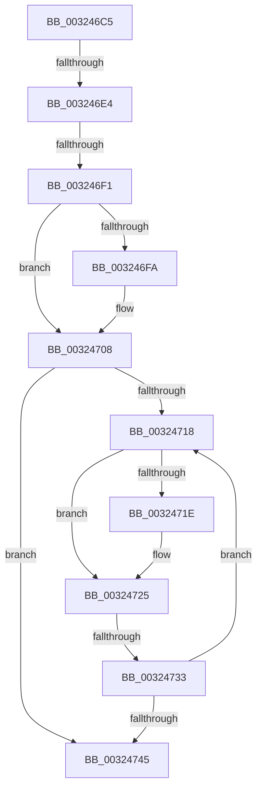

# sub_003246C5

- RVA: `0x003246C5`–`0x00324759` (길이 `148` bytes)
- VA: `0x00000001403246C5`
- 실행 섹션: `.text`
- PDB 이름 있음: `아니요`; PDB Function 태그: `아니요`
- unwind 정보 RVA: `0x00075ABC`
- 디코드: `38`개 명령, `148/148` bytes 표시
- 미해석 바이트: `0` (있으면 어셈블리에 `.byte`로 보존)

> 이 문서는 커널 이미지의 기계어와 PDB 기호를 분석해 생성했습니다. 4번과 5번은 함수 원형과 자료형을 바이너리 사용 방식에서 추정한 C 해석이며 원본 소스 복구 결과는 아닙니다.

## 1. Dependencies

- 직접 호출 지점: **1**; 고유 호출 대상: **1**
- 직접 호출자로 확인된 함수: **0**
- RIP 상대 이미지 참조: **3**

### Outgoing calls
- `0x00324701` → [ExpWaitForSpinLockExclusiveAndAcquire](ExpWaitForSpinLockExclusiveAndAcquire_function_003239A0.md) (function, `0x003239A0`)

### Direct callers
- 이 함수 시작 RVA로 연결되는 직접 call은 확인되지 않았습니다. 간접 호출은 완전히 역산할 수 없습니다.

### Static image references
- `0x003246D7` → RVA `0x00FC6D20` (`ALMOSTRO`; read)
- `0x003246E4` → RVA `0x00FC6B06` (`ALMOSTRO`; read)
- `0x00324727` → RVA `0x00FC52AC` (`ALMOSTRO`; reference)

## 2. Other-region calls and transfers

- 다른 실행 섹션으로 향하는 call: **0**
- call이 아닌 외부 분기/꼬리 이동: **3**
  - `0x003246DE` → [sub_003247A5 + 0x2F](Unknown_function_003247A5.md) (`tail-transfer`)
  - `0x003246EB` → [sub_003247A5](Unknown_function_003247A5.md) (`tail-transfer`)
  - `0x0032472D` → [sub_003247A5 + 0x40](Unknown_function_003247A5.md) (`tail-transfer`)

## 3. Assembly (complete function range)

```asm
003246C5  48 89 74 24 30                  mov qword ptr [rsp + 0x30], rsi
003246CA  44 0F 20 C6                     mov rsi, cr8
003246CE  B8 02 00 00 00                  mov eax, 2
003246D3  44 0F 22 C0                     mov cr8, rax
003246D7  83 3D 42 26 CA 00 00            cmp dword ptr [rip + 0xca2642], 0
003246DE  0F 85 F0 00 00 00               jne 0x1403247d4
003246E4  F6 05 1B 24 CA 00 21            test byte ptr [rip + 0xca241b], 0x21
003246EB  0F 85 B4 00 00 00               jne 0x1403247a5
003246F1  33 FF                           xor edi, edi
003246F3  F0 0F BA 2B 1F                  lock bts dword ptr [rbx], 0x1f
003246F8  73 0E                           jae 0x140324708
003246FA  40 0F B6 D6                     movzx edx, sil
003246FE  48 8B CB                        mov rcx, rbx
00324701  E8 9A F2 FF FF                  call 0x1403239a0
00324706  8B F8                           mov edi, eax
00324708  8B 03                           mov eax, dword ptr [rbx]
0032470A  8B C8                           mov ecx, eax
0032470C  0F BA F1 1E                     btr ecx, 0x1e
00324710  81 F9 00 00 00 80               cmp ecx, 0x80000000
00324716  74 2D                           je 0x140324745
00324718  0F BA E0 1E                     bt eax, 0x1e
0032471C  72 07                           jb 0x140324725
0032471E  F0 81 0B 00 00 00 40            lock or dword ptr [rbx], 0x40000000
00324725  FF C7                           inc edi
00324727  85 3D 7F 0B CA 00               test dword ptr [rip + 0xca0b7f], edi
0032472D  0F 84 B2 00 00 00               je 0x1403247e5
00324733  F3 90                           pause
00324735  8B 03                           mov eax, dword ptr [rbx]
00324737  8B C8                           mov ecx, eax
00324739  0F BA F1 1E                     btr ecx, 0x1e
0032473D  81 F9 00 00 00 80               cmp ecx, 0x80000000
00324743  75 D3                           jne 0x140324718
00324745  40 0F B6 C6                     movzx eax, sil
00324749  48 8B 74 24 30                  mov rsi, qword ptr [rsp + 0x30]
0032474E  48 8B 5C 24 40                  mov rbx, qword ptr [rsp + 0x40]
00324753  48 83 C4 20                     add rsp, 0x20
00324757  5F                              pop rdi
00324758  C3                              ret
```

## 4. C-style interpretation (structured pseudocode)

```c
__int64 __fastcall sub_003246C5(__int64 a1, __int64 a2, __int64 a3, __int64 a4, __int64 a5, __int64 a6, __int64 a7, __int64 a8)
{
    __int64 result;
    __int64 v_rdi;
    __int64 v_rsp;
    unsigned __int64 v_stack_p30;

    v_stack_p30 = v_rsi;
    v_rdi = 0;
    result = 2;
    if (!(condition_is_above_or_equal)) {
        a2 = (unsigned __int8)(v_cr8);
        a1 = v_rbx;
        result = ExpWaitForSpinLockExclusiveAndAcquire(a1, a2, a3, a4);
        v_rdi = (unsigned int)(result);
    }
    if (((unsigned int)((unsigned int)((unsigned int)((unsigned int)(*(unsigned int *)(v_rbx)))))) == 0x80000000ULL) goto loc_00324745;
loc_00324718:
    if (((unsigned int)((unsigned int)((unsigned int)((unsigned int)(*(unsigned int *)(v_rbx)))))) >= 0x80000000ULL) {
    }
    v_rdi = (unsigned int)((v_rdi) + 1);
    if (((unsigned int)((unsigned int)((unsigned int)((unsigned int)(*(unsigned int *)(v_rbx)))))) != 0x80000000ULL) goto loc_00324718;
loc_00324745:
    v_rsp = (v_rsp) + (32);
    return (unsigned __int8)(v_cr8);
}
```

## 5. (Beta) C Style

```c
int64_t sub_003246C5(int64_t Arg1, int64_t Arg2, int64_t Arg3, int64_t Arg4, uint64_t Arg5, int64_t Arg6, uint64_t Arg7, int64_t Arg8)
{
    int64_t result;
    int64_t local_rdi;
    int64_t local_rsp;
    uint64_t v_stack_p30;

    v_stack_p30 = local_rsi;
    local_rdi = 0;
    result = 2;
    if (!(condition_is_above_or_equal)) {
        Arg2 = (uint8_t)(v_cr8);
        Arg1 = local_rbx;
        result = ExpWaitForSpinLockExclusiveAndAcquire(Arg1, Arg2, Arg3, Arg4);
        local_rdi = (uint32_t)(result);
    }
    if (((uint32_t)((uint32_t)((uint32_t)((uint32_t)(*(uint32_t *)(local_rbx)))))) == 0x80000000ULL) goto loc_00324745;
loc_00324718:
    if (((uint32_t)((uint32_t)((uint32_t)((uint32_t)(*(uint32_t *)(local_rbx)))))) >= 0x80000000ULL) {
    }
    local_rdi = (uint32_t)((local_rdi) + 1);
    if (((uint32_t)((uint32_t)((uint32_t)((uint32_t)(*(uint32_t *)(local_rbx)))))) != 0x80000000ULL) goto loc_00324718;
loc_00324745:
    local_rsp = (local_rsp) + (32);
    return (uint8_t)(v_cr8);
}
```

## 6. Execution-region graph

[열기: 2D/3D 그래프와 함수 탐색 컨트롤 패널](../../../control-panel.html?section=text&rva=0x003246C5&view=graph)

- 2D 그래프는 위에서 아래로 흐르고, 3D 그래프는 빈 공간을 드래그해 회전합니다. Shift+드래그는 이동, 휠은 확대·축소, 함수 노드 선택은 대상 보고서 이동입니다.

### Static fallback


