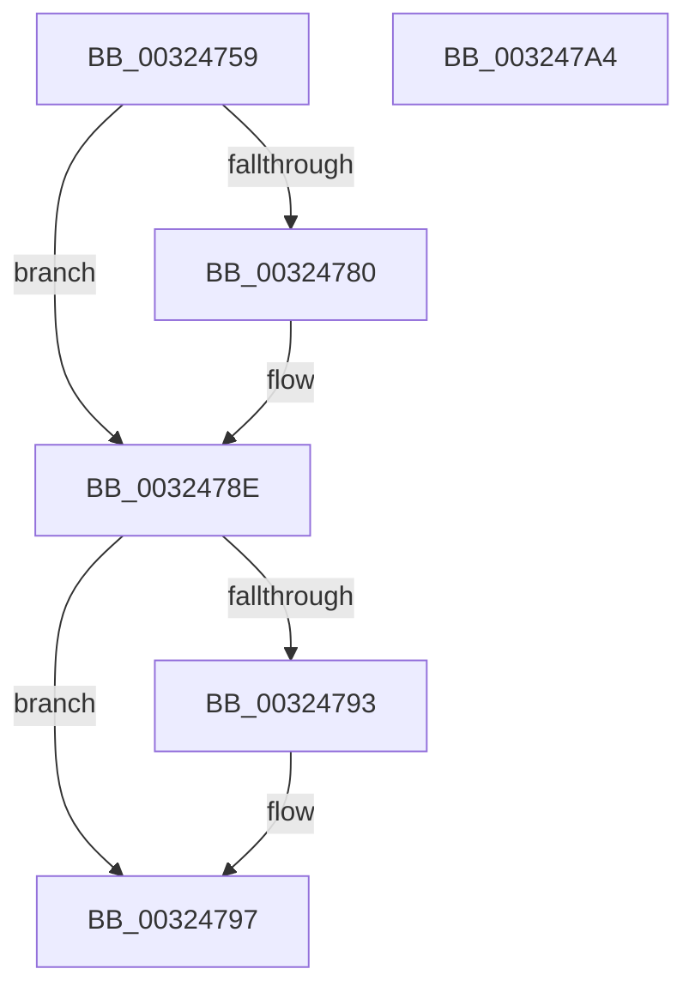

# sub_00324759

- RVA: `0x00324759`–`0x003247A5` (길이 `76` bytes)
- VA: `0x0000000140324759`
- 실행 섹션: `.text`
- PDB 이름 있음: `아니요`; PDB Function 태그: `아니요`
- unwind 정보 RVA: `0x00075AD4`
- 디코드: `23`개 명령, `76/76` bytes 표시
- 미해석 바이트: `0` (있으면 어셈블리에 `.byte`로 보존)

> 이 문서는 커널 이미지의 기계어와 PDB 기호를 분석해 생성했습니다. 4번과 5번은 함수 원형과 자료형을 바이너리 사용 방식에서 추정한 C 해석이며 원본 소스 복구 결과는 아닙니다.

## 1. Dependencies

- 직접 호출 지점: **2**; 고유 호출 대상: **2**
- 직접 호출자로 확인된 함수: **0**
- RIP 상대 이미지 참조: **0**

### Outgoing calls
- `0x00324770` → [KeAbPreAcquire](../21/KeAbPreAcquire_function_00210230.md) (function, `0x00210230`)
- `0x00324789` → [ExfAcquirePushLockExclusiveEx](../20/ExfAcquirePushLockExclusiveEx_function_0020FC90.md) (function, `0x0020FC90`)

### Direct callers
- 이 함수 시작 RVA로 연결되는 직접 call은 확인되지 않았습니다. 간접 호출은 완전히 역산할 수 없습니다.

### Static image references
- 디코드된 RIP-relative 메모리 참조가 없습니다.

## 2. Other-region calls and transfers

- 다른 실행 섹션으로 향하는 call: **0**
- 별도 외부 분기/꼬리 이동을 확인하지 못했습니다.

## 3. Assembly (complete function range)

```asm
00324759  CC                              int3
0032475A  65 48 8B 04 25 88 01 00 00      mov rax, qword ptr gs:[0x188]
00324763  45 33 C0                        xor r8d, r8d
00324766  33 D2                           xor edx, edx
00324768  66 FF 88 E6 01 00 00            dec word ptr [rax + 0x1e6]
0032476F  90                              nop
00324770  E8 BB BA EE FF                  call 0x140210230
00324775  F0 48 0F BA 2B 00               lock bts qword ptr [rbx], 0
0032477B  48 8B F8                        mov rdi, rax
0032477E  73 0E                           jae 0x14032478e
00324780  4C 8B C3                        mov r8, rbx
00324783  48 8B D0                        mov rdx, rax
00324786  48 8B CB                        mov rcx, rbx
00324789  E8 02 B5 EE FF                  call 0x14020fc90
0032478E  48 85 FF                        test rdi, rdi
00324791  74 04                           je 0x140324797
00324793  C6 47 0A 01                     mov byte ptr [rdi + 0xa], 1
00324797  B0 FF                           mov al, 0xff
00324799  48 8B 5C 24 40                  mov rbx, qword ptr [rsp + 0x40]
0032479E  48 83 C4 20                     add rsp, 0x20
003247A2  5F                              pop rdi
003247A3  C3                              ret
003247A4  CC                              int3
```

## 4. C-style interpretation (structured pseudocode)

```c
__int64 __fastcall sub_00324759(__int64 a1, int a2, int a3, __int64 a4, __int64 a5, __int64 a6, __int64 a7, __int64 a8)
{
    __int64 result;
    __int64 v_rsp;

    a3 = 0;
    a2 = 0;
    result = KeAbPreAcquire(a1, a2, a3, a4);
    if (!(condition_is_above_or_equal)) {
        a3 = v_rbx;
        a2 = result;
        a1 = v_rbx;
        result = ExfAcquirePushLockExclusiveEx(a1, a2, a3, a4);
    }
    if (result != 0) {
        *(unsigned __int8 *)(result + 10) = 1;
    }
    v_rsp = (v_rsp) + (32);
    return 255;
}
```

## 5. (Beta) C Style

```c
int64_t sub_00324759(int64_t Arg1, int32_t Arg2, int32_t Arg3, int64_t Arg4, uint64_t Arg5, uint64_t Arg6, uint64_t Arg7, int64_t Arg8)
{
    int64_t result;
    int64_t local_rsp;

    Arg3 = 0;
    Arg2 = 0;
    result = KeAbPreAcquire(Arg1, Arg2, Arg3, Arg4);
    if (!(condition_is_above_or_equal)) {
        Arg3 = local_rbx;
        Arg2 = result;
        Arg1 = local_rbx;
        result = ExfAcquirePushLockExclusiveEx(Arg1, Arg2, Arg3, Arg4);
    }
    if (result != 0) {
        *(uint8_t *)(result + 0xA) = 1;
    }
    local_rsp = (local_rsp) + (32);
    return 255;
}
```

## 6. Execution-region graph

[열기: 2D/3D 그래프와 함수 탐색 컨트롤 패널](../../../control-panel.html?section=text&rva=0x00324759&view=graph)

- 2D 그래프는 위에서 아래로 흐르고, 3D 그래프는 빈 공간을 드래그해 회전합니다. Shift+드래그는 이동, 휠은 확대·축소, 함수 노드 선택은 대상 보고서 이동입니다.

### Static fallback


