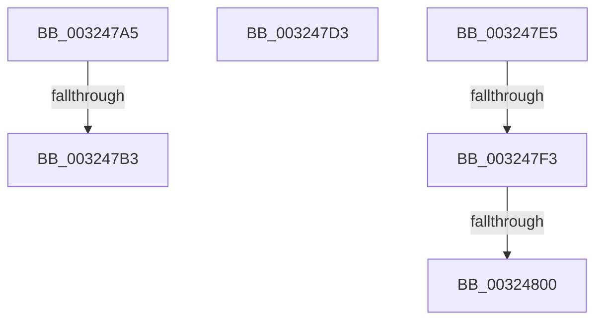

# sub_003247A5

- RVA: `0x003247A5`–`0x0032480C` (길이 `103` bytes)
- VA: `0x00000001403247A5`
- 실행 섹션: `.text`
- PDB 이름 있음: `아니요`; PDB Function 태그: `아니요`
- unwind 정보 RVA: `0x00075AE8`
- 디코드: `26`개 명령, `103/103` bytes 표시
- 미해석 바이트: `0` (있으면 어셈블리에 `.byte`로 보존)

> 이 문서는 커널 이미지의 기계어와 PDB 기호를 분석해 생성했습니다. 4번과 5번은 함수 원형과 자료형을 바이너리 사용 방식에서 추정한 C 해석이며 원본 소스 복구 결과는 아닙니다.

## 1. Dependencies

- 직접 호출 지점: **4**; 고유 호출 대상: **4**
- 직접 호출자로 확인된 함수: **0**
- RIP 상대 이미지 참조: **2**

### Outgoing calls
- `0x003247BA` → [ExpAcquireSpinLockExclusiveAtDpcLevelInstrumented](ExpAcquireSpinLockExclusiveAtDpcLevelInstrumented_function_00323A70.md) (function, `0x00323A70`)
- `0x003247DB` → [KiRaiseIrqlProcessIrqlFlags](../4F/KiRaiseIrqlProcessIrqlFlags_function_004F56FC.md) (function, `0x004F56FC`)
- `0x003247F3` → [KiCheckVpBackingLongSpinWaitHypercall](../30/KiCheckVpBackingLongSpinWaitHypercall_function_0030F490.md) (function, `0x0030F490`)
- `0x00324802` → [HvlNotifyLongSpinWait](../30/HvlNotifyLongSpinWait_function_0030F460.md) (function, `0x0030F460`)

### Direct callers
- 이 함수 시작 RVA로 연결되는 직접 call은 확인되지 않았습니다. 간접 호출은 완전히 역산할 수 없습니다.

### Static image references
- `0x003247A5` → RVA `0x00F0DE58` (`.data`; read)
- `0x003247E5` → RVA `0x00FC6AB8` (`ALMOSTRO`; read)

## 2. Other-region calls and transfers

- 다른 실행 섹션으로 향하는 call: **0**
- call이 아닌 외부 분기/꼬리 이동: **5**
  - `0x003247AD` → [sub_003246C5 + 0x2C](Unknown_function_003246C5.md) (`tail-transfer`)
  - `0x003247E0` → [sub_003246C5 + 0x1F](Unknown_function_003246C5.md) (`tail-transfer`)
  - `0x003247ED` → [sub_003246C5 + 0x6E](Unknown_function_003246C5.md) (`tail-transfer`)
  - `0x003247FA` → [sub_003246C5 + 0x6E](Unknown_function_003246C5.md) (`tail-transfer`)
  - `0x00324807` → [sub_003246C5 + 0x70](Unknown_function_003246C5.md) (`tail-transfer`)

## 3. Assembly (complete function range)

```asm
003247A5  8B 05 AD 96 BE 00               mov eax, dword ptr [rip + 0xbe96ad]
003247AB  85 C0                           test eax, eax
003247AD  0F 85 3E FF FF FF               jne 0x1403246f1
003247B3  40 0F B6 D6                     movzx edx, sil
003247B7  48 8B CB                        mov rcx, rbx
003247BA  E8 B1 F2 FF FF                  call 0x140323a70
003247BF  48 8B 5C 24 40                  mov rbx, qword ptr [rsp + 0x40]
003247C4  40 0F B6 C6                     movzx eax, sil
003247C8  48 8B 74 24 30                  mov rsi, qword ptr [rsp + 0x30]
003247CD  48 83 C4 20                     add rsp, 0x20
003247D1  5F                              pop rdi
003247D2  C3                              ret
003247D3  CC                              int3
003247D4  0F B6 D0                        movzx edx, al
003247D7  40 0F B6 CE                     movzx ecx, sil
003247DB  E8 1C 0F 1D 00                  call 0x1404f56fc
003247E0  E9 FF FE FF FF                  jmp 0x1403246e4
003247E5  8B 05 CD 22 CA 00               mov eax, dword ptr [rip + 0xca22cd]
003247EB  A8 40                           test al, 0x40
003247ED  0F 84 40 FF FF FF               je 0x140324733
003247F3  E8 98 AC FE FF                  call 0x14030f490
003247F8  84 C0                           test al, al
003247FA  0F 84 33 FF FF FF               je 0x140324733
00324800  8B CF                           mov ecx, edi
00324802  E8 59 AC FE FF                  call 0x14030f460
00324807  E9 29 FF FF FF                  jmp 0x140324735
```

## 4. C-style interpretation (structured pseudocode)

```c
__int64 __fastcall sub_003247A5(__int64 a1, __int64 a2, __int64 a3, __int64 a4, __int64 a5, __int64 a6, __int64 a7, __int64 a8)
{
    __int64 result;
    __int64 v_rsp;

    result = ExpAcquireSpinLockExclusiveAtDpcLevelInstrumented(v_rbx, (unsigned __int8)(v_rsi), a3, a4);
    v_rsp = (v_rsp) + (32);
    return (unsigned __int8)(v_rsi);
}
```

## 5. (Beta) C Style

```c
int64_t sub_003247A5(int64_t Arg1, int64_t Arg2, int64_t Arg3, int64_t Arg4, uint64_t Arg5, int64_t Arg6, uint64_t Arg7, int64_t Arg8)
{
    int64_t result;
    int64_t local_rsp;

    result = ExpAcquireSpinLockExclusiveAtDpcLevelInstrumented(local_rbx, (uint8_t)(local_rsi), Arg3, Arg4);
    local_rsp = (local_rsp) + (32);
    return (uint8_t)(local_rsi);
}
```

## 6. Execution-region graph

[열기: 2D/3D 그래프와 함수 탐색 컨트롤 패널](../../../control-panel.html?section=text&rva=0x003247A5&view=graph)

- 2D 그래프는 위에서 아래로 흐르고, 3D 그래프는 빈 공간을 드래그해 회전합니다. Shift+드래그는 이동, 휠은 확대·축소, 함수 노드 선택은 대상 보고서 이동입니다.

### Static fallback


