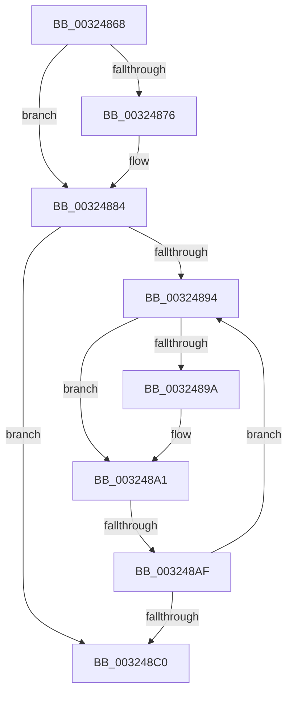

# sub_00324868

- RVA: `0x00324868`–`0x003248C5` (길이 `93` bytes)
- VA: `0x0000000140324868`
- 실행 섹션: `.text`
- PDB 이름 있음: `아니요`; PDB Function 태그: `아니요`
- unwind 정보 RVA: `0x00075B20`
- 디코드: `26`개 명령, `93/93` bytes 표시
- 미해석 바이트: `0` (있으면 어셈블리에 `.byte`로 보존)

> 이 문서는 커널 이미지의 기계어와 PDB 기호를 분석해 생성했습니다. 4번과 5번은 함수 원형과 자료형을 바이너리 사용 방식에서 추정한 C 해석이며 원본 소스 복구 결과는 아닙니다.

## 1. Dependencies

- 직접 호출 지점: **1**; 고유 호출 대상: **1**
- 직접 호출자로 확인된 함수: **0**
- RIP 상대 이미지 참조: **1**

### Outgoing calls
- `0x0032487D` → [ExpWaitForSpinLockExclusiveAndAcquire](ExpWaitForSpinLockExclusiveAndAcquire_function_003239A0.md) (function, `0x003239A0`)

### Direct callers
- 이 함수 시작 RVA로 연결되는 직접 call은 확인되지 않았습니다. 간접 호출은 완전히 역산할 수 없습니다.

### Static image references
- `0x003248A3` → RVA `0x00FC52AC` (`ALMOSTRO`; reference)

## 2. Other-region calls and transfers

- 다른 실행 섹션으로 향하는 call: **0**
- call이 아닌 외부 분기/꼬리 이동: **1**
  - `0x003248A9` → [sub_00324954](Unknown_function_00324954.md) (`tail-transfer`)

## 3. Assembly (complete function range)

```asm
00324868  48 89 74 24 40                  mov qword ptr [rsp + 0x40], rsi
0032486D  33 F6                           xor esi, esi
0032486F  F0 0F BA 2B 1F                  lock bts dword ptr [rbx], 0x1f
00324874  73 0E                           jae 0x140324884
00324876  40 0F B6 D5                     movzx edx, bpl
0032487A  48 8B CB                        mov rcx, rbx
0032487D  E8 1E F1 FF FF                  call 0x1403239a0
00324882  8B F0                           mov esi, eax
00324884  8B 13                           mov edx, dword ptr [rbx]
00324886  8B CA                           mov ecx, edx
00324888  0F BA F1 1E                     btr ecx, 0x1e
0032488C  81 F9 00 00 00 80               cmp ecx, 0x80000000
00324892  74 2C                           je 0x1403248c0
00324894  0F BA E2 1E                     bt edx, 0x1e
00324898  72 07                           jb 0x1403248a1
0032489A  F0 81 0B 00 00 00 40            lock or dword ptr [rbx], 0x40000000
003248A1  FF C6                           inc esi
003248A3  85 35 03 0A CA 00               test dword ptr [rip + 0xca0a03], esi
003248A9  0F 84 A5 00 00 00               je 0x140324954
003248AF  F3 90                           pause
003248B1  8B 13                           mov edx, dword ptr [rbx]
003248B3  8B C2                           mov eax, edx
003248B5  0F BA F0 1E                     btr eax, 0x1e
003248B9  3D 00 00 00 80                  cmp eax, 0x80000000
003248BE  75 D4                           jne 0x140324894
003248C0  48 8B 74 24 40                  mov rsi, qword ptr [rsp + 0x40]
```

## 4. C-style interpretation (structured pseudocode)

```c
__int64 __fastcall sub_00324868(__int64 a1, __int64 a2, __int64 a3, __int64 a4, __int64 a5, __int64 a6, __int64 a7, __int64 a8)
{
    __int64 result;
    __int64 v_rsi;
    unsigned __int64 v_stack_p40;

    v_stack_p40 = v_rsi;
    v_rsi = 0;
    if (!(condition_is_above_or_equal)) {
        a2 = (unsigned __int8)(v_rbp);
        a1 = v_rbx;
        result = ExpWaitForSpinLockExclusiveAndAcquire(a1, a2, a3, a4);
        v_rsi = (unsigned int)(result);
    }
    if (((unsigned int)((unsigned int)((unsigned int)((unsigned int)(*(unsigned int *)(v_rbx)))))) == 0x80000000ULL) goto loc_003248C0;
loc_00324894:
    if (((unsigned int)((unsigned int)((unsigned int)((unsigned int)(*(unsigned int *)(v_rbx)))))) >= 0x80000000ULL) {
    }
    v_rsi = (unsigned int)((v_rsi) + 1);
    if (((unsigned int)((unsigned int)((unsigned int)((unsigned int)(*(unsigned int *)(v_rbx)))))) != 0x80000000ULL) goto loc_00324894;
loc_003248C0:
    return (unsigned int)((unsigned int)((unsigned int)(*(unsigned int *)(v_rbx))));
}
```

## 5. (Beta) C Style

```c
int64_t sub_00324868(int64_t Arg1, int64_t Arg2, int64_t Arg3, int64_t Arg4, uint64_t Arg5, uint64_t Arg6, uint64_t Arg7, int64_t Arg8)
{
    int64_t result;
    int64_t local_rsi;
    uint64_t v_stack_p40;

    v_stack_p40 = local_rsi;
    local_rsi = 0;
    if (!(condition_is_above_or_equal)) {
        Arg2 = (uint8_t)(local_rbp);
        Arg1 = local_rbx;
        result = ExpWaitForSpinLockExclusiveAndAcquire(Arg1, Arg2, Arg3, Arg4);
        local_rsi = (uint32_t)(result);
    }
    if (((uint32_t)((uint32_t)((uint32_t)((uint32_t)(*(uint32_t *)(local_rbx)))))) == 0x80000000ULL) goto loc_003248C0;
loc_00324894:
    if (((uint32_t)((uint32_t)((uint32_t)((uint32_t)(*(uint32_t *)(local_rbx)))))) >= 0x80000000ULL) {
    }
    local_rsi = (uint32_t)((local_rsi) + 1);
    if (((uint32_t)((uint32_t)((uint32_t)((uint32_t)(*(uint32_t *)(local_rbx)))))) != 0x80000000ULL) goto loc_00324894;
loc_003248C0:
    return (uint32_t)((uint32_t)((uint32_t)(*(uint32_t *)(local_rbx))));
}
```

## 6. Execution-region graph

[열기: 2D/3D 그래프와 함수 탐색 컨트롤 패널](../../../control-panel.html?section=text&rva=0x00324868&view=graph)

- 2D 그래프는 위에서 아래로 흐르고, 3D 그래프는 빈 공간을 드래그해 회전합니다. Shift+드래그는 이동, 휠은 확대·축소, 함수 노드 선택은 대상 보고서 이동입니다.

### Static fallback


