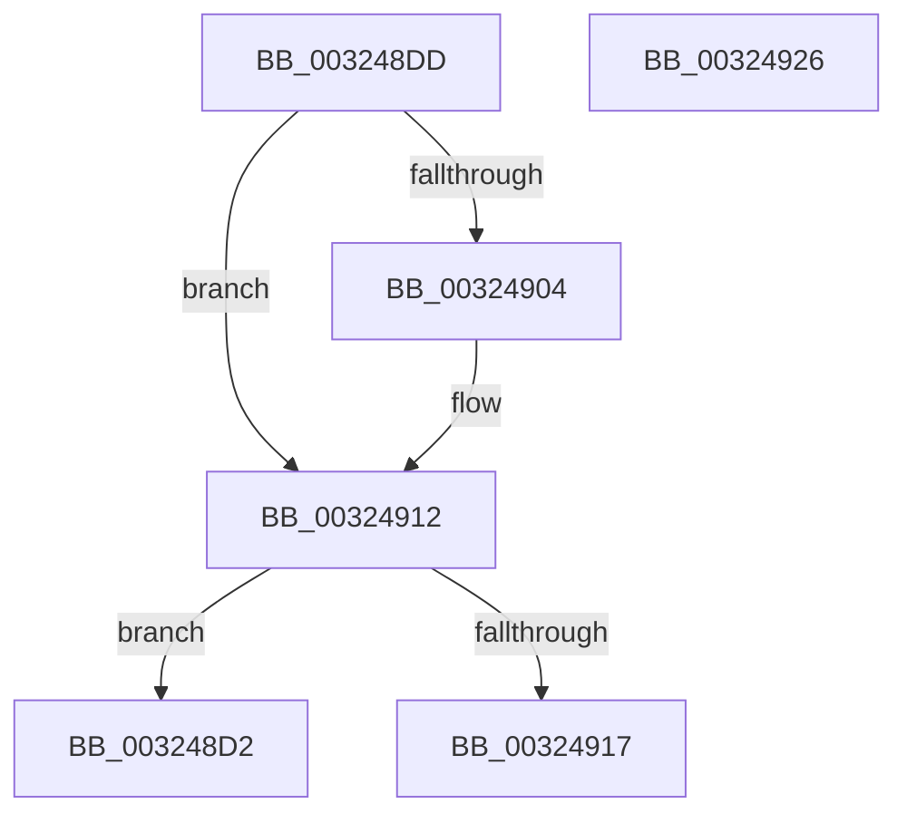

# sub_003248D2

- RVA: `0x003248D2`–`0x00324927` (길이 `85` bytes)
- VA: `0x00000001403248D2`
- 실행 섹션: `.text`
- PDB 이름 있음: `아니요`; PDB Function 태그: `아니요`
- unwind 정보 RVA: `0x00075B44`
- 디코드: `26`개 명령, `85/85` bytes 표시
- 미해석 바이트: `0` (있으면 어셈블리에 `.byte`로 보존)

> 이 문서는 커널 이미지의 기계어와 PDB 기호를 분석해 생성했습니다. 4번과 5번은 함수 원형과 자료형을 바이너리 사용 방식에서 추정한 C 해석이며 원본 소스 복구 결과는 아닙니다.

## 1. Dependencies

- 직접 호출 지점: **2**; 고유 호출 대상: **2**
- 직접 호출자로 확인된 함수: **0**
- RIP 상대 이미지 참조: **0**

### Outgoing calls
- `0x003248F4` → [KeAbPreAcquire](../21/KeAbPreAcquire_function_00210230.md) (function, `0x00210230`)
- `0x0032490D` → [ExfAcquirePushLockExclusiveEx](../20/ExfAcquirePushLockExclusiveEx_function_0020FC90.md) (function, `0x0020FC90`)

### Direct callers
- 이 함수 시작 RVA로 연결되는 직접 call은 확인되지 않았습니다. 간접 호출은 완전히 역산할 수 없습니다.

### Static image references
- 디코드된 RIP-relative 메모리 참조가 없습니다.

## 2. Other-region calls and transfers

- 다른 실행 섹션으로 향하는 call: **0**
- 별도 외부 분기/꼬리 이동을 확인하지 못했습니다.

## 3. Assembly (complete function range)

```asm
003248D2  48 8B 5C 24 48                  mov rbx, qword ptr [rsp + 0x48]
003248D7  48 83 C4 20                     add rsp, 0x20
003248DB  5F                              pop rdi
003248DC  C3                              ret
003248DD  CC                              int3
003248DE  65 48 8B 04 25 88 01 00 00      mov rax, qword ptr gs:[0x188]
003248E7  45 33 C0                        xor r8d, r8d
003248EA  33 D2                           xor edx, edx
003248EC  66 FF 88 E6 01 00 00            dec word ptr [rax + 0x1e6]
003248F3  90                              nop
003248F4  E8 37 B9 EE FF                  call 0x140210230
003248F9  F0 48 0F BA 2B 00               lock bts qword ptr [rbx], 0
003248FF  48 8B F8                        mov rdi, rax
00324902  73 0E                           jae 0x140324912
00324904  4C 8B C3                        mov r8, rbx
00324907  48 8B D0                        mov rdx, rax
0032490A  48 8B CB                        mov rcx, rbx
0032490D  E8 7E B3 EE FF                  call 0x14020fc90
00324912  48 85 FF                        test rdi, rdi
00324915  74 BB                           je 0x1403248d2
00324917  48 8B 5C 24 48                  mov rbx, qword ptr [rsp + 0x48]
0032491C  C6 47 0A 01                     mov byte ptr [rdi + 0xa], 1
00324920  48 83 C4 20                     add rsp, 0x20
00324924  5F                              pop rdi
00324925  C3                              ret
00324926  CC                              int3
```

## 4. C-style interpretation (structured pseudocode)

```c
__int64 __fastcall sub_003248D2(__int64 a1, int a2, int a3, __int64 a4, __int64 a5, __int64 a6, __int64 a7, __int64 a8, __int64 a9)
{
    __int64 v_rsp;
    unsigned __int64 v_stack_p70;

    v_rsp = (v_rsp) + (32);
    return result;
}
```

## 5. (Beta) C Style

```c
int64_t sub_003248D2(int64_t Arg1, int32_t Arg2, int32_t Arg3, int64_t Arg4, uint64_t Arg5, uint64_t Arg6, uint64_t Arg7, uint64_t Arg8, int64_t Arg9)
{
    int64_t local_rsp;
    uint64_t v_stack_p70;

    local_rsp = (local_rsp) + (32);
    return result;
}
```

## 6. Execution-region graph

[열기: 2D/3D 그래프와 함수 탐색 컨트롤 패널](../../../control-panel.html?section=text&rva=0x003248D2&view=graph)

- 2D 그래프는 위에서 아래로 흐르고, 3D 그래프는 빈 공간을 드래그해 회전합니다. Shift+드래그는 이동, 휠은 확대·축소, 함수 노드 선택은 대상 보고서 이동입니다.

### Static fallback


