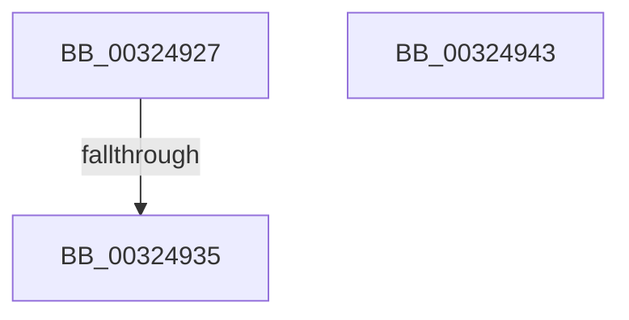

# sub_00324927

- RVA: `0x00324927`–`0x00324954` (길이 `45` bytes)
- VA: `0x0000000140324927`
- 실행 섹션: `.text`
- PDB 이름 있음: `아니요`; PDB Function 태그: `아니요`
- unwind 정보 RVA: `0x00075B5C`
- 디코드: `11`개 명령, `45/45` bytes 표시
- 미해석 바이트: `0` (있으면 어셈블리에 `.byte`로 보존)

> 이 문서는 커널 이미지의 기계어와 PDB 기호를 분석해 생성했습니다. 4번과 5번은 함수 원형과 자료형을 바이너리 사용 방식에서 추정한 C 해석이며 원본 소스 복구 결과는 아닙니다.

## 1. Dependencies

- 직접 호출 지점: **2**; 고유 호출 대상: **2**
- 직접 호출자로 확인된 함수: **0**
- RIP 상대 이미지 참조: **1**

### Outgoing calls
- `0x0032493C` → [ExpAcquireSpinLockExclusiveAtDpcLevelInstrumented](ExpAcquireSpinLockExclusiveAtDpcLevelInstrumented_function_00323A70.md) (function, `0x00323A70`)
- `0x0032494A` → [KiRaiseIrqlProcessIrqlFlags](../4F/KiRaiseIrqlProcessIrqlFlags_function_004F56FC.md) (function, `0x004F56FC`)

### Direct callers
- 이 함수 시작 RVA로 연결되는 직접 call은 확인되지 않았습니다. 간접 호출은 완전히 역산할 수 없습니다.

### Static image references
- `0x00324927` → RVA `0x00F0DE58` (`.data`; read)

## 2. Other-region calls and transfers

- 다른 실행 섹션으로 향하는 call: **0**
- call이 아닌 외부 분기/꼬리 이동: **3**
  - `0x0032492F` → [sub_00324868](Unknown_function_00324868.md) (`tail-transfer`)
  - `0x00324941` → [sub_003248C5](Unknown_function_003248C5.md) (`tail-transfer`)
  - `0x0032494F` → [sub_0032483C + 0x1F](Unknown_function_0032483C.md) (`tail-transfer`)

## 3. Assembly (complete function range)

```asm
00324927  8B 05 2B 95 BE 00               mov eax, dword ptr [rip + 0xbe952b]
0032492D  85 C0                           test eax, eax
0032492F  0F 85 33 FF FF FF               jne 0x140324868
00324935  40 0F B6 D5                     movzx edx, bpl
00324939  48 8B CB                        mov rcx, rbx
0032493C  E8 2F F1 FF FF                  call 0x140323a70
00324941  EB 82                           jmp 0x1403248c5
00324943  0F B6 D0                        movzx edx, al
00324946  40 0F B6 CD                     movzx ecx, bpl
0032494A  E8 AD 0D 1D 00                  call 0x1404f56fc
0032494F  E9 07 FF FF FF                  jmp 0x14032485b
```

## 4. C-style interpretation (structured pseudocode)

```c
__int64 __fastcall sub_00324927(void)
{
    __int64 result;

    result = ExpAcquireSpinLockExclusiveAtDpcLevelInstrumented(v_rbx, (unsigned __int8)(v_rbp), a3, a4);
}
```

## 5. (Beta) C Style

```c
void sub_00324927(void)
{
    int64_t result;

    result = ExpAcquireSpinLockExclusiveAtDpcLevelInstrumented(local_rbx, (uint8_t)(local_rbp), a3, a4);
}
```

## 6. Execution-region graph

[열기: 2D/3D 그래프와 함수 탐색 컨트롤 패널](../../../control-panel.html?section=text&rva=0x00324927&view=graph)

- 2D 그래프는 위에서 아래로 흐르고, 3D 그래프는 빈 공간을 드래그해 회전합니다. Shift+드래그는 이동, 휠은 확대·축소, 함수 노드 선택은 대상 보고서 이동입니다.

### Static fallback


