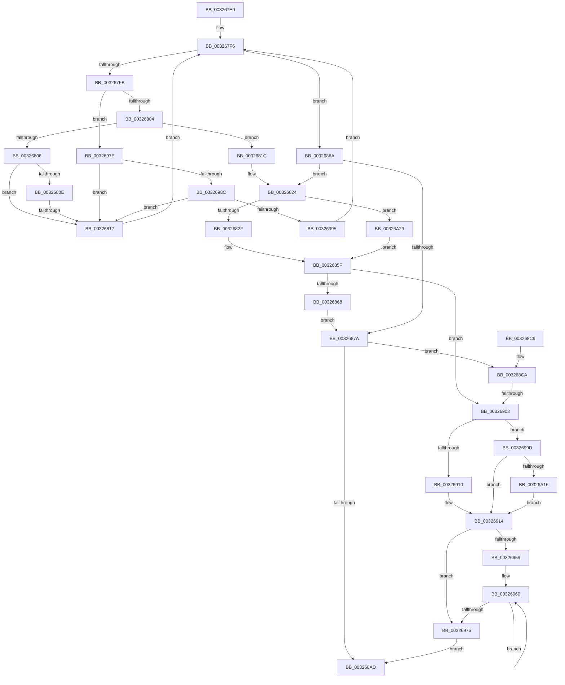

# sub_003267E9

- RVA: `0x003267E9`–`0x00326A3F` (길이 `598` bytes)
- VA: `0x00000001403267E9`
- 실행 섹션: `.text`
- PDB 이름 있음: `아니요`; PDB Function 태그: `아니요`
- unwind 정보 RVA: `0x00075CD8`
- 디코드: `169`개 명령, `598/598` bytes 표시
- 미해석 바이트: `0` (있으면 어셈블리에 `.byte`로 보존)

> 이 문서는 커널 이미지의 기계어와 PDB 기호를 분석해 생성했습니다. 4번과 5번은 함수 원형과 자료형을 바이너리 사용 방식에서 추정한 C 해석이며 원본 소스 복구 결과는 아닙니다.

## 1. Dependencies

- 직접 호출 지점: **10**; 고유 호출 대상: **9**
- 직접 호출자로 확인된 함수: **0**
- RIP 상대 이미지 참조: **0**

### Outgoing calls
- `0x00326832` → [RtlRbRemoveNode](../2E/RtlRbRemoveNode_function_002E4C10.md) (function, `0x002E4C10`)
- `0x0032688B` → [RtlpHpReleaseLockExclusive](RtlpHpReleaseLockExclusive_function_00324230.md) (function, `0x00324230`)
- `0x003268A0` → [RtlpHpSegSegmentAllocate](RtlpHpSegSegmentAllocate_function_00326A78.md) (function, `0x00326A78`)
- `0x003268D3` → [RtlpHpSegSegmentInitialize](../47/RtlpHpSegSegmentInitialize_function_00478EB0.md) (function, `0x00478EB0`)
- `0x003268E7` → [RtlpHpSegLockAcquire](../2E/RtlpHpSegLockAcquire_function_002E34A0.md) (function, `0x002E34A0`)
- `0x003268F6` → [RtlpHpSegHeapAddSegment](../49/RtlpHpSegHeapAddSegment_function_00491970.md) (function, `0x00491970`)
- `0x0032694C` → [RtlpHpReleaseLockExclusive](RtlpHpReleaseLockExclusive_function_00324230.md) (function, `0x00324230`)
- `0x003269CF` → [RtlpHpSegPageRangeCountCommittedPages](RtlpHpSegPageRangeCountCommittedPages_function_00326B80.md) (function, `0x00326B80`)
- `0x00326A1F` → [RtlpHpSegFreeRangeInsert](../2E/RtlpHpSegFreeRangeInsert_function_002E4380.md) (function, `0x002E4380`)
- `0x00326A32` → [RtlpHpSegLargeRangeAllocate](../2E/RtlpHpSegLargeRangeAllocate_function_002E7398.md) (function, `0x002E7398`)

### Direct callers
- 이 함수 시작 RVA로 연결되는 직접 call은 확인되지 않았습니다. 간접 호출은 완전히 역산할 수 없습니다.

### Static image references
- 디코드된 RIP-relative 메모리 참조가 없습니다.

## 2. Other-region calls and transfers

- 다른 실행 섹션으로 향하는 call: **0**
- call이 아닌 외부 분기/꼬리 이동: **2**
  - `0x00326811` → [sub_00326A50](Unknown_function_00326A50.md) (`tail-transfer`)
  - `0x003268FD` → [sub_00326A50 + 0x8](Unknown_function_00326A50.md) (`tail-transfer`)

## 3. Assembly (complete function range)

```asm
003267E9  48 89 7C 24 50                  mov qword ptr [rsp + 0x50], rdi
003267EE  45 33 C0                        xor r8d, r8d
003267F1  4C 89 74 24 58                  mov qword ptr [rsp + 0x58], r14
003267F6  48 85 DB                        test rbx, rbx
003267F9  74 6F                           je 0x14032686a
003267FB  3B 4B 1C                        cmp ecx, dword ptr [rbx + 0x1c]
003267FE  0F 82 7A 01 00 00               jb 0x14032697e
00326804  76 16                           jbe 0x14032681c
00326806  48 8B 43 08                     mov rax, qword ptr [rbx + 8]
0032680A  85 D2                           test edx, edx
0032680C  74 09                           je 0x140326817
0032680E  48 85 C0                        test rax, rax
00326811  0F 85 39 02 00 00               jne 0x140326a50
00326817  48 8B D8                        mov rbx, rax
0032681A  EB DA                           jmp 0x1403267f6
0032681C  8B FE                           mov edi, esi
0032681E  81 E7 00 00 80 00               and edi, 0x800000
00326824  48 8B D3                        mov rdx, rbx
00326827  85 FF                           test edi, edi
00326829  0F 85 FA 01 00 00               jne 0x140326a29
0032682F  49 8B C9                        mov rcx, r9
00326832  E8 D9 E3 FB FF                  call 0x1402e4c10
00326837  33 C0                           xor eax, eax
00326839  0F 57 C0                        xorps xmm0, xmm0
0032683C  0F 11 03                        movups xmmword ptr [rbx], xmm0
0032683F  48 89 43 10                     mov qword ptr [rbx + 0x10], rax
00326843  8B 43 1C                        mov eax, dword ptr [rbx + 0x1c]
00326846  F7 D0                           not eax
00326848  C7 03 DD CC DD CC               mov dword ptr [rbx], 0xccddccdd
0032684E  0F B7 C8                        movzx ecx, ax
00326851  49 0F BF 47 16                  movsx rax, word ptr [r15 + 0x16]
00326856  48 F7 D9                        neg rcx
00326859  F0 4A 01 4C 38 10               lock add qword ptr [rax + r15 + 0x10], rcx
0032685F  48 85 DB                        test rbx, rbx
00326862  0F 85 9B 00 00 00               jne 0x140326903
00326868  EB 10                           jmp 0x14032687a
0032686A  8B FE                           mov edi, esi
0032686C  49 8B D8                        mov rbx, r8
0032686F  81 E7 00 00 80 00               and edi, 0x800000
00326875  4D 85 C0                        test r8, r8
00326878  75 AA                           jne 0x140326824
0032687A  41 8B 47 28                     mov eax, dword ptr [r15 + 0x28]
0032687E  49 8D 4F 40                     lea rcx, [r15 + 0x40]
00326882  0F B6 D0                        movzx edx, al
00326885  45 0F B6 C4                     movzx r8d, r12b
00326889  23 D5                           and edx, ebp
0032688B  E8 A0 D9 FF FF                  call 0x140324230
00326890  8B CF                           mov ecx, edi
00326892  F7 D9                           neg ecx
00326894  49 8B CF                        mov rcx, r15
00326897  45 1B C0                        sbb r8d, r8d
0032689A  33 D2                           xor edx, edx
0032689C  41 83 E0 02                     and r8d, 2
003268A0  E8 D3 01 00 00                  call 0x140326a78
003268A5  4C 8B F0                        mov r14, rax
003268A8  48 85 C0                        test rax, rax
003268AB  75 1D                           jne 0x1403268ca
003268AD  4C 8B 74 24 58                  mov r14, qword ptr [rsp + 0x58]
003268B2  48 8B 7C 24 50                  mov rdi, qword ptr [rsp + 0x50]
003268B7  48 8B 5C 24 60                  mov rbx, qword ptr [rsp + 0x60]
003268BC  48 83 C4 20                     add rsp, 0x20
003268C0  41 5F                           pop r15
003268C2  41 5D                           pop r13
003268C4  41 5C                           pop r12
003268C6  5E                              pop rsi
003268C7  5D                              pop rbp
003268C8  C3                              ret
003268C9  CC                              int3
003268CA  45 33 C0                        xor r8d, r8d
003268CD  49 8B D6                        mov rdx, r14
003268D0  49 8B CF                        mov rcx, r15
003268D3  E8 D8 25 15 00                  call 0x140478eb0
003268D8  41 0F B6 5F 0A                  movzx ebx, byte ptr [r15 + 0xa]
003268DD  49 8B CF                        mov rcx, r15
003268E0  48 C1 E3 05                     shl rbx, 5
003268E4  49 03 DE                        add rbx, r14
003268E7  E8 B4 CB FB FF                  call 0x1402e34a0
003268EC  49 8B D6                        mov rdx, r14
003268EF  49 8B CF                        mov rcx, r15
003268F2  44 0F B6 E0                     movzx r12d, al
003268F6  E8 75 B0 16 00                  call 0x140491970
003268FB  85 FF                           test edi, edi
003268FD  0F 85 55 01 00 00               jne 0x140326a58
00326903  0F B6 4B 1F                     movzx ecx, byte ptr [rbx + 0x1f]
00326907  41 3B CD                        cmp ecx, r13d
0032690A  0F 85 8D 00 00 00               jne 0x14032699d
00326910  41 8D 7D FF                     lea edi, [r13 - 1]
00326914  0F B6 43 18                     movzx eax, byte ptr [rbx + 0x18]
00326918  45 0F B6 C4                     movzx r8d, r12b
0032691C  C1 EE 18                        shr esi, 0x18
0032691F  40 80 E6 0C                     and sil, 0xc
00326923  8B CF                           mov ecx, edi
00326925  40 0A F0                        or sil, al
00326928  48 C1 E1 05                     shl rcx, 5
0032692C  40 0A F5                        or sil, bpl
0032692F  40 88 73 18                     mov byte ptr [rbx + 0x18], sil
00326933  0F B6 44 19 18                  movzx eax, byte ptr [rcx + rbx + 0x18]
00326938  40 0A C5                        or al, bpl
0032693B  88 44 19 18                     mov byte ptr [rcx + rbx + 0x18], al
0032693F  49 8D 4F 40                     lea rcx, [r15 + 0x40]
00326943  41 8B 47 28                     mov eax, dword ptr [r15 + 0x28]
00326947  0F B6 D0                        movzx edx, al
0032694A  23 D5                           and edx, ebp
0032694C  E8 DF D8 FF FF                  call 0x140324230
00326951  C6 43 1A 00                     mov byte ptr [rbx + 0x1a], 0
00326955  3B FD                           cmp edi, ebp
00326957  76 1D                           jbe 0x140326976
00326959  48 8D 4B 38                     lea rcx, [rbx + 0x38]
0032695D  0F 1F 00                        nop dword ptr [rax]
00326960  40 88 69 02                     mov byte ptr [rcx + 2], bpl
00326964  FF C5                           inc ebp
00326966  0F B6 01                        movzx eax, byte ptr [rcx]
00326969  48 8D 49 20                     lea rcx, [rcx + 0x20]
0032696D  0C 01                           or al, 1
0032696F  88 41 E0                        mov byte ptr [rcx - 0x20], al
00326972  3B EF                           cmp ebp, edi
00326974  72 EA                           jb 0x140326960
00326976  48 8B C3                        mov rax, rbx
00326979  E9 2F FF FF FF                  jmp 0x1403268ad
0032697E  48 8B 03                        mov rax, qword ptr [rbx]
00326981  4C 8B C3                        mov r8, rbx
00326984  85 D2                           test edx, edx
00326986  0F 84 8B FE FF FF               je 0x140326817
0032698C  48 85 C0                        test rax, rax
0032698F  0F 84 82 FE FF FF               je 0x140326817
00326995  48 33 D8                        xor rbx, rax
00326998  E9 59 FE FF FF                  jmp 0x1403267f6
0032699D  41 2B CD                        sub ecx, r13d
003269A0  45 8B F5                        mov r14d, r13d
003269A3  44 0F B6 C1                     movzx r8d, cl
003269A7  FF C9                           dec ecx
003269A9  48 C1 E1 05                     shl rcx, 5
003269AD  49 C1 E6 05                     shl r14, 5
003269B1  4C 03 F3                        add r14, rbx
003269B4  41 8D 50 FF                     lea edx, [r8 - 1]
003269B8  41 0F B6 46 18                  movzx eax, byte ptr [r14 + 0x18]
003269BD  0C 02                           or al, 2
003269BF  41 88 46 18                     mov byte ptr [r14 + 0x18], al
003269C3  42 88 54 31 1A                  mov byte ptr [rcx + r14 + 0x1a], dl
003269C8  49 8B D6                        mov rdx, r14
003269CB  45 88 46 1F                     mov byte ptr [r14 + 0x1f], r8b
003269CF  E8 AC 01 00 00                  call 0x140326b80
003269D4  41 C7 06 DD CC DD CC            mov dword ptr [r14], 0xccddccdd
003269DB  41 8D 4D FF                     lea ecx, [r13 - 1]
003269DF  66 F7 D0                        not ax
003269E2  45 8D 45 FF                     lea r8d, [r13 - 1]
003269E6  66 41 89 46 1C                  mov word ptr [r14 + 0x1c], ax
003269EB  41 8B C0                        mov eax, r8d
003269EE  48 C1 E0 05                     shl rax, 5
003269F2  88 4C 18 1A                     mov byte ptr [rax + rbx + 0x1a], cl
003269F6  44 88 6B 1F                     mov byte ptr [rbx + 0x1f], r13b
003269FA  41 0F B7 4E 1C                  movzx ecx, word ptr [r14 + 0x1c]
003269FF  66 2B 4B 1C                     sub cx, word ptr [rbx + 0x1c]
00326A03  66 F7 D1                        not cx
00326A06  66 89 4B 1C                     mov word ptr [rbx + 0x1c], cx
00326A0A  41 8B F8                        mov edi, r8d
00326A0D  4D 85 F6                        test r14, r14
00326A10  0F 84 FE FE FF FF               je 0x140326914
00326A16  45 33 C0                        xor r8d, r8d
00326A19  49 8B D6                        mov rdx, r14
00326A1C  49 8B CF                        mov rcx, r15
00326A1F  E8 5C D9 FB FF                  call 0x1402e4380
00326A24  E9 EB FE FF FF                  jmp 0x140326914
00326A29  44 8B CD                        mov r9d, ebp
00326A2C  45 8B C5                        mov r8d, r13d
00326A2F  49 8B CF                        mov rcx, r15
00326A32  E8 61 09 FC FF                  call 0x1402e7398
00326A37  48 8B D8                        mov rbx, rax
00326A3A  E9 20 FE FF FF                  jmp 0x14032685f
```

## 4. C-style interpretation (structured pseudocode)

```c
__int64 __fastcall sub_003267E9(int a1, int a2, int a3, __int64 a4, __int64 a5, __int64 a6, __int64 a7, __int64 a8, __int64 a9, __int64 a10, __int64 a11, __int64 a12)
{
    __int64 result;
    __int64 v_r14;
    __int64 v_rbp;
    __int64 v_rbx;
    __int64 v_rdi;
    __int64 v_rsi;
    __int64 v_rsp;
    unsigned __int64 v_stack_p50;
    unsigned __int64 v_stack_p58;

    v_stack_p50 = v_rdi;
    a3 = 0;
    v_stack_p58 = v_r14;
loc_003267F6:
    if (v_rbx == 0) goto loc_0032686A;
    if (a1 < (*(unsigned int *)(v_rbx + 28))) goto loc_0032697E;
    if (a1 <= (*(unsigned int *)(v_rbx + 28))) goto loc_0032681C;
    if (a2 == 0) goto loc_00326817;
loc_00326817:
    goto loc_003267F6;
loc_0032681C:
    v_rdi = (unsigned int)(((unsigned int)((unsigned int)(v_rsi))) & (0x800000ULL));
loc_00326824:
    if ((unsigned int)(v_rdi) != 0) goto loc_00326A29;
    result = RtlRbRemoveNode(a4, *(unsigned __int64 *)(v_rbx + 8), a3, a4);
    result = 0;
    *(unsigned __int64 *)(*(unsigned __int64 *)(v_rbx + 8)) = v_xmm0;
    *(unsigned __int64 *)(*(unsigned __int64 *)(v_rbx + 8) + 16) = 0;
    result = (unsigned int)(~((unsigned int)(*(unsigned int *)(*(unsigned __int64 *)(v_rbx + 8) + 28))));
    *(unsigned int *)(*(unsigned __int64 *)(v_rbx + 8)) = 0xCCDDCCDDULL;
    a1 = -((unsigned __int16)(result));
loc_0032685F:
    if (*(unsigned __int64 *)(v_rbx + 8) != 0) goto loc_00326903;
    goto loc_0032687A;
loc_0032686A:
    v_rdi = (unsigned int)(((unsigned int)((unsigned int)(v_rsi))) & (0x800000ULL));
    if (0 != 0) goto loc_00326824;
loc_0032687A:
    a2 = (unsigned int)(((unsigned __int8)((unsigned int)(*(unsigned int *)(v_r15 + 40)))) & ((unsigned int)(v_rbp)));
    result = RtlpHpReleaseLockExclusive(v_r15 + 64, a2, (unsigned __int8)(v_r12), a4);
    a1 = (unsigned int)(-((unsigned int)((unsigned int)(v_rdi))));
    a2 = 0;
    a3 = (unsigned int)(((unsigned __int8)(v_r12)) & (2));
    result = RtlpHpSegSegmentAllocate(v_r15, a2, a3, a4);
    if (result != 0) goto loc_003268CA;
loc_003268AD:
    v_rsp = (v_rsp) + (32);
    return result;
loc_003268CA:
    a3 = 0;
    result = RtlpHpSegSegmentInitialize(v_r15, a11, a3, a4);
    v_rbx = (*(unsigned __int8 *)(v_r15 + 10)) << (5);
    v_rbx = (v_rbx) + (a11);
    result = RtlpHpSegLockAcquire(v_r15, a11, a3, a4);
    result = RtlpHpSegHeapAddSegment(v_r15, a11, a3, a4);
loc_00326903:
    if (((unsigned int)(*(unsigned __int8 *)(v_rbx + 31))) != ((unsigned int)(v_r13))) goto loc_0032699D;
loc_00326914:
    v_rsi = (unsigned int)((v_rsi) >> (24));
    v_rsi = (unsigned __int8)((v_rsi) & (12));
    v_rsi = (unsigned __int8)((v_rsi) | ((unsigned __int8)(*(unsigned __int8 *)(v_rbx + 24))));
    a1 = ((unsigned int)((unsigned int)(v_r13 - 1))) << (5);
    v_rsi = (unsigned __int8)((v_rsi) | ((unsigned __int8)(v_rbp)));
    *(unsigned __int8 *)(v_rbx + 24) = (unsigned __int8)(v_rsi);
    result = (unsigned __int8)((*(unsigned __int8 *)(a1 + v_rbx * 1 + 24)) | ((unsigned __int8)(v_rbp)));
    *(unsigned __int8 *)(a1 + v_rbx * 1 + 24) = (unsigned __int8)(result);
    a2 = (unsigned int)(((unsigned __int8)((unsigned int)(*(unsigned int *)(v_r15 + 40)))) & ((unsigned int)(v_rbp)));
    result = RtlpHpReleaseLockExclusive(v_r15 + 64, a2, (unsigned __int8)((unsigned __int8)(result)), a4);
    *(unsigned __int8 *)(v_rbx + 26) = 0;
    if (((unsigned int)(v_r13 - 1)) <= ((unsigned int)(v_rbp))) goto loc_00326976;
loc_00326960:
    *(unsigned __int8 *)(v_rbx + 56 + 2) = (unsigned __int8)(v_rbp);
    v_rbp = (unsigned int)((v_rbp) + 1);
    result = (unsigned __int8)((*(unsigned __int8 *)(v_rbx + 56)) | (1));
    *(unsigned __int8 *)(v_rbx + 56 + 32 - 32) = (unsigned __int8)(result);
    if (((unsigned int)(v_rbp)) < ((unsigned int)(v_r13 - 1))) goto loc_00326960;
loc_00326976:
    goto loc_003268AD;
loc_0032697E:
    if (a2 == 0) goto loc_00326817;
    if (*(unsigned __int64 *)(v_rbx) == 0) goto loc_00326817;
    v_rbx = (v_rbx) ^ (*(unsigned __int64 *)(v_rbx));
    goto loc_003267F6;
loc_0032699D:
    a1 = (unsigned int)((v_rbx + 56 + 32) - ((unsigned int)(v_r13)));
    a1 = (unsigned int)((a1) - 1);
    a1 = (a1) << (5);
    v_r14 = ((unsigned int)((unsigned int)(v_r13))) << (5);
    v_r14 = (v_r14) + (v_rbx);
    result = (unsigned __int8)((*(unsigned __int8 *)(v_r14 + 24)) | (2));
    *(unsigned __int8 *)(v_r14 + 24) = (unsigned __int8)(result);
    *(unsigned __int8 *)(a1 + v_r14 * 1 + 26) = (unsigned __int8)((unsigned __int8)(a1) - 1);
    *(unsigned __int8 *)(v_r14 + 31) = (unsigned __int8)((unsigned __int8)(a1));
    result = RtlpHpSegPageRangeCountCommittedPages(a1, v_r14, (unsigned __int8)(a1), a4);
    *(unsigned int *)(v_r14) = 0xCCDDCCDDULL;
    result = (unsigned __int16)(~(result));
    *(unsigned __int16 *)(v_r14 + 28) = (unsigned __int16)(result);
    result = ((unsigned int)((unsigned int)(v_r13 - 1))) << (5);
    *(unsigned __int8 *)(result + v_rbx * 1 + 26) = (unsigned __int8)(v_r13 - 1);
    *(unsigned __int8 *)(v_rbx + 31) = (unsigned __int8)(v_r13);
    a1 = (unsigned __int16)((*(unsigned __int16 *)(v_r14 + 28)) - (*(unsigned __int16 *)(v_rbx + 28)));
    a1 = (unsigned __int16)(~(a1));
    *(unsigned __int16 *)(v_rbx + 28) = (unsigned __int16)(a1);
    if (v_r14 == 0) goto loc_00326914;
    a3 = 0;
    result = RtlpHpSegFreeRangeInsert(v_r15, v_r14, a3, a4);
    goto loc_00326914;
loc_00326A29:
    result = RtlpHpSegLargeRangeAllocate(v_r15, v_r14, (unsigned int)((unsigned int)(v_r13)), (unsigned int)((unsigned int)(v_rbp)));
    goto loc_0032685F;
}
```

## 5. (Beta) C Style

```c
int64_t sub_003267E9(int32_t Arg1, int32_t Arg2, int32_t Arg3, int64_t Arg4, uint64_t Arg5, uint64_t Arg6, uint64_t Arg7, uint64_t Arg8, uint64_t Arg9, int64_t Arg10, int64_t Arg11, int64_t Arg12)
{
    int64_t result;
    int64_t local_r14;
    int64_t local_rbp;
    int64_t local_rbx;
    int64_t local_rdi;
    int64_t local_rsi;
    int64_t local_rsp;
    uint64_t v_stack_p50;
    uint64_t v_stack_p58;

    v_stack_p50 = local_rdi;
    Arg3 = 0;
    v_stack_p58 = local_r14;
loc_003267F6:
    if (local_rbx == 0) goto loc_0032686A;
    if (Arg1 < (*(uint32_t *)(local_rbx + 0x1C))) goto loc_0032697E;
    if (Arg1 <= (*(uint32_t *)(local_rbx + 0x1C))) goto loc_0032681C;
    if (Arg2 == 0) goto loc_00326817;
loc_00326817:
    goto loc_003267F6;
loc_0032681C:
    local_rdi = (uint32_t)(((uint32_t)((uint32_t)(local_rsi))) & (0x800000ULL));
loc_00326824:
    if ((uint32_t)(local_rdi) != 0) goto loc_00326A29;
    result = RtlRbRemoveNode(Arg4, *(uint64_t *)(local_rbx + 0x8), Arg3, Arg4);
    result = 0;
    *(uint64_t *)(*(uint64_t *)(local_rbx + 0x8)) = v_xmm0;
    *(uint64_t *)(*(uint64_t *)(local_rbx + 0x8) + 0x10) = 0;
    result = (uint32_t)(~((uint32_t)(*(uint32_t *)(*(uint64_t *)(local_rbx + 0x8) + 0x1C))));
    *(uint32_t *)(*(uint64_t *)(local_rbx + 0x8)) = 0xCCDDCCDDULL;
    Arg1 = -((uint16_t)(result));
loc_0032685F:
    if (*(uint64_t *)(local_rbx + 0x8) != 0) goto loc_00326903;
    goto loc_0032687A;
loc_0032686A:
    local_rdi = (uint32_t)(((uint32_t)((uint32_t)(local_rsi))) & (0x800000ULL));
    if (0 != 0) goto loc_00326824;
loc_0032687A:
    Arg2 = (uint32_t)(((uint8_t)((uint32_t)(*(uint32_t *)(local_r15 + 0x28)))) & ((uint32_t)(local_rbp)));
    result = RtlpHpReleaseLockExclusive(local_r15 + 64, Arg2, (uint8_t)(local_r12), Arg4);
    Arg1 = (uint32_t)(-((uint32_t)((uint32_t)(local_rdi))));
    Arg2 = 0;
    Arg3 = (uint32_t)(((uint8_t)(local_r12)) & (2));
    result = RtlpHpSegSegmentAllocate(local_r15, Arg2, Arg3, Arg4);
    if (result != 0) goto loc_003268CA;
loc_003268AD:
    local_rsp = (local_rsp) + (32);
    return result;
loc_003268CA:
    Arg3 = 0;
    result = RtlpHpSegSegmentInitialize(local_r15, Arg11, Arg3, Arg4);
    local_rbx = (*(uint8_t *)(local_r15 + 0xA)) << (5);
    local_rbx = (local_rbx) + (Arg11);
    result = RtlpHpSegLockAcquire(local_r15, Arg11, Arg3, Arg4);
    result = RtlpHpSegHeapAddSegment(local_r15, Arg11, Arg3, Arg4);
loc_00326903:
    if (((uint32_t)(*(uint8_t *)(local_rbx + 0x1F))) != ((uint32_t)(local_r13))) goto loc_0032699D;
loc_00326914:
    local_rsi = (uint32_t)((local_rsi) >> (24));
    local_rsi = (uint8_t)((local_rsi) & (12));
    local_rsi = (uint8_t)((local_rsi) | ((uint8_t)(*(uint8_t *)(local_rbx + 0x18))));
    Arg1 = ((uint32_t)((uint32_t)(local_r13 - 1))) << (5);
    local_rsi = (uint8_t)((local_rsi) | ((uint8_t)(local_rbp)));
    *(uint8_t *)(local_rbx + 0x18) = (uint8_t)(local_rsi);
    result = (uint8_t)((*(uint8_t *)(Arg1 + local_rbx * 1 + 0x18)) | ((uint8_t)(local_rbp)));
    *(uint8_t *)(Arg1 + local_rbx * 1 + 0x18) = (uint8_t)(result);
    Arg2 = (uint32_t)(((uint8_t)((uint32_t)(*(uint32_t *)(local_r15 + 0x28)))) & ((uint32_t)(local_rbp)));
    result = RtlpHpReleaseLockExclusive(local_r15 + 64, Arg2, (uint8_t)((uint8_t)(result)), Arg4);
    *(uint8_t *)(local_rbx + 0x1A) = 0;
    if (((uint32_t)(local_r13 - 1)) <= ((uint32_t)(local_rbp))) goto loc_00326976;
loc_00326960:
    *(uint8_t *)(local_rbx + 0x38 + 0x2) = (uint8_t)(local_rbp);
    local_rbp = (uint32_t)((local_rbp) + 1);
    result = (uint8_t)((*(uint8_t *)(local_rbx + 0x38)) | (1));
    *(uint8_t *)(local_rbx + 0x38 + 0x20 - 0x20) = (uint8_t)(result);
    if (((uint32_t)(local_rbp)) < ((uint32_t)(local_r13 - 1))) goto loc_00326960;
loc_00326976:
    goto loc_003268AD;
loc_0032697E:
    if (Arg2 == 0) goto loc_00326817;
    if (*(uint64_t *)(local_rbx) == 0) goto loc_00326817;
    local_rbx = (local_rbx) ^ (*(uint64_t *)(local_rbx));
    goto loc_003267F6;
loc_0032699D:
    Arg1 = (uint32_t)((local_rbx + 56 + 32) - ((uint32_t)(local_r13)));
    Arg1 = (uint32_t)((Arg1) - 1);
    Arg1 = (Arg1) << (5);
    local_r14 = ((uint32_t)((uint32_t)(local_r13))) << (5);
    local_r14 = (local_r14) + (local_rbx);
    result = (uint8_t)((*(uint8_t *)(local_r14 + 0x18)) | (2));
    *(uint8_t *)(local_r14 + 0x18) = (uint8_t)(result);
    *(uint8_t *)(Arg1 + local_r14 * 1 + 0x1A) = (uint8_t)((uint8_t)(Arg1) - 1);
    *(uint8_t *)(local_r14 + 0x1F) = (uint8_t)((uint8_t)(Arg1));
    result = RtlpHpSegPageRangeCountCommittedPages(Arg1, local_r14, (uint8_t)(Arg1), Arg4);
    *(uint32_t *)(local_r14) = 0xCCDDCCDDULL;
    result = (uint16_t)(~(result));
    *(uint16_t *)(local_r14 + 0x1C) = (uint16_t)(result);
    result = ((uint32_t)((uint32_t)(local_r13 - 1))) << (5);
    *(uint8_t *)(result + local_rbx * 1 + 0x1A) = (uint8_t)(local_r13 - 1);
    *(uint8_t *)(local_rbx + 0x1F) = (uint8_t)(local_r13);
    Arg1 = (uint16_t)((*(uint16_t *)(local_r14 + 0x1C)) - (*(uint16_t *)(local_rbx + 0x1C)));
    Arg1 = (uint16_t)(~(Arg1));
    *(uint16_t *)(local_rbx + 0x1C) = (uint16_t)(Arg1);
    if (local_r14 == 0) goto loc_00326914;
    Arg3 = 0;
    result = RtlpHpSegFreeRangeInsert(local_r15, local_r14, Arg3, Arg4);
    goto loc_00326914;
loc_00326A29:
    result = RtlpHpSegLargeRangeAllocate(local_r15, local_r14, (uint32_t)((uint32_t)(local_r13)), (uint32_t)((uint32_t)(local_rbp)));
    goto loc_0032685F;
}
```

## 6. Execution-region graph

[열기: 2D/3D 그래프와 함수 탐색 컨트롤 패널](../../../control-panel.html?section=text&rva=0x003267E9&view=graph)

- 2D 그래프는 위에서 아래로 흐르고, 3D 그래프는 빈 공간을 드래그해 회전합니다. Shift+드래그는 이동, 휠은 확대·축소, 함수 노드 선택은 대상 보고서 이동입니다.

### Static fallback


