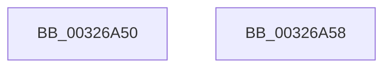

# sub_00326A50

- RVA: `0x00326A50`–`0x00326A71` (길이 `33` bytes)
- VA: `0x0000000140326A50`
- 실행 섹션: `.text`
- PDB 이름 있음: `아니요`; PDB Function 태그: `아니요`
- unwind 정보 RVA: `0x00075D04`
- 디코드: `9`개 명령, `33/33` bytes 표시
- 미해석 바이트: `0` (있으면 어셈블리에 `.byte`로 보존)

> 이 문서는 커널 이미지의 기계어와 PDB 기호를 분석해 생성했습니다. 4번과 5번은 함수 원형과 자료형을 바이너리 사용 방식에서 추정한 C 해석이며 원본 소스 복구 결과는 아닙니다.

## 1. Dependencies

- 직접 호출 지점: **1**; 고유 호출 대상: **1**
- 직접 호출자로 확인된 함수: **0**
- RIP 상대 이미지 참조: **0**

### Outgoing calls
- `0x00326A64` → [RtlpHpSegLargeRangeAllocate](../2E/RtlpHpSegLargeRangeAllocate_function_002E7398.md) (function, `0x002E7398`)

### Direct callers
- 이 함수 시작 RVA로 연결되는 직접 call은 확인되지 않았습니다. 간접 호출은 완전히 역산할 수 없습니다.

### Static image references
- 디코드된 RIP-relative 메모리 참조가 없습니다.

## 2. Other-region calls and transfers

- 다른 실행 섹션으로 향하는 call: **0**
- call이 아닌 외부 분기/꼬리 이동: **2**
  - `0x00326A53` → [sub_003267E9 + 0xD](Unknown_function_003267E9.md) (`tail-transfer`)
  - `0x00326A6C` → [sub_003267E9 + 0x11A](Unknown_function_003267E9.md) (`tail-transfer`)

## 3. Assembly (complete function range)

```asm
00326A50  48 33 D8                        xor rbx, rax
00326A53  E9 9E FD FF FF                  jmp 0x1403267f6
00326A58  45 33 C9                        xor r9d, r9d
00326A5B  45 8B C5                        mov r8d, r13d
00326A5E  48 8B D3                        mov rdx, rbx
00326A61  49 8B CF                        mov rcx, r15
00326A64  E8 2F 09 FC FF                  call 0x1402e7398
00326A69  48 8B D8                        mov rbx, rax
00326A6C  E9 92 FE FF FF                  jmp 0x140326903
```

## 4. C-style interpretation (structured pseudocode)

```c
__int64 __fastcall sub_00326A50(__int64 a1, __int64 a2, __int64 a3, int a4)
{
    __int64 v_rbx;

    v_rbx = (v_rbx) ^ (result);
}
```

## 5. (Beta) C Style

```c
int64_t sub_00326A50(int64_t Arg1, int64_t Arg2, int64_t Arg3, int32_t Arg4)
{
    int64_t local_rbx;

    local_rbx = (local_rbx) ^ (result);
}
```

## 6. Execution-region graph

[열기: 2D/3D 그래프와 함수 탐색 컨트롤 패널](../../../control-panel.html?section=text&rva=0x00326A50&view=graph)

- 2D 그래프는 위에서 아래로 흐르고, 3D 그래프는 빈 공간을 드래그해 회전합니다. Shift+드래그는 이동, 휠은 확대·축소, 함수 노드 선택은 대상 보고서 이동입니다.

### Static fallback


