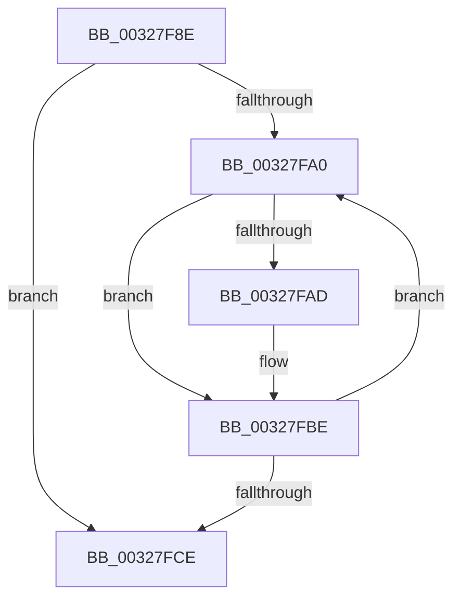

# sub_00327F8E

- RVA: `0x00327F8E`–`0x00327FD5` (길이 `71` bytes)
- VA: `0x0000000140327F8E`
- 실행 섹션: `.text`
- PDB 이름 있음: `아니요`; PDB Function 태그: `아니요`
- unwind 정보 RVA: `0x00075E7C`
- 디코드: `19`개 명령, `71/71` bytes 표시
- 미해석 바이트: `0` (있으면 어셈블리에 `.byte`로 보존)

> 이 문서는 커널 이미지의 기계어와 PDB 기호를 분석해 생성했습니다. 4번과 5번은 함수 원형과 자료형을 바이너리 사용 방식에서 추정한 C 해석이며 원본 소스 복구 결과는 아닙니다.

## 1. Dependencies

- 직접 호출 지점: **3**; 고유 호출 대상: **2**
- 직접 호출자로 확인된 함수: **0**
- RIP 상대 이미지 참조: **0**

### Outgoing calls
- `0x00327F93` → [PsGetNextPartition](../3B/PsGetNextPartition_function_003B9D5C.md) (function, `0x003B9D5C`)
- `0x00327FB9` → [KeSetEvent](../33/KeSetEvent_function_0033F310.md) (function, `0x0033F310`)
- `0x00327FC1` → [PsGetNextPartition](../3B/PsGetNextPartition_function_003B9D5C.md) (function, `0x003B9D5C`)

### Direct callers
- 이 함수 시작 RVA로 연결되는 직접 call은 확인되지 않았습니다. 간접 호출은 완전히 역산할 수 없습니다.

### Static image references
- 디코드된 RIP-relative 메모리 참조가 없습니다.

## 2. Other-region calls and transfers

- 다른 실행 섹션으로 향하는 call: **0**
- call이 아닌 외부 분기/꼬리 이동: **1**
  - `0x00327FD3` → [MiFreeExcessSegments + 0x28](MiFreeExcessSegments_function_00327F50.md) (`tail-transfer`)

## 3. Assembly (complete function range)

```asm
00327F8E  48 89 5C 24 20                  mov qword ptr [rsp + 0x20], rbx
00327F93  E8 C4 1D 09 00                  call 0x1403b9d5c
00327F98  48 8B D8                        mov rbx, rax
00327F9B  48 85 C0                        test rax, rax
00327F9E  74 2E                           je 0x140327fce
00327FA0  48 8B 0B                        mov rcx, qword ptr [rbx]
00327FA3  48 83 B9 38 08 00 00 00         cmp qword ptr [rcx + 0x838], 0
00327FAB  74 11                           je 0x140327fbe
00327FAD  48 81 C1 F8 06 00 00            add rcx, 0x6f8
00327FB4  45 33 C0                        xor r8d, r8d
00327FB7  33 D2                           xor edx, edx
00327FB9  E8 52 73 01 00                  call 0x14033f310
00327FBE  48 8B CB                        mov rcx, rbx
00327FC1  E8 96 1D 09 00                  call 0x1403b9d5c
00327FC6  48 8B D8                        mov rbx, rax
00327FC9  48 85 C0                        test rax, rax
00327FCC  75 D2                           jne 0x140327fa0
00327FCE  48 8B 5C 24 20                  mov rbx, qword ptr [rsp + 0x20]
00327FD3  EB A3                           jmp 0x140327f78
```

## 4. C-style interpretation (structured pseudocode)

```c
__int64 __fastcall sub_00327F8E(__int64 a1, int a2, int a3)
{
    __int64 result;
    unsigned __int64 v_stack_p20;

    v_stack_p20 = v_rbx;
    result = PsGetNextPartition(a1, a2, a3, a4);
    if (result == 0) goto loc_00327FCE;
loc_00327FA0:
    if ((*(unsigned __int64 *)(*(unsigned __int64 *)(result) + 2104)) != 0) {
        a1 = (*(unsigned __int64 *)(result)) + (0x6F8ULL);
        a3 = 0;
        a2 = 0;
        result = KeSetEvent(a1, a2, a3, a4);
    }
    result = PsGetNextPartition(result, a2, a3, a4);
    if (result != 0) goto loc_00327FA0;
loc_00327FCE:
}
```

## 5. (Beta) C Style

```c
int64_t sub_00327F8E(int64_t Arg1, int32_t Arg2, int32_t Arg3)
{
    int64_t result;
    uint64_t v_stack_p20;

    v_stack_p20 = local_rbx;
    result = PsGetNextPartition(Arg1, Arg2, Arg3, a4);
    if (result == 0) goto loc_00327FCE;
loc_00327FA0:
    if ((*(uint64_t *)(*(uint64_t *)(result) + 0x838)) != 0) {
        Arg1 = (*(uint64_t *)(result)) + (0x6F8ULL);
        Arg3 = 0;
        Arg2 = 0;
        result = KeSetEvent(Arg1, Arg2, Arg3, a4);
    }
    result = PsGetNextPartition(result, Arg2, Arg3, a4);
    if (result != 0) goto loc_00327FA0;
loc_00327FCE:
}
```

## 6. Execution-region graph

[열기: 2D/3D 그래프와 함수 탐색 컨트롤 패널](../../../control-panel.html?section=text&rva=0x00327F8E&view=graph)

- 2D 그래프는 위에서 아래로 흐르고, 3D 그래프는 빈 공간을 드래그해 회전합니다. Shift+드래그는 이동, 휠은 확대·축소, 함수 노드 선택은 대상 보고서 이동입니다.

### Static fallback


