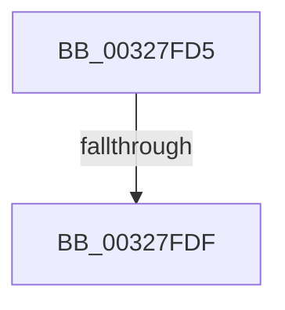

# sub_00327FD5

- RVA: `0x00327FD5`–`0x00327FF2` (길이 `29` bytes)
- VA: `0x0000000140327FD5`
- 실행 섹션: `.text`
- PDB 이름 있음: `아니요`; PDB Function 태그: `아니요`
- unwind 정보 RVA: `0x00075E90`
- 디코드: `7`개 명령, `29/29` bytes 표시
- 미해석 바이트: `0` (있으면 어셈블리에 `.byte`로 보존)

> 이 문서는 커널 이미지의 기계어와 PDB 기호를 분석해 생성했습니다. 4번과 5번은 함수 원형과 자료형을 바이너리 사용 방식에서 추정한 C 해석이며 원본 소스 복구 결과는 아닙니다.

## 1. Dependencies

- 직접 호출 지점: **1**; 고유 호출 대상: **1**
- 직접 호출자로 확인된 함수: **0**
- RIP 상대 이미지 참조: **0**

### Outgoing calls
- `0x00327FEB` → [KeSetEvent](../33/KeSetEvent_function_0033F310.md) (function, `0x0033F310`)

### Direct callers
- 이 함수 시작 RVA로 연결되는 직접 call은 확인되지 않았습니다. 간접 호출은 완전히 역산할 수 없습니다.

### Static image references
- 디코드된 RIP-relative 메모리 참조가 없습니다.

## 2. Other-region calls and transfers

- 다른 실행 섹션으로 향하는 call: **0**
- call이 아닌 외부 분기/꼬리 이동: **2**
  - `0x00327FDD` → [MiFreeExcessSegments + 0x28](MiFreeExcessSegments_function_00327F50.md) (`tail-transfer`)
  - `0x00327FF0` → [MiFreeExcessSegments + 0x28](MiFreeExcessSegments_function_00327F50.md) (`tail-transfer`)

## 3. Assembly (complete function range)

```asm
00327FD5  49 83 BA 38 08 00 00 00         cmp qword ptr [r10 + 0x838], 0
00327FDD  74 99                           je 0x140327f78
00327FDF  49 8D 8A F8 06 00 00            lea rcx, [r10 + 0x6f8]
00327FE6  45 33 C0                        xor r8d, r8d
00327FE9  33 D2                           xor edx, edx
00327FEB  E8 20 73 01 00                  call 0x14033f310
00327FF0  EB 86                           jmp 0x140327f78
```

## 4. C-style interpretation (structured pseudocode)

```c
__int64 __fastcall sub_00327FD5(__int64 a1, int a2, int a3)
{
    __int64 result;

    a3 = 0;
    a2 = 0;
    result = KeSetEvent(v_r10 + 1784, a2, a3, a4);
}
```

## 5. (Beta) C Style

```c
int64_t sub_00327FD5(int64_t Arg1, int32_t Arg2, int32_t Arg3)
{
    int64_t result;

    Arg3 = 0;
    Arg2 = 0;
    result = KeSetEvent(local_r10 + 1784, Arg2, Arg3, a4);
}
```

## 6. Execution-region graph

[열기: 2D/3D 그래프와 함수 탐색 컨트롤 패널](../../../control-panel.html?section=text&rva=0x00327FD5&view=graph)

- 2D 그래프는 위에서 아래로 흐르고, 3D 그래프는 빈 공간을 드래그해 회전합니다. Shift+드래그는 이동, 휠은 확대·축소, 함수 노드 선택은 대상 보고서 이동입니다.

### Static fallback


