# sub_00328FA3

- RVA: `0x00328FA3`–`0x00329426` (길이 `1,155` bytes)
- VA: `0x0000000140328FA3`
- 실행 섹션: `.text`
- PDB 이름 있음: `아니요`; PDB Function 태그: `아니요`
- unwind 정보 RVA: `0x00075FB8`
- 디코드: `278`개 명령, `1,155/1,155` bytes 표시
- 미해석 바이트: `0` (있으면 어셈블리에 `.byte`로 보존)

> 이 문서는 커널 이미지의 기계어와 PDB 기호를 분석해 생성했습니다. 4번과 5번은 함수 원형과 자료형을 바이너리 사용 방식에서 추정한 C 해석이며 원본 소스 복구 결과는 아닙니다.

## 1. Dependencies

- 직접 호출 지점: **12**; 고유 호출 대상: **11**
- 직접 호출자로 확인된 함수: **0**
- RIP 상대 이미지 참조: **6**

### Outgoing calls
- `0x00328FFD` → [memset](../6C/memset_function_006C6C40.md) (function, `0x006C6C40`)
- `0x003290B0` → [MiMakeProtectionMask](MiMakeProtectionMask_function_00329480.md) (function, `0x00329480`)
- `0x00329156` → [MiChargeCommit](../28/MiChargeCommit_function_00286EB0.md) (function, `0x00286EB0`)
- `0x00329176` → [MiCommitPoolMemory](MiCommitPoolMemory_function_00329520.md) (function, `0x00329520`)
- `0x0032921E` → [MiGetLargePoolPages](MiGetLargePoolPages_function_00327FF8.md) (function, `0x00327FF8`)
- `0x0032923A` → [MiGetPoolPages](MiGetPoolPages_function_00327D3C.md) (function, `0x00327D3C`)
- `0x00329256` → [MiReservePoolMemory](../3B/MiReservePoolMemory_function_003B4AD8.md) (function, `0x003B4AD8`)
- `0x003292FF` → [MmFreePoolMemory](../2C/MmFreePoolMemory_function_002C1578.md) (function, `0x002C1578`)
- `0x00329355` → [MmFreePoolMemory](../2C/MmFreePoolMemory_function_002C1578.md) (function, `0x002C1578`)
- `0x00329390` → [KeBugCheckEx](../4F/KeBugCheckEx_function_004FD660.md) (function, `0x004FD660`)
- `0x003293EC` → [MmKasanCommitRegion](../67/MmKasanCommitRegion_function_0067FCF4.md) (function, `0x0067FCF4`)
- `0x0032941C` → [RtlpHpEnvFreeVA](../2C/RtlpHpEnvFreeVA_function_002C1534.md) (function, `0x002C1534`)

### Direct callers
- 이 함수 시작 RVA로 연결되는 직접 call은 확인되지 않았습니다. 간접 호출은 완전히 역산할 수 없습니다.

### Static image references
- `0x0032900D` → RVA `0x00FC5000` (`ALMOSTRO`; read)
- `0x003290F8` → RVA `0x00E38480` (`.data`; read)
- `0x00329115` → RVA `0x00E380C0` (`.data`; read)
- `0x00329148` → RVA `0x00E30088` (`.data`; read)
- `0x003291C1` → RVA `0x00FCEC68` (`ALMOSTRO`; read)
- `0x003293D4` → RVA `0x00FC6ED8` (`ALMOSTRO`; read)

## 2. Other-region calls and transfers

- 다른 실행 섹션으로 향하는 call: **0**
- call이 아닌 외부 분기/꼬리 이동: **4**
  - `0x003291CD` → [sub_00329430 + 0x2C](Unknown_function_00329430.md) (`tail-transfer`)
  - `0x003292ED` → [sub_00329430 + 0x1C](Unknown_function_00329430.md) (`tail-transfer`)
  - `0x00329343` → [sub_00329430 + 0x24](Unknown_function_00329430.md) (`tail-transfer`)
  - `0x00329369` → [sub_00329430](Unknown_function_00329430.md) (`tail-transfer`)

## 3. Assembly (complete function range)

```asm
00328FA3  48 89 B4 24 18 01 00 00         mov qword ptr [rsp + 0x118], rsi
00328FAB  0F BA E7 0D                     bt edi, 0xd
00328FAF  0F 82 BE 02 00 00               jb 0x140329273
00328FB5  4C 89 7C 24 38                  mov qword ptr [rsp + 0x38], r15
00328FBA  49 8B F7                        mov rsi, r15
00328FBD  4C 89 7D 7F                     mov qword ptr [rbp + 0x7f], r15
00328FC1  44 8B 65 67                     mov r12d, dword ptr [rbp + 0x67]
00328FC5  85 D2                           test edx, edx
00328FC7  B8 00 01 00 00                  mov eax, 0x100
00328FCC  41 BE 40 00 00 00               mov r14d, 0x40
00328FD2  44 0F 44 F0                     cmove r14d, eax
00328FD6  41 F6 C4 60                     test r12b, 0x60
00328FDA  0F 85 4A 02 00 00               jne 0x14032922a
00328FE0  4D 8B 2A                        mov r13, qword ptr [r10]
00328FE3  48 8D 4D 97                     lea rcx, [rbp - 0x69]
00328FE7  8B 9D 87 00 00 00               mov ebx, dword ptr [rbp + 0x87]
00328FED  33 D2                           xor edx, edx
00328FEF  4C 89 6D 57                     mov qword ptr [rbp + 0x57], r13
00328FF3  8D 43 01                        lea eax, [rbx + 1]
00328FF6  44 8D 42 68                     lea r8d, [rdx + 0x68]
00328FFA  89 45 67                        mov dword ptr [rbp + 0x67], eax
00328FFD  E8 3E DC 39 00                  call 0x1406c6c40
00329002  8D 4B 01                        lea ecx, [rbx + 1]
00329005  85 C9                           test ecx, ecx
00329007  0F 84 89 03 00 00               je 0x140329396
0032900D  0F B7 05 EC BF C9 00            movzx eax, word ptr [rip + 0xc9bfec]
00329014  3B C8                           cmp ecx, eax
00329016  0F 87 7A 03 00 00               ja 0x140329396
0032901C  8B C7                           mov eax, edi
0032901E  89 5D F7                        mov dword ptr [rbp - 9], ebx
00329021  25 00 20 00 00                  and eax, 0x2000
00329026  4D 8B C5                        mov r8, r13
00329029  89 45 77                        mov dword ptr [rbp + 0x77], eax
0032902C  0F 85 0F 02 00 00               jne 0x140329241
00329032  45 33 DB                        xor r11d, r11d
00329035  41 B9 00 80 00 00               mov r9d, 0x8000
0032903B  41 8B DB                        mov ebx, r11d
0032903E  0F BA E7 0C                     bt edi, 0xc
00329042  0F 83 54 01 00 00               jae 0x14032919c
00329048  44 0F 20 C0                     mov rax, cr8
0032904C  4C 8D 4E FF                     lea r9, [rsi - 1]
00329050  88 45 FD                        mov byte ptr [rbp - 3], al
00329053  4D 03 C8                        add r9, r8
00329056  4C 89 6D 97                     mov qword ptr [rbp - 0x69], r13
0032905A  49 C1 E9 09                     shr r9, 9
0032905E  49 BA F8 FF FF FF 7F 00 00 00   movabs r10, 0x7ffffffff8
00329068  4D 23 CA                        and r9, r10
0032906B  4C 89 5D C7                     mov qword ptr [rbp - 0x39], r11
0032906F  48 BA 00 00 00 00 80 F6 FF FF   movabs rdx, 0xfffff68000000000
00329079  48 8B C2                        mov rax, rdx
0032907C  4C 03 C8                        add r9, rax
0032907F  49 8B C0                        mov rax, r8
00329082  48 C1 E8 09                     shr rax, 9
00329086  49 23 C2                        and rax, r10
00329089  4C 89 4D E7                     mov qword ptr [rbp - 0x19], r9
0032908D  4C 2B C8                        sub r9, rax
00329090  48 8B C2                        mov rax, rdx
00329093  4C 2B C8                        sub r9, rax
00329096  4C 89 5D EF                     mov qword ptr [rbp - 0x11], r11
0032909A  49 C1 F9 03                     sar r9, 3
0032909E  41 8B CC                        mov ecx, r12d
003290A1  49 FF C1                        inc r9
003290A4  4C 89 5D CF                     mov qword ptr [rbp - 0x31], r11
003290A8  4C 89 4D 9F                     mov qword ptr [rbp - 0x61], r9
003290AC  4C 89 5D BF                     mov qword ptr [rbp - 0x41], r11
003290B0  E8 CB 03 00 00                  call 0x140329480
003290B5  83 F8 18                        cmp eax, 0x18
003290B8  0F 87 C0 02 00 00               ja 0x14032937e
003290BE  B9 52 00 00 01                  mov ecx, 0x1000052
003290C3  0F A3 C1                        bt ecx, eax
003290C6  0F 83 B2 02 00 00               jae 0x14032937e
003290CC  66 83 E0 1F                     and ax, 0x1f
003290D0  66 C1 E0 03                     shl ax, 3
003290D4  66 89 45 FB                     mov word ptr [rbp - 5], ax
003290D8  0F BA E7 1E                     bt edi, 0x1e
003290DC  73 0C                           jae 0x1403290ea
003290DE  B9 00 02 00 00                  mov ecx, 0x200
003290E3  66 0B C1                        or ax, cx
003290E6  66 89 45 FB                     mov word ptr [rbp - 5], ax
003290EA  33 C9                           xor ecx, ecx
003290EC  48 C7 45 D7 04 00 00 00         mov qword ptr [rbp - 0x29], 4
003290F4  48 89 4D B7                     mov qword ptr [rbp - 0x49], rcx
003290F8  48 8D 0D 81 F3 B0 00            lea rcx, [rip + 0xb0f381]
003290FF  48 89 4D DF                     mov qword ptr [rbp - 0x21], rcx
00329103  0F 57 C0                        xorps xmm0, xmm0
00329106  0F 11 45 A7                     movups xmmword ptr [rbp - 0x59], xmm0
0032910A  49 0F BA E6 08                  bt r14, 8
0032910F  0F 83 EE 00 00 00               jae 0x140329203
00329115  48 8D 0D A4 EF B0 00            lea rcx, [rip + 0xb0efa4]
0032911C  C7 45 D7 05 00 00 00            mov dword ptr [rbp - 0x29], 5
00329123  48 89 4D DF                     mov qword ptr [rbp - 0x21], rcx
00329127  66 83 C8 02                     or ax, 2
0032912B  66 89 45 FB                     mov word ptr [rbp - 5], ax
0032912F  0F B6 45 FB                     movzx eax, byte ptr [rbp - 5]
00329133  A8 02                           test al, 2
00329135  0F 84 DB 00 00 00               je 0x140329216
0032913B  0F B7 81 AE 00 00 00            movzx eax, word ptr [rcx + 0xae]
00329142  41 B8 01 00 00 00               mov r8d, 1
00329148  48 8B 0D 39 6F B0 00            mov rcx, qword ptr [rip + 0xb06f39]
0032914F  49 8B D1                        mov rdx, r9
00329152  48 8B 0C C1                     mov rcx, qword ptr [rcx + rax*8]
00329156  E8 55 DD F5 FF                  call 0x140286eb0
0032915B  85 C0                           test eax, eax
0032915D  BB 9A 00 00 C0                  mov ebx, 0xc000009a
00329162  B8 00 00 00 00                  mov eax, 0
00329167  0F 45 D8                        cmovne ebx, eax
0032916A  85 DB                           test ebx, ebx
0032916C  0F 88 F3 01 00 00               js 0x140329365
00329172  48 8D 4D 97                     lea rcx, [rbp - 0x69]
00329176  E8 A5 03 00 00                  call 0x140329520
0032917B  8B D8                           mov ebx, eax
0032917D  85 C0                           test eax, eax
0032917F  0F 88 E0 01 00 00               js 0x140329365
00329185  45 33 DB                        xor r11d, r11d
00329188  48 81 C6 FF 0F 00 00            add rsi, 0xfff
0032918F  41 B9 00 80 00 00               mov r9d, 0x8000
00329195  48 81 E6 00 F0 FF FF            and rsi, 0xfffffffffffff000
0032919C  44 8B E7                        mov r12d, edi
0032919F  44 8B F3                        mov r14d, ebx
003291A2  41 81 E4 00 20 00 00            and r12d, 0x2000
003291A9  85 DB                           test ebx, ebx
003291AB  78 37                           js 0x1403291e4
003291AD  45 85 E4                        test r12d, r12d
003291B0  0F 85 F6 00 00 00               jne 0x1403292ac
003291B6  BB 00 80 00 00                  mov ebx, 0x8000
003291BB  0F BA E7 0C                     bt edi, 0xc
003291BF  73 15                           jae 0x1403291d6
003291C1  80 3D A0 5A CA 00 00            cmp byte ptr [rip + 0xca5aa0], 0
003291C8  74 09                           je 0x1403291d3
003291CA  4D 85 FF                        test r15, r15
003291CD  0F 85 89 02 00 00               jne 0x14032945c
003291D3  45 8B F3                        mov r14d, r11d
003291D6  48 8B 45 47                     mov rax, qword ptr [rbp + 0x47]
003291DA  4C 89 28                        mov qword ptr [rax], r13
003291DD  48 8B 45 4F                     mov rax, qword ptr [rbp + 0x4f]
003291E1  4C 89 38                        mov qword ptr [rax], r15
003291E4  48 8B B4 24 18 01 00 00         mov rsi, qword ptr [rsp + 0x118]
003291EC  41 8B C6                        mov eax, r14d
003291EF  48 81 C4 C0 00 00 00            add rsp, 0xc0
003291F6  41 5F                           pop r15
003291F8  41 5E                           pop r14
003291FA  41 5D                           pop r13
003291FC  41 5C                           pop r12
003291FE  5F                              pop rdi
003291FF  5B                              pop rbx
00329200  5D                              pop rbp
00329201  C3                              ret
00329202  CC                              int3
00329203  0F BA E7 1D                     bt edi, 0x1d
00329207  0F 83 22 FF FF FF               jae 0x14032912f
0032920D  66 83 C8 04                     or ax, 4
00329211  E9 15 FF FF FF                  jmp 0x14032912b
00329216  48 8D 4D 97                     lea rcx, [rbp - 0x69]
0032921A  A8 04                           test al, 4
0032921C  74 1C                           je 0x14032923a
0032921E  E8 D5 ED FF FF                  call 0x140327ff8
00329223  8B D8                           mov ebx, eax
00329225  E9 40 FF FF FF                  jmp 0x14032916a
0032922A  85 D2                           test edx, edx
0032922C  B8 80 00 00 00                  mov eax, 0x80
00329231  4C 0F 45 F0                     cmovne r14, rax
00329235  E9 A6 FD FF FF                  jmp 0x140328fe0
0032923A  E8 FD EA FF FF                  call 0x140327d3c
0032923F  EB E2                           jmp 0x140329223
00329241  49 8B D6                        mov rdx, r14
00329244  44 8B CB                        mov r9d, ebx
00329247  48 C1 EA 08                     shr rdx, 8
0032924B  4C 8B C6                        mov r8, rsi
0032924E  83 E2 01                        and edx, 1
00329251  33 C9                           xor ecx, ecx
00329253  83 CA 04                        or edx, 4
00329256  E8 7D B8 08 00                  call 0x1403b4ad8
0032925B  4C 8B E8                        mov r13, rax
0032925E  4C 8B C0                        mov r8, rax
00329261  48 85 C0                        test rax, rax
00329264  0F 84 37 01 00 00               je 0x1403293a1
0032926A  48 89 45 57                     mov qword ptr [rbp + 0x57], rax
0032926E  E9 BF FD FF FF                  jmp 0x140329032
00329273  49 8D 47 FF                     lea rax, [r15 - 1]
00329277  25 FF FF 1F 00                  and eax, 0x1fffff
0032927C  4C 2B F8                        sub r15, rax
0032927F  49 81 C7 FF FF 1F 00            add r15, 0x1fffff
00329286  4C 89 7C 24 38                  mov qword ptr [rsp + 0x38], r15
0032928B  49 8B F7                        mov rsi, r15
0032928E  4C 89 7D 7F                     mov qword ptr [rbp + 0x7f], r15
00329292  48 81 F9 00 00 20 00            cmp rcx, 0x200000
00329299  0F 86 22 FD FF FF               jbe 0x140328fc1
0032929F  49 8D 34 0F                     lea rsi, [r15 + rcx]
003292A3  48 89 75 7F                     mov qword ptr [rbp + 0x7f], rsi
003292A7  E9 15 FD FF FF                  jmp 0x140328fc1
003292AC  48 8B 44 24 30                  mov rax, qword ptr [rsp + 0x30]
003292B1  49 8B D5                        mov rdx, r13
003292B4  4C 8D 68 FF                     lea r13, [rax - 1]
003292B8  48 F7 D8                        neg rax
003292BB  4C 03 EA                        add r13, rdx
003292BE  4C 23 E8                        and r13, rax
003292C1  49 8B CD                        mov rcx, r13
003292C4  4C 89 6D 57                     mov qword ptr [rbp + 0x57], r13
003292C8  48 2B CA                        sub rcx, rdx
003292CB  74 41                           je 0x14032930e
003292CD  48 8D 82 FF FF 1F 00            lea rax, [rdx + 0x1fffff]
003292D4  48 25 00 00 E0 FF               and rax, 0xffffffffffe00000
003292DA  48 2B C8                        sub rcx, rax
003292DD  48 89 44 24 30                  mov qword ptr [rsp + 0x30], rax
003292E2  48 03 CA                        add rcx, rdx
003292E5  48 89 4D 87                     mov qword ptr [rbp - 0x79], rcx
003292E9  48 89 4D 7F                     mov qword ptr [rbp + 0x7f], rcx
003292ED  0F 84 59 01 00 00               je 0x14032944c
003292F3  45 8B C1                        mov r8d, r9d
003292F6  48 8D 55 7F                     lea rdx, [rbp + 0x7f]
003292FA  48 8D 4C 24 30                  lea rcx, [rsp + 0x30]
003292FF  E8 74 82 F9 FF                  call 0x1402c1578
00329304  48 8B 4D 87                     mov rcx, qword ptr [rbp - 0x79]
00329308  44 8B F0                        mov r14d, eax
0032930B  45 33 DB                        xor r11d, r11d
0032930E  48 2B F1                        sub rsi, rcx
00329311  4B 8D 14 2F                     lea rdx, [r15 + r13]
00329315  49 2B F7                        sub rsi, r15
00329318  0F 84 98 FE FF FF               je 0x1403291b6
0032931E  48 8D 82 FF FF 1F 00            lea rax, [rdx + 0x1fffff]
00329325  BB 00 80 00 00                  mov ebx, 0x8000
0032932A  48 25 00 00 E0 FF               and rax, 0xffffffffffe00000
00329330  48 2B D0                        sub rdx, rax
00329333  48 89 44 24 30                  mov qword ptr [rsp + 0x30], rax
00329338  48 8D 04 32                     lea rax, [rdx + rsi]
0032933C  48 89 45 7F                     mov qword ptr [rbp + 0x7f], rax
00329340  48 85 C0                        test rax, rax
00329343  0F 84 0B 01 00 00               je 0x140329454
00329349  44 8B C3                        mov r8d, ebx
0032934C  48 8D 55 7F                     lea rdx, [rbp + 0x7f]
00329350  48 8D 4C 24 30                  lea rcx, [rsp + 0x30]
00329355  E8 1E 82 F9 FF                  call 0x1402c1578
0032935A  44 8B F0                        mov r14d, eax
0032935D  45 33 DB                        xor r11d, r11d
00329360  E9 56 FE FF FF                  jmp 0x1403291bb
00329365  83 7D 77 00                     cmp dword ptr [rbp + 0x77], 0
00329369  0F 85 C1 00 00 00               jne 0x140329430
0032936F  45 33 DB                        xor r11d, r11d
00329372  45 8B EB                        mov r13d, r11d
00329375  4C 89 5D 57                     mov qword ptr [rbp + 0x57], r11
00329379  E9 0A FE FF FF                  jmp 0x140329188
0032937E  4C 8B CE                        mov r9, rsi
00329381  4C 89 64 24 20                  mov qword ptr [rsp + 0x20], r12
00329386  BA 00 53 00 00                  mov edx, 0x5300
0032938B  B9 1A 00 00 00                  mov ecx, 0x1a
00329390  E8 CB 42 1D 00                  call 0x1404fd660
00329395  CC                              int3
00329396  41 BE F1 00 00 C0               mov r14d, 0xc00000f1
0032939C  E9 43 FE FF FF                  jmp 0x1403291e4
003293A1  41 BE 17 00 00 C0               mov r14d, 0xc0000017
003293A7  E9 38 FE FF FF                  jmp 0x1403291e4
003293AC  49 8D 47 FF                     lea rax, [r15 - 1]
003293B0  49 8B D5                        mov rdx, r13
003293B3  83 E0 07                        and eax, 7
003293B6  48 B9 00 00 00 00 00 80 00 00   movabs rcx, 0x800000000000
003293C0  48 2B D0                        sub rdx, rax
003293C3  49 03 CD                        add rcx, r13
003293C6  48 B8 06 00 00 00 00 80 00 00   movabs rax, 0x800000000006
003293D0  48 C1 E9 03                     shr rcx, 3
003293D4  48 03 0D FD DA C9 00            add rcx, qword ptr [rip + 0xc9dafd]
003293DB  48 03 D0                        add rdx, rax
003293DE  49 03 D7                        add rdx, r15
003293E1  48 C1 EA 03                     shr rdx, 3
003293E5  48 03 15 EC DA C9 00            add rdx, qword ptr [rip + 0xc9daec]
003293EC  E8 03 69 35 00                  call 0x14067fcf4
003293F1  44 8B F0                        mov r14d, eax
003293F4  85 C0                           test eax, eax
003293F6  0F 89 DA FD FF FF               jns 0x1403291d6
003293FC  4D 85 ED                        test r13, r13
003293FF  0F 84 DF FD FF FF               je 0x1403291e4
00329405  45 85 E4                        test r12d, r12d
00329408  48 8D 54 24 38                  lea rdx, [rsp + 0x38]
0032940D  B8 00 40 00 00                  mov eax, 0x4000
00329412  48 8D 4D 57                     lea rcx, [rbp + 0x57]
00329416  0F 44 D8                        cmove ebx, eax
00329419  44 8B C3                        mov r8d, ebx
0032941C  E8 13 81 F9 FF                  call 0x1402c1534
00329421  E9 BE FD FF FF                  jmp 0x1403291e4
```

## 4. C-style interpretation (structured pseudocode)

```c
__int64 __fastcall sub_00328FA3(__int64 a1, int a2, __int64 a3, __int64 a4, __int64 a5, __int64 a6, __int64 a7, __int64 a8, __int64 a9, __int64 a10, __int64 a11, __int64 a12, __int64 a13, __int64 a14, __int64 a15, __int64 a16, __int64 a17, __int64 a18, __int64 a19, __int64 a20, __int64 a21, __int64 a22, __int64 a23, __int64 a24, __int64 a25, __int64 a26, __int64 a27, __int64 a28, __int64 a29, __int64 a30, __int64 a31, __int64 a32, __int64 a33, __int64 a34, __int64 a35)
{
    __int64 result;
    __int64 v_r11;
    __int64 v_r12;
    __int64 v_r13;
    __int64 v_r14;
    __int64 v_r15;
    __int64 v_rbx;
    __int64 v_rsi;
    __int64 v_rsp;
    unsigned __int64 v_stack_p118;
    unsigned __int64 v_stack_p128;
    unsigned __int64 v_stack_p130;
    unsigned __int64 v_stack_p38;

    v_stack_p118 = v_rsi;
    if (condition_is_below) goto loc_00329273;
    v_stack_p38 = v_r15;
    *(unsigned __int64 *)(v_rbp + 127) = v_r15;
loc_00328FC1:
    v_r14 = 64;
    if (a2 == 0) { v_r14 = 256; }
    if ((((unsigned __int8)((unsigned int)(*(unsigned int *)(v_rbp + 103)))) & (96)) != 0) goto loc_0032922A;
loc_00328FE0:
    a2 = 0;
    *(unsigned __int64 *)(v_rbp + 87) = *(unsigned __int64 *)(v_r10);
    *(unsigned int *)(v_rbp + 103) = (unsigned int)((unsigned int)(*(unsigned int *)(v_rbp + 135)) + 1);
    result = memset(v_rbp - 105, a2, a2 + 104, a4);
    if ((unsigned int)((unsigned int)(*(unsigned int *)(v_rbp + 135)) + 1) == 0) goto loc_00329396;
    if (((unsigned int)((unsigned int)(*(unsigned int *)(v_rbp + 135)) + 1)) > ((unsigned int)(*(unsigned __int16 *)(v_rip + 13221868)))) goto loc_00329396;
    *(unsigned int *)(v_rbp - 9) = (unsigned int)((unsigned int)(*(unsigned int *)(v_rbp + 135)));
    result = (unsigned int)(((unsigned int)((unsigned int)(v_rdi))) & (0x2000ULL));
    *(unsigned int *)(v_rbp + 119) = (unsigned int)(result);
    if (condition_is_not_equal) goto loc_00329241;
loc_00329032:
    v_r11 = 0;
    if (condition_is_above_or_equal) goto loc_0032919C;
    *(unsigned __int8 *)(v_rbp - 3) = (unsigned __int8)(v_cr8);
    a4 = (v_r15 - 1) + (*(unsigned __int64 *)(v_r10));
    *(unsigned __int64 *)(v_rbp - 105) = *(unsigned __int64 *)(v_r10);
    a4 = (a4) >> (9);
    a4 = (a4) & (v_r10);
    *(unsigned __int64 *)(v_rbp - 57) = 0;
    a4 = (a4) + (0);
    result = (*(unsigned __int64 *)(v_r10)) >> (9);
    result = (result) & (v_r10);
    *(unsigned __int64 *)(v_rbp - 25) = a4;
    a4 = (a4) - (result);
    a4 = (a4) - (0);
    *(unsigned __int64 *)(v_rbp - 17) = 0;
    a4 = (a4) >> (3);
    a4 = (a4) + 1;
    *(unsigned __int64 *)(v_rbp - 49) = 0;
    *(unsigned __int64 *)(v_rbp - 97) = a4;
    *(unsigned __int64 *)(v_rbp - 65) = 0;
    result = MiMakeProtectionMask((unsigned int)((unsigned int)((unsigned int)(*(unsigned int *)(v_rbp + 103)))), a2, *(unsigned __int64 *)(v_r10), a4);
    if (((unsigned int)(result)) > 24) goto loc_0032937E;
    if (((unsigned int)(result)) >= 24) goto loc_0032937E;
    result = (unsigned __int16)((result) & (31));
    result = (unsigned __int16)((result) << (3));
    *(unsigned __int16 *)(v_rbp - 5) = (unsigned __int16)(result);
    if (!(condition_is_above_or_equal)) {
        a1 = 512;
        result = (unsigned __int16)((result) | ((unsigned __int16)(a1)));
        *(unsigned __int16 *)(v_rbp - 5) = (unsigned __int16)(result);
    }
    a1 = 0;
    *(unsigned __int64 *)(v_rbp - 41) = 4;
    *(unsigned __int64 *)(v_rbp - 73) = 0;
    *(unsigned __int64 *)(v_rbp - 33) = v_rip + 11596673;
    *(unsigned __int64 *)(v_rbp - 89) = v_xmm0;
    if (condition_is_above_or_equal) goto loc_00329203;
    *(unsigned int *)(v_rbp - 41) = 5;
    *(unsigned __int64 *)(v_rbp - 33) = v_rip + 11595684;
    result = (unsigned __int16)((result) | (2));
loc_0032912B:
    *(unsigned __int16 *)(v_rbp - 5) = (unsigned __int16)(result);
loc_0032912F:
    if ((((unsigned __int8)(*(unsigned __int8 *)(v_rbp - 5))) & (2)) == 0) goto loc_00329216;
    result = MiChargeCommit(*(unsigned __int64 *)(*(unsigned __int64 *)(v_rip + 11562809) + *(unsigned __int16 *)(v_rip + 11595684 + 174) * 8), a4, 1, a4);
    v_rbx = (unsigned int)(0xC000009AULL);
    if ((unsigned int)(result) != 0) { v_rbx = 0; }
loc_0032916A:
    if (sign_flag) goto loc_00329365;
    result = MiCommitPoolMemory(v_rbp - 105, a4, 1, a4);
    if (sign_flag) goto loc_00329365;
    v_r11 = 0;
loc_00329188:
    v_rsi = (v_r15) + (0xFFFULL);
    v_rsi = (v_rsi) & (0xFFFFFFFFFFFFF000ULL);
loc_0032919C:
    v_r12 = (unsigned int)(((unsigned int)((unsigned int)(v_rdi))) & (0x2000ULL));
    if (sign_flag) goto loc_003291E4;
    if ((unsigned int)(v_r12) != 0) goto loc_003292AC;
loc_003291B6:
loc_003291BB:
    if (condition_is_above_or_equal) goto loc_003291D6;
    if ((*(unsigned __int8 *)(v_rip + 13261472)) == 0) goto loc_003291D3;
loc_003291D3:
loc_003291D6:
    *(unsigned __int64 *)(*(unsigned __int64 *)(v_rbp + 71)) = *(unsigned __int64 *)(v_r10);
    *(unsigned __int64 *)(*(unsigned __int64 *)(v_rbp + 79)) = v_r15;
loc_003291E4:
    v_rsp = (v_rsp) + (192);
    return 0;
loc_00329203:
    if (condition_is_above_or_equal) goto loc_0032912F;
    result = (unsigned __int16)((0) | (4));
    goto loc_0032912B;
loc_00329216:
    if ((((unsigned __int8)(result)) & (4)) == 0) goto loc_0032923A;
    result = MiGetLargePoolPages(v_rbp - 105, a4, 1, (unsigned int)(0x8000ULL));
loc_00329223:
    goto loc_0032916A;
loc_0032922A:
    v_r14 = 0;
    if ((unsigned int)(a4) != 0) { v_r14 = 128; }
    goto loc_00328FE0;
loc_0032923A:
    result = MiGetPoolPages(v_rbp - 105, a4, 1, (unsigned int)(0x8000ULL));
    goto loc_00329223;
loc_00329241:
    a2 = (v_r14) >> (8);
    a2 = (unsigned int)((a2) & (1));
    a1 = 0;
    a2 = (unsigned int)((a2) | (4));
    result = MiReservePoolMemory(a1, a2, a35, (unsigned int)((unsigned int)((unsigned int)((unsigned int)(result)))));
    if (result == 0) goto loc_003293A1;
    *(unsigned __int64 *)(v_rbp + 87) = result;
    goto loc_00329032;
loc_00329273:
    result = (unsigned int)((v_r15 - 1) & (0x1FFFFFULL));
    v_r15 = (v_r15) - (result);
    v_r15 = (v_r15) + (0x1FFFFFULL);
    v_stack_p130 = v_r15;
    *(unsigned __int64 *)(v_rbp + 127) = v_r15;
    if (0 <= 0x200000ULL) goto loc_00328FC1;
    *(unsigned __int64 *)(v_rbp + 127) = v_r15 + a1 * 1;
    goto loc_00328FC1;
loc_003292AC:
    result = -(a6);
    v_r13 = (a6 - 1) + (result);
    v_r13 = (v_r13) & (result);
    *(unsigned __int64 *)(v_rbp + 87) = v_r13;
    a1 = (v_r13) - (result);
    if (condition_is_equal) goto loc_0032930E;
    result = (result + 2097151) & (0xFFFFFFFFFFE00000ULL);
    a1 = (a1) - (result);
    v_stack_p128 = result;
    a1 = (a1) + (result);
    *(unsigned __int64 *)(v_rbp - 121) = a1;
    *(unsigned __int64 *)(v_rbp + 127) = a1;
    result = MmFreePoolMemory(a6, v_rbp + 127, (unsigned int)((unsigned int)((unsigned int)((unsigned int)((unsigned int)((unsigned int)(result)))))), (unsigned int)((unsigned int)((unsigned int)((unsigned int)(result)))));
    v_r11 = 0;
loc_0032930E:
    v_rsi = (v_r15 + a1 * 1) - (*(unsigned __int64 *)(v_rbp - 121));
    v_rsi = (v_rsi) - (v_r15);
    if (condition_is_equal) goto loc_003291B6;
    result = (v_r15 + v_r13 * 1 + 2097151) & (0xFFFFFFFFFFE00000ULL);
    a2 = (v_r15 + v_r13 * 1) - (result);
    v_stack_p128 = result;
    *(unsigned __int64 *)(v_rbp + 127) = a2 + v_rsi * 1;
    result = MmFreePoolMemory(a6, v_rbp + 127, (unsigned int)((unsigned int)((unsigned int)(0x8000ULL))), (unsigned int)((unsigned int)((unsigned int)((unsigned int)(result)))));
    v_r11 = 0;
    goto loc_003291BB;
loc_00329365:
    v_r11 = 0;
    *(unsigned __int64 *)(v_rbp + 87) = 0;
    goto loc_00329188;
loc_0032937E:
    v_stack_p118 = v_r12;
    result = KeBugCheckEx(26, (unsigned int)(0x5300ULL), (unsigned int)((unsigned int)((unsigned int)(0x8000ULL))), v_rsi);
loc_00329396:
    goto loc_003291E4;
loc_003293A1:
    goto loc_003291E4;
}
```

## 5. (Beta) C Style

```c
int64_t sub_00328FA3(int64_t Arg1, int32_t Arg2, int64_t Arg3, int64_t Arg4, uint64_t Arg5, void *Arg6, uint64_t Arg7, uint64_t Arg8, uint64_t Arg9, uint64_t Arg10, uint64_t Arg11, uint64_t Arg12, uint64_t Arg13, uint64_t Arg14, uint64_t Arg15, uint64_t Arg16, uint64_t Arg17, uint64_t Arg18, uint64_t Arg19, uint64_t Arg20, uint64_t Arg21, uint64_t Arg22, uint64_t Arg23, uint64_t Arg24, uint64_t Arg25, uint64_t Arg26, uint64_t Arg27, uint64_t Arg28, uint64_t Arg29, uint64_t Arg30, uint64_t Arg31, uint64_t Arg32, uint64_t Arg33, uint64_t Arg34, int64_t Arg35)
{
    uint8_t *arg6 = (uint8_t *)Arg6;

    int64_t result;
    int64_t local_r11;
    int64_t local_r12;
    int64_t local_r13;
    int64_t local_r14;
    int64_t local_r15;
    int64_t local_rbx;
    int64_t local_rsi;
    int64_t local_rsp;
    uint64_t v_stack_p118;
    uint64_t v_stack_p128;
    uint64_t v_stack_p130;
    uint64_t v_stack_p38;

    v_stack_p118 = local_rsi;
    if (condition_is_below) goto loc_00329273;
    v_stack_p38 = local_r15;
    *(uint64_t *)(local_rbp + 0x7F) = local_r15;
loc_00328FC1:
    local_r14 = 64;
    if (Arg2 == 0) { local_r14 = 256; }
    if ((((uint8_t)((uint32_t)(*(uint32_t *)(local_rbp + 0x67)))) & (96)) != 0) goto loc_0032922A;
loc_00328FE0:
    Arg2 = 0;
    *(uint64_t *)(local_rbp + 0x57) = *(uint64_t *)(local_r10);
    *(uint32_t *)(local_rbp + 0x67) = (uint32_t)((uint32_t)(*(uint32_t *)(local_rbp + 0x87)) + 1);
    result = memset(local_rbp - 105, Arg2, Arg2 + 104, Arg4);
    if ((uint32_t)((uint32_t)(*(uint32_t *)(local_rbp + 0x87)) + 1) == 0) goto loc_00329396;
    if (((uint32_t)((uint32_t)(*(uint32_t *)(local_rbp + 0x87)) + 1)) > ((uint32_t)(*(uint16_t *)(v_rip + 0xC9BFEC)))) goto loc_00329396;
    *(uint32_t *)(local_rbp - 0x9) = (uint32_t)((uint32_t)(*(uint32_t *)(local_rbp + 0x87)));
    result = (uint32_t)(((uint32_t)((uint32_t)(local_rdi))) & (0x2000ULL));
    *(uint32_t *)(local_rbp + 0x77) = (uint32_t)(result);
    if (condition_is_not_equal) goto loc_00329241;
loc_00329032:
    local_r11 = 0;
    if (condition_is_above_or_equal) goto loc_0032919C;
    *(uint8_t *)(local_rbp - 0x3) = (uint8_t)(v_cr8);
    Arg4 = (local_r15 - 1) + (*(uint64_t *)(local_r10));
    *(uint64_t *)(local_rbp - 0x69) = *(uint64_t *)(local_r10);
    Arg4 = (Arg4) >> (9);
    Arg4 = (Arg4) & (local_r10);
    *(uint64_t *)(local_rbp - 0x39) = 0;
    Arg4 = (Arg4) + (0);
    result = (*(uint64_t *)(local_r10)) >> (9);
    result = (result) & (local_r10);
    *(uint64_t *)(local_rbp - 0x19) = Arg4;
    Arg4 = (Arg4) - (result);
    Arg4 = (Arg4) - (0);
    *(uint64_t *)(local_rbp - 0x11) = 0;
    Arg4 = (Arg4) >> (3);
    Arg4 = (Arg4) + 1;
    *(uint64_t *)(local_rbp - 0x31) = 0;
    *(uint64_t *)(local_rbp - 0x61) = Arg4;
    *(uint64_t *)(local_rbp - 0x41) = 0;
    result = MiMakeProtectionMask((uint32_t)((uint32_t)((uint32_t)(*(uint32_t *)(local_rbp + 0x67)))), Arg2, *(uint64_t *)(local_r10), Arg4);
    if (((uint32_t)(result)) > 24) goto loc_0032937E;
    if (((uint32_t)(result)) >= 24) goto loc_0032937E;
    result = (uint16_t)((result) & (31));
    result = (uint16_t)((result) << (3));
    *(uint16_t *)(local_rbp - 0x5) = (uint16_t)(result);
    if (!(condition_is_above_or_equal)) {
        Arg1 = 512;
        result = (uint16_t)((result) | ((uint16_t)(Arg1)));
        *(uint16_t *)(local_rbp - 0x5) = (uint16_t)(result);
    }
    Arg1 = 0;
    *(uint64_t *)(local_rbp - 0x29) = 4;
    *(uint64_t *)(local_rbp - 0x49) = 0;
    *(uint64_t *)(local_rbp - 0x21) = v_rip + 11596673;
    *(uint64_t *)(local_rbp - 0x59) = v_xmm0;
    if (condition_is_above_or_equal) goto loc_00329203;
    *(uint32_t *)(local_rbp - 0x29) = 5;
    *(uint64_t *)(local_rbp - 0x21) = v_rip + 11595684;
    result = (uint16_t)((result) | (2));
loc_0032912B:
    *(uint16_t *)(local_rbp - 0x5) = (uint16_t)(result);
loc_0032912F:
    if ((((uint8_t)(*(uint8_t *)(local_rbp - 0x5))) & (2)) == 0) goto loc_00329216;
    result = MiChargeCommit(*(uint64_t *)(*(uint64_t *)(v_rip + 0xB06F39) + *(uint16_t *)(v_rip + 0xB0EFA4 + 0xAE) * 8), Arg4, 1, Arg4);
    local_rbx = (uint32_t)(0xC000009AULL);
    if ((uint32_t)(result) != 0) { local_rbx = 0; }
loc_0032916A:
    if (sign_flag) goto loc_00329365;
    result = MiCommitPoolMemory(local_rbp - 105, Arg4, 1, Arg4);
    if (sign_flag) goto loc_00329365;
    local_r11 = 0;
loc_00329188:
    local_rsi = (local_r15) + (0xFFFULL);
    local_rsi = (local_rsi) & (0xFFFFFFFFFFFFF000ULL);
loc_0032919C:
    local_r12 = (uint32_t)(((uint32_t)((uint32_t)(local_rdi))) & (0x2000ULL));
    if (sign_flag) goto loc_003291E4;
    if ((uint32_t)(local_r12) != 0) goto loc_003292AC;
loc_003291B6:
loc_003291BB:
    if (condition_is_above_or_equal) goto loc_003291D6;
    if ((*(uint8_t *)(v_rip + 0xCA5AA0)) == 0) goto loc_003291D3;
loc_003291D3:
loc_003291D6:
    *(uint64_t *)(*(uint64_t *)(local_rbp + 0x47)) = *(uint64_t *)(local_r10);
    *(uint64_t *)(*(uint64_t *)(local_rbp + 0x4F)) = local_r15;
loc_003291E4:
    local_rsp = (local_rsp) + (192);
    return 0;
loc_00329203:
    if (condition_is_above_or_equal) goto loc_0032912F;
    result = (uint16_t)((0) | (4));
    goto loc_0032912B;
loc_00329216:
    if ((((uint8_t)(result)) & (4)) == 0) goto loc_0032923A;
    result = MiGetLargePoolPages(local_rbp - 105, Arg4, 1, (uint32_t)(0x8000ULL));
loc_00329223:
    goto loc_0032916A;
loc_0032922A:
    local_r14 = 0;
    if ((uint32_t)(Arg4) != 0) { local_r14 = 128; }
    goto loc_00328FE0;
loc_0032923A:
    result = MiGetPoolPages(local_rbp - 105, Arg4, 1, (uint32_t)(0x8000ULL));
    goto loc_00329223;
loc_00329241:
    Arg2 = (local_r14) >> (8);
    Arg2 = (uint32_t)((Arg2) & (1));
    Arg1 = 0;
    Arg2 = (uint32_t)((Arg2) | (4));
    result = MiReservePoolMemory(Arg1, Arg2, Arg35, (uint32_t)((uint32_t)((uint32_t)((uint32_t)(result)))));
    if (result == 0) goto loc_003293A1;
    *(uint64_t *)(local_rbp + 0x57) = result;
    goto loc_00329032;
loc_00329273:
    result = (uint32_t)((local_r15 - 1) & (0x1FFFFFULL));
    local_r15 = (local_r15) - (result);
    local_r15 = (local_r15) + (0x1FFFFFULL);
    v_stack_p130 = local_r15;
    *(uint64_t *)(local_rbp + 0x7F) = local_r15;
    if (0 <= 0x200000ULL) goto loc_00328FC1;
    *(uint64_t *)(local_rbp + 0x7F) = local_r15 + Arg1 * 1;
    goto loc_00328FC1;
loc_003292AC:
    result = -(Arg6);
    local_r13 = (Arg6 - 1) + (result);
    local_r13 = (local_r13) & (result);
    *(uint64_t *)(local_rbp + 0x57) = local_r13;
    Arg1 = (local_r13) - (result);
    if (condition_is_equal) goto loc_0032930E;
    result = (result + 2097151) & (0xFFFFFFFFFFE00000ULL);
    Arg1 = (Arg1) - (result);
    v_stack_p128 = result;
    Arg1 = (Arg1) + (result);
    *(uint64_t *)(local_rbp - 0x79) = Arg1;
    *(uint64_t *)(local_rbp + 0x7F) = Arg1;
    result = MmFreePoolMemory(Arg6, local_rbp + 127, (uint32_t)((uint32_t)((uint32_t)((uint32_t)((uint32_t)((uint32_t)(result)))))), (uint32_t)((uint32_t)((uint32_t)((uint32_t)(result)))));
    local_r11 = 0;
loc_0032930E:
    local_rsi = (local_r15 + Arg1 * 1) - (*(uint64_t *)(local_rbp - 0x79));
    local_rsi = (local_rsi) - (local_r15);
    if (condition_is_equal) goto loc_003291B6;
    result = (local_r15 + local_r13 * 1 + 2097151) & (0xFFFFFFFFFFE00000ULL);
    Arg2 = (local_r15 + local_r13 * 1) - (result);
    v_stack_p128 = result;
    *(uint64_t *)(local_rbp + 0x7F) = Arg2 + local_rsi * 1;
    result = MmFreePoolMemory(Arg6, local_rbp + 127, (uint32_t)((uint32_t)((uint32_t)(0x8000ULL))), (uint32_t)((uint32_t)((uint32_t)((uint32_t)(result)))));
    local_r11 = 0;
    goto loc_003291BB;
loc_00329365:
    local_r11 = 0;
    *(uint64_t *)(local_rbp + 0x57) = 0;
    goto loc_00329188;
loc_0032937E:
    v_stack_p118 = local_r12;
    result = KeBugCheckEx(26, (uint32_t)(0x5300ULL), (uint32_t)((uint32_t)((uint32_t)(0x8000ULL))), local_rsi);
loc_00329396:
    goto loc_003291E4;
loc_003293A1:
    goto loc_003291E4;
}
```

### 관측된 메모리 오프셋

구조체 형식이 확인되지 않은 접근은 인자 기준의 오프셋으로만 기록했습니다.

| 기준 인자 | 오프셋 표현 | 폭 (bit) | 접근 |
|---|---:|---:|---|
| `Arg6` | `- 0x1` | `64` | `R` |

## 6. Execution-region graph

[열기: 2D/3D 그래프와 함수 탐색 컨트롤 패널](../../../control-panel.html?section=text&rva=0x00328FA3&view=graph)

- 2D 그래프는 위에서 아래로 흐르고, 3D 그래프는 빈 공간을 드래그해 회전합니다. Shift+드래그는 이동, 휠은 확대·축소, 함수 노드 선택은 대상 보고서 이동입니다.

### Static fallback

```mermaid
flowchart TD
  bb_00328FA3[BB_00328FA3]
  bb_00328FB5[BB_00328FB5]
  bb_00328FC1[BB_00328FC1]
  bb_00328FE0[BB_00328FE0]
  bb_0032900D[BB_0032900D]
  bb_0032901C[BB_0032901C]
  bb_00329032[BB_00329032]
  bb_00329048[BB_00329048]
  bb_003290BE[BB_003290BE]
  bb_003290CC[BB_003290CC]
  bb_003290DE[BB_003290DE]
  bb_003290EA[BB_003290EA]
  bb_00329115[BB_00329115]
  bb_0032912B[BB_0032912B]
  bb_0032912F[BB_0032912F]
  bb_0032913B[BB_0032913B]
  bb_0032916A[BB_0032916A]
  bb_00329172[BB_00329172]
  bb_00329185[BB_00329185]
  bb_00329188[BB_00329188]
  bb_0032919C[BB_0032919C]
  bb_003291AD[BB_003291AD]
  bb_003291B6[BB_003291B6]
  bb_003291BB[BB_003291BB]
  bb_003291C1[BB_003291C1]
  bb_003291CA[BB_003291CA]
  bb_003291D3[BB_003291D3]
  bb_003291D6[BB_003291D6]
  bb_003291E4[BB_003291E4]
  bb_00329202[BB_00329202]
  bb_00329203[BB_00329203]
  bb_0032920D[BB_0032920D]
  bb_00329216[BB_00329216]
  bb_0032921E[BB_0032921E]
  bb_00329223[BB_00329223]
  bb_0032922A[BB_0032922A]
  bb_0032923A[BB_0032923A]
  bb_00329241[BB_00329241]
  bb_0032926A[BB_0032926A]
  bb_00329273[BB_00329273]
  bb_0032929F[BB_0032929F]
  bb_003292AC[BB_003292AC]
  bb_003292CD[BB_003292CD]
  bb_003292F3[BB_003292F3]
  bb_0032930E[BB_0032930E]
  bb_0032931E[BB_0032931E]
  bb_00329349[BB_00329349]
  bb_00329365[BB_00329365]
  bb_0032936F[BB_0032936F]
  bb_0032937E[BB_0032937E]
  bb_00329396[BB_00329396]
  bb_003293A1[BB_003293A1]
  bb_003293AC[BB_003293AC]
  bb_003293FC[BB_003293FC]
  bb_00329405[BB_00329405]
  bb_00328FA3 -->|branch| bb_00329273
  bb_00328FA3 -->|fallthrough| bb_00328FB5
  bb_00328FB5 -->|flow| bb_00328FC1
  bb_00328FC1 -->|branch| bb_0032922A
  bb_00328FC1 -->|fallthrough| bb_00328FE0
  bb_00328FE0 -->|branch| bb_00329396
  bb_00328FE0 -->|fallthrough| bb_0032900D
  bb_0032900D -->|branch| bb_00329396
  bb_0032900D -->|fallthrough| bb_0032901C
  bb_0032901C -->|branch| bb_00329241
  bb_0032901C -->|fallthrough| bb_00329032
  bb_00329032 -->|branch| bb_0032919C
  bb_00329032 -->|fallthrough| bb_00329048
  bb_00329048 -->|branch| bb_0032937E
  bb_00329048 -->|fallthrough| bb_003290BE
  bb_003290BE -->|branch| bb_0032937E
  bb_003290BE -->|fallthrough| bb_003290CC
  bb_003290CC -->|branch| bb_003290EA
  bb_003290CC -->|fallthrough| bb_003290DE
  bb_003290DE -->|flow| bb_003290EA
  bb_003290EA -->|branch| bb_00329203
  bb_003290EA -->|fallthrough| bb_00329115
  bb_00329115 -->|flow| bb_0032912B
  bb_0032912B -->|flow| bb_0032912F
  bb_0032912F -->|branch| bb_00329216
  bb_0032912F -->|fallthrough| bb_0032913B
  bb_0032913B -->|flow| bb_0032916A
  bb_0032916A -->|branch| bb_00329365
  bb_0032916A -->|fallthrough| bb_00329172
  bb_00329172 -->|branch| bb_00329365
  bb_00329172 -->|fallthrough| bb_00329185
  bb_00329185 -->|flow| bb_00329188
  bb_00329188 -->|flow| bb_0032919C
  bb_0032919C -->|branch| bb_003291E4
  bb_0032919C -->|fallthrough| bb_003291AD
  bb_003291AD -->|branch| bb_003292AC
  bb_003291AD -->|fallthrough| bb_003291B6
  bb_003291B6 -->|flow| bb_003291BB
  bb_003291BB -->|branch| bb_003291D6
  bb_003291BB -->|fallthrough| bb_003291C1
  bb_003291C1 -->|branch| bb_003291D3
  bb_003291C1 -->|fallthrough| bb_003291CA
  bb_003291CA -->|fallthrough| bb_003291D3
  bb_003291D3 -->|flow| bb_003291D6
  bb_003291D6 -->|flow| bb_003291E4
  bb_00329202 -->|flow| bb_00329203
  bb_00329203 -->|branch| bb_0032912F
  bb_00329203 -->|fallthrough| bb_0032920D
  bb_0032920D -->|branch| bb_0032912B
  bb_00329216 -->|branch| bb_0032923A
  bb_00329216 -->|fallthrough| bb_0032921E
  bb_0032921E -->|flow| bb_00329223
  bb_00329223 -->|branch| bb_0032916A
  bb_0032922A -->|branch| bb_00328FE0
  bb_0032923A -->|branch| bb_00329223
  bb_00329241 -->|branch| bb_003293A1
  bb_00329241 -->|fallthrough| bb_0032926A
  bb_0032926A -->|branch| bb_00329032
  bb_00329273 -->|branch| bb_00328FC1
  bb_00329273 -->|fallthrough| bb_0032929F
  bb_0032929F -->|branch| bb_00328FC1
  bb_003292AC -->|branch| bb_0032930E
  bb_003292AC -->|fallthrough| bb_003292CD
  bb_003292CD -->|fallthrough| bb_003292F3
  bb_003292F3 -->|flow| bb_0032930E
  bb_0032930E -->|branch| bb_003291B6
  bb_0032930E -->|fallthrough| bb_0032931E
  bb_0032931E -->|fallthrough| bb_00329349
  bb_00329349 -->|branch| bb_003291BB
  bb_00329365 -->|fallthrough| bb_0032936F
  bb_0032936F -->|branch| bb_00329188
  bb_0032937E -->|flow| bb_00329396
  bb_00329396 -->|branch| bb_003291E4
  bb_003293A1 -->|branch| bb_003291E4
  bb_003293AC -->|branch| bb_003291D6
  bb_003293AC -->|fallthrough| bb_003293FC
  bb_003293FC -->|branch| bb_003291E4
  bb_003293FC -->|fallthrough| bb_00329405
  bb_00329405 -->|branch| bb_003291E4
```


