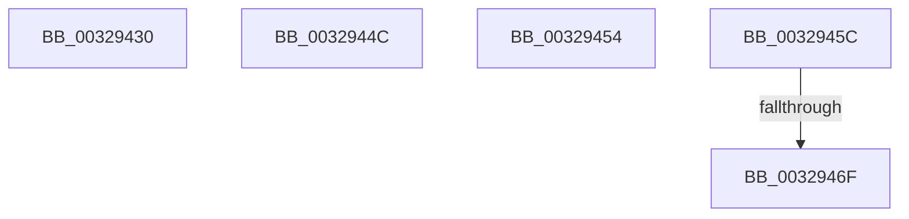

# sub_00329430

- RVA: `0x00329430`–`0x00329477` (길이 `71` bytes)
- VA: `0x0000000140329430`
- 실행 섹션: `.text`
- PDB 이름 있음: `아니요`; PDB Function 태그: `아니요`
- unwind 정보 RVA: `0x00075FE0`
- 디코드: `15`개 명령, `71/71` bytes 표시
- 미해석 바이트: `0` (있으면 어셈블리에 `.byte`로 보존)

> 이 문서는 커널 이미지의 기계어와 PDB 기호를 분석해 생성했습니다. 4번과 5번은 함수 원형과 자료형을 바이너리 사용 방식에서 추정한 C 해석이며 원본 소스 복구 결과는 아닙니다.

## 1. Dependencies

- 직접 호출 지점: **1**; 고유 호출 대상: **1**
- 직접 호출자로 확인된 함수: **0**
- RIP 상대 이미지 참조: **0**

### Outgoing calls
- `0x00329442` → [MmFreePoolMemory](../2C/MmFreePoolMemory_function_002C1578.md) (function, `0x002C1578`)

### Direct callers
- 이 함수 시작 RVA로 연결되는 직접 call은 확인되지 않았습니다. 간접 호출은 완전히 역산할 수 없습니다.

### Static image references
- 디코드된 RIP-relative 메모리 참조가 없습니다.

## 2. Other-region calls and transfers

- 다른 실행 섹션으로 향하는 call: **0**
- call이 아닌 외부 분기/꼬리 이동: **5**
  - `0x00329447` → [sub_00328FA3 + 0x3CC](Unknown_function_00328FA3.md) (`tail-transfer`)
  - `0x0032944F` → [sub_00328FA3 + 0x36B](Unknown_function_00328FA3.md) (`tail-transfer`)
  - `0x00329457` → [sub_00328FA3 + 0x218](Unknown_function_00328FA3.md) (`tail-transfer`)
  - `0x00329469` → [sub_006E1E4C](../6E/Unknown_function_006E1E4C.md) (`tail-transfer`)
  - `0x00329475` → [sub_00328FA3 + 0x459](Unknown_function_00328FA3.md) (`tail-transfer`)

## 3. Assembly (complete function range)

```asm
00329430  41 B8 00 80 00 00               mov r8d, 0x8000
00329436  4C 89 6D 57                     mov qword ptr [rbp + 0x57], r13
0032943A  48 8D 55 7F                     lea rdx, [rbp + 0x7f]
0032943E  48 8D 4D 57                     lea rcx, [rbp + 0x57]
00329442  E8 31 81 F9 FF                  call 0x1402c1578
00329447  E9 23 FF FF FF                  jmp 0x14032936f
0032944C  45 8B F3                        mov r14d, r11d
0032944F  E9 BA FE FF FF                  jmp 0x14032930e
00329454  45 8B F3                        mov r14d, r11d
00329457  E9 5F FD FF FF                  jmp 0x1403291bb
0032945C  48 B8 00 00 00 00 00 80 FF FF   movabs rax, 0xffff800000000000
00329466  4C 3B E8                        cmp r13, rax
00329469  0F 83 DD 89 3B 00               jae 0x1406e1e4c
0032946F  41 BE EF 00 00 C0               mov r14d, 0xc00000ef
00329475  EB 85                           jmp 0x1403293fc
```

## 4. C-style interpretation (structured pseudocode)

```c
__int64 __fastcall sub_00329430(void)
{
    __int64 result;

    *(unsigned __int64 *)(v_rbp + 87) = v_r13;
    result = MmFreePoolMemory(v_rbp + 87, v_rbp + 127, (unsigned int)(0x8000ULL), a4);
}
```

## 5. (Beta) C Style

```c
void sub_00329430(void)
{
    int64_t result;

    *(uint64_t *)(local_rbp + 0x57) = local_r13;
    result = MmFreePoolMemory(local_rbp + 87, local_rbp + 127, (uint32_t)(0x8000ULL), a4);
}
```

## 6. Execution-region graph

[열기: 2D/3D 그래프와 함수 탐색 컨트롤 패널](../../../control-panel.html?section=text&rva=0x00329430&view=graph)

- 2D 그래프는 위에서 아래로 흐르고, 3D 그래프는 빈 공간을 드래그해 회전합니다. Shift+드래그는 이동, 휠은 확대·축소, 함수 노드 선택은 대상 보고서 이동입니다.

### Static fallback


