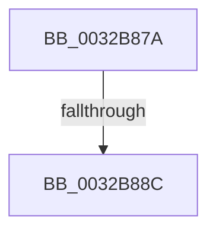

# sub_0032B87A

- RVA: `0x0032B87A`–`0x0032B8BA` (길이 `64` bytes)
- VA: `0x000000014032B87A`
- 실행 섹션: `.text`
- PDB 이름 있음: `아니요`; PDB Function 태그: `아니요`
- unwind 정보 RVA: `0x000760EC`
- 디코드: `16`개 명령, `64/64` bytes 표시
- 미해석 바이트: `0` (있으면 어셈블리에 `.byte`로 보존)

> 이 문서는 커널 이미지의 기계어와 PDB 기호를 분석해 생성했습니다. 4번과 5번은 함수 원형과 자료형을 바이너리 사용 방식에서 추정한 C 해석이며 원본 소스 복구 결과는 아닙니다.

## 1. Dependencies

- 직접 호출 지점: **0**; 고유 호출 대상: **0**
- 직접 호출자로 확인된 함수: **0**
- RIP 상대 이미지 참조: **0**

### Outgoing calls
- 직접 디코드된 call 명령이 없습니다.

### Direct callers
- 이 함수 시작 RVA로 연결되는 직접 call은 확인되지 않았습니다. 간접 호출은 완전히 역산할 수 없습니다.

### Static image references
- 디코드된 RIP-relative 메모리 참조가 없습니다.

## 2. Other-region calls and transfers

- 다른 실행 섹션으로 향하는 call: **0**
- call이 아닌 외부 분기/꼬리 이동: **1**
  - `0x0032B88A` → [sub_0032B8CD](Unknown_function_0032B8CD.md) (`tail-transfer`)

## 3. Assembly (complete function range)

```asm
0032B87A  48 89 6C 24 40                  mov qword ptr [rsp + 0x40], rbp
0032B87F  25 00 0C 00 00                  and eax, 0xc00
0032B884  48 3D 00 08 00 00               cmp rax, 0x800
0032B88A  74 41                           je 0x14032b8cd
0032B88C  83 E7 0F                        and edi, 0xf
0032B88F  48 81 E3 1F FC FF FF            and rbx, 0xfffffffffffffc1f
0032B896  48 C1 E7 05                     shl rdi, 5
0032B89A  48 0B FB                        or rdi, rbx
0032B89D  48 89 3E                        mov qword ptr [rsi], rdi
0032B8A0  48 8B 6C 24 40                  mov rbp, qword ptr [rsp + 0x40]
0032B8A5  B8 01 00 00 80                  mov eax, 0x80000001
0032B8AA  48 8B 5C 24 48                  mov rbx, qword ptr [rsp + 0x48]
0032B8AF  48 8B 74 24 50                  mov rsi, qword ptr [rsp + 0x50]
0032B8B4  48 83 C4 30                     add rsp, 0x30
0032B8B8  5F                              pop rdi
0032B8B9  C3                              ret
```

## 4. C-style interpretation (structured pseudocode)

```c
__int64 __fastcall sub_0032B87A(__int64 a1, __int64 a2, __int64 a3, __int64 a4, __int64 a5, __int64 a6, __int64 a7, __int64 a8, __int64 a9, __int64 a10)
{
    __int64 result;
    __int64 v_rbx;
    __int64 v_rdi;
    __int64 v_rsp;
    unsigned __int64 v_stack_p40;

    v_stack_p40 = v_rbp;
    result = (unsigned int)((result) & (0xC00ULL));
    v_rdi = (unsigned int)((v_rdi) & (15));
    v_rbx = (v_rbx) & (-993);
    v_rdi = (v_rdi) << (5);
    v_rdi = (v_rdi) | (v_rbx);
    *(unsigned __int64 *)(v_rsi) = v_rdi;
    v_rsp = (v_rsp) + (48);
    return (unsigned int)(0x80000001ULL);
}
```

## 5. (Beta) C Style

```c
int64_t sub_0032B87A(int64_t Arg1, int64_t Arg2, int64_t Arg3, int64_t Arg4, uint64_t Arg5, uint64_t Arg6, uint64_t Arg7, int64_t Arg8, int64_t Arg9, int64_t Arg10)
{
    int64_t result;
    int64_t local_rbx;
    int64_t local_rdi;
    int64_t local_rsp;
    uint64_t v_stack_p40;

    v_stack_p40 = local_rbp;
    result = (uint32_t)((result) & (0xC00ULL));
    local_rdi = (uint32_t)((local_rdi) & (15));
    local_rbx = (local_rbx) & (-993);
    local_rdi = (local_rdi) << (5);
    local_rdi = (local_rdi) | (local_rbx);
    *(uint64_t *)(local_rsi) = local_rdi;
    local_rsp = (local_rsp) + (48);
    return (uint32_t)(0x80000001ULL);
}
```

## 6. Execution-region graph

[열기: 2D/3D 그래프와 함수 탐색 컨트롤 패널](../../../control-panel.html?section=text&rva=0x0032B87A&view=graph)

- 2D 그래프는 위에서 아래로 흐르고, 3D 그래프는 빈 공간을 드래그해 회전합니다. Shift+드래그는 이동, 휠은 확대·축소, 함수 노드 선택은 대상 보고서 이동입니다.

### Static fallback


