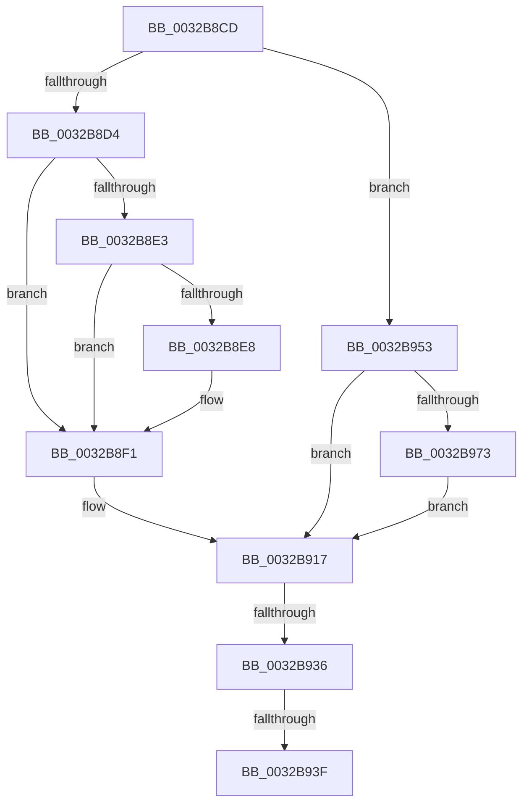

# sub_0032B8CD

- RVA: `0x0032B8CD`–`0x0032B991` (길이 `196` bytes)
- VA: `0x000000014032B8CD`
- 실행 섹션: `.text`
- PDB 이름 있음: `아니요`; PDB Function 태그: `아니요`
- unwind 정보 RVA: `0x00076114`
- 디코드: `48`개 명령, `196/196` bytes 표시
- 미해석 바이트: `0` (있으면 어셈블리에 `.byte`로 보존)

> 이 문서는 커널 이미지의 기계어와 PDB 기호를 분석해 생성했습니다. 4번과 5번은 함수 원형과 자료형을 바이너리 사용 방식에서 추정한 C 해석이며 원본 소스 복구 결과는 아닙니다.

## 1. Dependencies

- 직접 호출 지점: **2**; 고유 호출 대상: **2**
- 직접 호출자로 확인된 함수: **0**
- RIP 상대 이미지 참조: **1**

### Outgoing calls
- `0x0032B95B` → [MiLockTransitionLeafPageEx](../40/MiLockTransitionLeafPageEx_function_00405884.md) (function, `0x00405884`)
- `0x0032B966` → [MI_READ_PTE_LOCK_FREE](../28/MI_READ_PTE_LOCK_FREE_function_002828A0.md) (function, `0x002828A0`)

### Direct callers
- 이 함수 시작 RVA로 연결되는 직접 call은 확인되지 않았습니다. 간접 호출은 완전히 역산할 수 없습니다.

### Static image references
- `0x0032B8D4` → RVA `0x00E2DC80` (`.data`; read)

## 2. Other-region calls and transfers

- 다른 실행 섹션으로 향하는 call: **0**
- call이 아닌 외부 분기/꼬리 이동: **3**
  - `0x0032B930` → [sub_0032B87A + 0x26](Unknown_function_0032B87A.md) (`tail-transfer`)
  - `0x0032B939` → [sub_0032B87A + 0x26](Unknown_function_0032B87A.md) (`tail-transfer`)
  - `0x0032B94E` → [sub_0032B87A + 0x26](Unknown_function_0032B87A.md) (`tail-transfer`)

## 3. Assembly (complete function range)

```asm
0032B8CD  80 7C 24 68 00                  cmp byte ptr [rsp + 0x68], 0
0032B8D2  74 7F                           je 0x14032b953
0032B8D4  48 8B 0D A5 23 B0 00            mov rcx, qword ptr [rip + 0xb023a5]
0032B8DB  48 8B C3                        mov rax, rbx
0032B8DE  48 85 C9                        test rcx, rcx
0032B8E1  74 0E                           je 0x14032b8f1
0032B8E3  F6 C3 10                        test bl, 0x10
0032B8E6  75 09                           jne 0x14032b8f1
0032B8E8  48 8B C1                        mov rax, rcx
0032B8EB  48 F7 D0                        not rax
0032B8EE  48 23 C3                        and rax, rbx
0032B8F1  48 C1 E8 0C                     shr rax, 0xc
0032B8F5  48 B9 FF FF FF FF FF 00 00 00   movabs rcx, 0xffffffffff
0032B8FF  48 23 C1                        and rax, rcx
0032B902  48 8D 2C 40                     lea rbp, [rax + rax*2]
0032B906  48 C1 E5 04                     shl rbp, 4
0032B90A  48 B8 00 00 00 00 00 DE FF FF   movabs rax, 0xffffde0000000000
0032B914  48 03 E8                        add rbp, rax
0032B917  83 E7 0F                        and edi, 0xf
0032B91A  48 81 E3 1F FC FF FF            and rbx, 0xfffffffffffffc1f
0032B921  48 C1 E7 05                     shl rdi, 5
0032B925  48 0B FB                        or rdi, rbx
0032B928  80 7C 24 68 00                  cmp byte ptr [rsp + 0x68], 0
0032B92D  48 89 3E                        mov qword ptr [rsi], rdi
0032B930  0F 85 6A FF FF FF               jne 0x14032b8a0
0032B936  48 85 ED                        test rbp, rbp
0032B939  0F 84 61 FF FF FF               je 0x14032b8a0
0032B93F  48 B8 FF FF FF FF FF FF FF 7F   movabs rax, 0x7fffffffffffffff
0032B949  F0 48 21 45 18                  lock and qword ptr [rbp + 0x18], rax
0032B94E  E9 4D FF FF FF                  jmp 0x14032b8a0
0032B953  45 33 C0                        xor r8d, r8d
0032B956  33 D2                           xor edx, edx
0032B958  48 8B CE                        mov rcx, rsi
0032B95B  E8 24 9F 0D 00                  call 0x140405884
0032B960  48 8B CE                        mov rcx, rsi
0032B963  48 8B E8                        mov rbp, rax
0032B966  E8 35 6F F5 FF                  call 0x1402828a0
0032B96B  48 8B D8                        mov rbx, rax
0032B96E  48 85 ED                        test rbp, rbp
0032B971  74 A4                           je 0x14032b917
0032B973  48 8B 4D 10                     mov rcx, qword ptr [rbp + 0x10]
0032B977  48 8B D7                        mov rdx, rdi
0032B97A  83 E2 0F                        and edx, 0xf
0032B97D  48 81 E1 1F FC FF FF            and rcx, 0xfffffffffffffc1f
0032B984  48 C1 E2 05                     shl rdx, 5
0032B988  48 0B D1                        or rdx, rcx
0032B98B  48 89 55 10                     mov qword ptr [rbp + 0x10], rdx
0032B98F  EB 86                           jmp 0x14032b917
```

## 4. C-style interpretation (structured pseudocode)

```c
__int64 __fastcall sub_0032B8CD(__int64 a1, int a2, int a3, __int64 a4, __int64 a5, __int64 a6, __int64 a7, __int64 a8, __int64 a9, __int64 a10, __int64 a11, __int64 a12, unsigned __int8 a13)
{
    __int64 result;
    __int64 v_rbp;
    __int64 v_rbx;
    __int64 v_rdi;

    if (a13 == 0) goto loc_0032B953;
    if (*(unsigned __int64 *)(v_rip + 11543461) == 0) goto loc_0032B8F1;
    result = v_rbx;
    if ((((unsigned __int8)(v_rbx)) & (16)) == 0) {
        result = *(unsigned __int64 *)(v_rip + 11543461);
        result = ~(result);
        result = (result) & (v_rbx);
    }
    result = (result) >> (12);
    result = (result) & (*(unsigned __int64 *)(v_rip + 11543461));
    v_rbp = (result + result * 2) << (4);
    v_rbp = (v_rbp) + (result);
loc_0032B917:
    v_rdi = (unsigned int)((v_rdi) & (15));
    v_rbx = (v_rbx) & (-993);
    v_rdi = (v_rdi) << (5);
    v_rdi = (v_rdi) | (v_rbx);
    *(unsigned __int64 *)(v_rsi) = v_rdi;
loc_0032B953:
    a3 = 0;
    a2 = 0;
    result = MiLockTransitionLeafPageEx(v_rsi, a2, a3, a4);
    result = MI_READ_PTE_LOCK_FREE(v_rsi, a2, a3, a4);
    if (result == 0) goto loc_0032B917;
    a2 = (unsigned int)((v_rdi) & (15));
    a1 = (*(unsigned __int64 *)(result + 16)) & (-993);
    a2 = (a2) << (5);
    a2 = (a2) | (a1);
    *(unsigned __int64 *)(result + 16) = a2;
    goto loc_0032B917;
}
```

## 5. (Beta) C Style

```c
int64_t sub_0032B8CD(int64_t Arg1, int32_t Arg2, int32_t Arg3, int64_t Arg4, uint64_t Arg5, uint64_t Arg6, uint64_t Arg7, uint64_t Arg8, uint64_t Arg9, uint64_t Arg10, uint64_t Arg11, uint64_t Arg12, uint8_t Arg13)
{
    int64_t result;
    int64_t local_rbp;
    int64_t local_rbx;
    int64_t local_rdi;

    if (Arg13 == 0) goto loc_0032B953;
    if (*(uint64_t *)(v_rip + 0xB023A5) == 0) goto loc_0032B8F1;
    result = local_rbx;
    if ((((uint8_t)(local_rbx)) & (16)) == 0) {
        result = *(uint64_t *)(v_rip + 0xB023A5);
        result = ~(result);
        result = (result) & (local_rbx);
    }
    result = (result) >> (12);
    result = (result) & (*(uint64_t *)(v_rip + 0xB023A5));
    local_rbp = (result + result * 2) << (4);
    local_rbp = (local_rbp) + (result);
loc_0032B917:
    local_rdi = (uint32_t)((local_rdi) & (15));
    local_rbx = (local_rbx) & (-993);
    local_rdi = (local_rdi) << (5);
    local_rdi = (local_rdi) | (local_rbx);
    *(uint64_t *)(local_rsi) = local_rdi;
loc_0032B953:
    Arg3 = 0;
    Arg2 = 0;
    result = MiLockTransitionLeafPageEx(local_rsi, Arg2, Arg3, Arg4);
    result = MI_READ_PTE_LOCK_FREE(local_rsi, Arg2, Arg3, Arg4);
    if (result == 0) goto loc_0032B917;
    Arg2 = (uint32_t)((local_rdi) & (15));
    Arg1 = (*(uint64_t *)(result + 0x10)) & (-993);
    Arg2 = (Arg2) << (5);
    Arg2 = (Arg2) | (Arg1);
    *(uint64_t *)(result + 0x10) = Arg2;
    goto loc_0032B917;
}
```

## 6. Execution-region graph

[열기: 2D/3D 그래프와 함수 탐색 컨트롤 패널](../../../control-panel.html?section=text&rva=0x0032B8CD&view=graph)

- 2D 그래프는 위에서 아래로 흐르고, 3D 그래프는 빈 공간을 드래그해 회전합니다. Shift+드래그는 이동, 휠은 확대·축소, 함수 노드 선택은 대상 보고서 이동입니다.

### Static fallback


