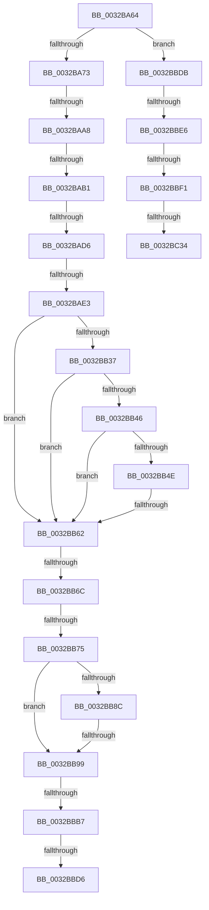

# sub_0032BA64

- RVA: `0x0032BA64`–`0x0032BC3B` (길이 `471` bytes)
- VA: `0x000000014032BA64`
- 실행 섹션: `.text`
- PDB 이름 있음: `아니요`; PDB Function 태그: `아니요`
- unwind 정보 RVA: `0x0007613C`
- 디코드: `101`개 명령, `471/471` bytes 표시
- 미해석 바이트: `0` (있으면 어셈블리에 `.byte`로 보존)

> 이 문서는 커널 이미지의 기계어와 PDB 기호를 분석해 생성했습니다. 4번과 5번은 함수 원형과 자료형을 바이너리 사용 방식에서 추정한 C 해석이며 원본 소스 복구 결과는 아닙니다.

## 1. Dependencies

- 직접 호출 지점: **2**; 고유 호출 대상: **2**
- 직접 호출자로 확인된 함수: **0**
- RIP 상대 이미지 참조: **1**

### Outgoing calls
- `0x0032BB19` → [MI_READ_PTE_LOCK_FREE](../28/MI_READ_PTE_LOCK_FREE_function_002828A0.md) (function, `0x002828A0`)
- `0x0032BBC8` → [MiLocateCloneAddress](../3D/MiLocateCloneAddress_function_003D26B4.md) (function, `0x003D26B4`)

### Direct callers
- 이 함수 시작 RVA로 연결되는 직접 call은 확인되지 않았습니다. 간접 호출은 완전히 역산할 수 없습니다.

### Static image references
- `0x0032BC01` → RVA `0x00E30088` (`.data`; read)

## 2. Other-region calls and transfers

- 다른 실행 섹션으로 향하는 call: **0**
- call이 아닌 외부 분기/꼬리 이동: **14**
  - `0x0032BAA2` → [sub_0032BD21 + 0x3BE](Unknown_function_0032BD21.md) (`tail-transfer`)
  - `0x0032BAAB` → [sub_0032BD21 + 0x413](Unknown_function_0032BD21.md) (`tail-transfer`)
  - `0x0032BAD0` → [sub_0032C29C + 0x33](Unknown_function_0032C29C.md) (`tail-transfer`)
  - `0x0032BADD` → [sub_0032BC4B](Unknown_function_0032BC4B.md) (`tail-transfer`)
  - `0x0032BB5C` → [sub_0032BC4B + 0x2F](Unknown_function_0032BC4B.md) (`tail-transfer`)
  - `0x0032BB66` → [sub_0032BC4B + 0x75](Unknown_function_0032BC4B.md) (`tail-transfer`)
  - `0x0032BB6F` → [sub_0032BC4B + 0x2A](Unknown_function_0032BC4B.md) (`tail-transfer`)
  - `0x0032BB93` → [sub_0032BD21 + 0xDA](Unknown_function_0032BD21.md) (`tail-transfer`)
  - `0x0032BBB1` → [sub_0032BC4B + 0x2A](Unknown_function_0032BC4B.md) (`tail-transfer`)
  - `0x0032BBD0` → [sub_0032BD21 + 0xE7](Unknown_function_0032BD21.md) (`tail-transfer`)
  - `0x0032BBD6` → [sub_0032BC4B + 0x2A](Unknown_function_0032BC4B.md) (`tail-transfer`)
  - `0x0032BBE0` → [sub_0032BD21](Unknown_function_0032BD21.md) (`tail-transfer`)
  - `0x0032BBEB` → [sub_0032BD21 + 0xF7](Unknown_function_0032BD21.md) (`tail-transfer`)
  - `0x0032BC2E` → [sub_0032C29C + 0xC6](Unknown_function_0032C29C.md) (`tail-transfer`)

## 3. Assembly (complete function range)

```asm
0032BA64  4C 89 6C 24 38                  mov qword ptr [rsp + 0x38], r13
0032BA69  40 F6 C7 01                     test dil, 1
0032BA6D  0F 84 68 01 00 00               je 0x14032bbdb
0032BA73  48 8B D7                        mov rdx, rdi
0032BA76  49 BD 00 00 00 00 00 DE FF FF   movabs r13, 0xffffde0000000000
0032BA80  48 C1 EA 0C                     shr rdx, 0xc
0032BA84  48 B9 FF FF FF FF FF 00 00 00   movabs rcx, 0xffffffffff
0032BA8E  48 23 D1                        and rdx, rcx
0032BA91  4C 8D 04 52                     lea r8, [rdx + rdx*2]
0032BA95  4D 03 C0                        add r8, r8
0032BA98  49 8B CD                        mov rcx, r13
0032BA9B  4A 8D 1C C1                     lea rbx, [rcx + r8*8]
0032BA9F  83 F8 10                        cmp eax, 0x10
0032BAA2  0F 84 37 06 00 00               je 0x14032c0df
0032BAA8  83 F8 40                        cmp eax, 0x40
0032BAAB  0F 84 83 06 00 00               je 0x14032c134
0032BAB1  48 8B 43 28                     mov rax, qword ptr [rbx + 0x28]
0032BAB5  41 BD FF 03 00 00               mov r13d, 0x3ff
0032BABB  48 C1 E8 2B                     shr rax, 0x2b
0032BABF  66 41 23 C5                     and ax, r13w
0032BAC3  66 41 89 07                     mov word ptr [r15], ax
0032BAC7  48 8B 43 28                     mov rax, qword ptr [rbx + 0x28]
0032BACB  48 0F BA E0 28                  bt rax, 0x28
0032BAD0  0F 82 F9 07 00 00               jb 0x14032c2cf
0032BAD6  48 8B 43 28                     mov rax, qword ptr [rbx + 0x28]
0032BADA  48 85 C0                        test rax, rax
0032BADD  0F 89 68 01 00 00               jns 0x14032bc4b
0032BAE3  48 C1 E6 19                     shl rsi, 0x19
0032BAE7  48 B9 00 00 00 00 80 F6 FF FF   movabs rcx, 0xfffff68000000000
0032BAF1  48 8B C1                        mov rax, rcx
0032BAF4  48 C1 E0 19                     shl rax, 0x19
0032BAF8  48 BF 00 F0 FF FF FF FF 00 00   movabs rdi, 0xfffffffff000
0032BB02  48 2B F0                        sub rsi, rax
0032BB05  48 C1 FE 10                     sar rsi, 0x10
0032BB09  48 23 FE                        and rdi, rsi
0032BB0C  48 C1 EF 09                     shr rdi, 9
0032BB10  48 8B C1                        mov rax, rcx
0032BB13  48 03 F8                        add rdi, rax
0032BB16  48 8B CF                        mov rcx, rdi
0032BB19  E8 82 6D F5 FF                  call 0x1402828a0
0032BB1E  48 8B 17                        mov rdx, qword ptr [rdi]
0032BB21  4C 8B C0                        mov r8, rax
0032BB24  49 C1 E8 3C                     shr r8, 0x3c
0032BB28  48 B8 00 D0 BE 7D FB F6 FF FF   movabs rax, 0xfffff6fb7dbed000
0032BB32  48 3B F8                        cmp rdi, rax
0032BB35  72 2B                           jb 0x14032bb62
0032BB37  48 B8 F8 D7 BE 7D FB F6 FF FF   movabs rax, 0xfffff6fb7dbed7f8
0032BB41  48 3B F8                        cmp rdi, rax
0032BB44  77 1C                           ja 0x14032bb62
0032BB46  4C 8B CA                        mov r9, rdx
0032BB49  F6 C2 01                        test dl, 1
0032BB4C  74 14                           je 0x14032bb62
0032BB4E  F6 C2 42                        test dl, 0x42
0032BB51  0F 95 C1                        setne cl
0032BB54  F6 C2 20                        test dl, 0x20
0032BB57  0F 95 C0                        setne al
0032BB5A  84 C8                           test al, cl
0032BB5C  0F 84 18 01 00 00               je 0x14032bc7a
0032BB62  41 83 E0 07                     and r8d, 7
0032BB66  0F 85 54 01 00 00               jne 0x14032bcc0
0032BB6C  45 85 C0                        test r8d, r8d
0032BB6F  0F 85 00 01 00 00               jne 0x14032bc75
0032BB75  44 8B 43 10                     mov r8d, dword ptr [rbx + 0x10]
0032BB79  48 8B 43 28                     mov rax, qword ptr [rbx + 0x28]
0032BB7D  49 C1 E8 05                     shr r8, 5
0032BB81  41 83 E0 1F                     and r8d, 0x1f
0032BB85  48 0F BA E0 28                  bt rax, 0x28
0032BB8A  72 0D                           jb 0x14032bb99
0032BB8C  48 8B 43 08                     mov rax, qword ptr [rbx + 8]
0032BB90  48 85 C0                        test rax, rax
0032BB93  0F 89 62 02 00 00               jns 0x14032bdfb
0032BB99  65 48 8B 04 25 88 01 00 00      mov rax, qword ptr gs:[0x188]
0032BBA2  48 8B 88 B8 00 00 00            mov rcx, qword ptr [rax + 0xb8]
0032BBA9  48 83 B9 80 02 00 00 00         cmp qword ptr [rcx + 0x280], 0
0032BBB1  0F 84 BE 00 00 00               je 0x14032bc75
0032BBB7  48 8B 53 08                     mov rdx, qword ptr [rbx + 8]
0032BBBB  49 B9 00 00 00 00 00 00 00 80   movabs r9, 0x8000000000000000
0032BBC5  49 0B D1                        or rdx, r9
0032BBC8  E8 E7 6A 0A 00                  call 0x1403d26b4
0032BBCD  48 85 C0                        test rax, rax
0032BBD0  0F 85 32 02 00 00               jne 0x14032be08
0032BBD6  E9 9A 00 00 00                  jmp 0x14032bc75
0032BBDB  48 0F BA E7 0A                  bt rdi, 0xa
0032BBE0  0F 82 3B 01 00 00               jb 0x14032bd21
0032BBE6  48 0F BA E7 0B                  bt rdi, 0xb
0032BBEB  0F 82 27 02 00 00               jb 0x14032be18
0032BBF1  65 48 8B 04 25 88 01 00 00      mov rax, qword ptr gs:[0x188]
0032BBFA  48 8B 88 B8 00 00 00            mov rcx, qword ptr [rax + 0xb8]
0032BC01  48 8B 05 80 44 B0 00            mov rax, qword ptr [rip + 0xb04480]
0032BC08  0F B7 89 AE 04 00 00            movzx ecx, word ptr [rcx + 0x4ae]
0032BC0F  48 8B 0C C8                     mov rcx, qword ptr [rax + rcx*8]
0032BC13  0F B7 01                        movzx eax, word ptr [rcx]
0032BC16  66 41 89 07                     mov word ptr [r15], ax
0032BC1A  8B 45 30                        mov eax, dword ptr [rbp + 0x30]
0032BC1D  48 C1 EF 05                     shr rdi, 5
0032BC21  25 00 00 20 04                  and eax, 0x4200000
0032BC26  83 E7 1F                        and edi, 0x1f
0032BC29  3D 00 00 20 04                  cmp eax, 0x4200000
0032BC2E  0F 84 2E 07 00 00               je 0x14032c362
0032BC34  8B C7                           mov eax, edi
0032BC36  4C 8B 6C 24 38                  mov r13, qword ptr [rsp + 0x38]
```

## 4. C-style interpretation (structured pseudocode)

```c
__int64 __fastcall sub_0032BA64(__int64 a1, __int64 a2, __int64 a3, __int64 a4, __int64 a5, __int64 a6, __int64 a7)
{
    __int64 result;
    __int64 v_rdi;
    __int64 v_rsi;
    unsigned __int64 v_stack_p38;

    v_stack_p38 = v_r13;
    if ((((unsigned __int8)(v_rdi)) & (1)) == 0) goto loc_0032BBDB;
    a2 = (v_rdi) >> (12);
    a2 = (a2) & (a1);
    a3 = (a2 + a2 * 2) + (a2 + a2 * 2);
    result = (*(unsigned __int64 *)(v_r13 + a3 * 8 + 40)) >> (43);
    result = (unsigned __int16)((result) & ((unsigned __int16)((unsigned int)(0x3FFULL))));
    *(unsigned __int16 *)(v_r15) = (unsigned __int16)(result);
    v_rsi = (v_rsi) << (25);
    result = (v_r13) << (25);
    v_rsi = (v_rsi) - (result);
    v_rsi = (v_rsi) >> (16);
    v_rdi = (v_rdi) & (v_rsi);
    v_rdi = (v_rdi) >> (9);
    v_rdi = (v_rdi) + (v_r13);
    result = MI_READ_PTE_LOCK_FREE(v_rdi, a2, a3, a4);
    a3 = (result) >> (60);
    if (v_rdi < result) goto loc_0032BB62;
    if (v_rdi > result) goto loc_0032BB62;
    if ((((unsigned __int8)(*(unsigned __int64 *)(v_rdi))) & (1)) == 0) goto loc_0032BB62;
    a1 = ((((unsigned __int8)(*(unsigned __int64 *)(v_rdi))) & (66)) != 0) ? 1 : 0;
    result = ((((unsigned __int8)(*(unsigned __int64 *)(v_rdi))) & (32)) != 0) ? 1 : 0;
loc_0032BB62:
    a3 = (unsigned int)((a3) & (7));
    a3 = ((unsigned int)(*(unsigned int *)(v_r13 + a3 * 8 + 16))) >> (5);
    a3 = (unsigned int)((a3) & (31));
    if (condition_is_below) goto loc_0032BB99;
loc_0032BB99:
    a2 = (*(unsigned __int64 *)(v_r13 + a3 * 8 + 8)) | (*(unsigned __int64 *)(v_rdi));
    result = MiLocateCloneAddress(*(unsigned __int64 *)(*(unsigned __int64 *)(gs_base + (0 + 392)) + 184), a2, a3, *(unsigned __int64 *)(v_rdi));
loc_0032BBDB:
    *(unsigned __int16 *)(v_r15) = (unsigned __int16)(*(unsigned __int16 *)(*(unsigned __int64 *)(*(unsigned __int64 *)(v_rip + 11551872) + *(unsigned __int16 *)(*(unsigned __int64 *)(*(unsigned __int64 *)(gs_base + (0 + 392)) + 184) + 1198) * 8)));
    v_rdi = (v_rdi) >> (5);
    result = (unsigned int)(((unsigned int)(*(unsigned int *)(v_rbp + 48))) & (0x4200000ULL));
    v_rdi = (unsigned int)((v_rdi) & (31));
    return (unsigned int)((unsigned int)(v_rdi));
}
```

## 5. (Beta) C Style

```c
int64_t sub_0032BA64(int64_t Arg1, int64_t Arg2, int64_t Arg3, int64_t Arg4, uint64_t Arg5, uint64_t Arg6, int64_t Arg7)
{
    int64_t result;
    int64_t local_rdi;
    int64_t local_rsi;
    uint64_t v_stack_p38;

    v_stack_p38 = local_r13;
    if ((((uint8_t)(local_rdi)) & (1)) == 0) goto loc_0032BBDB;
    Arg2 = (local_rdi) >> (12);
    Arg2 = (Arg2) & (Arg1);
    Arg3 = (Arg2 + Arg2 * 2) + (Arg2 + Arg2 * 2);
    result = (*(uint64_t *)(local_r13 + Arg3 * 8 + 0x28)) >> (43);
    result = (uint16_t)((result) & ((uint16_t)((uint32_t)(0x3FFULL))));
    *(uint16_t *)(local_r15) = (uint16_t)(result);
    local_rsi = (local_rsi) << (25);
    result = (local_r13) << (25);
    local_rsi = (local_rsi) - (result);
    local_rsi = (local_rsi) >> (16);
    local_rdi = (local_rdi) & (local_rsi);
    local_rdi = (local_rdi) >> (9);
    local_rdi = (local_rdi) + (local_r13);
    result = MI_READ_PTE_LOCK_FREE(local_rdi, Arg2, Arg3, Arg4);
    Arg3 = (result) >> (60);
    if (local_rdi < result) goto loc_0032BB62;
    if (local_rdi > result) goto loc_0032BB62;
    if ((((uint8_t)(*(uint64_t *)(local_rdi))) & (1)) == 0) goto loc_0032BB62;
    Arg1 = ((((uint8_t)(*(uint64_t *)(local_rdi))) & (66)) != 0) ? 1 : 0;
    result = ((((uint8_t)(*(uint64_t *)(local_rdi))) & (32)) != 0) ? 1 : 0;
loc_0032BB62:
    Arg3 = (uint32_t)((Arg3) & (7));
    Arg3 = ((uint32_t)(*(uint32_t *)(local_r13 + Arg3 * 8 + 0x10))) >> (5);
    Arg3 = (uint32_t)((Arg3) & (31));
    if (condition_is_below) goto loc_0032BB99;
loc_0032BB99:
    Arg2 = (*(uint64_t *)(local_r13 + Arg3 * 8 + 0x8)) | (*(uint64_t *)(local_rdi));
    result = MiLocateCloneAddress(*(uint64_t *)(*(uint64_t *)(gs_base + (0 + 0x188)) + 0xB8), Arg2, Arg3, *(uint64_t *)(local_rdi));
loc_0032BBDB:
    *(uint16_t *)(local_r15) = (uint16_t)(*(uint16_t *)(*(uint64_t *)(*(uint64_t *)(v_rip + 0xB04480) + *(uint16_t *)(*(uint64_t *)(*(uint64_t *)(gs_base + (0 + 0x188)) + 0xB8) + 0x4AE) * 8)));
    local_rdi = (local_rdi) >> (5);
    result = (uint32_t)(((uint32_t)(*(uint32_t *)(local_rbp + 0x30))) & (0x4200000ULL));
    local_rdi = (uint32_t)((local_rdi) & (31));
    return (uint32_t)((uint32_t)(local_rdi));
}
```

## 6. Execution-region graph

[열기: 2D/3D 그래프와 함수 탐색 컨트롤 패널](../../../control-panel.html?section=text&rva=0x0032BA64&view=graph)

- 2D 그래프는 위에서 아래로 흐르고, 3D 그래프는 빈 공간을 드래그해 회전합니다. Shift+드래그는 이동, 휠은 확대·축소, 함수 노드 선택은 대상 보고서 이동입니다.

### Static fallback


