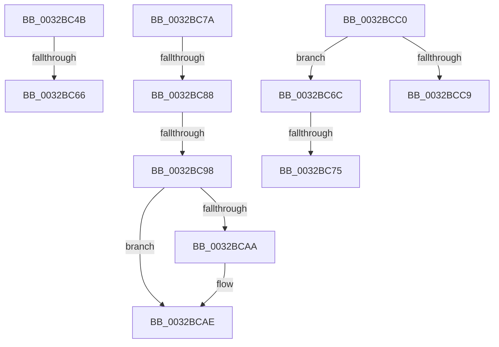

# sub_0032BC4B

- RVA: `0x0032BC4B`–`0x0032BCD2` (길이 `135` bytes)
- VA: `0x000000014032BC4B`
- 실행 섹션: `.text`
- PDB 이름 있음: `아니요`; PDB Function 태그: `아니요`
- unwind 정보 RVA: `0x00076164`
- 디코드: `36`개 명령, `135/135` bytes 표시
- 미해석 바이트: `0` (있으면 어셈블리에 `.byte`로 보존)

> 이 문서는 커널 이미지의 기계어와 PDB 기호를 분석해 생성했습니다. 4번과 5번은 함수 원형과 자료형을 바이너리 사용 방식에서 추정한 C 해석이며 원본 소스 복구 결과는 아닙니다.

## 1. Dependencies

- 직접 호출 지점: **1**; 고유 호출 대상: **1**
- 직접 호출자로 확인된 함수: **0**
- RIP 상대 이미지 참조: **0**

### Outgoing calls
- `0x0032BC7A` → [MiPteHasShadow](MiPteHasShadow_function_0032B998.md) (function, `0x0032B998`)

### Direct callers
- 이 함수 시작 RVA로 연결되는 직접 call은 확인되지 않았습니다. 간접 호출은 완전히 역산할 수 없습니다.

### Static image references
- 디코드된 RIP-relative 메모리 참조가 없습니다.

## 2. Other-region calls and transfers

- 다른 실행 섹션으로 향하는 call: **0**
- call이 아닌 외부 분기/꼬리 이동: **8**
  - `0x0032BC64` → [sub_0032BA64 + 0x1D2](Unknown_function_0032BA64.md) (`tail-transfer`)
  - `0x0032BC6A` → [sub_0032BA64 + 0x1D2](Unknown_function_0032BA64.md) (`tail-transfer`)
  - `0x0032BC6F` → [sub_0032BD21 + 0x503](Unknown_function_0032BD21.md) (`tail-transfer`)
  - `0x0032BC78` → [sub_0032BA64 + 0x1D2](Unknown_function_0032BA64.md) (`tail-transfer`)
  - `0x0032BC82` → [sub_0032BA64 + 0xFE](Unknown_function_0032BA64.md) (`tail-transfer`)
  - `0x0032BC92` → [sub_0032BA64 + 0xFE](Unknown_function_0032BA64.md) (`tail-transfer`)
  - `0x0032BCBB` → [sub_0032BA64 + 0xFE](Unknown_function_0032BA64.md) (`tail-transfer`)
  - `0x0032BCCD` → [sub_0032BA64 + 0x108](Unknown_function_0032BA64.md) (`tail-transfer`)

## 3. Assembly (complete function range)

```asm
0032BC4B  8B 43 10                        mov eax, dword ptr [rbx + 0x10]
0032BC4E  41 8B 09                        mov ecx, dword ptr [r9]
0032BC51  48 C1 E8 05                     shr rax, 5
0032BC55  81 E1 00 00 20 04               and ecx, 0x4200000
0032BC5B  83 E0 1F                        and eax, 0x1f
0032BC5E  81 F9 00 00 20 04               cmp ecx, 0x4200000
0032BC64  75 D0                           jne 0x14032bc36
0032BC66  45 89 14 24                     mov dword ptr [r12], r10d
0032BC6A  EB CA                           jmp 0x14032bc36
0032BC6C  F6 C2 10                        test dl, 0x10
0032BC6F  0F 85 AF 05 00 00               jne 0x14032c224
0032BC75  41 8B C0                        mov eax, r8d
0032BC78  EB BC                           jmp 0x14032bc36
0032BC7A  E8 19 FD FF FF                  call 0x14032b998
0032BC7F  48 85 C0                        test rax, rax
0032BC82  0F 84 DA FE FF FF               je 0x14032bb62
0032BC88  48 8B 80 08 05 00 00            mov rax, qword ptr [rax + 0x508]
0032BC8F  48 85 C0                        test rax, rax
0032BC92  0F 84 CA FE FF FF               je 0x14032bb62
0032BC98  48 C1 EF 03                     shr rdi, 3
0032BC9C  81 E7 FF 01 00 00               and edi, 0x1ff
0032BCA2  48 8B 04 F8                     mov rax, qword ptr [rax + rdi*8]
0032BCA6  A8 20                           test al, 0x20
0032BCA8  74 04                           je 0x14032bcae
0032BCAA  49 83 C9 20                     or r9, 0x20
0032BCAE  49 8B D1                        mov rdx, r9
0032BCB1  48 83 CA 42                     or rdx, 0x42
0032BCB5  A8 42                           test al, 0x42
0032BCB7  49 0F 44 D1                     cmove rdx, r9
0032BCBB  E9 A2 FE FF FF                  jmp 0x14032bb62
0032BCC0  0F B6 C2                        movzx eax, dl
0032BCC3  24 18                           and al, 0x18
0032BCC5  3C 08                           cmp al, 8
0032BCC7  75 A3                           jne 0x14032bc6c
0032BCC9  41 83 C8 18                     or r8d, 0x18
0032BCCD  E9 9A FE FF FF                  jmp 0x14032bb6c
```

## 4. C-style interpretation (structured pseudocode)

```c
__int64 __fastcall sub_0032BC4B(__int64 a1, unsigned __int8 a2, int a3, __int64 a4)
{
    __int64 result;

    result = ((unsigned int)(*(unsigned int *)(v_rbx + 16))) >> (5);
    a1 = (unsigned int)(((unsigned int)(*(unsigned int *)(a4))) & (0x4200000ULL));
    result = (unsigned int)((result) & (31));
    *(unsigned int *)(v_r12) = (unsigned int)(v_r10);
}
```

## 5. (Beta) C Style

```c
int64_t sub_0032BC4B(int64_t Arg1, uint8_t Arg2, int32_t Arg3, void *Arg4)
{
    uint8_t *arg4 = (uint8_t *)Arg4;

    int64_t result;

    result = ((uint32_t)(*(uint32_t *)(local_rbx + 0x10))) >> (5);
    Arg1 = (uint32_t)(((uint32_t)(*(uint32_t *)(arg4))) & (0x4200000ULL));
    result = (uint32_t)((result) & (31));
    *(uint32_t *)(local_r12) = (uint32_t)(local_r10);
}
```

### 관측된 메모리 오프셋

구조체 형식이 확인되지 않은 접근은 인자 기준의 오프셋으로만 기록했습니다.

| 기준 인자 | 오프셋 표현 | 폭 (bit) | 접근 |
|---|---:|---:|---|
| `Arg4` | `+ 0x0` | `32` | `R` |

## 6. Execution-region graph

[열기: 2D/3D 그래프와 함수 탐색 컨트롤 패널](../../../control-panel.html?section=text&rva=0x0032BC4B&view=graph)

- 2D 그래프는 위에서 아래로 흐르고, 3D 그래프는 빈 공간을 드래그해 회전합니다. Shift+드래그는 이동, 휠은 확대·축소, 함수 노드 선택은 대상 보고서 이동입니다.

### Static fallback


