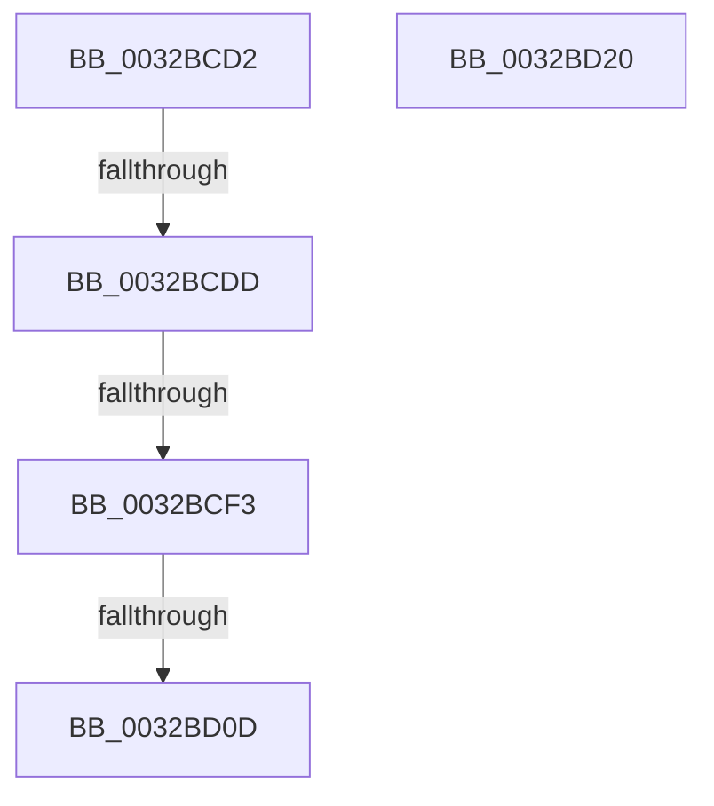

# sub_0032BCD2

- RVA: `0x0032BCD2`–`0x0032BD21` (길이 `79` bytes)
- VA: `0x000000014032BCD2`
- 실행 섹션: `.text`
- PDB 이름 있음: `아니요`; PDB Function 태그: `아니요`
- unwind 정보 RVA: `0x00076178`
- 디코드: `23`개 명령, `79/79` bytes 표시
- 미해석 바이트: `0` (있으면 어셈블리에 `.byte`로 보존)

> 이 문서는 커널 이미지의 기계어와 PDB 기호를 분석해 생성했습니다. 4번과 5번은 함수 원형과 자료형을 바이너리 사용 방식에서 추정한 C 해석이며 원본 소스 복구 결과는 아닙니다.

## 1. Dependencies

- 직접 호출 지점: **1**; 고유 호출 대상: **1**
- 직접 호출자로 확인된 함수: **0**
- RIP 상대 이미지 참조: **0**

### Outgoing calls
- `0x0032BCE0` → [MiGetValidAwePartitionId](../4F/MiGetValidAwePartitionId_function_004F5F64.md) (function, `0x004F5F64`)

### Direct callers
- 이 함수 시작 RVA로 연결되는 직접 call은 확인되지 않았습니다. 간접 호출은 완전히 역산할 수 없습니다.

### Static image references
- 디코드된 RIP-relative 메모리 참조가 없습니다.

## 2. Other-region calls and transfers

- 다른 실행 섹션으로 향하는 call: **0**
- call이 아닌 외부 분기/꼬리 이동: **3**
  - `0x0032BCD7` → [sub_0032C244](Unknown_function_0032C244.md) (`tail-transfer`)
  - `0x0032BCED` → [sub_0032C244 + 0x1E](Unknown_function_0032C244.md) (`tail-transfer`)
  - `0x0032BD07` → [sub_0032BC3B](Unknown_function_0032BC3B.md) (`tail-transfer`)

## 3. Assembly (complete function range)

```asm
0032BCD2  41 0F BA E0 15                  bt r8d, 0x15
0032BCD7  0F 82 67 05 00 00               jb 0x14032c244
0032BCDD  48 8B CF                        mov rcx, rdi
0032BCE0  E8 7F A2 1C 00                  call 0x1404f5f64
0032BCE5  66 41 89 07                     mov word ptr [r15], ax
0032BCE9  40 F6 C7 01                     test dil, 1
0032BCED  0F 85 6F 05 00 00               jne 0x14032c262
0032BCF3  B8 18 00 00 00                  mov eax, 0x18
0032BCF8  8B 4D 30                        mov ecx, dword ptr [rbp + 0x30]
0032BCFB  81 E1 00 00 20 04               and ecx, 0x4200000
0032BD01  81 F9 00 00 20 04               cmp ecx, 0x4200000
0032BD07  0F 85 2E FF FF FF               jne 0x14032bc3b
0032BD0D  45 89 14 24                     mov dword ptr [r12], r10d
0032BD11  48 83 C4 40                     add rsp, 0x40
0032BD15  41 5F                           pop r15
0032BD17  41 5E                           pop r14
0032BD19  41 5C                           pop r12
0032BD1B  5F                              pop rdi
0032BD1C  5E                              pop rsi
0032BD1D  5D                              pop rbp
0032BD1E  5B                              pop rbx
0032BD1F  C3                              ret
0032BD20  CC                              int3
```

## 4. C-style interpretation (structured pseudocode)

```c
__int64 __fastcall sub_0032BCD2(__int64 a1, __int64 a2, int a3)
{
    __int64 result;
    __int64 v_rsp;

    result = MiGetValidAwePartitionId(v_rdi, a2, a3, a4);
    *(unsigned __int16 *)(v_r15) = (unsigned __int16)(result);
    a1 = (unsigned int)(((unsigned int)(*(unsigned int *)(v_rbp + 48))) & (0x4200000ULL));
    *(unsigned int *)(v_r12) = (unsigned int)(v_r10);
    v_rsp = (v_rsp) + (64);
    return 24;
}
```

## 5. (Beta) C Style

```c
int64_t sub_0032BCD2(int64_t Arg1, int64_t Arg2, int32_t Arg3)
{
    int64_t result;
    int64_t local_rsp;

    result = MiGetValidAwePartitionId(local_rdi, Arg2, Arg3, a4);
    *(uint16_t *)(local_r15) = (uint16_t)(result);
    Arg1 = (uint32_t)(((uint32_t)(*(uint32_t *)(local_rbp + 0x30))) & (0x4200000ULL));
    *(uint32_t *)(local_r12) = (uint32_t)(local_r10);
    local_rsp = (local_rsp) + (64);
    return 24;
}
```

## 6. Execution-region graph

[열기: 2D/3D 그래프와 함수 탐색 컨트롤 패널](../../../control-panel.html?section=text&rva=0x0032BCD2&view=graph)

- 2D 그래프는 위에서 아래로 흐르고, 3D 그래프는 빈 공간을 드래그해 회전합니다. Shift+드래그는 이동, 휠은 확대·축소, 함수 노드 선택은 대상 보고서 이동입니다.

### Static fallback


