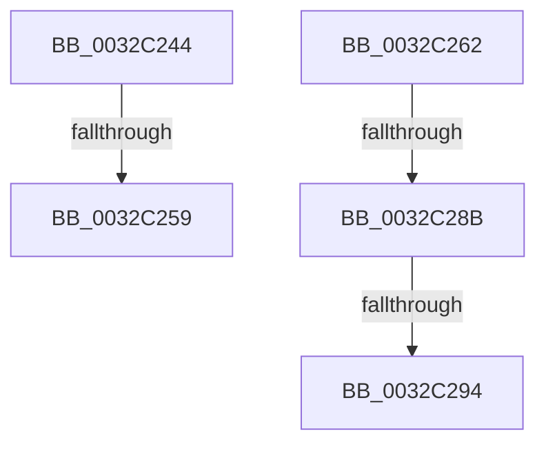

# sub_0032C244

- RVA: `0x0032C244`–`0x0032C29C` (길이 `88` bytes)
- VA: `0x000000014032C244`
- 실행 섹션: `.text`
- PDB 이름 있음: `아니요`; PDB Function 태그: `아니요`
- unwind 정보 RVA: `0x000761A0`
- 디코드: `21`개 명령, `88/88` bytes 표시
- 미해석 바이트: `0` (있으면 어셈블리에 `.byte`로 보존)

> 이 문서는 커널 이미지의 기계어와 PDB 기호를 분석해 생성했습니다. 4번과 5번은 함수 원형과 자료형을 바이너리 사용 방식에서 추정한 C 해석이며 원본 소스 복구 결과는 아닙니다.

## 1. Dependencies

- 직접 호출 지점: **0**; 고유 호출 대상: **0**
- 직접 호출자로 확인된 함수: **0**
- RIP 상대 이미지 참조: **0**

### Outgoing calls
- 직접 디코드된 call 명령이 없습니다.

### Direct callers
- 이 함수 시작 RVA로 연결되는 직접 call은 확인되지 않았습니다. 간접 호출은 완전히 역산할 수 없습니다.

### Static image references
- 디코드된 RIP-relative 메모리 참조가 없습니다.

## 2. Other-region calls and transfers

- 다른 실행 섹션으로 향하는 call: **0**
- call이 아닌 외부 분기/꼬리 이동: **5**
  - `0x0032C253` → [sub_0032BCD2 + 0xB](Unknown_function_0032BCD2.md) (`tail-transfer`)
  - `0x0032C25D` → [sub_0032BA64](Unknown_function_0032BA64.md) (`tail-transfer`)
  - `0x0032C285` → [sub_006E1EB6](../6E/Unknown_function_006E1EB6.md) (`tail-transfer`)
  - `0x0032C28E` → [sub_006E1EB6](../6E/Unknown_function_006E1EB6.md) (`tail-transfer`)
  - `0x0032C297` → [sub_0032BCD2 + 0x26](Unknown_function_0032BCD2.md) (`tail-transfer`)

## 3. Assembly (complete function range)

```asm
0032C244  41 8B C8                        mov ecx, r8d
0032C247  81 E1 00 00 00 0C               and ecx, 0xc000000
0032C24D  81 F9 00 00 00 08               cmp ecx, 0x8000000
0032C253  0F 85 84 FA FF FF               jne 0x14032bcdd
0032C259  4C 8D 4D 30                     lea r9, [rbp + 0x30]
0032C25D  E9 02 F8 FF FF                  jmp 0x14032ba64
0032C262  8B 4D 30                        mov ecx, dword ptr [rbp + 0x30]
0032C265  48 0F BA E7 0B                  bt rdi, 0xb
0032C26A  BA 01 00 00 00                  mov edx, 1
0032C26F  B8 04 00 00 00                  mov eax, 4
0032C274  0F 43 C2                        cmovae eax, edx
0032C277  C1 E9 07                        shr ecx, 7
0032C27A  83 E1 1F                        and ecx, 0x1f
0032C27D  8B D1                           mov edx, ecx
0032C27F  C1 EA 03                        shr edx, 3
0032C282  83 FA 03                        cmp edx, 3
0032C285  0F 85 2B 5C 3B 00               jne 0x1406e1eb6
0032C28B  F6 C1 07                        test cl, 7
0032C28E  0F 84 22 5C 3B 00               je 0x1406e1eb6
0032C294  83 C8 18                        or eax, 0x18
0032C297  E9 5C FA FF FF                  jmp 0x14032bcf8
```

## 4. C-style interpretation (structured pseudocode)

```c
__int64 __fastcall sub_0032C244(__int64 a1, __int64 a2, int a3)
{
    a1 = (unsigned int)(((unsigned int)(a3)) & (0xC000000ULL));
}
```

## 5. (Beta) C Style

```c
int64_t sub_0032C244(int64_t Arg1, int64_t Arg2, int32_t Arg3)
{
    Arg1 = (uint32_t)(((uint32_t)(Arg3)) & (0xC000000ULL));
}
```

## 6. Execution-region graph

[열기: 2D/3D 그래프와 함수 탐색 컨트롤 패널](../../../control-panel.html?section=text&rva=0x0032C244&view=graph)

- 2D 그래프는 위에서 아래로 흐르고, 3D 그래프는 빈 공간을 드래그해 회전합니다. Shift+드래그는 이동, 휠은 확대·축소, 함수 노드 선택은 대상 보고서 이동입니다.

### Static fallback


