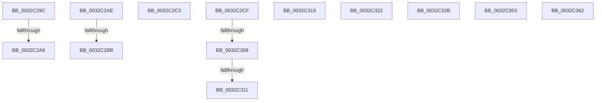

# sub_0032C29C

- RVA: `0x0032C29C`–`0x0032C36F` (길이 `211` bytes)
- VA: `0x000000014032C29C`
- 실행 섹션: `.text`
- PDB 이름 있음: `아니요`; PDB Function 태그: `아니요`
- unwind 정보 RVA: `0x000761B0`
- 디코드: `49`개 명령, `211/211` bytes 표시
- 미해석 바이트: `0` (있으면 어셈블리에 `.byte`로 보존)

> 이 문서는 커널 이미지의 기계어와 PDB 기호를 분석해 생성했습니다. 4번과 5번은 함수 원형과 자료형을 바이너리 사용 방식에서 추정한 C 해석이며 원본 소스 복구 결과는 아닙니다.

## 1. Dependencies

- 직접 호출 지점: **1**; 고유 호출 대상: **1**
- 직접 호출자로 확인된 함수: **0**
- RIP 상대 이미지 참조: **0**

### Outgoing calls
- `0x0032C340` → [KeBugCheckEx](../4F/KeBugCheckEx_function_004FD660.md) (function, `0x004FD660`)

### Direct callers
- 이 함수 시작 RVA로 연결되는 직접 call은 확인되지 않았습니다. 간접 호출은 완전히 역산할 수 없습니다.

### Static image references
- 디코드된 RIP-relative 메모리 참조가 없습니다.

## 2. Other-region calls and transfers

- 다른 실행 섹션으로 향하는 call: **0**
- call이 아닌 외부 분기/꼬리 이동: **13**
  - `0x0032C2A0` → [sub_0032BA64 + 0x1D2](Unknown_function_0032BA64.md) (`tail-transfer`)
  - `0x0032C2A9` → [sub_0032BA64 + 0x1D2](Unknown_function_0032BA64.md) (`tail-transfer`)
  - `0x0032C2B5` → [sub_0032BD21 + 0x45F](Unknown_function_0032BD21.md) (`tail-transfer`)
  - `0x0032C2BE` → [sub_0032BD21 + 0x45F](Unknown_function_0032BD21.md) (`tail-transfer`)
  - `0x0032C2CA` → [sub_0032BA64 + 0x4D](Unknown_function_0032BA64.md) (`tail-transfer`)
  - `0x0032C302` → [sub_006E1EC7](../6E/Unknown_function_006E1EC7.md) (`tail-transfer`)
  - `0x0032C30B` → [sub_006E1EC7](../6E/Unknown_function_006E1EC7.md) (`tail-transfer`)
  - `0x0032C314` → [sub_0032BD21 + 0x50C](Unknown_function_0032BD21.md) (`tail-transfer`)
  - `0x0032C31D` → [sub_0032BD21 + 0x51C](Unknown_function_0032BD21.md) (`tail-transfer`)
  - `0x0032C326` → [sub_0032BD21 + 0x75](Unknown_function_0032BD21.md) (`tail-transfer`)
  - `0x0032C34E` → [sub_0032BD21 + 0x35F](Unknown_function_0032BD21.md) (`tail-transfer`)
  - `0x0032C35D` → [sub_0032BD21 + 0x242](Unknown_function_0032BD21.md) (`tail-transfer`)
  - `0x0032C36A` → [sub_0032BA64 + 0x1D0](Unknown_function_0032BA64.md) (`tail-transfer`)

## 3. Assembly (complete function range)

```asm
0032C29C  40 F6 C7 08                     test dil, 8
0032C2A0  0F 84 90 F9 FF FF               je 0x14032bc36
0032C2A6  83 C8 18                        or eax, 0x18
0032C2A9  E9 88 F9 FF FF                  jmp 0x14032bc36
0032C2AE  41 81 F8 00 04 00 00            cmp r8d, 0x400
0032C2B5  0F 85 C5 FE FF FF               jne 0x14032c180
0032C2BB  83 CA 08                        or edx, 8
0032C2BE  E9 BD FE FF FF                  jmp 0x14032c180
0032C2C3  4C 8D 4D 30                     lea r9, [rbp + 0x30]
0032C2C7  45 33 D2                        xor r10d, r10d
0032C2CA  E9 E2 F7 FF FF                  jmp 0x14032bab1
0032C2CF  48 0F BA E7 0B                  bt rdi, 0xb
0032C2D4  BA 01 00 00 00                  mov edx, 1
0032C2D9  B8 04 00 00 00                  mov eax, 4
0032C2DE  0F 43 C2                        cmovae eax, edx
0032C2E1  8B C8                           mov ecx, eax
0032C2E3  83 C9 02                        or ecx, 2
0032C2E6  48 85 FF                        test rdi, rdi
0032C2E9  0F 48 C8                        cmovs ecx, eax
0032C2EC  41 8B 01                        mov eax, dword ptr [r9]
0032C2EF  8B D0                           mov edx, eax
0032C2F1  C1 EA 07                        shr edx, 7
0032C2F4  83 E2 1F                        and edx, 0x1f
0032C2F7  44 8B C2                        mov r8d, edx
0032C2FA  41 C1 E8 03                     shr r8d, 3
0032C2FE  41 83 F8 03                     cmp r8d, 3
0032C302  0F 85 BF 5B 3B 00               jne 0x1406e1ec7
0032C308  F6 C2 07                        test dl, 7
0032C30B  0F 84 B6 5B 3B 00               je 0x1406e1ec7
0032C311  83 C9 18                        or ecx, 0x18
0032C314  E9 14 FF FF FF                  jmp 0x14032c22d
0032C319  45 89 14 24                     mov dword ptr [r12], r10d
0032C31D  E9 1B FF FF FF                  jmp 0x14032c23d
0032C322  48 8B 40 08                     mov rax, qword ptr [rax + 8]
0032C326  E9 6B FA FF FF                  jmp 0x14032bd96
0032C32B  4C 8B CF                        mov r9, rdi
0032C32E  48 89 6C 24 20                  mov qword ptr [rsp + 0x20], rbp
0032C333  4C 8B C6                        mov r8, rsi
0032C336  BA 02 12 04 00                  mov edx, 0x41202
0032C33B  B9 1A 00 00 00                  mov ecx, 0x1a
0032C340  E8 1B 13 1D 00                  call 0x1404fd660
0032C345  CC                              int3
0032C346  48 8B 94 24 88 00 00 00         mov rdx, qword ptr [rsp + 0x88]
0032C34E  E9 2D FD FF FF                  jmp 0x14032c080
0032C353  49 8B 81 D8 44 00 00            mov rax, qword ptr [r9 + 0x44d8]
0032C35A  4C 8B 08                        mov r9, qword ptr [rax]
0032C35D  E9 01 FC FF FF                  jmp 0x14032bf63
0032C362  41 C7 04 24 00 00 00 00         mov dword ptr [r12], 0
0032C36A  E9 C5 F8 FF FF                  jmp 0x14032bc34
```

## 4. C-style interpretation (structured pseudocode)

```c
__int64 __fastcall sub_0032C29C(__int64 a1, int a2, int a3)
{
    __int64 result;
    unsigned __int64 v_stack_p20;
    unsigned __int64 v_stack_p88;

    result = (unsigned int)((result) | (24));
}
```

## 5. (Beta) C Style

```c
int64_t sub_0032C29C(int64_t Arg1, int32_t Arg2, int32_t Arg3)
{
    int64_t result;
    uint64_t v_stack_p20;
    uint64_t v_stack_p88;

    result = (uint32_t)((result) | (24));
}
```

## 6. Execution-region graph

[열기: 2D/3D 그래프와 함수 탐색 컨트롤 패널](../../../control-panel.html?section=text&rva=0x0032C29C&view=graph)

- 2D 그래프는 위에서 아래로 흐르고, 3D 그래프는 빈 공간을 드래그해 회전합니다. Shift+드래그는 이동, 휠은 확대·축소, 함수 노드 선택은 대상 보고서 이동입니다.

### Static fallback


