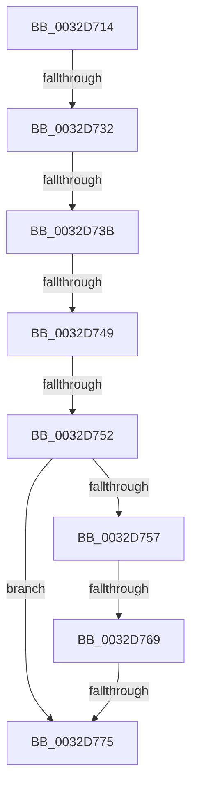

# sub_0032D714

- RVA: `0x0032D714`–`0x0032D782` (길이 `110` bytes)
- VA: `0x000000014032D714`
- 실행 섹션: `.text`
- PDB 이름 있음: `아니요`; PDB Function 태그: `아니요`
- unwind 정보 RVA: `0x00076214`
- 디코드: `24`개 명령, `110/110` bytes 표시
- 미해석 바이트: `0` (있으면 어셈블리에 `.byte`로 보존)

> 이 문서는 커널 이미지의 기계어와 PDB 기호를 분석해 생성했습니다. 4번과 5번은 함수 원형과 자료형을 바이너리 사용 방식에서 추정한 C 해석이며 원본 소스 복구 결과는 아닙니다.

## 1. Dependencies

- 직접 호출 지점: **0**; 고유 호출 대상: **0**
- 직접 호출자로 확인된 함수: **0**
- RIP 상대 이미지 참조: **0**

### Outgoing calls
- 직접 디코드된 call 명령이 없습니다.

### Direct callers
- 이 함수 시작 RVA로 연결되는 직접 call은 확인되지 않았습니다. 간접 호출은 완전히 역산할 수 없습니다.

### Static image references
- 디코드된 RIP-relative 메모리 참조가 없습니다.

## 2. Other-region calls and transfers

- 다른 실행 섹션으로 향하는 call: **0**
- call이 아닌 외부 분기/꼬리 이동: **6**
  - `0x0032D72C` → [sub_0032DCE6](Unknown_function_0032DCE6.md) (`tail-transfer`)
  - `0x0032D735` → [sub_0032DE3E + 0x12](Unknown_function_0032DE3E.md) (`tail-transfer`)
  - `0x0032D743` → [sub_0032DCE6 + 0x39](Unknown_function_0032DCE6.md) (`tail-transfer`)
  - `0x0032D74C` → [sub_0032DCE6 + 0x20](Unknown_function_0032DCE6.md) (`tail-transfer`)
  - `0x0032D763` → [sub_0032DDA1](Unknown_function_0032DDA1.md) (`tail-transfer`)
  - `0x0032D76F` → [sub_0032DD3E](Unknown_function_0032DD3E.md) (`tail-transfer`)

## 3. Assembly (complete function range)

```asm
0032D714  4C 89 BC 24 A8 00 00 00         mov qword ptr [rsp + 0xa8], r15
0032D71C  49 8B C0                        mov rax, r8
0032D71F  83 E2 01                        and edx, 1
0032D722  48 83 E0 FE                     and rax, 0xfffffffffffffffe
0032D726  4C 8B F8                        mov r15, rax
0032D729  48 85 D2                        test rdx, rdx
0032D72C  0F 85 B4 05 00 00               jne 0x14032dce6
0032D732  F6 C1 23                        test cl, 0x23
0032D735  0F 84 15 07 00 00               je 0x14032de50
0032D73B  4C 89 7D DF                     mov qword ptr [rbp - 0x21], r15
0032D73F  41 F6 C0 01                     test r8b, 1
0032D743  0F 85 D6 05 00 00               jne 0x14032dd1f
0032D749  F6 C1 02                        test cl, 2
0032D74C  0F 85 B4 05 00 00               jne 0x14032dd06
0032D752  F6 C1 20                        test cl, 0x20
0032D755  74 1E                           je 0x14032d775
0032D757  49 8B 47 08                     mov rax, qword ptr [r15 + 8]
0032D75B  48 81 78 08 00 10 00 00         cmp qword ptr [rax + 8], 0x1000
0032D763  0F 87 38 06 00 00               ja 0x14032dda1
0032D769  41 8B 47 38                     mov eax, dword ptr [r15 + 0x38]
0032D76D  A8 20                           test al, 0x20
0032D76F  0F 85 C9 05 00 00               jne 0x14032dd3e
0032D775  4D 8B 2B                        mov r13, qword ptr [r11]
0032D778  48 B8 F8 FF FF FF 7F 00 00 00   movabs rax, 0x7ffffffff8
```

## 4. C-style interpretation (structured pseudocode)

```c
__int64 __fastcall sub_0032D714(unsigned __int8 a1, int a2, __int64 a3)
{
    __int64 result;
    unsigned __int64 v_stack_pA8;

    v_stack_pA8 = v_r15;
    a2 = (unsigned int)((a2) & (1));
    result = (a3) & (-2);
    *(unsigned __int64 *)(v_rbp - 33) = result;
    if (((a1) & (32)) == 0) goto loc_0032D775;
loc_0032D775:
    return (unsigned int)(*(unsigned int *)(result + 56));
}
```

## 5. (Beta) C Style

```c
int64_t sub_0032D714(uint8_t Arg1, int32_t Arg2, void *Arg3)
{
    uint8_t *arg3 = (uint8_t *)Arg3;

    int64_t result;
    uint64_t v_stack_pA8;

    v_stack_pA8 = local_r15;
    Arg2 = (uint32_t)((Arg2) & (1));
    result = (Arg3) & (-2);
    *(uint64_t *)(local_rbp - 0x21) = result;
    if (((Arg1) & (32)) == 0) goto loc_0032D775;
loc_0032D775:
    return (uint32_t)(*(uint32_t *)(result + 0x38));
}
```

### 관측된 메모리 오프셋

구조체 형식이 확인되지 않은 접근은 인자 기준의 오프셋으로만 기록했습니다.

| 기준 인자 | 오프셋 표현 | 폭 (bit) | 접근 |
|---|---:|---:|---|
| `Arg3` | `+ 0x8` | `64` | `R` |
| `Arg3` | `+ 0x38` | `32` | `R` |

## 6. Execution-region graph

[열기: 2D/3D 그래프와 함수 탐색 컨트롤 패널](../../../control-panel.html?section=text&rva=0x0032D714&view=graph)

- 2D 그래프는 위에서 아래로 흐르고, 3D 그래프는 빈 공간을 드래그해 회전합니다. Shift+드래그는 이동, 휠은 확대·축소, 함수 노드 선택은 대상 보고서 이동입니다.

### Static fallback


