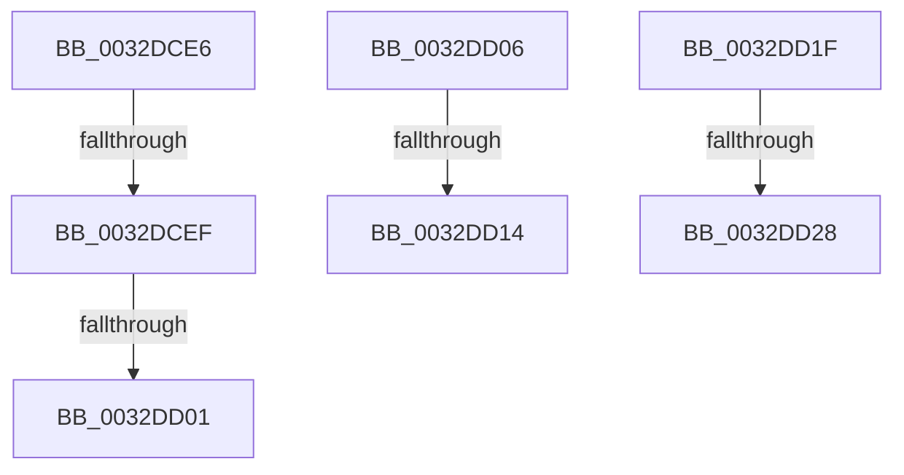

# sub_0032DCE6

- RVA: `0x0032DCE6`–`0x0032DD35` (길이 `79` bytes)
- VA: `0x000000014032DCE6`
- 실행 섹션: `.text`
- PDB 이름 있음: `아니요`; PDB Function 태그: `아니요`
- unwind 정보 RVA: `0x00076248`
- 디코드: `19`개 명령, `79/79` bytes 표시
- 미해석 바이트: `0` (있으면 어셈블리에 `.byte`로 보존)

> 이 문서는 커널 이미지의 기계어와 PDB 기호를 분석해 생성했습니다. 4번과 5번은 함수 원형과 자료형을 바이너리 사용 방식에서 추정한 C 해석이며 원본 소스 복구 결과는 아닙니다.

## 1. Dependencies

- 직접 호출 지점: **0**; 고유 호출 대상: **0**
- 직접 호출자로 확인된 함수: **0**
- RIP 상대 이미지 참조: **0**

### Outgoing calls
- 직접 디코드된 call 명령이 없습니다.

### Direct callers
- 이 함수 시작 RVA로 연결되는 직접 call은 확인되지 않았습니다. 간접 호출은 완전히 역산할 수 없습니다.

### Static image references
- 디코드된 RIP-relative 메모리 참조가 없습니다.

## 2. Other-region calls and transfers

- 다른 실행 섹션으로 향하는 call: **0**
- call이 아닌 외부 분기/꼬리 이동: **7**
  - `0x0032DCE9` → [sub_0032DE3E + 0x1B](Unknown_function_0032DE3E.md) (`tail-transfer`)
  - `0x0032DCFB` → [sub_0032D714 + 0x27](Unknown_function_0032D714.md) (`tail-transfer`)
  - `0x0032DD01` → [sub_0032D714 + 0x1E](Unknown_function_0032D714.md) (`tail-transfer`)
  - `0x0032DD0E` → [sub_0032DE3E](Unknown_function_0032DE3E.md) (`tail-transfer`)
  - `0x0032DD1A` → [sub_0032D714 + 0x3E](Unknown_function_0032D714.md) (`tail-transfer`)
  - `0x0032DD22` → [sub_0032D714 + 0x35](Unknown_function_0032D714.md) (`tail-transfer`)
  - `0x0032DD30` → [sub_0032D714 + 0x35](Unknown_function_0032D714.md) (`tail-transfer`)

## 3. Assembly (complete function range)

```asm
0032DCE6  80 38 02                        cmp byte ptr [rax], 2
0032DCE9  0F 85 6A 01 00 00               jne 0x14032de59
0032DCEF  83 C9 01                        or ecx, 1
0032DCF2  48 8B D0                        mov rdx, rax
0032DCF5  89 4D A7                        mov dword ptr [rbp - 0x59], ecx
0032DCF8  80 3A 04                        cmp byte ptr [rdx], 4
0032DCFB  0F 84 3A FA FF FF               je 0x14032d73b
0032DD01  E9 2C FA FF FF                  jmp 0x14032d732
0032DD06  41 8B 47 50                     mov eax, dword ptr [r15 + 0x50]
0032DD0A  0F BA E0 12                     bt eax, 0x12
0032DD0E  0F 83 2A 01 00 00               jae 0x14032de3e
0032DD14  83 C9 08                        or ecx, 8
0032DD17  89 4D A7                        mov dword ptr [rbp - 0x59], ecx
0032DD1A  E9 33 FA FF FF                  jmp 0x14032d752
0032DD1F  80 38 04                        cmp byte ptr [rax], 4
0032DD22  0F 85 21 FA FF FF               jne 0x14032d749
0032DD28  49 8B 47 30                     mov rax, qword ptr [r15 + 0x30]
0032DD2C  48 89 45 EF                     mov qword ptr [rbp - 0x11], rax
0032DD30  E9 14 FA FF FF                  jmp 0x14032d749
```

## 4. C-style interpretation (structured pseudocode)

```c
__int64 __fastcall sub_0032DCE6(int a1)
{
    a1 = (unsigned int)((a1) | (1));
    *(unsigned int *)(v_rbp - 89) = a1;
}
```

## 5. (Beta) C Style

```c
int64_t sub_0032DCE6(int32_t Arg1)
{
    Arg1 = (uint32_t)((Arg1) | (1));
    *(uint32_t *)(local_rbp - 0x59) = Arg1;
}
```

## 6. Execution-region graph

[열기: 2D/3D 그래프와 함수 탐색 컨트롤 패널](../../../control-panel.html?section=text&rva=0x0032DCE6&view=graph)

- 2D 그래프는 위에서 아래로 흐르고, 3D 그래프는 빈 공간을 드래그해 회전합니다. Shift+드래그는 이동, 휠은 확대·축소, 함수 노드 선택은 대상 보고서 이동입니다.

### Static fallback


