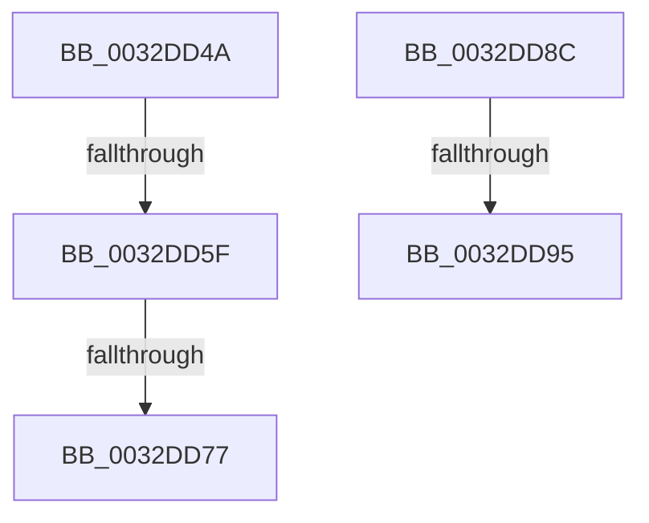

# sub_0032DD4A

- RVA: `0x0032DD4A`–`0x0032DDA1` (길이 `87` bytes)
- VA: `0x000000014032DD4A`
- 실행 섹션: `.text`
- PDB 이름 있음: `아니요`; PDB Function 태그: `아니요`
- unwind 정보 RVA: `0x00076284`
- 디코드: `22`개 명령, `87/87` bytes 표시
- 미해석 바이트: `0` (있으면 어셈블리에 `.byte`로 보존)

> 이 문서는 커널 이미지의 기계어와 PDB 기호를 분석해 생성했습니다. 4번과 5번은 함수 원형과 자료형을 바이너리 사용 방식에서 추정한 C 해석이며 원본 소스 복구 결과는 아닙니다.

## 1. Dependencies

- 직접 호출 지점: **3**; 고유 호출 대상: **3**
- 직접 호출자로 확인된 함수: **0**
- RIP 상대 이미지 참조: **0**

### Outgoing calls
- `0x0032DD52` → [MiAllowGuardFault](../34/MiAllowGuardFault_function_0034B5B0.md) (function, `0x0034B5B0`)
- `0x0032DD64` → [MiUpdatePageTableUseCount](../3D/MiUpdatePageTableUseCount_function_003D34F0.md) (function, `0x003D34F0`)
- `0x0032DD77` → [MiMakePrototypePteVadLookup](../2C/MiMakePrototypePteVadLookup_function_002C3480.md) (function, `0x002C3480`)

### Direct callers
- 이 함수 시작 RVA로 연결되는 직접 call은 확인되지 않았습니다. 간접 호출은 완전히 역산할 수 없습니다.

### Static image references
- 디코드된 RIP-relative 메모리 참조가 없습니다.

## 2. Other-region calls and transfers

- 다른 실행 섹션으로 향하는 call: **0**
- call이 아닌 외부 분기/꼬리 이동: **5**
  - `0x0032DD59` → [sub_0032D782 + 0x444](Unknown_function_0032D782.md) (`tail-transfer`)
  - `0x0032DD71` → [sub_0032DE99 + 0xB4](Unknown_function_0032DE99.md) (`tail-transfer`)
  - `0x0032DD87` → [sub_0032D782 + 0x2B2](Unknown_function_0032D782.md) (`tail-transfer`)
  - `0x0032DD8F` → [sub_0032DE99](Unknown_function_0032DE99.md) (`tail-transfer`)
  - `0x0032DD9C` → [sub_0032D782 + 0x30A](Unknown_function_0032D782.md) (`tail-transfer`)

## 3. Assembly (complete function range)

```asm
0032DD4A  4C 8B 4D 67                     mov r9, qword ptr [rbp + 0x67]
0032DD4E  49 8B 49 10                     mov rcx, qword ptr [r9 + 0x10]
0032DD52  E8 59 D8 01 00                  call 0x14034b5b0
0032DD57  85 C0                           test eax, eax
0032DD59  0F 84 67 FE FF FF               je 0x14032dbc6
0032DD5F  8B D7                           mov edx, edi
0032DD61  49 8B CD                        mov rcx, r13
0032DD64  E8 87 57 0A 00                  call 0x1403d34f0
0032DD69  83 E3 EF                        and ebx, 0xffffffef
0032DD6C  8B CB                           mov ecx, ebx
0032DD6E  48 85 F6                        test rsi, rsi
0032DD71  0F 84 D6 01 00 00               je 0x14032df4d
0032DD77  E8 04 57 F9 FF                  call 0x1402c3480
0032DD7C  49 89 04 24                     mov qword ptr [r12], rax
0032DD80  48 8B 45 6F                     mov rax, qword ptr [rbp + 0x6f]
0032DD84  C6 00 02                        mov byte ptr [rax], 2
0032DD87  E9 A8 FC FF FF                  jmp 0x14032da34
0032DD8C  80 3A 02                        cmp byte ptr [rdx], 2
0032DD8F  0F 85 04 01 00 00               jne 0x14032de99
0032DD95  48 83 E0 FE                     and rax, 0xfffffffffffffffe
0032DD99  8B 40 28                        mov eax, dword ptr [rax + 0x28]
0032DD9C  E9 EB FC FF FF                  jmp 0x14032da8c
```

## 4. C-style interpretation (structured pseudocode)

```c
__int64 __fastcall sub_0032DD4A(void)
{
    __int64 result;
    __int64 v_rbx;

    result = MiAllowGuardFault(*(unsigned __int64 *)(*(unsigned __int64 *)(v_rbp + 103) + 16), a2, a3, *(unsigned __int64 *)(v_rbp + 103));
    result = MiUpdatePageTableUseCount(v_r13, (unsigned int)((unsigned int)(v_rdi)), a3, *(unsigned __int64 *)(v_rbp + 103));
    v_rbx = (unsigned int)((v_rbx) & (0xFFFFFFEFULL));
    result = MiMakePrototypePteVadLookup((unsigned int)((unsigned int)(v_rbx)), (unsigned int)((unsigned int)(v_rdi)), a3, *(unsigned __int64 *)(v_rbp + 103));
    *(unsigned __int64 *)(v_r12) = result;
    *(unsigned __int8 *)(*(unsigned __int64 *)(v_rbp + 111)) = 2;
}
```

## 5. (Beta) C Style

```c
void sub_0032DD4A(void)
{
    int64_t result;
    int64_t local_rbx;

    result = MiAllowGuardFault(*(uint64_t *)(*(uint64_t *)(local_rbp + 0x67) + 0x10), a2, a3, *(uint64_t *)(local_rbp + 0x67));
    result = MiUpdatePageTableUseCount(local_r13, (uint32_t)((uint32_t)(local_rdi)), a3, *(uint64_t *)(local_rbp + 0x67));
    local_rbx = (uint32_t)((local_rbx) & (0xFFFFFFEFULL));
    result = MiMakePrototypePteVadLookup((uint32_t)((uint32_t)(local_rbx)), (uint32_t)((uint32_t)(local_rdi)), a3, *(uint64_t *)(local_rbp + 0x67));
    *(uint64_t *)(local_r12) = result;
    *(uint8_t *)(*(uint64_t *)(local_rbp + 0x6F)) = 2;
}
```

## 6. Execution-region graph

[열기: 2D/3D 그래프와 함수 탐색 컨트롤 패널](../../../control-panel.html?section=text&rva=0x0032DD4A&view=graph)

- 2D 그래프는 위에서 아래로 흐르고, 3D 그래프는 빈 공간을 드래그해 회전합니다. Shift+드래그는 이동, 휠은 확대·축소, 함수 노드 선택은 대상 보고서 이동입니다.

### Static fallback


