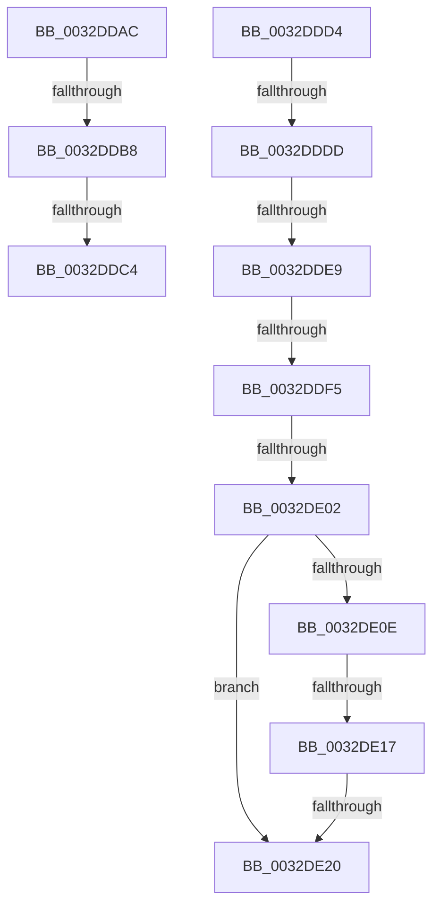

# sub_0032DDAC

- RVA: `0x0032DDAC`–`0x0032DE3E` (길이 `146` bytes)
- VA: `0x000000014032DDAC`
- 실행 섹션: `.text`
- PDB 이름 있음: `아니요`; PDB Function 태그: `아니요`
- unwind 정보 RVA: `0x000762B0`
- 디코드: `36`개 명령, `146/146` bytes 표시
- 미해석 바이트: `0` (있으면 어셈블리에 `.byte`로 보존)

> 이 문서는 커널 이미지의 기계어와 PDB 기호를 분석해 생성했습니다. 4번과 5번은 함수 원형과 자료형을 바이너리 사용 방식에서 추정한 C 해석이며 원본 소스 복구 결과는 아닙니다.

## 1. Dependencies

- 직접 호출 지점: **1**; 고유 호출 대상: **1**
- 직접 호출자로 확인된 함수: **0**
- RIP 상대 이미지 참조: **0**

### Outgoing calls
- `0x0032DE38` → [KeBugCheckEx](../4F/KeBugCheckEx_function_004FD660.md) (function, `0x004FD660`)

### Direct callers
- 이 함수 시작 RVA로 연결되는 직접 call은 확인되지 않았습니다. 간접 호출은 완전히 역산할 수 없습니다.

### Static image references
- 디코드된 RIP-relative 메모리 참조가 없습니다.

## 2. Other-region calls and transfers

- 다른 실행 섹션으로 향하는 call: **0**
- call이 아닌 외부 분기/꼬리 이동: **9**
  - `0x0032DDB2` → [sub_0032D782 + 0x3EF](Unknown_function_0032D782.md) (`tail-transfer`)
  - `0x0032DDBE` → [sub_0032D782 + 0x3EF](Unknown_function_0032D782.md) (`tail-transfer`)
  - `0x0032DDCF` → [sub_0032D782 + 0x2ED](Unknown_function_0032D782.md) (`tail-transfer`)
  - `0x0032DDD7` → [sub_0032D782 + 0x2B2](Unknown_function_0032D782.md) (`tail-transfer`)
  - `0x0032DDE3` → [sub_0032D782 + 0x53](Unknown_function_0032D782.md) (`tail-transfer`)
  - `0x0032DDEF` → [sub_0032D782 + 0x53](Unknown_function_0032D782.md) (`tail-transfer`)
  - `0x0032DDFC` → [sub_0032D782 + 0x53](Unknown_function_0032D782.md) (`tail-transfer`)
  - `0x0032DE11` → [sub_0032D782 + 0x53](Unknown_function_0032D782.md) (`tail-transfer`)
  - `0x0032DE1A` → [sub_0032D782 + 0x53](Unknown_function_0032D782.md) (`tail-transfer`)

## 3. Assembly (complete function range)

```asm
0032DDAC  49 8B C0                        mov rax, r8
0032DDAF  4C 3B E8                        cmp r13, rax
0032DDB2  0F 82 B9 FD FF FF               jb 0x14032db71
0032DDB8  49 8B C1                        mov rax, r9
0032DDBB  4C 3B E8                        cmp r13, rax
0032DDBE  0F 87 AD FD FF FF               ja 0x14032db71
0032DDC4  BB 04 00 00 00                  mov ebx, 4
0032DDC9  49 8B F2                        mov rsi, r10
0032DDCC  8D 7B FD                        lea edi, [rbx - 3]
0032DDCF  E9 9B FC FF FF                  jmp 0x14032da6f
0032DDD4  F6 C1 02                        test cl, 2
0032DDD7  0F 85 57 FC FF FF               jne 0x14032da34
0032DDDD  49 8B C0                        mov rax, r8
0032DDE0  4C 3B E8                        cmp r13, rax
0032DDE3  0F 82 EC F9 FF FF               jb 0x14032d7d5
0032DDE9  49 8B C1                        mov rax, r9
0032DDEC  4C 3B E8                        cmp r13, rax
0032DDEF  0F 87 E0 F9 FF FF               ja 0x14032d7d5
0032DDF5  49 8B 53 10                     mov rdx, qword ptr [r11 + 0x10]
0032DDF9  48 85 D2                        test rdx, rdx
0032DDFC  0F 84 D3 F9 FF FF               je 0x14032d7d5
0032DE02  48 8B C2                        mov rax, rdx
0032DE05  48 83 E0 FE                     and rax, 0xfffffffffffffffe
0032DE09  F6 C2 01                        test dl, 1
0032DE0C  74 12                           je 0x14032de20
0032DE0E  80 38 07                        cmp byte ptr [rax], 7
0032DE11  0F 84 BE F9 FF FF               je 0x14032d7d5
0032DE17  80 38 08                        cmp byte ptr [rax], 8
0032DE1A  0F 84 B5 F9 FF FF               je 0x14032d7d5
0032DE20  4D 8B 43 08                     mov r8, qword ptr [r11 + 8]
0032DE24  4D 8B CC                        mov r9, r12
0032DE27  49 8B D5                        mov rdx, r13
0032DE2A  48 C7 44 24 20 06 00 00 00      mov qword ptr [rsp + 0x20], 6
0032DE33  B9 50 00 00 00                  mov ecx, 0x50
0032DE38  E8 23 F8 1C 00                  call 0x1404fd660
0032DE3D  CC                              int3
```

## 4. C-style interpretation (structured pseudocode)

```c
__int64 __fastcall sub_0032DDAC(unsigned __int8 a1, __int64 a2, __int64 a3, __int64 a4)
{
    unsigned __int64 v_stack_p20;
}
```

## 5. (Beta) C Style

```c
int64_t sub_0032DDAC(uint8_t Arg1, int64_t Arg2, int64_t Arg3, int64_t Arg4)
{
    uint64_t v_stack_p20;
}
```

## 6. Execution-region graph

[열기: 2D/3D 그래프와 함수 탐색 컨트롤 패널](../../../control-panel.html?section=text&rva=0x0032DDAC&view=graph)

- 2D 그래프는 위에서 아래로 흐르고, 3D 그래프는 빈 공간을 드래그해 회전합니다. Shift+드래그는 이동, 휠은 확대·축소, 함수 노드 선택은 대상 보고서 이동입니다.

### Static fallback


