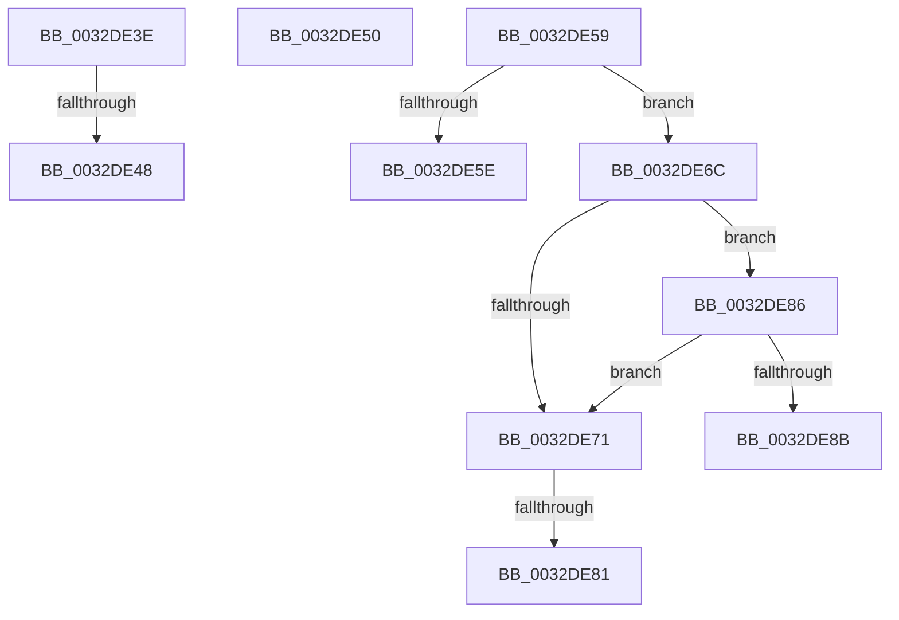

# sub_0032DE3E

- RVA: `0x0032DE3E`–`0x0032DE99` (길이 `91` bytes)
- VA: `0x000000014032DE3E`
- 실행 섹션: `.text`
- PDB 이름 있음: `아니요`; PDB Function 태그: `아니요`
- unwind 정보 RVA: `0x000762CC`
- 디코드: `25`개 명령, `91/91` bytes 표시
- 미해석 바이트: `0` (있으면 어셈블리에 `.byte`로 보존)

> 이 문서는 커널 이미지의 기계어와 PDB 기호를 분석해 생성했습니다. 4번과 5번은 함수 원형과 자료형을 바이너리 사용 방식에서 추정한 C 해석이며 원본 소스 복구 결과는 아닙니다.

## 1. Dependencies

- 직접 호출 지점: **0**; 고유 호출 대상: **0**
- 직접 호출자로 확인된 함수: **0**
- RIP 상대 이미지 참조: **0**

### Outgoing calls
- 직접 디코드된 call 명령이 없습니다.

### Direct callers
- 이 함수 시작 RVA로 연결되는 직접 call은 확인되지 않았습니다. 간접 호출은 완전히 역산할 수 없습니다.

### Static image references
- 디코드된 RIP-relative 메모리 참조가 없습니다.

## 2. Other-region calls and transfers

- 다른 실행 섹션으로 향하는 call: **0**
- call이 아닌 외부 분기/꼬리 이동: **7**
  - `0x0032DE42` → [sub_0032D714 + 0x3E](Unknown_function_0032D714.md) (`tail-transfer`)
  - `0x0032DE4B` → [sub_0032DCE6 + 0x31](Unknown_function_0032DCE6.md) (`tail-transfer`)
  - `0x0032DE54` → [sub_0032D714 + 0x61](Unknown_function_0032D714.md) (`tail-transfer`)
  - `0x0032DE67` → [sub_0032DCE6 + 0x12](Unknown_function_0032DCE6.md) (`tail-transfer`)
  - `0x0032DE7B` → [sub_0032D714 + 0x1E](Unknown_function_0032D714.md) (`tail-transfer`)
  - `0x0032DE81` → [sub_0032DCE6 + 0x12](Unknown_function_0032DCE6.md) (`tail-transfer`)
  - `0x0032DE94` → [sub_0032DCE6 + 0x12](Unknown_function_0032DCE6.md) (`tail-transfer`)

## 3. Assembly (complete function range)

```asm
0032DE3E  0F BA E0 0E                     bt eax, 0xe
0032DE42  0F 83 0A F9 FF FF               jae 0x14032d752
0032DE48  83 C9 14                        or ecx, 0x14
0032DE4B  E9 C7 FE FF FF                  jmp 0x14032dd17
0032DE50  4C 8B 7D DF                     mov r15, qword ptr [rbp - 0x21]
0032DE54  E9 1C F9 FF FF                  jmp 0x14032d775
0032DE59  80 38 01                        cmp byte ptr [rax], 1
0032DE5C  75 0E                           jne 0x14032de6c
0032DE5E  83 C9 02                        or ecx, 2
0032DE61  48 8B D0                        mov rdx, rax
0032DE64  89 4D A7                        mov dword ptr [rbp - 0x59], ecx
0032DE67  E9 8C FE FF FF                  jmp 0x14032dcf8
0032DE6C  48 85 D2                        test rdx, rdx
0032DE6F  75 15                           jne 0x14032de86
0032DE71  49 8B C7                        mov rax, r15
0032DE74  49 8B D7                        mov rdx, r15
0032DE77  41 F6 C0 01                     test r8b, 1
0032DE7B  0F 84 B1 F8 FF FF               je 0x14032d732
0032DE81  E9 72 FE FF FF                  jmp 0x14032dcf8
0032DE86  80 38 05                        cmp byte ptr [rax], 5
0032DE89  75 E6                           jne 0x14032de71
0032DE8B  83 C9 20                        or ecx, 0x20
0032DE8E  48 8B D0                        mov rdx, rax
0032DE91  89 4D A7                        mov dword ptr [rbp - 0x59], ecx
0032DE94  E9 5F FE FF FF                  jmp 0x14032dcf8
```

## 4. C-style interpretation (structured pseudocode)

```c
__int64 __fastcall sub_0032DE3E(int a1, __int64 a2, unsigned __int8 a3)
{
    a1 = (unsigned int)((a1) | (20));
}
```

## 5. (Beta) C Style

```c
int64_t sub_0032DE3E(int32_t Arg1, int64_t Arg2, uint8_t Arg3)
{
    Arg1 = (uint32_t)((Arg1) | (20));
}
```

## 6. Execution-region graph

[열기: 2D/3D 그래프와 함수 탐색 컨트롤 패널](../../../control-panel.html?section=text&rva=0x0032DE3E&view=graph)

- 2D 그래프는 위에서 아래로 흐르고, 3D 그래프는 빈 공간을 드래그해 회전합니다. Shift+드래그는 이동, 휠은 확대·축소, 함수 노드 선택은 대상 보고서 이동입니다.

### Static fallback


