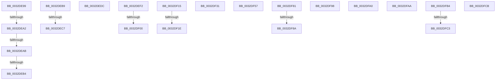

# sub_0032DE99

- RVA: `0x0032DE99`–`0x0032DFD5` (길이 `316` bytes)
- VA: `0x000000014032DE99`
- 실행 섹션: `.text`
- PDB 이름 있음: `아니요`; PDB Function 태그: `아니요`
- unwind 정보 RVA: `0x000762DC`
- 디코드: `69`개 명령, `316/316` bytes 표시
- 미해석 바이트: `0` (있으면 어셈블리에 `.byte`로 보존)

> 이 문서는 커널 이미지의 기계어와 PDB 기호를 분석해 생성했습니다. 4번과 5번은 함수 원형과 자료형을 바이너리 사용 방식에서 추정한 C 해석이며 원본 소스 복구 결과는 아닙니다.

## 1. Dependencies

- 직접 호출 지점: **6**; 고유 호출 대상: **4**
- 직접 호출자로 확인된 함수: **0**
- RIP 상대 이미지 참조: **3**

### Outgoing calls
- `0x0032DED2` → [ExpReleaseSpinLockSharedFromDpcLevelInstrumented](../2F/ExpReleaseSpinLockSharedFromDpcLevelInstrumented_function_002F0F48.md) (function, `0x002F0F48`)
- `0x0032DF0B` → [ExpReleaseSpinLockSharedFromDpcLevelInstrumented](../2F/ExpReleaseSpinLockSharedFromDpcLevelInstrumented_function_002F0F48.md) (function, `0x002F0F48`)
- `0x0032DF27` → [MiPrefetchJumpVad](../4D/MiPrefetchJumpVad_function_004D7A28.md) (function, `0x004D7A28`)
- `0x0032DF47` → [KeBugCheckEx](../4F/KeBugCheckEx_function_004FD660.md) (function, `0x004FD660`)
- `0x0032DF4D` → [MiMakeDemandZeroPte](../33/MiMakeDemandZeroPte_function_00337A00.md) (function, `0x00337A00`)
- `0x0032DF6D` → [KeBugCheckEx](../4F/KeBugCheckEx_function_004FD660.md) (function, `0x004FD660`)

### Direct callers
- 이 함수 시작 RVA로 연결되는 직접 call은 확인되지 않았습니다. 간접 호출은 완전히 역산할 수 없습니다.

### Static image references
- `0x0032DEB9` → RVA `0x00F0DE58` (`.data`; read)
- `0x0032DEDC` → RVA `0x00E2DB68` (`.data`; read)
- `0x0032DF8A` → RVA `0x00E2DB70` (`.data`; read)

## 2. Other-region calls and transfers

- 다른 실행 섹션으로 향하는 call: **0**
- call이 아닌 외부 분기/꼬리 이동: **21**
  - `0x0032DE9C` → [sub_0032DD4A + 0x4B](Unknown_function_0032DD4A.md) (`tail-transfer`)
  - `0x0032DEA5` → [sub_0032DD4A + 0x4B](Unknown_function_0032DD4A.md) (`tail-transfer`)
  - `0x0032DEAE` → [sub_0032D782 + 0x307](Unknown_function_0032D782.md) (`tail-transfer`)
  - `0x0032DEB4` → [sub_0032DD4A + 0x4B](Unknown_function_0032DD4A.md) (`tail-transfer`)
  - `0x0032DEC1` → [sub_0032D782 + 0x281](Unknown_function_0032D782.md) (`tail-transfer`)
  - `0x0032DED7` → [sub_0032D782 + 0x295](Unknown_function_0032D782.md) (`tail-transfer`)
  - `0x0032DEED` → [sub_0032D782 + 0x2ED](Unknown_function_0032D782.md) (`tail-transfer`)
  - `0x0032DEFA` → [sub_0032D782 + 0x3D8](Unknown_function_0032D782.md) (`tail-transfer`)
  - `0x0032DF10` → [sub_0032D782 + 0x3EC](Unknown_function_0032D782.md) (`tail-transfer`)
  - `0x0032DF18` → [sub_0032D782 + 0x444](Unknown_function_0032D782.md) (`tail-transfer`)
  - `0x0032DF2C` → [sub_0032D782 + 0x444](Unknown_function_0032D782.md) (`tail-transfer`)
  - `0x0032DF52` → [sub_0032DD4A + 0x32](Unknown_function_0032DD4A.md) (`tail-transfer`)
  - `0x0032DF7C` → [sub_0032D782 + 0x25D](Unknown_function_0032D782.md) (`tail-transfer`)
  - `0x0032DF84` → [sub_0032D782 + 0x1DE](Unknown_function_0032D782.md) (`tail-transfer`)
  - `0x0032DF93` → [sub_0032D782 + 0x25D](Unknown_function_0032D782.md) (`tail-transfer`)
  - `0x0032DF9B` → [sub_0032D782 + 0x49E](Unknown_function_0032D782.md) (`tail-transfer`)
  - `0x0032DFA5` → [sub_0032D782 + 0x55C](Unknown_function_0032D782.md) (`tail-transfer`)
  - `0x0032DFAF` → [sub_0032D782 + 0x55C](Unknown_function_0032D782.md) (`tail-transfer`)
  - `0x0032DFBD` → [sub_0032D782 + 0x20F](Unknown_function_0032D782.md) (`tail-transfer`)
  - `0x0032DFC6` → [sub_0032D782 + 0x49E](Unknown_function_0032D782.md) (`tail-transfer`)
  - `0x0032DFD0` → [sub_0032D782 + 0x24A](Unknown_function_0032D782.md) (`tail-transfer`)

## 3. Assembly (complete function range)

```asm
0032DE99  80 3A 08                        cmp byte ptr [rdx], 8
0032DE9C  0F 84 F3 FE FF FF               je 0x14032dd95
0032DEA2  80 3A 07                        cmp byte ptr [rdx], 7
0032DEA5  0F 84 EA FE FF FF               je 0x14032dd95
0032DEAB  80 3A 04                        cmp byte ptr [rdx], 4
0032DEAE  0F 85 D5 FB FF FF               jne 0x14032da89
0032DEB4  E9 DC FE FF FF                  jmp 0x14032dd95
0032DEB9  8B 05 99 FF BD 00               mov eax, dword ptr [rip + 0xbdff99]
0032DEBF  85 C0                           test eax, eax
0032DEC1  0F 85 3C FB FF FF               jne 0x14032da03
0032DEC7  48 8B 55 5F                     mov rdx, qword ptr [rbp + 0x5f]
0032DECB  49 8D 88 EC 03 00 00            lea rcx, [r8 + 0x3ec]
0032DED2  E8 71 30 FC FF                  call 0x1402f0f48
0032DED7  E9 3B FB FF FF                  jmp 0x14032da17
0032DEDC  48 8B 35 85 FC AF 00            mov rsi, qword ptr [rip + 0xaffc85]
0032DEE3  BF 01 00 00 00                  mov edi, 1
0032DEE8  8B 4D A7                        mov ecx, dword ptr [rbp - 0x59]
0032DEEB  8B DF                           mov ebx, edi
0032DEED  E9 7D FB FF FF                  jmp 0x14032da6f
0032DEF2  8B 05 60 FF BD 00               mov eax, dword ptr [rip + 0xbdff60]
0032DEF8  85 C0                           test eax, eax
0032DEFA  0F 85 5A FC FF FF               jne 0x14032db5a
0032DF00  48 8B 55 5F                     mov rdx, qword ptr [rbp + 0x5f]
0032DF04  49 8D 88 EC 03 00 00            lea rcx, [r8 + 0x3ec]
0032DF0B  E8 38 30 FC FF                  call 0x1402f0f48
0032DF10  E9 59 FC FF FF                  jmp 0x14032db6e
0032DF15  4D 85 F6                        test r14, r14
0032DF18  0F 84 A8 FC FF FF               je 0x14032dbc6
0032DF1E  4D 8B C5                        mov r8, r13
0032DF21  49 8B D6                        mov rdx, r14
0032DF24  49 8B CF                        mov rcx, r15
0032DF27  E8 FC 9A 1A 00                  call 0x1404d7a28
0032DF2C  E9 95 FC FF FF                  jmp 0x14032dbc6
0032DF31  4D 8B C5                        mov r8, r13
0032DF34  48 C7 44 24 20 00 00 00 00      mov qword ptr [rsp + 0x20], 0
0032DF3D  BA 78 44 00 00                  mov edx, 0x4478
0032DF42  B9 1A 00 00 00                  mov ecx, 0x1a
0032DF47  E8 14 F7 1C 00                  call 0x1404fd660
0032DF4C  CC                              int3
0032DF4D  E8 AE 9A 00 00                  call 0x140337a00
0032DF52  E9 25 FE FF FF                  jmp 0x14032dd7c
0032DF57  4D 8B C5                        mov r8, r13
0032DF5A  48 C7 44 24 20 00 00 00 00      mov qword ptr [rsp + 0x20], 0
0032DF63  BA 77 44 00 00                  mov edx, 0x4477
0032DF68  B9 1A 00 00 00                  mov ecx, 0x1a
0032DF6D  E8 EE F6 1C 00                  call 0x1404fd660
0032DF72  CC                              int3
0032DF73  48 8B 35 EE FB AF 00            mov rsi, qword ptr [rip + 0xaffbee]
0032DF7A  8B DF                           mov ebx, edi
0032DF7C  E9 5E FA FF FF                  jmp 0x14032d9df
0032DF81  48 85 C0                        test rax, rax
0032DF84  0F 84 D6 F9 FF FF               je 0x14032d960
0032DF8A  48 8B 35 DF FB AF 00            mov rsi, qword ptr [rip + 0xaffbdf]
0032DF91  8B DF                           mov ebx, edi
0032DF93  E9 47 FA FF FF                  jmp 0x14032d9df
0032DF98  49 8B F2                        mov rsi, r10
0032DF9B  E9 80 FC FF FF                  jmp 0x14032dc20
0032DFA0  BB 18 00 00 00                  mov ebx, 0x18
0032DFA5  E9 34 FD FF FF                  jmp 0x14032dcde
0032DFAA  BB 18 00 00 00                  mov ebx, 0x18
0032DFAF  E9 2A FD FF FF                  jmp 0x14032dcde
0032DFB4  41 8B 46 30                     mov eax, dword ptr [r14 + 0x30]
0032DFB8  83 E0 70                        and eax, 0x70
0032DFBB  3C 50                           cmp al, 0x50
0032DFBD  0F 84 CE F9 FF FF               je 0x14032d991
0032DFC3  49 8B F2                        mov rsi, r10
0032DFC6  E9 55 FC FF FF                  jmp 0x14032dc20
0032DFCB  BB 18 00 00 00                  mov ebx, 0x18
0032DFD0  E9 F7 F9 FF FF                  jmp 0x14032d9cc
```

## 4. C-style interpretation (structured pseudocode)

```c
__int64 __fastcall sub_0032DE99(__int64 a1, __int64 a2, __int64 a3)
{
    unsigned __int64 v_stack_p20;
}
```

## 5. (Beta) C Style

```c
int64_t sub_0032DE99(int64_t Arg1, void *Arg2, int64_t Arg3)
{
    uint8_t *arg2 = (uint8_t *)Arg2;

    uint64_t v_stack_p20;
}
```

### 관측된 메모리 오프셋

구조체 형식이 확인되지 않은 접근은 인자 기준의 오프셋으로만 기록했습니다.

| 기준 인자 | 오프셋 표현 | 폭 (bit) | 접근 |
|---|---:|---:|---|
| `Arg2` | `+ 0x0` | `8` | `R` |

## 6. Execution-region graph

[열기: 2D/3D 그래프와 함수 탐색 컨트롤 패널](../../../control-panel.html?section=text&rva=0x0032DE99&view=graph)

- 2D 그래프는 위에서 아래로 흐르고, 3D 그래프는 빈 공간을 드래그해 회전합니다. Shift+드래그는 이동, 휠은 확대·축소, 함수 노드 선택은 대상 보고서 이동입니다.

### Static fallback


