# sub_0032E02E

- RVA: `0x0032E02E`–`0x0032E2BC` (길이 `654` bytes)
- VA: `0x000000014032E02E`
- 실행 섹션: `.text`
- PDB 이름 있음: `아니요`; PDB Function 태그: `아니요`
- unwind 정보 RVA: `0x00076328`
- 디코드: `150`개 명령, `654/654` bytes 표시
- 미해석 바이트: `0` (있으면 어셈블리에 `.byte`로 보존)

> 이 문서는 커널 이미지의 기계어와 PDB 기호를 분석해 생성했습니다. 4번과 5번은 함수 원형과 자료형을 바이너리 사용 방식에서 추정한 C 해석이며 원본 소스 복구 결과는 아닙니다.

## 1. Dependencies

- 직접 호출 지점: **3**; 고유 호출 대상: **3**
- 직접 호출자로 확인된 함수: **0**
- RIP 상대 이미지 참조: **4**

### Outgoing calls
- `0x0032E116` → [ExpAcquireSpinLockSharedAtDpcLevelInstrumented](../27/ExpAcquireSpinLockSharedAtDpcLevelInstrumented_function_0027CD20.md) (function, `0x0027CD20`)
- `0x0032E251` → [MiGetProtoPteAddress](MiGetProtoPteAddress_function_0032E970.md) (function, `0x0032E970`)
- `0x0032E25F` → [MiVadExtentCommitted](MiVadExtentCommitted_function_0032E930.md) (function, `0x0032E930`)

### Direct callers
- 이 함수 시작 RVA로 연결되는 직접 call은 확인되지 않았습니다. 간접 호출은 완전히 역산할 수 없습니다.

### Static image references
- `0x0032E04A` → RVA `0x00E2DC80` (`.data`; read)
- `0x0032E0D6` → RVA `0x00E2DB78` (`.data`; read)
- `0x0032E101` → RVA `0x00FC6B06` (`ALMOSTRO`; read)
- `0x0032E10A` → RVA `0x00F0DE58` (`.data`; read)

## 2. Other-region calls and transfers

- 다른 실행 섹션으로 향하는 call: **0**
- call이 아닌 외부 분기/꼬리 이동: **16**
  - `0x0032E044` → [sub_0032E327 + 0xA9](Unknown_function_0032E327.md) (`tail-transfer`)
  - `0x0032E072` → [sub_0032E327 + 0xA9](Unknown_function_0032E327.md) (`tail-transfer`)
  - `0x0032E0A1` → [sub_0032E327 + 0x110](Unknown_function_0032E327.md) (`tail-transfer`)
  - `0x0032E0D0` → [sub_0032E327 + 0x177](Unknown_function_0032E327.md) (`tail-transfer`)
  - `0x0032E0DD` → [sub_0032E327](Unknown_function_0032E327.md) (`tail-transfer`)
  - `0x0032E12D` → [sub_0032E327 + 0xDD](Unknown_function_0032E327.md) (`tail-transfer`)
  - `0x0032E14D` → [sub_0032E327 + 0x15](Unknown_function_0032E327.md) (`tail-transfer`)
  - `0x0032E18A` → [sub_0032E327 + 0x15](Unknown_function_0032E327.md) (`tail-transfer`)
  - `0x0032E1C7` → [sub_0032E327 + 0x15](Unknown_function_0032E327.md) (`tail-transfer`)
  - `0x0032E200` → [sub_0032E327 + 0x183](Unknown_function_0032E327.md) (`tail-transfer`)
  - `0x0032E20D` → [sub_0032E327 + 0x18F](Unknown_function_0032E327.md) (`tail-transfer`)
  - `0x0032E218` → [sub_0032E327 + 0x1A4](Unknown_function_0032E327.md) (`tail-transfer`)
  - `0x0032E222` → [sub_0032E327 + 0x54](Unknown_function_0032E327.md) (`tail-transfer`)
  - `0x0032E22F` → [sub_0032E327 + 0xF1](Unknown_function_0032E327.md) (`tail-transfer`)
  - `0x0032E23A` → [sub_0032E327 + 0x1AB](Unknown_function_0032E327.md) (`tail-transfer`)
  - `0x0032E282` → [sub_0032E327 + 0x12D](Unknown_function_0032E327.md) (`tail-transfer`)

## 3. Assembly (complete function range)

```asm
0032E02E  48 89 5C 24 48                  mov qword ptr [rsp + 0x48], rbx
0032E033  48 C1 ED 05                     shr rbp, 5
0032E037  83 E5 1F                        and ebp, 0x1f
0032E03A  48 89 74 24 50                  mov qword ptr [rsp + 0x50], rsi
0032E03F  48 0F BA E0 0A                  bt rax, 0xa
0032E044  0F 83 86 03 00 00               jae 0x14032e3d0
0032E04A  48 8B 15 2F FC AF 00            mov rdx, qword ptr [rip + 0xaffc2f]
0032E051  48 8B C8                        mov rcx, rax
0032E054  48 85 D2                        test rdx, rdx
0032E057  74 0D                           je 0x14032e066
0032E059  A8 10                           test al, 0x10
0032E05B  75 09                           jne 0x14032e066
0032E05D  48 8B CA                        mov rcx, rdx
0032E060  48 F7 D1                        not rcx
0032E063  48 23 C8                        and rcx, rax
0032E066  48 C1 E9 20                     shr rcx, 0x20
0032E06A  BA FF FF FF FF                  mov edx, 0xffffffff
0032E06F  48 3B CA                        cmp rcx, rdx
0032E072  0F 85 58 03 00 00               jne 0x14032e3d0
0032E078  49 C1 E6 19                     shl r14, 0x19
0032E07C  48 B9 00 00 00 00 80 F6 FF FF   movabs rcx, 0xfffff68000000000
0032E086  48 8B C1                        mov rax, rcx
0032E089  48 C1 E0 19                     shl rax, 0x19
0032E08D  4C 2B F0                        sub r14, rax
0032E090  48 B8 FF FF FE FF FF 7F 00 00   movabs rax, 0x7ffffffeffff
0032E09A  49 C1 FE 10                     sar r14, 0x10
0032E09E  4C 3B F0                        cmp r14, rax
0032E0A1  0F 87 90 03 00 00               ja 0x14032e437
0032E0A7  65 48 8B 04 25 88 01 00 00      mov rax, qword ptr gs:[0x188]
0032E0B0  48 8B 88 B8 00 00 00            mov rcx, qword ptr [rax + 0xb8]
0032E0B7  8B 81 FC 05 00 00               mov eax, dword ptr [rcx + 0x5fc]
0032E0BD  A8 01                           test al, 1
0032E0BF  75 22                           jne 0x14032e0e3
0032E0C1  49 8B C6                        mov rax, r14
0032E0C4  48 25 00 F0 FF FF               and rax, 0xfffffffffffff000
0032E0CA  48 3D 00 00 FE 7F               cmp rax, 0x7ffe0000
0032E0D0  0F 84 C8 03 00 00               je 0x14032e49e
0032E0D6  48 3B 05 9B FA AF 00            cmp rax, qword ptr [rip + 0xaffa9b]
0032E0DD  0F 84 44 02 00 00               je 0x14032e327
0032E0E3  65 48 8B 04 25 88 01 00 00      mov rax, qword ptr gs:[0x188]
0032E0EC  48 8B 88 B8 00 00 00            mov rcx, qword ptr [rax + 0xb8]
0032E0F3  48 8B 89 10 04 00 00            mov rcx, qword ptr [rcx + 0x410]
0032E0FA  48 81 C1 EC 03 00 00            add rcx, 0x3ec
0032E101  F6 05 FE 89 C9 00 21            test byte ptr [rip + 0xc989fe], 0x21
0032E108  74 13                           je 0x14032e11d
0032E10A  8B 05 48 FD BD 00               mov eax, dword ptr [rip + 0xbdfd48]
0032E110  85 C0                           test eax, eax
0032E112  75 09                           jne 0x14032e11d
0032E114  B2 FF                           mov dl, 0xff
0032E116  E8 05 EC F4 FF                  call 0x14027cd20
0032E11B  EB 16                           jmp 0x14032e133
0032E11D  0F 0D 09                        prefetchw byte ptr [rcx]
0032E120  8B 01                           mov eax, dword ptr [rcx]
0032E122  0F BA F0 1F                     btr eax, 0x1f
0032E126  8D 50 01                        lea edx, [rax + 1]
0032E129  F0 0F B1 11                     lock cmpxchg dword ptr [rcx], edx
0032E12D  0F 85 D1 02 00 00               jne 0x14032e404
0032E133  65 48 8B 04 25 88 01 00 00      mov rax, qword ptr gs:[0x188]
0032E13C  48 8B 90 B8 00 00 00            mov rdx, qword ptr [rax + 0xb8]
0032E143  48 8B 9A 60 05 00 00            mov rbx, qword ptr [rdx + 0x560]
0032E14A  48 85 DB                        test rbx, rbx
0032E14D  0F 84 E9 01 00 00               je 0x14032e33c
0032E153  0F B6 4B 20                     movzx ecx, byte ptr [rbx + 0x20]
0032E157  49 8B FE                        mov rdi, r14
0032E15A  8B 43 18                        mov eax, dword ptr [rbx + 0x18]
0032E15D  48 C1 E1 20                     shl rcx, 0x20
0032E161  48 0B C8                        or rcx, rax
0032E164  48 C1 EF 0C                     shr rdi, 0xc
0032E168  48 3B F9                        cmp rdi, rcx
0032E16B  72 13                           jb 0x14032e180
0032E16D  0F B6 4B 21                     movzx ecx, byte ptr [rbx + 0x21]
0032E171  8B 43 1C                        mov eax, dword ptr [rbx + 0x1c]
0032E174  48 C1 E1 20                     shl rcx, 0x20
0032E178  48 0B C8                        or rcx, rax
0032E17B  48 3B F9                        cmp rdi, rcx
0032E17E  76 54                           jbe 0x14032e1d4
0032E180  48 8B 9A 58 05 00 00            mov rbx, qword ptr [rdx + 0x558]
0032E187  48 85 DB                        test rbx, rbx
0032E18A  0F 84 AC 01 00 00               je 0x14032e33c
0032E190  0F B6 4B 21                     movzx ecx, byte ptr [rbx + 0x21]
0032E194  8B 43 1C                        mov eax, dword ptr [rbx + 0x1c]
0032E197  48 C1 E1 20                     shl rcx, 0x20
0032E19B  48 0B C8                        or rcx, rax
0032E19E  48 3B F9                        cmp rdi, rcx
0032E1A1  77 18                           ja 0x14032e1bb
0032E1A3  0F B6 4B 20                     movzx ecx, byte ptr [rbx + 0x20]
0032E1A7  8B 43 18                        mov eax, dword ptr [rbx + 0x18]
0032E1AA  48 C1 E1 20                     shl rcx, 0x20
0032E1AE  48 0B C8                        or rcx, rax
0032E1B1  48 3B F9                        cmp rdi, rcx
0032E1B4  73 0E                           jae 0x14032e1c4
0032E1B6  48 8B 1B                        mov rbx, qword ptr [rbx]
0032E1B9  EB 04                           jmp 0x14032e1bf
0032E1BB  48 8B 5B 08                     mov rbx, qword ptr [rbx + 8]
0032E1BF  48 85 DB                        test rbx, rbx
0032E1C2  75 CC                           jne 0x14032e190
0032E1C4  48 85 DB                        test rbx, rbx
0032E1C7  0F 84 6F 01 00 00               je 0x14032e33c
0032E1CD  48 89 9A 60 05 00 00            mov qword ptr [rdx + 0x560], rbx
0032E1D4  65 48 8B 04 25 88 01 00 00      mov rax, qword ptr gs:[0x188]
0032E1DD  48 8B F3                        mov rsi, rbx
0032E1E0  48 8B 88 B8 00 00 00            mov rcx, qword ptr [rax + 0xb8]
0032E1E7  8B 81 FC 05 00 00               mov eax, dword ptr [rcx + 0x5fc]
0032E1ED  A8 01                           test al, 1
0032E1EF  75 22                           jne 0x14032e213
0032E1F1  49 8B C6                        mov rax, r14
0032E1F4  48 25 00 F0 FF FF               and rax, 0xfffffffffffff000
0032E1FA  48 3D 00 00 FE 7F               cmp rax, 0x7ffe0000
0032E200  0F 84 A4 02 00 00               je 0x14032e4aa
0032E206  48 3B 05 6B F9 AF 00            cmp rax, qword ptr [rip + 0xaff96b]
0032E20D  0F 84 A3 02 00 00               je 0x14032e4b6
0032E213  8B 43 30                        mov eax, dword ptr [rbx + 0x30]
0032E216  A8 04                           test al, 4
0032E218  0F 85 AD 02 00 00               jne 0x14032e4cb
0032E21E  24 70                           and al, 0x70
0032E220  3C 20                           cmp al, 0x20
0032E222  0F 84 53 01 00 00               je 0x14032e37b
0032E228  8B 4B 30                        mov ecx, dword ptr [rbx + 0x30]
0032E22B  0F BA E1 15                     bt ecx, 0x15
0032E22F  0F 82 E3 01 00 00               jb 0x14032e418
0032E235  8B 43 40                        mov eax, dword ptr [rbx + 0x40]
0032E238  A8 01                           test al, 1
0032E23A  0F 85 92 02 00 00               jne 0x14032e4d2
0032E240  4C 8D 4C 24 40                  lea r9, [rsp + 0x40]
0032E245  41 B8 0C 00 00 00               mov r8d, 0xc
0032E24B  48 8B D7                        mov rdx, rdi
0032E24E  48 8B CB                        mov rcx, rbx
0032E251  E8 1A 07 00 00                  call 0x14032e970
0032E256  49 8B D6                        mov rdx, r14
0032E259  48 8B CB                        mov rcx, rbx
0032E25C  48 8B F8                        mov rdi, rax
0032E25F  E8 CC 06 00 00                  call 0x14032e930
0032E264  65 48 8B 04 25 88 01 00 00      mov rax, qword ptr gs:[0x188]
0032E26D  F6 05 92 88 C9 00 01            test byte ptr [rip + 0xc98892], 1
0032E274  48 8B 88 B8 00 00 00            mov rcx, qword ptr [rax + 0xb8]
0032E27B  4C 8B 81 10 04 00 00            mov r8, qword ptr [rcx + 0x410]
0032E282  0F 85 CC 01 00 00               jne 0x14032e454
0032E288  F0 41 81 A0 EC 03 00 00 FF FF FF BF  lock and dword ptr [r8 + 0x3ec], 0xbfffffff
0032E294  F0 41 FF 88 EC 03 00 00         lock dec dword ptr [r8 + 0x3ec]
0032E29C  48 8B 74 24 50                  mov rsi, qword ptr [rsp + 0x50]
0032E2A1  48 8B C7                        mov rax, rdi
0032E2A4  48 8B 5C 24 48                  mov rbx, qword ptr [rsp + 0x48]
0032E2A9  41 89 2F                        mov dword ptr [r15], ebp
0032E2AC  48 8B 6C 24 58                  mov rbp, qword ptr [rsp + 0x58]
0032E2B1  48 83 C4 20                     add rsp, 0x20
0032E2B5  41 5F                           pop r15
0032E2B7  41 5E                           pop r14
0032E2B9  5F                              pop rdi
0032E2BA  C3                              ret
0032E2BB  CC                              int3
```

## 4. C-style interpretation (structured pseudocode)

```c
__int64 __fastcall sub_0032E02E(__int64 a1, __int64 a2, __int64 a3, __int64 a4, __int64 a5, __int64 a6, __int64 a7, __int64 a8, __int64 a9, __int64 a10, __int64 a11)
{
    __int64 result;
    __int64 v_r14;
    __int64 v_rbp;
    __int64 v_rdi;
    __int64 v_rsp;
    unsigned __int64 v_stack_p48;
    unsigned __int64 v_stack_p50;

    v_stack_p48 = v_rbx;
    v_rbp = (v_rbp) >> (5);
    v_rbp = (unsigned int)((v_rbp) & (31));
    v_stack_p50 = v_rsi;
    if (*(unsigned __int64 *)(v_rip + 11533359) == 0) goto loc_0032E066;
    if ((((unsigned __int8)(result)) & (16)) == 0) {
        a1 = *(unsigned __int64 *)(v_rip + 11533359);
        a1 = ~(a1);
        a1 = (a1) & (result);
    }
    a1 = (a1) >> (32);
    v_r14 = (v_r14) << (25);
    result = (a1) << (25);
    v_r14 = (v_r14) - (result);
    v_r14 = (v_r14) >> (16);
    if ((((unsigned __int8)((unsigned int)(*(unsigned int *)(*(unsigned __int64 *)(*(unsigned __int64 *)(gs_base + (0 + 392)) + 184) + 1532)))) & (1)) != 0) goto loc_0032E0E3;
    result = (v_r14) & (0xFFFFFFFFFFFFF000ULL);
loc_0032E0E3:
    a1 = (*(unsigned __int64 *)(*(unsigned __int64 *)(*(unsigned __int64 *)(gs_base + (0 + 392)) + 184) + 1040)) + (0x3ECULL);
    if (((*(unsigned __int8 *)(v_rip + 13208062)) & (33)) == 0) goto loc_0032E11D;
    if ((unsigned int)((unsigned int)(*(unsigned int *)(v_rip + 12451144))) != 0) goto loc_0032E11D;
    result = ExpAcquireSpinLockSharedAtDpcLevelInstrumented(a1, 255, a3, a4);
    goto loc_0032E133;
loc_0032E11D:
loc_0032E133:
    a1 = (*(unsigned __int8 *)(*(unsigned __int64 *)(*(unsigned __int64 *)(*(unsigned __int64 *)(gs_base + (0 + 392)) + 184) + 1376) + 32)) << (32);
    a1 = (a1) | ((unsigned int)(*(unsigned int *)(*(unsigned __int64 *)(*(unsigned __int64 *)(*(unsigned __int64 *)(gs_base + (0 + 392)) + 184) + 1376) + 24)));
    v_rdi = (v_r14) >> (12);
    if (v_rdi < a1) goto loc_0032E180;
    a1 = (*(unsigned __int8 *)(*(unsigned __int64 *)(*(unsigned __int64 *)(*(unsigned __int64 *)(gs_base + (0 + 392)) + 184) + 1376) + 33)) << (32);
    a1 = (a1) | ((unsigned int)(*(unsigned int *)(*(unsigned __int64 *)(*(unsigned __int64 *)(*(unsigned __int64 *)(gs_base + (0 + 392)) + 184) + 1376) + 28)));
    if (v_rdi <= a1) goto loc_0032E1D4;
loc_0032E180:
loc_0032E190:
    a1 = (*(unsigned __int8 *)(*(unsigned __int64 *)(*(unsigned __int64 *)(*(unsigned __int64 *)(gs_base + (0 + 392)) + 184) + 1368) + 33)) << (32);
    a1 = (a1) | ((unsigned int)(*(unsigned int *)(*(unsigned __int64 *)(*(unsigned __int64 *)(*(unsigned __int64 *)(gs_base + (0 + 392)) + 184) + 1368) + 28)));
    if (v_rdi > a1) goto loc_0032E1BB;
    a1 = (*(unsigned __int8 *)(*(unsigned __int64 *)(*(unsigned __int64 *)(*(unsigned __int64 *)(gs_base + (0 + 392)) + 184) + 1368) + 32)) << (32);
    a1 = (a1) | ((unsigned int)(*(unsigned int *)(*(unsigned __int64 *)(*(unsigned __int64 *)(*(unsigned __int64 *)(gs_base + (0 + 392)) + 184) + 1368) + 24)));
    if (v_rdi >= a1) goto loc_0032E1C4;
    goto loc_0032E1BF;
loc_0032E1BB:
loc_0032E1BF:
    if (*(unsigned __int64 *)(*(unsigned __int64 *)(*(unsigned __int64 *)(*(unsigned __int64 *)(*(unsigned __int64 *)(gs_base + (0 + 392)) + 184) + 1368)) + 8) != 0) goto loc_0032E190;
loc_0032E1C4:
    *(unsigned __int64 *)(*(unsigned __int64 *)(*(unsigned __int64 *)(gs_base + (0 + 392)) + 184) + 1376) = *(unsigned __int64 *)(*(unsigned __int64 *)(*(unsigned __int64 *)(*(unsigned __int64 *)(*(unsigned __int64 *)(gs_base + (0 + 392)) + 184) + 1368)) + 8);
loc_0032E1D4:
    if ((((unsigned __int8)((unsigned int)(*(unsigned int *)(*(unsigned __int64 *)(*(unsigned __int64 *)(gs_base + (0 + 392)) + 184) + 1532)))) & (1)) != 0) goto loc_0032E213;
    result = (v_r14) & (0xFFFFFFFFFFFFF000ULL);
loc_0032E213:
    result = (unsigned __int8)(((unsigned int)(*(unsigned int *)(*(unsigned __int64 *)(*(unsigned __int64 *)(*(unsigned __int64 *)(*(unsigned __int64 *)(*(unsigned __int64 *)(gs_base + (0 + 392)) + 184) + 1368)) + 8) + 48))) & (112));
    result = MiGetProtoPteAddress(*(unsigned __int64 *)(*(unsigned __int64 *)(*(unsigned __int64 *)(*(unsigned __int64 *)(*(unsigned __int64 *)(gs_base + (0 + 392)) + 184) + 1368)) + 8), v_rdi, 12, a8);
    result = MiVadExtentCommitted(*(unsigned __int64 *)(*(unsigned __int64 *)(*(unsigned __int64 *)(*(unsigned __int64 *)(*(unsigned __int64 *)(gs_base + (0 + 392)) + 184) + 1368)) + 8), v_r14, 12, a8);
    *(unsigned int *)(v_r15) = (unsigned int)(v_rbp);
    v_rsp = (v_rsp) + (32);
    return result;
}
```

## 5. (Beta) C Style

```c
int64_t sub_0032E02E(int64_t Arg1, int64_t Arg2, int64_t Arg3, int64_t Arg4, uint64_t Arg5, uint64_t Arg6, uint64_t Arg7, int64_t Arg8, int64_t Arg9, int64_t Arg10, int64_t Arg11)
{
    int64_t result;
    int64_t local_r14;
    int64_t local_rbp;
    int64_t local_rdi;
    int64_t local_rsp;
    uint64_t v_stack_p48;
    uint64_t v_stack_p50;

    v_stack_p48 = local_rbx;
    local_rbp = (local_rbp) >> (5);
    local_rbp = (uint32_t)((local_rbp) & (31));
    v_stack_p50 = local_rsi;
    if (*(uint64_t *)(v_rip + 0xAFFC2F) == 0) goto loc_0032E066;
    if ((((uint8_t)(result)) & (16)) == 0) {
        Arg1 = *(uint64_t *)(v_rip + 0xAFFC2F);
        Arg1 = ~(Arg1);
        Arg1 = (Arg1) & (result);
    }
    Arg1 = (Arg1) >> (32);
    local_r14 = (local_r14) << (25);
    result = (Arg1) << (25);
    local_r14 = (local_r14) - (result);
    local_r14 = (local_r14) >> (16);
    if ((((uint8_t)((uint32_t)(*(uint32_t *)(*(uint64_t *)(*(uint64_t *)(gs_base + (0 + 0x188)) + 0xB8) + 0x5FC)))) & (1)) != 0) goto loc_0032E0E3;
    result = (local_r14) & (0xFFFFFFFFFFFFF000ULL);
loc_0032E0E3:
    Arg1 = (*(uint64_t *)(*(uint64_t *)(*(uint64_t *)(gs_base + (0 + 0x188)) + 0xB8) + 0x410)) + (0x3ECULL);
    if (((*(uint8_t *)(v_rip + 0xC989FE)) & (33)) == 0) goto loc_0032E11D;
    if ((uint32_t)((uint32_t)(*(uint32_t *)(v_rip + 0xBDFD48))) != 0) goto loc_0032E11D;
    result = ExpAcquireSpinLockSharedAtDpcLevelInstrumented(Arg1, 255, Arg3, Arg4);
    goto loc_0032E133;
loc_0032E11D:
loc_0032E133:
    Arg1 = (*(uint8_t *)(*(uint64_t *)(*(uint64_t *)(*(uint64_t *)(gs_base + (0 + 0x188)) + 0xB8) + 0x560) + 0x20)) << (32);
    Arg1 = (Arg1) | ((uint32_t)(*(uint32_t *)(*(uint64_t *)(*(uint64_t *)(*(uint64_t *)(gs_base + (0 + 0x188)) + 0xB8) + 0x560) + 0x18)));
    local_rdi = (local_r14) >> (12);
    if (local_rdi < Arg1) goto loc_0032E180;
    Arg1 = (*(uint8_t *)(*(uint64_t *)(*(uint64_t *)(*(uint64_t *)(gs_base + (0 + 0x188)) + 0xB8) + 0x560) + 0x21)) << (32);
    Arg1 = (Arg1) | ((uint32_t)(*(uint32_t *)(*(uint64_t *)(*(uint64_t *)(*(uint64_t *)(gs_base + (0 + 0x188)) + 0xB8) + 0x560) + 0x1C)));
    if (local_rdi <= Arg1) goto loc_0032E1D4;
loc_0032E180:
loc_0032E190:
    Arg1 = (*(uint8_t *)(*(uint64_t *)(*(uint64_t *)(*(uint64_t *)(gs_base + (0 + 0x188)) + 0xB8) + 0x558) + 0x21)) << (32);
    Arg1 = (Arg1) | ((uint32_t)(*(uint32_t *)(*(uint64_t *)(*(uint64_t *)(*(uint64_t *)(gs_base + (0 + 0x188)) + 0xB8) + 0x558) + 0x1C)));
    if (local_rdi > Arg1) goto loc_0032E1BB;
    Arg1 = (*(uint8_t *)(*(uint64_t *)(*(uint64_t *)(*(uint64_t *)(gs_base + (0 + 0x188)) + 0xB8) + 0x558) + 0x20)) << (32);
    Arg1 = (Arg1) | ((uint32_t)(*(uint32_t *)(*(uint64_t *)(*(uint64_t *)(*(uint64_t *)(gs_base + (0 + 0x188)) + 0xB8) + 0x558) + 0x18)));
    if (local_rdi >= Arg1) goto loc_0032E1C4;
    goto loc_0032E1BF;
loc_0032E1BB:
loc_0032E1BF:
    if (*(uint64_t *)(*(uint64_t *)(*(uint64_t *)(*(uint64_t *)(*(uint64_t *)(gs_base + (0 + 0x188)) + 0xB8) + 0x558)) + 0x8) != 0) goto loc_0032E190;
loc_0032E1C4:
    *(uint64_t *)(*(uint64_t *)(*(uint64_t *)(gs_base + (0 + 0x188)) + 0xB8) + 0x560) = *(uint64_t *)(*(uint64_t *)(*(uint64_t *)(*(uint64_t *)(*(uint64_t *)(gs_base + (0 + 0x188)) + 0xB8) + 0x558)) + 0x8);
loc_0032E1D4:
    if ((((uint8_t)((uint32_t)(*(uint32_t *)(*(uint64_t *)(*(uint64_t *)(gs_base + (0 + 0x188)) + 0xB8) + 0x5FC)))) & (1)) != 0) goto loc_0032E213;
    result = (local_r14) & (0xFFFFFFFFFFFFF000ULL);
loc_0032E213:
    result = (uint8_t)(((uint32_t)(*(uint32_t *)(*(uint64_t *)(*(uint64_t *)(*(uint64_t *)(*(uint64_t *)(*(uint64_t *)(gs_base + (0 + 0x188)) + 0xB8) + 0x558)) + 0x8) + 0x30))) & (112));
    result = MiGetProtoPteAddress(*(uint64_t *)(*(uint64_t *)(*(uint64_t *)(*(uint64_t *)(*(uint64_t *)(gs_base + (0 + 0x188)) + 0xB8) + 0x558)) + 0x8), local_rdi, 12, Arg8);
    result = MiVadExtentCommitted(*(uint64_t *)(*(uint64_t *)(*(uint64_t *)(*(uint64_t *)(*(uint64_t *)(gs_base + (0 + 0x188)) + 0xB8) + 0x558)) + 0x8), local_r14, 12, Arg8);
    *(uint32_t *)(local_r15) = (uint32_t)(local_rbp);
    local_rsp = (local_rsp) + (32);
    return result;
}
```

## 6. Execution-region graph

[열기: 2D/3D 그래프와 함수 탐색 컨트롤 패널](../../../control-panel.html?section=text&rva=0x0032E02E&view=graph)

- 2D 그래프는 위에서 아래로 흐르고, 3D 그래프는 빈 공간을 드래그해 회전합니다. Shift+드래그는 이동, 휠은 확대·축소, 함수 노드 선택은 대상 보고서 이동입니다.

### Static fallback

```mermaid
flowchart TD
  bb_0032E02E[BB_0032E02E]
  bb_0032E04A[BB_0032E04A]
  bb_0032E059[BB_0032E059]
  bb_0032E05D[BB_0032E05D]
  bb_0032E066[BB_0032E066]
  bb_0032E078[BB_0032E078]
  bb_0032E0A7[BB_0032E0A7]
  bb_0032E0C1[BB_0032E0C1]
  bb_0032E0D6[BB_0032E0D6]
  bb_0032E0E3[BB_0032E0E3]
  bb_0032E10A[BB_0032E10A]
  bb_0032E114[BB_0032E114]
  bb_0032E11D[BB_0032E11D]
  bb_0032E133[BB_0032E133]
  bb_0032E153[BB_0032E153]
  bb_0032E16D[BB_0032E16D]
  bb_0032E180[BB_0032E180]
  bb_0032E190[BB_0032E190]
  bb_0032E1A3[BB_0032E1A3]
  bb_0032E1B6[BB_0032E1B6]
  bb_0032E1BB[BB_0032E1BB]
  bb_0032E1BF[BB_0032E1BF]
  bb_0032E1C4[BB_0032E1C4]
  bb_0032E1CD[BB_0032E1CD]
  bb_0032E1D4[BB_0032E1D4]
  bb_0032E1F1[BB_0032E1F1]
  bb_0032E206[BB_0032E206]
  bb_0032E213[BB_0032E213]
  bb_0032E21E[BB_0032E21E]
  bb_0032E228[BB_0032E228]
  bb_0032E235[BB_0032E235]
  bb_0032E240[BB_0032E240]
  bb_0032E288[BB_0032E288]
  bb_0032E2BB[BB_0032E2BB]
  bb_0032E02E -->|fallthrough| bb_0032E04A
  bb_0032E04A -->|branch| bb_0032E066
  bb_0032E04A -->|fallthrough| bb_0032E059
  bb_0032E059 -->|branch| bb_0032E066
  bb_0032E059 -->|fallthrough| bb_0032E05D
  bb_0032E05D -->|flow| bb_0032E066
  bb_0032E066 -->|fallthrough| bb_0032E078
  bb_0032E078 -->|fallthrough| bb_0032E0A7
  bb_0032E0A7 -->|branch| bb_0032E0E3
  bb_0032E0A7 -->|fallthrough| bb_0032E0C1
  bb_0032E0C1 -->|fallthrough| bb_0032E0D6
  bb_0032E0D6 -->|fallthrough| bb_0032E0E3
  bb_0032E0E3 -->|branch| bb_0032E11D
  bb_0032E0E3 -->|fallthrough| bb_0032E10A
  bb_0032E10A -->|branch| bb_0032E11D
  bb_0032E10A -->|fallthrough| bb_0032E114
  bb_0032E114 -->|branch| bb_0032E133
  bb_0032E11D -->|fallthrough| bb_0032E133
  bb_0032E133 -->|fallthrough| bb_0032E153
  bb_0032E153 -->|branch| bb_0032E180
  bb_0032E153 -->|fallthrough| bb_0032E16D
  bb_0032E16D -->|branch| bb_0032E1D4
  bb_0032E16D -->|fallthrough| bb_0032E180
  bb_0032E180 -->|fallthrough| bb_0032E190
  bb_0032E190 -->|branch| bb_0032E1BB
  bb_0032E190 -->|fallthrough| bb_0032E1A3
  bb_0032E1A3 -->|branch| bb_0032E1C4
  bb_0032E1A3 -->|fallthrough| bb_0032E1B6
  bb_0032E1B6 -->|branch| bb_0032E1BF
  bb_0032E1BB -->|flow| bb_0032E1BF
  bb_0032E1BF -->|branch| bb_0032E190
  bb_0032E1BF -->|fallthrough| bb_0032E1C4
  bb_0032E1C4 -->|fallthrough| bb_0032E1CD
  bb_0032E1CD -->|flow| bb_0032E1D4
  bb_0032E1D4 -->|branch| bb_0032E213
  bb_0032E1D4 -->|fallthrough| bb_0032E1F1
  bb_0032E1F1 -->|fallthrough| bb_0032E206
  bb_0032E206 -->|fallthrough| bb_0032E213
  bb_0032E213 -->|fallthrough| bb_0032E21E
  bb_0032E21E -->|fallthrough| bb_0032E228
  bb_0032E228 -->|fallthrough| bb_0032E235
  bb_0032E235 -->|fallthrough| bb_0032E240
  bb_0032E240 -->|fallthrough| bb_0032E288
```


